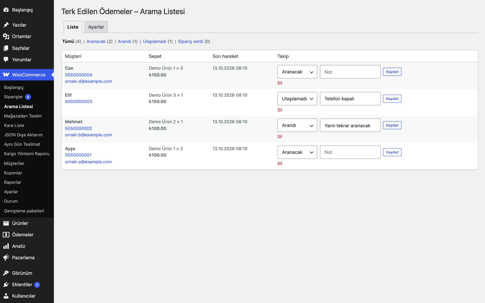

# Abandoned Checkout Call List for WooCommerce

Ödeme sayfasından ayrılanların e-posta/telefon ve sepetini onayla kaydeder; müşteri temsilcisine arama listesi sunar, sipariş verenleri otomatik işaretler.

> **English:** With visitor consent, records checkout e-mail/phone/first name and cart contents when someone leaves checkout, and gives call-centre staff a follow-up list with statuses (to call / called / unreachable / ordered) and notes. Marks recovered orders automatically and purges old rows (default 30 days). Disabled until you enable it; includes WordPress privacy exporter/eraser.

   

## Ne işe yarar

Ödeme adımına gelip siparişi tamamlamayanları aramak isteyen mağazalar için bir takip listesi. Veri yalnızca ziyaretçi onay metnini görüp (varsayılan olarak onay kutusunu işaretleyip) alanlardan çıktıktan sonra kaydedilir.

## Özellikler

- Ödeme formundaki e-posta, telefon ve ad alanlarından çıkıldığında kayıt (yalnızca ödeme sayfasında, onay metni gösterilmişse)
- Sepet sunucuda okunur (müşteriden gelen sepet verisine güvenilmez)
- Liste: durum süzgeci, tıklanabilir telefon/e-posta, sepet özeti, not
- Durumlar: **Aranacak**, **Arandı**, **Ulaşılamadı**, **Sipariş verdi**
- Aynı e-posta veya telefonla sipariş oluşunca (sipariş oluşturma veya işleniyor/beklemede/tamamlandı durumuna geçiş) kayıt otomatik **Sipariş verdi** olur ve siparişe bağlanır. Ödemesi henüz alınmamış ("Ödeme bekleniyor") bir sipariş de sayılır; başarısız ve iptal edilen siparişler sayılmaz
- Günlük temizlik: N gün (varsayılan 30) güncellenmeyen kayıtlar silinir
- WordPress kişisel veri dışa aktarma ve silme araçları (e-posta anahtarı; aynı e-postayla verilmiş siparişlerin/hesabın telefonuyla eşleşen yalnızca-telefonlu kayıtlar da kapsanır)
- Etkinleştirilene kadar hiçbir şey yakalanmaz

## Nasıl kullanılır

1. Eklentiyi etkinleştirin; WooCommerce → **Arama Listesi → Ayarlar** ekranında onay metnini yazın ve **Etkin**'i işaretleyin.
2. Mağazanızda ziyaretçi olarak "Demo Ürün"ü sepete ekleyip ödeme sayfasına gidin; onay kutusunu işaretleyin.
3. E-posta alanına `ornek@example.com`, telefon alanına örnek bir numara yazıp alandan çıkın, sayfadan ayrılın.
4. WooCommerce → **Arama Listesi** ekranında kaydın "Aranacak" durumuyla ve sepet özetiyle göründüğünü görün.
5. Aradıktan sonra durumu "Arandı" ya da "Ulaşılamadı" yapıp not ekleyin.
6. Aynı e-postayla bir sipariş verildiğinde kayıt otomatik "Sipariş verdi" olur ve siparişe bağlanır.

## Kurulum

1. Klasörü `wp-content/plugins/` altına kopyalayın ve etkinleştirin (tablo oluşturulur).
2. WooCommerce → **Arama Listesi → Ayarlar**: onay metnini yazın (veya Ayarlar → Gizlilik'ten Gizlilik Politikası sayfasını seçin) ve **Etkin**'i işaretleyin.
3. Ödeme sayfanız klasik `[woocommerce_checkout]` kısa kodunu kullanmalıdır.

## Ayarlar

| Ayar | Varsayılan |
|---|---|
| Etkin | kapalı |
| Onay metni | boş: Gizlilik Politikası bağlantılı varsayılan metin (sayfa seçili değilse kayıt alınmaz) |
| Onay kutusu zorunlu | açık |
| Saklama süresi (gün) | 30 |

Ayarlar `eru_accl_settings` seçeneğinde (`autoload=no`); veriler `{önek}eru_accl_leads` tablosunda: e-posta, telefon (normalleştirilmiş), ad, sepet, durum, not, sipariş no, tarihler.

**IP:** Yalnızca hız sınırlaması için kullanılır, saklanmaz. Proxy/CDN arkasında `eru_accl_client_ip` filtresiyle güvenilir adresi verin.

## Kısa kodlar, kancalar ve filtreler

| Ad | Tür | Açıklama |
|---|---|---|
| `eru_accl_client_ip` | filtre | Hız sınırı için istemci IP'si (varsayılan `REMOTE_ADDR`) |
| `eru_accl_purge` | eylem (cron) | Günlük temizlik |

## Entegrasyonlar ve gereksinimler

WordPress 6.5+, PHP 8.0+, WooCommerce 9.0+, HPOS uyumlu. Klasik ödeme sayfası.

## Sınırlamalar

- Kişisel veri silme e-posta adresiyle çalışır ve o e-postanın sipariş/hesap telefonuyla eşleşen yalnızca-telefonlu kayıtları da siler. Aynı telefonu paylaşan iki kişi (ör. aile) varsa birinin silme talebi diğerinin yalnızca-telefonlu kaydını da kaldırır; bu bilinçli olarak "fazla silme" yönünde tercih edilmiştir.
- Blok tabanlı ödeme sayfası desteklenmez (onay metni gösterilemez, bu yüzden hiçbir şey kaydedilmez).
- Ayrı bir müşteri temsilcisi rolü, atıf raporları ve özet e-posta yoktur; liste `manage_woocommerce` yetkisiyle açılır.
- WordPress kişisel veri araçları yalnızca e-posta verir: yalnızca-telefonlu bir kaydın silinebilmesi için o kişinin aynı e-postayla verilmiş bir siparişi veya hesap telefonu olmalıdır; aksi halde kaydı listeden elle silin.
- Temizlik görevi, yakalama kapalı olsa bile zamanlanmış kalır; böylece saklanan kayıtlar silinmeye devam eder.
- Yalnızca ödeme formu alanlarından yakalanır; sepet sayfasında veya sayfadan çıkış anında yakalama yoktur.
- **KVKK:** Bu eklenti kişisel veri (e-posta, telefon, ad, sepet) işler. Aydınlatma metninize ve gizlilik politikanıza ekleyin; açık rıza/meşru menfaat dayanağınızı belirleyin; saklama süresini ihtiyacınıza göre kısaltın. Silme/dışa aktarma talepleri WordPress → Araçlar → Kişisel veriler ekranından karşılanır. Eklenti gizlilik politikası taslağına metin ekler.

## SSS

**Onay verilmezse ne olur?** Hiçbir şey kaydedilmez; istek sunucuda da reddedilir.

**Siparişi veren listeden kalkar mı?** Kalkmaz; durumu **Sipariş verdi** olur ve saklama süresi sonunda silinir.

**Eklentiyi devre dışı bırakırsam ne olur?** Zamanlanmış temizlik olayı kaldırılır, tablo ve ayarlar durur. Eklentiyi silmek (Eklentiler → Sil) `eru_accl_leads` tablosunu, ayarları ve sürüm seçeneğini siler; sipariş verisine dokunulmaz.

**Dış servise veri gönderir mi?** Hayır, kodda dış HTTP isteği yoktur; kayıtlar yalnızca sitenizin veritabanındadır.

**Blok ödeme sayfasında çalışır mı?** Hayır, onay metni gösterilemediği için hiçbir şey kaydedilmez (bkz. Sınırlamalar).

**Önbellek eklentisi sorun çıkarır mı?** Yakalama, ödeme sayfasındaki betiğin `admin-ajax.php`'ye yaptığı istekle çalışır. Önbellek veya güvenlik eklentisinin bu isteği engellemediğini test edin.

**Çeviri nasıl yapılır?** Metin alanı `abandoned-checkout-call-list-for-woocommerce`; çeviri yolu `/languages`.

## Değişiklik geçmişi

Bkz. [CHANGELOG.md](CHANGELOG.md).

## Destek

- Önce bu sayfadaki **SSS** ve **Sınırlamalar** bölümlerine göz atın; sık karşılaşılan durumlar orada.
- Hata mı buldunuz? [GitHub Issues](https://github.com/erayusta/erusoft-wp/issues) üzerinden bildirin. WordPress, WooCommerce, PHP ve eklenti sürümünü, adımları ve beklenen/gerçekleşen sonucu yazmanız işi hızlandırır.
- Kurulum, yapılandırma, özel geliştirme veya entegrasyon desteği için **[hello@erusoft.com](mailto:hello@erusoft.com)** adresine yazın. Erusoft hakkında: [erusoft.com](https://erusoft.com).
- Lütfen şifre, API anahtarı veya müşteri verisi (ad, telefon, TCKN, sipariş dökümü) göndermeyin; ekran görüntülerindeki kişisel verileri karartın.

## Lisans

GPL-2.0-or-later. Diğer Erusoft eklentileri: https://wordpress.erusoft.com/
