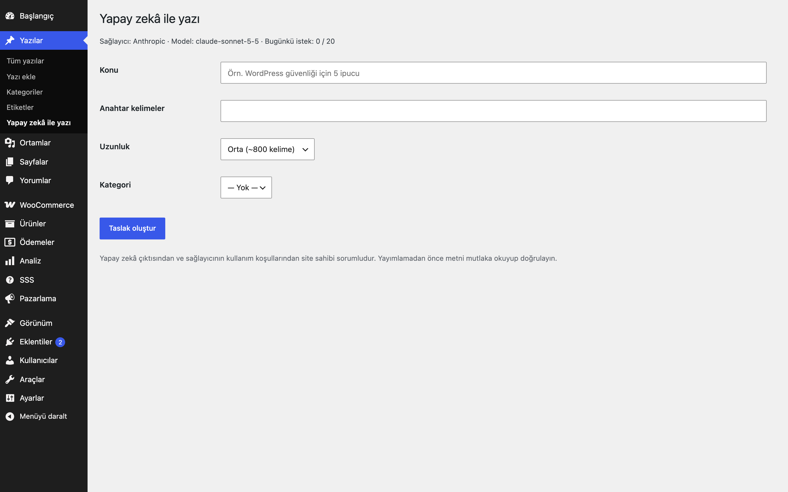
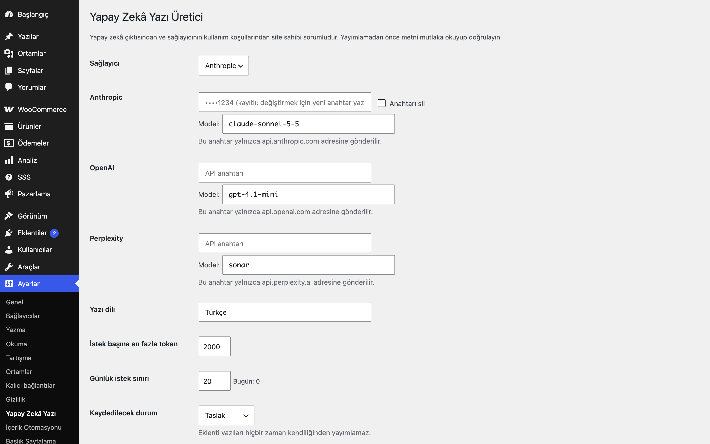

# AI Post Generator for WordPress

Konu ve anahtar kelimelerden OpenAI, Anthropic veya Perplexity ile yazı taslağı üretir; kendi API anahtarınızı kullanırsınız.

> **English:** Generate post drafts from a topic and keywords with OpenAI, Anthropic or Perplexity. Bring your own key (password field, autoload off, never echoed back, bound to its provider host); output is saved as draft/pending only, sanitised with `wp_kses_post`, with max-token and daily-request guards. Site owners are responsible for AI output and provider terms.

  

## Ne işe yarar

Yazılar → **Yapay zekâ ile yazı** ekranında konuyu yazarsınız; eklenti seçtiğiniz sağlayıcıya tek bir istek gönderir ve sonucu **taslak** olarak kaydeder. Anahtar girilmeden hiçbir istek gönderilmez.

## Özellikler

- Sağlayıcılar: OpenAI (chat completions), Anthropic (messages; varsayılan model `claude-sonnet-5-5`), Perplexity
- Her sağlayıcı için düzenlenebilir model adı
- API anahtarları parola alanıdır, `autoload=no` saklanır, tam hâliyle geri gösterilmez; her anahtar yalnızca kendi sağlayıcı adresine gönderilir
- Yalnızca taslak (isteğe bağlı: incelemede); otomatik yayın yoktur
- Çıktı `wp_kses_post` ile temizlenir; Perplexity kaynak bağlantıları yalnızca https/http olarak eklenir
- İstek başına en çok token ve günlük istek sınırı
- İsteğe bağlı öne çıkan görsel: yalnızca OpenAI görsel yanıtından (ek istek sayılır)
- Üretmek için `publish_posts` (katkıda bulunanlar üretemez; `eru_apg_capability` filtresiyle değişir), ayarlar için `manage_options` yetkisi
- Sağlayıcı hata gövdeleri kullanıcıya gösterilmez (anahtar parçası içerebilir); yalnızca genel bir ileti ve HTTP kodu görünür
- Görsel yanıtı en çok 10 MB (`eru_apg_max_image_bytes`)

## Kurulum

1. `ai-post-generator-for-wordpress` klasörünü `wp-content/plugins/` altına kopyalayın (veya zip olarak yükleyin).
2. Eklentiler ekranından etkinleştirin.
3. Ayarları yapın (aşağıya bakın).

## Ayarlar

Ayarlar → **Yapay Zekâ Yazı**: sağlayıcı, anahtarlar ve model adları, yazı dili, token sınırı (varsayılan 2000), günlük istek sınırı (varsayılan 20), kaydedilecek durum, görsel. Seçenekler: `eru_apg_settings`, `eru_apg_keys`, `eru_apg_usage`.

## Kısa kodlar, kancalar, filtreler

| Ad | Tür | Açıklama |
|---|---|---|
| `eru_apg_settings` | seçenek | Genel ayarlar |
| `eru_apg_keys` | seçenek | Anahtarlar (autoload kapalı) |
| `eru_apg_endpoint` | filtre | `($url, $sağlayıcı)`; adres yine de sağlayıcının sunucusuyla eşleşmek zorundadır |
| `eru_apg_capability` | filtre | Yazı üretme yetkisi (varsayılan `publish_posts`) |
| `eru_apg_max_image_bytes` | filtre | Çözülmüş görsel için bayt üst sınırı |
| `_eru_apg_source` | yazı meta | `sağlayıcı:model` |

## Entegrasyonlar ve gereksinimler

WordPress 6.5+, PHP 8.0+. Seçtiğiniz sağlayıcıdan alınmış kendi API anahtarınız gerekir; istekler `api.openai.com`, `api.anthropic.com` ve `api.perplexity.ai` adreslerine gider ve ücretlendirme sağlayıcıya aittir.

## Hangisini seçmeliyim?

- **AI Post Generator** (bu eklenti): tek seferlik, elle tetiklenen taslaklar.
- **Content Automation for WordPress**: konu kuyruğundan zamanlanmış otomatik üretim hattı.
- **Site Content Generator** (ileride): site içeriği için toplu üretim.

> **Sorumluluk:** Yapay zekâ çıktısından ve sağlayıcıların kullanım koşullarından site sahibi sorumludur; yayımlamadan önce metni okuyup doğrulayın.

## Sınırlamalar

- Üretilen metin yanlış veya eksik olabilir; yayımlamadan önce okuyup doğrulayın.
- Tek yazı üretir; kuyruk ve zamanlama için Content Automation'a bakın.
- Görsel desteği yalnızca OpenAI ve base64 yanıtla çalışır; başka kaynaktan görsel indirilmez.
- Eklenti "yapay zekâ dedektörü atlatma" gibi bir adım içermez.

## SSS

**Neden hiçbir şey olmuyor?** Seçili sağlayıcı için anahtar girilmemiş olabilir; anahtar yoksa istek gönderilmez.

**Yazılar yayımlanır mı?** Hayır; daima taslak (veya incelemede) kaydedilir.

## Değişiklik geçmişi

Bkz. [CHANGELOG.md](CHANGELOG.md).

## Lisans

GPL-2.0-or-later.

Diğer Erusoft eklentileri: https://wordpress.erusoft.com/
