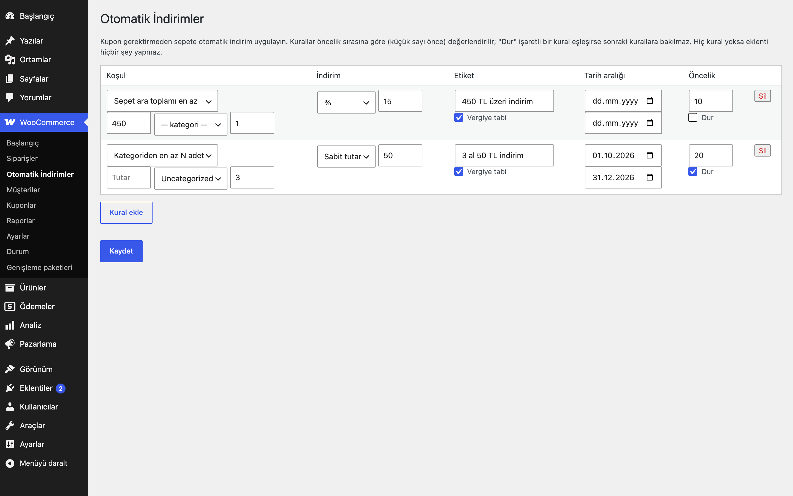

# Automatic Discounts for WooCommerce

Kupon gerektirmeyen otomatik indirimler: sepet tutarına veya kategoriden alınan adede göre yüzde ya da sabit indirim.

> **English:** Coupon-free automatic discounts. Rules grant a percentage or fixed amount off when the cart subtotal reaches a threshold or when enough items of a category are in the cart, with date ranges, priorities and a "stop further rules" flag. With no rules the plugin does nothing.

[](https://www.gnu.org/licenses/gpl-2.0.html)   



## Ne işe yarar

Müşterinin kupon kodu girmesine gerek kalmadan, kurallarınıza uyan sepetlere indirim uygular. Kurallar öncelik sırasıyla değerlendirilir; indirim sepette adlandırdığınız bir "ücret satırı" olarak görünür.

## Özellikler

- İki koşul türü: **sepet ara toplamı en az X** ve **bir kategoriden en az N adet** (alt kategoriler dahil)
- Yüzde veya sabit tutar; sabit tutar ilgili tabanı aşamaz
- Başlangıç ve bitiş tarihi (mağaza saat dilimine göre)
- Öncelik sırası ve "Dur" seçeneği: eşleşen kural "Dur" işaretliyse sonraki kurallara bakılmaz
- Sepette görünen ad ve "vergiye tabi" seçeneği
- Her toplam hesaplamasında yeniden üretilir; iki kez uygulanmaz
- Toplam indirim, ödenecek sepet tutarını aşamaz

## Kurulum

1. `automatic-discounts-for-woocommerce` klasörünü `wp-content/plugins/` altına kopyalayın (veya zip olarak yükleyin).
2. Eklentiler ekranından etkinleştirin (WooCommerce gereklidir).
3. Aşağıdaki ayar ekranından yapılandırın. Yapılandırma yapılana kadar mağazanızda hiçbir değişiklik olmaz.

## Ayarlar

WooCommerce → **Otomatik İndirimler**. Kurallar `eru_ad_rules` seçeneğinde saklanır; varsayılan boştur. Koşul ara toplam için kupon öncesi, indirim tabanı ise kupon sonrası ve KDV hariç satır toplamıdır. Kategori kuralında taban yalnızca o kategorideki satırlardır.

## Diğer indirimlerle birlikte kullanım

Bu eklenti indirimini sepete **negatif ücret satırı** olarak ekler; her toplam hesaplamasında satır baştan üretilir, bu yüzden kaç kez yeniden hesaplanırsa hesaplansın sonuç aynıdır. Aynı mantığı kullanan diğer Erusoft indirim eklentileri (Ödeme Yöntemi İndirimleri, Otomatik İndirimler, Sepet Kampanyaları, Birlikte Al İndirimleri) **birlikte çalışır ve indirimler toplanır**: her biri kendi satırını ekler, hiçbiri diğerinin satırını değiştirmez. Her eklentinin yüzdesi satır toplamları üzerinden hesaplanır (diğer eklentilerin ücret satırları taban değeri düşürmez); örneğin 1.000 TL'lik sepette %10 Otomatik İndirim (100 TL) ile %5 Ödeme Yöntemi İndirimi (50 TL) birlikte 850 TL öder. Tek bir eklentinin indirimi sepette ödenecek tutarı aşamaz. Birlikte toplanmasını istemiyorsanız `eru_ad_apply` filtresiyle `false` dönerek bu eklentiyi koşullu olarak devre dışı bırakabilirsiniz (örnek aşağıda).

```php
// Örnek: Ödeme Yöntemi İndirimi uygulanan sepette bu eklentinin indirimini atla.
add_filter( 'eru_ad_apply', function ( $apply, $cart ) {
	foreach ( $cart->get_fees() as $fee ) {
		if ( 'Havale indirimi' === $fee->name ) {
			return false;
		}
	}
	return $apply;
}, 10, 2 );
```

## Kancalar, filtreler ve veri alanları

| Ad | Tür | Açıklama |
|---|---|---|
| `eru_ad_rules` | seçenek | Kural listesi (`type`, `min_subtotal`, `category`, `min_qty`, `mode`, `value`, `label`, `start`, `end`, `priority`, `stop`, `taxable`) |
| `eru_ad_apply` | filtre | `true` döner; `false` dönerseniz hiçbir otomatik indirim uygulanmaz (`$apply`, `$cart`) |
| `eru_ad_discount_amount` | filtre | Bir kuralın pozitif indirim tutarı (`$amount`, `$rule`, `$cart`); 0 dönerseniz satır eklenmez |

## Entegrasyonlar ve gereksinimler

WordPress 6.5+, PHP 8.0+, WooCommerce 9.0+. HPOS (özel sipariş tabloları) ile uyumludur. WooCommerce yoksa eklenti bir uyarı gösterir ve hiçbir şey yapmaz. Harici servis kullanmaz.

## Sınırlamalar

- Birden çok indirim eklentisi birlikte çalışırken toplam indirim sepet tutarını aşmaz: bu eklenti, önce çalışan eklentilerin eklediği indirimleri (negatif ücretler) düşüp kalan tutar kadar indirim yapar.
- Yalnızca sepet düzeyinde indirim verir; tek ürüne özel fiyat indirimi (işaretli fiyat/rozet) bu sürümde yoktur.
- Kampanya rozeti göstermez.
- Blok tabanlı sepet/ödeme sayfalarında ücret satırı gösterilir, ancak özel bildirim metni yoktur.
- Eklenti silindiğinde (Eklentiler → Sil) yalnızca kendi ayarı silinir.

## SSS

**Kuponla birlikte nasıl çalışır?** Yüzde, kupon sonrası satır toplamı üzerinden hesaplanır; kuponla birlikte kullanılabilir.

**İki kural aynı adı taşırsa?** Sepette ayrı satır olmaları için ikinci satırın adına otomatik "(2)" eklenir.

### Hangisini seçmeliyim?

| İhtiyaç | Eklenti |
|---|---|
| Kupon kodsuz, kategori / tarih / öncelik kuralları olan genel indirim motoru | **Otomatik İndirimler** (bu eklenti) |
| Sepet tutarı kademeleri ve "X TL daha ekleyin, %Y kazanın" ilerleme mesajı | [Sepet Kampanyaları](../cart-campaigns-for-woocommerce/) |
| Belirli ürünleri bir set olarak satıp ürün sayfasında "Hepsini sepete ekle" sunmak | [Birlikte Al İndirimleri](../bought-together-discounts-for-woocommerce/) |
| Tek bir ekranda birleşik kampanya yönetimi (Faz 3, planlanıyor) | Campaign Engine |

Aynı sepet için iki eklentiyi birlikte etkinleştirirseniz indirimler toplanır; yalnızca birinin geçerli olmasını istiyorsanız `eru_ad_apply` / `eru_cc_apply` / `eru_btd_apply` filtrelerini kullanın.

## Değişiklik geçmişi

Bkz. [CHANGELOG.md](CHANGELOG.md).

## Lisans

GPL-2.0-or-later.

Diğer Erusoft eklentileri: https://wordpress.erusoft.com/
