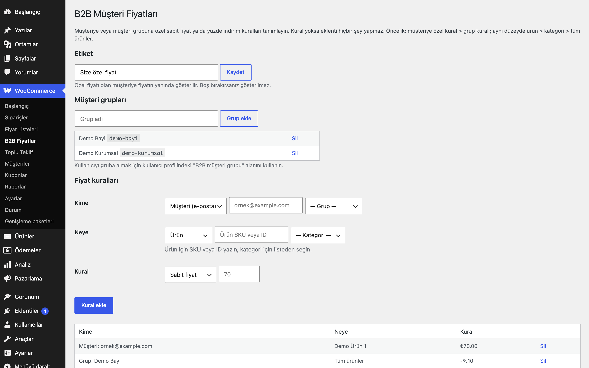

# B2B Customer Pricing for WooCommerce

Belirli müşteriye veya müşteri grubuna özel sabit fiyat ve yüzde iskonto kuralları.

> **English:** Customer-specific and customer-group prices or percentage discounts for products, categories or the whole catalogue. Rules are managed on one admin screen; customers see a configurable "special price" label. Nothing changes until you create a rule.

   

## Ne işe yarar

Bayi, kurumsal müşteri veya anlaşmalı alıcılarınıza standart fiyat listesinden bağımsız fiyat verirsiniz. Kural tek bir müşteriye (e-posta ile) ya da bir müşteri grubuna yazılır; ürün, kategori veya tüm katalog için sabit fiyat ya da yüzde indirim tanımlanabilir.

## Özellikler

- Müşteriye özel kural ve müşteri grubu kuralı (grup kullanıcı profilinden atanır)
- Ürün, varyasyon, kategori (alt kategoriler dahil) veya tüm ürünler için sabit fiyat veya yüzde indirim
- Çakışmada belirgin kural kazanır: müşteri kuralı > grup kuralı; ürün > kategori > tüm ürünler
- Özel fiyatı olan müşteriye fiyatın yanında ayarlanabilir etiket ("Size özel fiyat")
- Katalog, ürün sayfası, sepet ve ödeme aynı fiyatı kullanır; varyasyonlu ürün fiyat aralığı müşteriye göre önbelleklenir
- Yüzde iskonto her zaman normal fiyat üzerinden hesaplanır; sepet toplamı kaç kez hesaplanırsa hesaplansın aynı kalır
- Misafirler ve kuralı olmayan müşteriler normal fiyatı görür

## Hangisini seçmeliyim?

Erusoft kataloğunda fiyatı kişiye göre değiştiren üç eklenti vardır:

- **Role-Based Prices for WooCommerce**: Az sayıda rol için ürün başına sabit fiyat girmek istiyorsanız. En basit seçenek.
- **Price Lists for WooCommerce**: Adlandırılmış fiyat listeleri (yüzde, kategori, sabit fiyat) tanımlayıp role veya kişiye atamak istiyorsanız.
- **B2B Customer Pricing for WooCommerce**: Belirli müşteriye veya müşteri grubuna özel fiyat/iskonto kuralları yazmak istiyorsanız.

Üçü aynı mağazada birlikte etkin olabilir; çakışmada öncelik şöyledir: **müşteriye özel kural (B2B Customer Pricing) > fiyat listesi (Price Lists) > rol fiyatı (Role-Based Prices)**. Bu, filtre önceliğiyle sağlanır (USD Pricing 998 temel fiyatı dolardan çevirir; rol fiyatı 999, fiyat listesi 1000, müşteri kuralı 1001; sonra çalışan kazanır). Bir üründe üst düzey eklenti fiyat vermiyorsa bir alttaki uygulanır. Yine de kafa karışıklığını önlemek için mümkünse tek bir yaklaşım seçin.

## Kurulum

1. `b2b-customer-pricing-for-woocommerce` klasörünü `wp-content/plugins/` altına kopyalayın (veya zip olarak yükleyin).
2. Eklentiler ekranından etkinleştirin (WooCommerce gereklidir).
3. WooCommerce → **B2B Fiyatlar** ekranından grup ve kural ekleyin. Kural yoksa mağazanızda hiçbir değişiklik olmaz.

## Nasıl kullanılır

1. Eklentiyi etkinleştirin ve WooCommerce → **B2B Fiyatlar** ekranını açın.
2. Etiketi "Size özel fiyat" olarak bırakın. **Müşteri grupları** altında "Demo Bayi" adlı bir grup ekleyin.
3. Kullanıcılar → `ornek@example.com` hesabının profilini açıp "B2B müşteri grubu" alanından "Demo Bayi"yi seçin.
4. **Fiyat kuralları** bölümünde kime: "Demo Bayi" grubu, neye: "Demo Ürün" (SKU veya ID), kural: yüzde indirim %20 olarak bir kural ekleyin.
5. Normal fiyatı 250 TL olan "Demo Ürün"e bu hesapla giriş yaparak bakın: fiyat 200 TL görünür ve yanında "Size özel fiyat" etiketi çıkar. Aynı fiyat sepette ve ödemede de geçerlidir.
6. Çıkış yapıp (misafir olarak) bakın: normal fiyat 250 TL görünür.

## Ayarlar

WooCommerce → **B2B Fiyatlar**:

- **Etiket**: Özel fiyatı olan müşteriye fiyatın yanında gösterilen metin (varsayılan "Size özel fiyat"; boş bırakılırsa gösterilmez).
- **Müşteri grupları**: Grup ekleyin; kullanıcıyı gruba almak için Kullanıcılar → profil → "B2B müşteri grubu".
- **Fiyat kuralları**: Kime (müşteri e-postası veya grup) + neye (ürün SKU/ID, kategori, tüm ürünler) + kural (sabit fiyat veya yüzde indirim).

Veriler `eru_b2b_rules`, `eru_b2b_groups`, `eru_b2b_label` seçeneklerinde ve kullanıcı meta alanı `eru_b2b_group`'ta tutulur.

**Yönetim ekranı ve sipariş düzenleme:** wp-admin'de yöneticinin kendi kuralları hiçbir ürüne uygulanmaz (ürün listesi, ürün düzenleme). Yönetimden siparişe ürün eklerken (WooCommerce sipariş kalemi AJAX'ı) siparişin müşterisinin fiyatı kullanılır; misafir siparişte temel fiyat. Farklı davranış için `eru_b2b_pricing_user_id` filtresi.

**Çalışma anında konan fiyat:** Bir eklenti sepet satırının fiyatını `set_price()` ile değiştirdiyse (ör. Gift Product Rules hediye satırı 0) bu eklenti o satıra dokunmaz.

**İndirimdeki ürünler:** Yüzde kuralı, ürünün etkin indirimli fiyatından yüksek bir fiyat üretemez (normal 100, indirimli 70, %10 kural → 70). Sabit fiyat kuralları olduğu gibi uygulanır.

## Kancalar, filtreler ve veri alanları

| Ad | Tür | Açıklama |
|---|---|---|
| `eru_b2b_rules` | seçenek | Kural listesi |
| `eru_b2b_groups` | seçenek | Grup anahtarı => ad |
| `eru_b2b_label` | seçenek | Fiyat etiketi |
| `eru_b2b_group` | kullanıcı meta | Kullanıcının grubu |
| `eru_b2b_price` | filtre | Müşteri fiyatını değiştirin (`$price`, `$product`, `$user_id`) |
| `eru_b2b_pricing_user_id` | filtre | Fiyatı belirlenecek kullanıcı (`$uid`; wp-admin'de 0, sipariş kalemi AJAX'ında siparişin müşterisi) |

## Entegrasyonlar ve gereksinimler

WordPress 6.5+, PHP 8.0+, WooCommerce 9.0+. HPOS ile uyumludur. WooCommerce yoksa eklenti bir uyarı gösterir ve hiçbir şey yapmaz. Harici servis ve dış HTTP isteği yoktur. Fiyat filtreleri 1001 önceliğiyle çalışır (Role-Based Prices 999, Price Lists 1000).

## Sınırlamalar

- Sayfa önbelleği (sayfa cache) kullanıyorsanız giriş yapmış kullanıcıları önbellekten hariç tutun, yoksa fiyatlar karışabilir.
- Kural, ürünün tüm fiyatının yerine geçer; müşteriye özel fiyatı olan üründe indirimli fiyat rozeti gösterilmez.
- Kural girişleri tek tek yapılır; toplu CSV içe aktarma yoktur.
- Sabit fiyatlar vergi ayarlarınıza göre (vergi dahil/hariç) girilmiş sayılır.
- Eklenti silindiğinde (Eklentiler → Sil) kendi seçenekleri ve kullanıcı grup atamaları silinir.

## SSS

**Müşteri hem kendi kuralına hem grup kuralına uyuyorsa?** Müşteriye özel kural kazanır. Müşterinin o ürün için kuralı yoksa grup kuralı uygulanır.

**Yüzde iskonto hangi fiyat üzerinden hesaplanır?** Ürünün normal (indirimsiz) fiyatı üzerinden.

**Eklentiyi devre dışı bırakırsam ya da silersem ne olur?** Devre dışı bırakınca kurallar çalışmaz ve herkes normal fiyatı görür; veriler durur. Eklentiler → Sil ile `eru_b2b_rules`, `eru_b2b_groups`, `eru_b2b_label`, `eru_b2b_version` seçenekleri ve tüm kullanıcıların `eru_b2b_group` meta alanı silinir. Eklenti başka bir tablo oluşturmaz, saklama için ayrı bir sabit yoktur.

**HPOS uyumlu mu?** Evet, uyumluluk bildirilir. Cart/Checkout blokları için ayrı bir bildirim yoktur; fiyat WooCommerce'in ürün fiyatı filtreleriyle uygulanır.

**Dış servise bağlanır mı?** Hayır, dış HTTP isteği yoktur.

**Çeviri ve çoklu site?** Metin alanı `b2b-customer-pricing-for-woocommerce`, alan yolu `/languages`; klasörde hazır çeviri dosyası yoktur, arayüz Türkçedir. Ağ düzeyinde etkinleştirme için özel bir destek yoktur; seçenekler site başınadır.

**Bir grubu silersem kuralları ne olur?** Yönetim ekranındaki silme bağlantısı onay isterken grubun kurallarının da silineceğini bildirir.

**Rol ya da fiyat listesi eklentileriyle birlikte kullanılabilir mi?** Evet; öncelik sırası "Hangisini seçmeliyim?" bölümündedir.

## Değişiklik geçmişi

Bkz. [CHANGELOG.md](CHANGELOG.md).

## Destek

- Önce bu sayfadaki **SSS** ve **Sınırlamalar** bölümlerine göz atın; sık karşılaşılan durumlar orada.
- Hata mı buldunuz? [GitHub Issues](https://github.com/erayusta/erusoft-wp/issues) üzerinden bildirin. WordPress, WooCommerce, PHP ve eklenti sürümünü, adımları ve beklenen/gerçekleşen sonucu yazmanız işi hızlandırır.
- Kurulum, yapılandırma, özel geliştirme veya entegrasyon desteği için **[hello@erusoft.com](mailto:hello@erusoft.com)** adresine yazın. Erusoft hakkında: [erusoft.com](https://erusoft.com).
- Lütfen şifre, API anahtarı veya müşteri verisi (ad, telefon, TCKN, sipariş dökümü) göndermeyin; ekran görüntülerindeki kişisel verileri karartın.

## Lisans

GPL-2.0-or-later.

Diğer Erusoft eklentileri: https://wordpress.erusoft.com/
