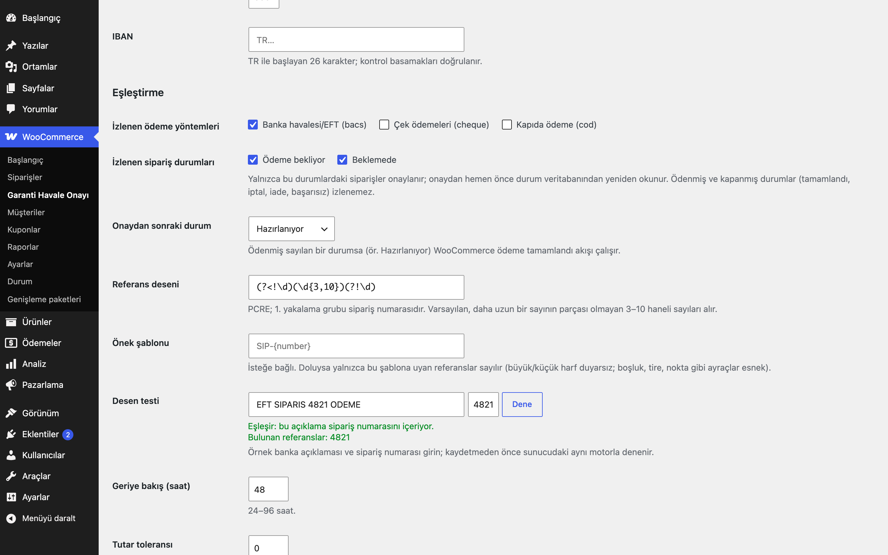
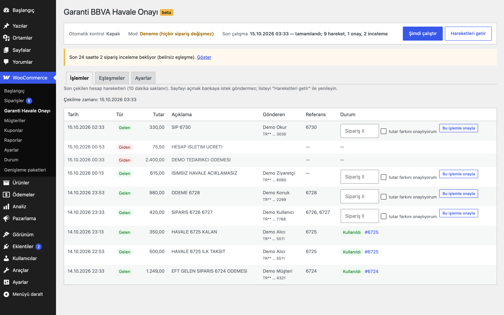
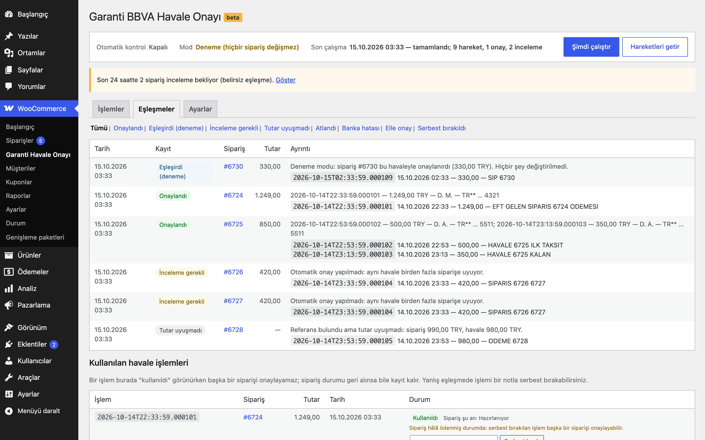
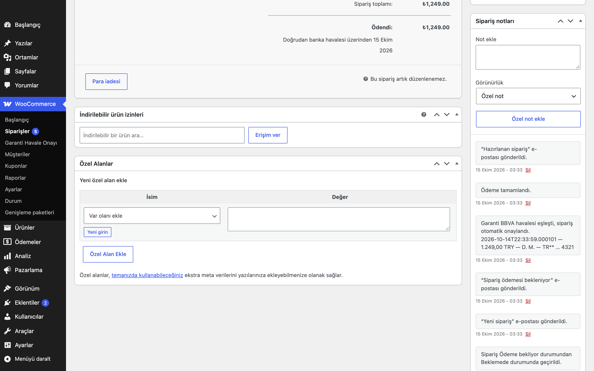

# Bank Transfer Auto-Approval for Garanti BBVA

> **English:** Polls the Garanti BBVA Account Transactions API read-only (OAuth2 client credentials, your own consent ID) and approves bank transfer orders whose order number and amount match an incoming credit. The reference pattern, tolerance, watched gateways and statuses, and the target status are settings. A used-transaction ledger (unique per transaction, written before the status change under a run lock) means one transfer can never approve two orders, even after a status rollback; ambiguous matches go to review instead. Optional split payments, dry-run mode (on by default), a transactions screen with "approve with this transaction", a match log, e-mail to the shop manager, WP-CLI. Polling only: no webhook, no REST route. Inert until you enable it and save the credentials.

[](https://www.gnu.org/licenses/gpl-2.0.html)   

> **Beta:** canlı API ile kendi hesabınızla doğrulayın.

Havale/EFT ile ödenen siparişleri Garanti BBVA hesabınıza gelen hareketlerle eşleştirir: açıklamada sipariş numarası geçen ve tutarı sipariş toplamına uyan gelen havale bulunursa sipariş onaylanır, not düşülür ve yöneticiye e-posta gider. Aynı havale hiçbir zaman iki siparişi onaylayamaz.



## Özellikler

- Garanti BBVA hesap hareketlerini rızayla (consent) salt-okunur çekme; her çalışmada yeni token, sayfalı liste (100'lük sayfa, en fazla 30 sayfa)
- Sipariş numarası ve tutar eşleştirme; ayarlanabilir referans deseni ve önek şablonu, tutar toleransı, isteğe bağlı parçalı havale
- Eşleşen siparişi otomatik onaylama (izlenen ödeme yöntemi ve durumlar, onay sonrası durum ayardır), siparişe maskeli not ve yöneticiye e-posta
- Kullanılan işlem kaydı: bir banka işlemi en fazla bir siparişi onaylar; belirsiz eşleşmeler "inceleme gerekli" olur
- Deneme modu (varsayılan açık), İşlemler ekranında "bu işlemle onayla", Eşleşmeler günlüğü, WP-CLI

## Kurulum

1. `bank-transfer-auto-approval-for-garanti-bbva` klasörünü `wp-content/plugins/` altına kopyalayın (veya zip olarak yükleyin).
2. Eklentiler ekranından etkinleştirin. WooCommerce gereklidir.
3. WooCommerce → **Garanti Havale Onayı** → **Ayarlar**: client ID, client secret, rıza (consent) ID, hesap numarası, şube numarası ve IBAN'ı girin. **Deneme modu** açık kalsın.
4. **Şimdi çalıştır** ile bir tur başlatın (Action Scheduler birkaç saniye içinde çalıştırır). **Eşleşmeler** sekmesinde "Eşleşirdi" satırlarını kontrol edin.
5. Sonuçlar doğruysa **Otomatik kontrol**'ü açın ve **Deneme modu**'nu kapatın.

Etkinleştirme sonrası eklenti pasiftir: kimlik bilgileri kaydedilip ana anahtar açılana kadar dış istek, zamanlanmış iş veya ön yüz çıktısı yoktur. Sayfaları açmak bankaya istek göndermez. **Ana anahtar (Otomatik kontrol) kapalıyken hiçbir sipariş onaylanmaz:** "Şimdi çalıştır" ve `wp eru-gha check` yalnızca deneme turu yapar, "Bu işlemle onayla" reddedilir.

## Rıza (consent) ve yetkiler

- Eklenti, Garanti BBVA'nın **Account Transactions** API'sini kullanır. Erişim için Garanti BBVA geliştirici portalında bir uygulama (client ID ve secret) ve hesap hareketlerini okumak için verdiğiniz **rıza (consent) kimliği** gerekir. Rıza, hangi hesabın hareketlerinin okunabileceğini ve ne kadar süre geçerli olduğunu belirler; süresi dolduğunda banka hata döner ve tur hiçbir onay yapmadan durur (yöneticiye üst çubukta gösterilir).
- Token `POST /auth/oauth/v2/token` ile `client_credentials` akışıyla alınır; client ID ve secret yalnızca istek gövdesinde gider, adres satırına (GET) eklenmez. Banka token'ı tek kullanımlık olarak belgeler: token saklanmaz, her tur yeni token alır. Bir sayfa 401 dönerse yeni token alınıp o sayfa **bir kez** tekrarlanır; yine 401 gelirse tur durur.
- Hareketler `POST /balancesandmovements/accountinformation/transaction/v1/gettransactions` ile, rıza kimliği, hesap no, şube no, IBAN ve tarih aralığıyla istenir. Eklenti yalnızca okur; bankada hiçbir işlem başlatmaz.
- Client secret yalnızca yazılabilir (ekrana geri yazılmaz, "Kayıtlı" görünür, boş bırakılırsa korunur), ayar `autoload=no` saklanır, günlüğe yazılmaz. IBAN TR kontrol basamaklarıyla doğrulanır.
- Yönetim ekranı, düğmeler ve WP-CLI `manage_woocommerce` yetkisi ister; ayar formu da bu yetkiyle kaydedilir (mağaza yöneticisi kaydedebilir). Her form nonce ile korunur.

## Nasıl eşleştirir?

1. **Çekme:** Son **48 saatin** (ayar, 24–96) hareketleri sayfa sayfa çekilir ve işlem kimliğine (`transactionInstanceId`) göre tekilleştirilir. Yanıtta toplam kayıt veya "sonraki sayfa" bilgisi olmadığından liste **boş bir sayfa gelince** biter; 100'den kısa bir sayfa tek başına son sayılmaz (banka sayfa boyutunu düşürebilir). Herhangi bir sayfa hata verirse ya da liste 30 sayfada bitmezse tur **hiç eşleştirme yapmadan** durur (eksik veriyle karar verilmez).
2. **Adaylar:** Yalnızca **gelen** (alacak, `txnCreditDebitIndicator = A`), tutarı **sıfırdan büyük** ve hesabın para birimindeki (TRY; `eru_gha_account_currency` filtresi) hareketler sayılır. Giden hareketler ve kullanılan işlem kaydında olan hareketler atlanır.
3. **Referans:** Açıklama (`explanation`) ve EFT açıklaması (`remark`) birleştirilir; **referans deseninin** 1. yakalama grubu sipariş numarasıyla (`get_order_number()`) karşılaştırılır. Varsayılan desen `(?<!\d)(\d{3,10})(?!\d)`: daha uzun bir sayının parçası olmayan 3–10 haneli sayılar. **Önek şablonu** (ör. `SIP-{number}`) doluysa yalnızca şablona uyan referanslar sayılır; büyük/küçük harf fark etmez, boşluk/tire/nokta gibi ayraçlar esnektir.
4. **Sipariş:** İzlenen ödeme yöntemlerinden (varsayılan `bacs`) biriyle, izlenen durumlardan (varsayılan **Beklemede** ve **Ödeme bekleniyor**; ödenmiş ve kapanmış durumlar seçilemez) birinde, para birimi hesabınkiyle aynı ve havaleden en geç 1 saat sonra oluşturulmuş olmalı. Siparişler 100'erli sayfalarla okunur.
5. **Tutar:** `|havale − sipariş toplamı| ≤ tolerans` (varsayılan **0**, birebir; ayar). **Parçalı havale** (varsayılan kapalı) açıksa ve tek havale tutmuyorsa, siparişe referans veren ve **aynı göndericiden** (gönderen IBAN'ı, yoksa adı) gelen en az iki kullanılmamış havalenin toplamı karşılaştırılır. Farklı göndericilerin havaleleri birleştirilmez; toplamları tutsa bile sipariş "inceleme gerekli" olur. Göndericisi bilinmeyen havaleler hiç birleştirilmez.
6. **Belirsizlik:** Aynı havale birden fazla siparişe uyuyorsa ya da bir siparişe birden fazla havale ayrı ayrı uyuyorsa **hiçbiri onaylanmaz**; sipariş "inceleme gerekli" olarak işaretlenir (sipariş notu, `_eru_gha_review` meta, günlük satırı, yöneticiye tek e-posta).
7. **Onay:** Tur kilidi altında sipariş durumu veritabanından **yeniden okunur** (bu arada değiştiyse onay yapılmaz); işlem(ler) **önce** kullanılan işlem kaydına yazılır, kayıt başarısız olursa (işlem zaten kullanılmış) onay yapılmaz. Sonra not, `_eru_gha_txn_ids` meta ve durum değişikliği gelir.

| Sipariş no | Banka açıklaması | Sipariş / havale | Sonuç |
|---|---|---|---|
| 123 | `SIPARIS 123 ODEME` | 1.000,00 / 1.000,00 | Onaylanır |
| 123 | `SIPARIS 1234` | 1.000,00 / 1.000,00 | Eşleşmez (1234 ayrı bir sayı) |
| 123 | `SIP-1235` | 1.000,00 / 1.000,00 | Eşleşmez |
| 123 (şablon `SIP-{number}`) | `sip-123 havale` | 1.000,00 / 1.000,00 | Onaylanır |
| 123 (şablon `SIP-{number}`) | `SIPARIS 123` | 1.000,00 / 1.000,00 | Eşleşmez (şablon yok) |
| 123 (tolerans 0,01) | `123` | 1.000,00 / 999,995 | Onaylanır |
| 123 (tolerans 0,01) | `123` | 1.000,00 / 999,98 | Tutar uyuşmadı (günlüğe yazılır) |
| 789 | `789` + `789 KALAN` (aynı gönderen) | 1.000,00 / 600 + 400 | Parçalı havale açıksa onaylanır, kapalıysa uyuşmadı |
| 789 | `789` (gönderen A) + `789` (gönderen B) | 1.000,00 / 600 + 400 | Parçalı havale açıksa "inceleme gerekli" |
| 123 | `SIPARIS 123` (gelen, tutar −250) | 250,00 / −250,00 | Yok sayılır |
| 123 ve 456 | `SIPARIS 123 456` | ikisi de 250,00 / 250,00 | İkisi de "inceleme gerekli" |
| 123 | `SIPARIS 123` (giden) | 250,00 / 250,00 | Yok sayılır |

**Onay sonrası durum** (varsayılan **Hazırlanıyor**) ödenmiş sayılan bir durumsa WooCommerce'in "ödeme tamamlandı" akışı (`payment_complete`, ödeme tarihi, stok) çalışır; değilse yalnızca durum değiştirilir. **Custom Order Statuses for WooCommerce** ile eklenen durumlar listede görünür.

Sipariş notu gönderen adını yalnızca **baş harfleriyle** (ör. `D. M.`) ve gönderen IBAN'ını yalnızca **son 4 hanesiyle** gösterir. Bildirim e-postası (varsayılan: site yönetici e-postası) aynı maskeli bilgiyi içerir.



## Kullanılan işlem kaydı

`{önek}eru_gha_used` tablosu her onayda kullanılan banka işlemini (işlem kimliği, sipariş, tutar, zaman) tutar; `(txn_id, active)` benzersiz anahtarı veritabanı düzeyinde aynı işlem için ikinci bir etkin kaydı reddeder. Parçalı havalede tüm işlemler tek bir `INSERT` ile yazılır: ya hepsi ya hiçbiri.

- Sipariş durumu geri alınsa (ör. Hazırlanıyor → Beklemede) kayıt **silinmez**; aynı havale o siparişi veya başka bir siparişi yeniden onaylamaz.
- Bir sipariş de **tek bir işlem setiyle** onaylanır: siparişin etkin bir kaydı varken başka bir havale onu onaylayamaz. Kontrol kayıt `INSERT`'ünün içindedir ve kayıt + durum değişikliği sipariş başına bir MySQL kilidi (`GET_LOCK`, 5 sn) altında yapılır; kilit alınamazsa onay yapılmaz (READ COMMITTED yalıtımında da geçerli). Böyle bir durumda günlükte "Bu sipariş daha önce bir havale işlemiyle onaylanmış; yeniden onay için defterdeki kaydı serbest bırakın" yazar; yeniden onay için önce eski işlemi serbest bırakın.
- Tur kilidi sahiplidir: yalnızca alan iş bırakır; başka bir iş kilidi ancak süresi (1 saat) dolunca devralır.
- Yanlış bir eşleşmede **Eşleşmeler** sekmesindeki **Serbest bırak** düğmesiyle (yetki, nonce ve **zorunlu not**) işlem serbest bırakılır: kayıt silinmez, "serbest" olarak işaretlenir, siparişe not düşülür ve günlüğe yazılır. Ardından işlem yeniden eşleşebilir. Liste siparişin güncel durumunu gösterir; sipariş hâlâ ödenmiş durumdaysa serbest bırakılan işlemin başka bir siparişi onaylayabileceği uyarısı çıkar.

## Elle onay

**İşlemler** sekmesi son çekilen hareketleri (10 dakika saklanır) tarih, tür, tutar, açıklama, gönderen ve bulunan referanslarla gösterir. Bir gelen hareket için sipariş kimliğini seçip **Bu işlemle onayla** dediğinizde sunucu işlemi **yalnızca kimliğiyle** kendi önbelleğinden bulur; formdan işlem verisi alınmaz. Aynı kurallar geçerlidir (izlenen durum ve ödeme yöntemi, para birimi, kullanılan işlem kaydı); tutar farklıysa "tutar farkını onaylıyorum" kutusu gerekir. Otomatik kontrol kapalıyken elle onay reddedilir. Liste "Hareketleri getir" ile yenilenir (kuyruğa alınır).

## Deneme modu

Deneme modu ilk kurulumda **açıktır**. Açıkken tur hareketleri çeker ve eşleştirir, ancak sipariş durumu, not, meta, e-posta ve kullanılan işlem kaydı **değişmez**; her eşleşme için günlüğe tek bir **"Eşleşirdi"** satırı yazılır (aynı sipariş ve işlem için günde bir kez). Elle onay da deneme modunda yalnızca günlüğe yazar. `wp eru-gha check --dry-run` ayardan bağımsız olarak deneme turu çalıştırır. **Otomatik kontrol kapalıyken** her tur ("Şimdi çalıştır", WP-CLI) deneme turudur; WP-CLI çıktısında `dry_run=yes (ana anahtar kapalı)` görünür.



## Zamanlama ve günlük

- **Otomatik kontrol** açıkken Action Scheduler her **5, 15 veya 30 dakikada** (ayar, varsayılan 15) bir tur çalıştırır; tur bir kilit altında çalışır, aynı anda ikinci tur başlamaz. **Şimdi çalıştır** yalnızca bir iş kuyruğa alır (sayfa isteğinde banka çağrılmaz). Ana anahtar zamanlamayı ve onay yetkisini yönetir; kapalıyken "Şimdi çalıştır" ve WP-CLI kimlik bilgileriyle yalnızca deneme turu çalıştırır.
- **Eşleşmeler** günlüğü: onaylandı, eşleşirdi, inceleme gerekli, tutar uyuşmadı, atlandı, banka hatası, elle onay, serbest bırakıldı. Tutar uyuşmazlığı, inceleme ve banka hatası satırları **(sipariş, işlem) başına günde bir kez** yazılır. Günlük **30 gün** (ayar, 7–365) sonra günlük bir işle 1000'erli partilerle silinir.



## WP-CLI

```
wp eru-gha check [--dry-run]
wp eru-gha transactions [--hours=48] [--format=table|csv|json]
wp eru-gha ledger [--page=1] [--format=table|csv|json]
```

## Kancalar ve filtreler

| Ad | Açıklama |
|---|---|
| `eru_gha_api_base` | API adresi (varsayılan `https://apis.garantibbva.com.tr`) |
| `eru_gha_account_currency` | Hesap para birimi (varsayılan `TRY`) |
| `eru_gha_before_approve` | Eylem: onaydan hemen önce (`$order_id`, `$txn_ids`) |
| `eru_gha_order_approved` | Eylem: onaydan sonra (`$order_id`, `$txn_ids`, `$source` = `auto`/`manual`) |

## Kişisel veri

Hareket açıklamaları ve EFT açıklamaları gönderen adını içerebilir; bu yüzden kişisel veri sayılır. Eşleşme günlüğü (`{önek}eru_gha_log`) hareket açıklamalarını en fazla 160 karakter, gönderen adı baş harflere çevrilmiş, IBAN'lar ve 11 haneden uzun sayılar maskelenmiş olarak tutar (açıklama başka kişisel bilgi içerebilir); ayarlanan süre sonunda silinir ve WordPress kişisel veri dışa aktarma/silme araçlarına (sipariş e-postasıyla) bağlıdır. İşlemler ekranının önbelleği (10 dakikalık geçici veri) gönderen adını ve parçalı havale gruplaması için gönderen IBAN'ının (yoksa adının) site anahtarıyla üretilmiş HMAC özetini içerir; silme aracı bu önbelleği de temizler. Kullanılan işlem kaydı yalnızca işlem kimliği, sipariş no ve tutar tutar; aynı havalenin ikinci bir siparişi onaylamasını önlemek için saklanır. Eklenti gizlilik politikası sayfasına öneri metni ekler.

## Gereksinimler

WordPress 6.5+, PHP 8.0+, WooCommerce 9.0+ (Action Scheduler WooCommerce ile gelir). HPOS ile uyumludur; sipariş verisi yalnızca `WC_Order` üzerinden okunur ve yazılır (onay öncesi durum kontrolü için durum sütunu doğrudan okunur). Sipariş meta alanları: `_eru_gha_txn_ids`, `_eru_gha_review`.

## Sınırlamalar

- **Beta:** Garanti BBVA'nın herkese açık bir deneme (sandbox) ortamı bilinmiyor. Token alma, sayfalama, 401 sonrası yeniden token, eksik sayfa/kesik liste davranışı, eşleştirme, kullanılan işlem kaydı ve deneme modu yalnızca belgelenen biçimde **uydurma (mock) yanıtlarla** sınandı. Kendi hesabınızla, önce deneme modunda doğrulayın.
- Banka alanları sağlayıcının **Account Transactions** API'sine göredir: işlem kimliği `transactionInstanceId`, tür `txnCreditDebitIndicator` (`A` = gelen), `amount`, `explanation`, EFT bilgisi `enrichmentInformation` (`remark`, `senderName`, `senderIBANEFT`), tarih `activityDate`/`valueDate`. İşlem zamanı `transactionInstanceId` içindeki zaman damgasından, yoksa işlem gününün sonundan (İstanbul saati) alınır. Yanıtta para birimi alanı yoksa hareket hesabın para biriminde kabul edilir. Alanlar hesabınızda farklıysa önce `wp eru-gha transactions` ile kontrol edin.
- Yalnızca **yoklama (polling)** vardır; banka bildirim (webhook) göndermez, eklenti de REST uç noktası açmaz. Onay, havalenin bankada görünmesinden sonraki ilk turda gerçekleşir.
- İşlem kimliği olmayan hareketler gösterilir ama hiçbir zaman onay için kullanılmaz.
- Sayfa sonu yalnızca boş sayfayla anlaşılır (yanıtta toplam/sonraki sayfa alanı belgelenmedi); bu her turda bir ek istek demektir. Sayfa numarasının 1'den başladığı ve `pageSize` değerinin kabul edildiği varsayılır.
- Hesap ve şube numarası sayı olarak gönderilir (baştaki sıfırlar düşer), kaynak eklentideki biçime uygun olarak; doğrulanmadı.
- Parçalı havalede aynı gönderici, gönderen IBAN'ı (yoksa adı) ile anlaşılır; banka bu alanları vermezse parçalı havale hiç birleştirilmez.
- İzlenen siparişler en yeniden başlayarak 10.000 adede kadar okunur; sınır aşılırsa günlüğe uyarı yazılır.
- Tek hesap desteklenir.
- Eklenti silindiğinde (Eklentiler → Sil) ayarlar, eşleşme günlüğü tablosu, kilitler, geçici veriler ve zamanlanmış işler silinir; **sipariş metası (`_eru_gha_*`) ve sipariş notları korunur.** **Kullanılan işlem kaydı** (`{önek}eru_gha_used`: işlem kimliği, sipariş no, tutar) da korunur: eklenti yeniden kurulduğunda aynı havalenin ikinci bir siparişi onaylamasını önleyen kayıt budur. Bu tabloyu da silmek için `wp-config.php` içinde `define( 'ERU_GHA_REMOVE_DATA', true );` tanımlayın.

## English summary

Read-only Garanti BBVA Account Transactions polling with OAuth2 client credentials (fresh token per run, one re-mint per page on 401) and paging (100 per page, 30 pages, de-duplicated by `transactionInstanceId`); any page failure or truncation aborts the run before matching. Incoming credits in the account currency are matched to bank transfer orders in the watched gateways and statuses by a configurable reference regex (group 1, default digit-bounded 3–10 digits) or prefix template, amount tolerance (default 0) and optional split payments (off by default, same sender only); an order may be created at most 1 hour after the transfer. Ambiguity (one transfer fits two orders, or two transfers fit one order) means no approval and a review flag. Approvals happen under a run lock: status re-read from the database, ledger claim first (unique `(txn_id, active)`), then note (payer initials, IBAN last 4), meta and status (`payment_complete()` for paid statuses). Dry-run on by default, and every run is a dry-run while the master switch is off; manual approval (refused while off) from the server-side transaction cache by id; ledger release needs a note. Log retention, privacy exporter/eraser, WP-CLI. Beta: verified against mocked HTTP only.

## Sürüm notları

Bkz. [CHANGELOG.md](CHANGELOG.md).

## Lisans

GPL-2.0-or-later. Diğer Erusoft eklentileri: https://wordpress.erusoft.com
