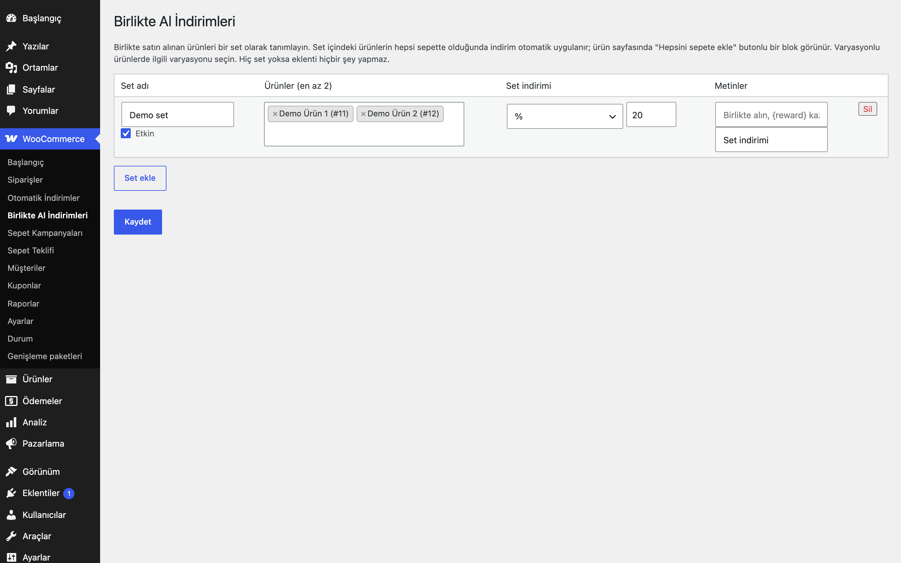
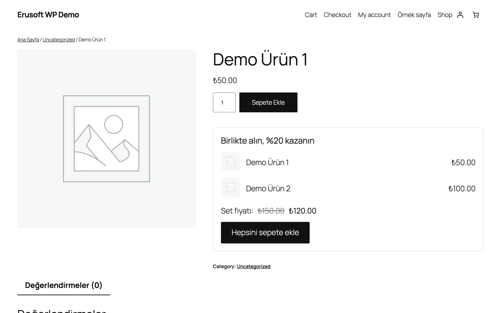
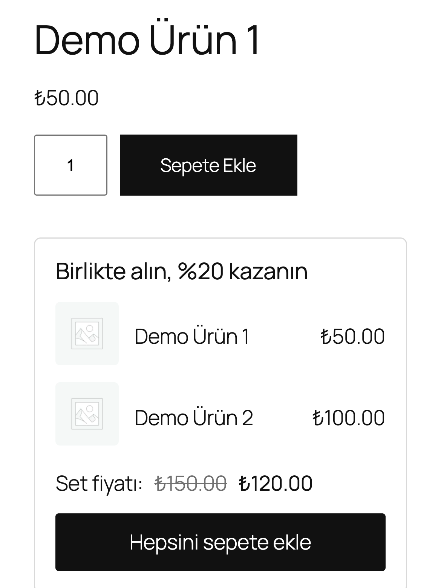

# Bought Together Discounts for WooCommerce

Ürünleri "birlikte al" seti olarak tanımlayın; ürün sayfasında teklif bloğu, sepette otomatik set indirimi.

> **English:** Define "bought together" product sets with a percentage or fixed set discount. A product-page block offers the set with an add-all-to-cart button, and the discount is applied automatically when every item of the set is in the cart. With no sets the plugin does nothing.

[](https://www.gnu.org/licenses/gpl-2.0.html)   





## Ne işe yarar

Birbirini tamamlayan ürünleri (örneğin ana ürün ve aksesuarı) bir set olarak tanımlarsınız. Set ürünlerinin hepsi sepete girdiğinde indirim kendiliğinden uygulanır; ürün sayfasında "Birlikte alın, %20 kazanın" bloğu tek tıkla hepsini sepete ekletir.

## Özellikler

- Set başına iki veya daha fazla ürün; basit ürün ve varyasyon desteği
- Yüzde veya set başına sabit tutar
- Ürün sayfasında görsel, ad, fiyat, set fiyatı ve "Hepsini sepete ekle" butonu (mobil uyumlu)
- Sepette birden fazla tam set varsa her set için indirim verilir
- Bir ürün birimi yalnızca bir sette sayılır (aynı ürün iki sette olsa bile çift indirim olmaz)
- Başlık ve sepet etiketi her set için düzenlenebilir

## Kurulum

1. `bought-together-discounts-for-woocommerce` klasörünü `wp-content/plugins/` altına kopyalayın (veya zip olarak yükleyin).
2. Eklentiler ekranından etkinleştirin (WooCommerce gereklidir).
3. Aşağıdaki ayar ekranından yapılandırın. Yapılandırma yapılana kadar mağazanızda hiçbir değişiklik olmaz.

## Nasıl kullanılır

1. Eklentiyi etkinleştirin ve WooCommerce → **Birlikte Al İndirimleri** sayfasını açın.
2. **Set ekle**'ye basın, set adına "Demo Set" yazın ve ürün arama kutusundan iki ürün seçin: "Demo Ürün" ve "Demo Aksesuar".
3. Set indirimini yüzde olarak seçip `20` girin (ya da "Sabit tutar (set başına)" seçip örneğin `50` TL girin), **Etkin** kutusunu işaretleyin ve **Kaydet**'e basın.
4. "Demo Ürün"ün sayfasını açın: ürün ve aksesuar, set fiyatıyla birlikte "Hepsini sepete ekle" düğmesiyle görünür.
5. Düğmeye basın; iki ürün de sepete girer ve sepette set etiketiyle (boşsa "Birlikte alma indirimi") negatif bir ücret satırı oluşur.
6. Ürünlerden birini sepetten çıkarın: set tamamlanmadığı için indirim satırı kendiliğinden kalkar.

## Ayarlar

WooCommerce → **Birlikte Al İndirimleri**. Setler `eru_btd_sets` seçeneğinde saklanır; varsayılan boştur. Varyasyonlu ürünlerde ürün arama kutusundan ilgili **varyasyonu** seçin (varyasyonlu ana ürün kaydedilmez). İndirim tabanı, setteki ürünlerin kupon öncesi birim fiyatlarıdır.

## Diğer indirimlerle birlikte kullanım

Bu eklenti indirimini sepete **negatif ücret satırı** olarak ekler; her toplam hesaplamasında satır baştan üretilir, bu yüzden kaç kez yeniden hesaplanırsa hesaplansın sonuç aynıdır. Aynı mantığı kullanan diğer Erusoft indirim eklentileri (Ödeme Yöntemi İndirimleri, Otomatik İndirimler, Sepet Kampanyaları, Birlikte Al İndirimleri) **birlikte çalışır ve indirimler toplanır**: her biri kendi satırını ekler, hiçbiri diğerinin satırını değiştirmez. Her eklentinin yüzdesi satır toplamları üzerinden hesaplanır (diğer eklentilerin ücret satırları taban değeri düşürmez); örneğin 1.000 TL'lik sepette %10 Otomatik İndirim (100 TL) ile %5 Ödeme Yöntemi İndirimi (50 TL) birlikte 850 TL öder. Tek bir eklentinin indirimi sepette ödenecek tutarı aşamaz. Birlikte toplanmasını istemiyorsanız `eru_btd_apply` filtresiyle `false` dönerek bu eklentiyi koşullu olarak devre dışı bırakabilirsiniz (örnek aşağıda).

```php
// Örnek: Ödeme Yöntemi İndirimi uygulanan sepette bu eklentinin indirimini atla.
add_filter( 'eru_btd_apply', function ( $apply, $cart ) {
	foreach ( $cart->get_fees() as $fee ) {
		if ( 'Havale indirimi' === $fee->name ) {
			return false;
		}
	}
	return $apply;
}, 10, 2 );
```

## Kancalar, filtreler ve veri alanları

| Ad | Tür | Açıklama |
|---|---|---|
| `eru_btd_sets` | seçenek | Set listesi (`name`, `products`, `mode`, `value`, `label`, `heading`, `active`) |
| `eru_btd_apply` | filtre | `false` dönerseniz set indirimi uygulanmaz (`$apply`, `$cart`) |
| `eru_btd_discount_amount` | filtre | Pozitif indirim tutarı (`$amount`, `$hit`, `$cart`); 0 dönerseniz satır eklenmez |

## Entegrasyonlar ve gereksinimler

WordPress 6.5+, PHP 8.0+, WooCommerce 9.0+. HPOS (özel sipariş tabloları) ile uyumludur. WooCommerce yoksa eklenti bir uyarı gösterir ve hiçbir şey yapmaz. Harici servis kullanmaz.

## Sınırlamalar

- Birden çok indirim eklentisi birlikte çalışırken toplam indirim sepet tutarını aşmaz: bu eklenti, önce çalışan eklentilerin eklediği indirimleri (negatif ücretler) düşüp kalan tutar kadar indirim yapar.
- "Hepsini sepete ekle" ya hepsini ekler ya hiçbirini: setteki bir ürün satın alınamıyorsa (stok yok, satışta değil) hiçbir ürün eklenmez ve hata mesajı gösterilir. Setlerin kimliği kayıtla birlikte saklanır; bir seti silmek diğerlerinin düğmelerini bozmaz.
- Setteki her ürün satın alınabilir ve stokta değilse ürün sayfası bloğu gösterilmez.
- Ürün sayfası bloğu klasik "add to cart" kancasını kullanır (`woocommerce_after_add_to_cart_form`); tema bu kancayı çağırmıyorsa blok görünmez.
- Her ürün sete bir adet olarak eklenir; set içinde farklı adet tanımlanamaz.
- Kategori bazlı eşleşme yoktur; ürün ve varyasyon bazında çalışır.
- Eklenti silindiğinde (Eklentiler → Sil) yalnızca kendi ayarı silinir.

## SSS

**Ürün sayfasında birden fazla set çıkar mı?** Hayır, ürünü içeren ilk etkin set gösterilir.

**Müşteri ürünlerden birini sepetten çıkarırsa?** Set tamamlanmadığı için indirim kendiliğinden kalkar.

**Eklentiyi devre dışı bırakırsam veya silersem ne olur?** Devre dışı bırakınca set indirimi ve ürün sayfası bloğu çalışmaz; ayarlar yerinde kalır. Eklenti silinirken yalnızca `eru_btd_sets` seçeneği silinir. İndirimli verilmiş siparişlerdeki ücret satırları sipariş kaydında olduğu gibi kalır.

**HPOS ve blok tabanlı Sepet/Ödeme ile uyumlu mu?** HPOS uyumluluğu bildirilir. Blok Sepet/Ödeme için ayrı bir uyumluluk bildirimi yoktur; indirim sepete ücret satırı olarak eklendiği için sepet toplamı WooCommerce'in hesabından geçer, ancak ürün sayfası bloğu klasik "add to cart" kancasına bağlıdır.

**Önbellek eklentileriyle sorun olur mu?** İndirim sunucuda her sepet hesabında yeniden üretilir; önbelleğe alınan bir ürün sayfasında set fiyatı bloğu bir önceki yapılandırmayı gösterebilir. Setleri değiştirdikten sonra sayfa önbelleğinizi temizleyin.

**Varyasyonlu ürünle çalışır mı?** Evet, ancak sete varyasyonlu ana ürün değil, ilgili **varyasyon** eklenir.

### Hangisini seçmeliyim?

Belirli ürünleri set olarak satmak için bu eklenti; kupon kodsuz genel kural motoru için [Otomatik İndirimler](../automatic-discounts-for-woocommerce/); sepet tutarı kademeleri için [Sepet Kampanyaları](../cart-campaigns-for-woocommerce/). Hepsi birlikte etkinse indirimler toplanır.

## Değişiklik geçmişi

Bkz. [CHANGELOG.md](CHANGELOG.md).

## Destek

- Önce bu sayfadaki **SSS** ve **Sınırlamalar** bölümlerine göz atın; sık karşılaşılan durumlar orada.
- Hata mı buldunuz? [GitHub Issues](https://github.com/erayusta/erusoft-wp/issues) üzerinden bildirin. WordPress, WooCommerce, PHP ve eklenti sürümünü, adımları ve beklenen/gerçekleşen sonucu yazmanız işi hızlandırır.
- Kurulum, yapılandırma, özel geliştirme veya entegrasyon desteği için **[hello@erusoft.com](mailto:hello@erusoft.com)** adresine yazın. Erusoft hakkında: [erusoft.com](https://erusoft.com).
- Lütfen şifre, API anahtarı veya müşteri verisi (ad, telefon, TCKN, sipariş dökümü) göndermeyin; ekran görüntülerindeki kişisel verileri karartın.

## Lisans

GPL-2.0-or-later.

Diğer Erusoft eklentileri: https://wordpress.erusoft.com/
