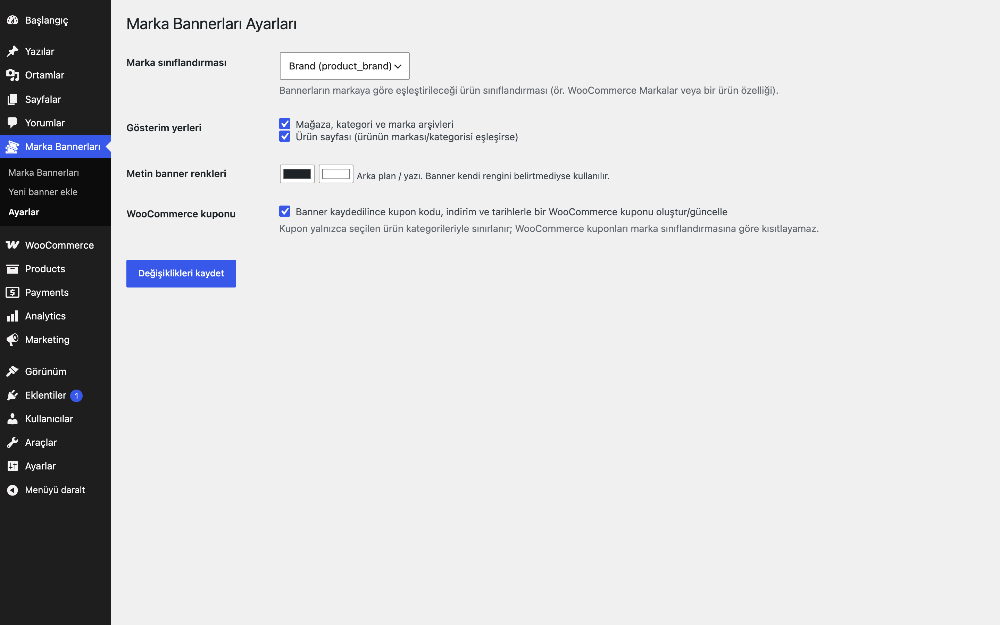
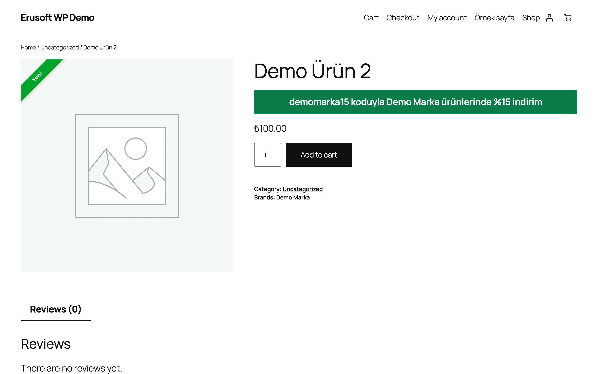

# Brand Coupon Banners for WooCommerce

Marka veya ürün kategorisine bağlı kupon kampanyalarını, tarih aralığıyla görsel ya da metin banner olarak mağaza arşivlerinde ve ürün sayfasında gösterir. Marka sınıflandırması ayarlardan seçilir; isterseniz kupon WooCommerce'te otomatik oluşturulur.

## Özellikler

- Marka sınıflandırması ayarlardan seçilir (`product_brand`, bir ürün özelliği veya kayıtlı herhangi bir ürün sınıflandırması)
- Marka ve/veya kategoriye bağlı kampanya; ikisi de boşsa tüm mağaza
- Başlangıç/bitiş tarihi (site saat dilimine göre)
- Masaüstü ve mobil için ayrı görsel, ya da renkli metin banner (`{code}` kupon kodunu yazar)
- Mağaza/kategori/marka arşivlerinde ve eşleşen ürün sayfasında gösterim; blok temaları desteklenir
- İsteğe bağlı: banner kaydedilince WooCommerce kuponu oluşturma/güncelleme (kategori kısıtıyla)
- Etkin banner yoksa ön yüze hiçbir şey eklenmez

## Nasıl kullanılır

1. Eklentiyi etkinleştirin; Marka Bannerları → **Ayarlar** ekranında marka sınıflandırmasını seçin (markanız yoksa "Marka kullanma") ve gösterim yerlerini işaretleyin.
2. İsterseniz "WooCommerce kuponu" seçeneğini açın.
3. Marka Bannerları → **Yeni banner ekle**: "Demo Banner" başlığıyla, kupon kodu `DEMO15`, yüzde indirim 15 girin.
4. Ürün kategorilerinden "Demo Kategori"yi seçin; başlangıç ve bitiş tarihini belirleyin, "Aktif"i işaretleyin.
5. Görsel seçin ya da banner metnine `{code} koduyla %15 indirim` yazın; `{code}` yerine kupon kodu basılır.
6. Kaydedin: kategori arşivinde ve o kategorideki bir ürünün sayfasında banner görünür; kupon açıksa WooCommerce'te `DEMO15` oluşur.

## Kurulum

1. `brand-coupon-banners-for-woocommerce` klasörünü `wp-content/plugins/` altına kopyalayın (veya zip olarak yükleyin).
2. Eklentiler ekranından etkinleştirin.
3. Marka Bannerları → Ayarlar ekranından marka sınıflandırmasını seçin, ardından Marka Bannerları → Yeni banner ekle ile kampanya oluşturun.

## Ayarlar

Marka Bannerları → Ayarlar: marka sınıflandırması, gösterim yerleri (arşiv / ürün sayfası), metin banner renkleri, kupon oluşturma (`eru_bcb_options`).

## Kancalar ve filtreler

| Ad | Tür | Açıklama |
|---|---|---|
| `eru_bcb_banner` | filtre | Gösterilecek bannerı değiştirir (`$banner`, `$context`: cats, brands, scope) |

## Gereksinimler

WordPress 6.5+, PHP 8.0+, WooCommerce 9.0+.

## Sınırlamalar

- WooCommerce kuponları markaya göre kısıtlanamaz; oluşturulan kupon yalnızca seçilen ürün kategorileriyle sınırlanır.
- Blok temalarında banner her zaman listenin üstünde gösterilir; "listedeki sıra" yalnızca klasik şablonlarda çalışır.
- Aynı sayfada tek banner gösterilir (tarihe uyan ilk eşleşme).
- Eklenti silindiğinde (Eklentiler → Sil) yalnızca kendi ayarları (`eru_bcb_*` seçenekleri) silinir; banner kayıtları (`eru_bcb_banner` yazı türü), bunların meta verileri ve kuponlar korunur.

## SSS

**Aynı kodlu kupon zaten varsa?** Başka bir kupona dokunulmaz; yalnızca bu bannerın oluşturduğu kupon güncellenir.

**Marka sınıflandırması yoksa?** Ayarlarda "Marka kullanma"yı seçin; yalnızca kategori ve genel bannerlar çalışır.

**Eklentiyi silersem bannerlar gider mi?** Hayır. Silmede yalnızca `eru_bcb_options` ayarı silinir; banner kayıtları, meta verileri ve oluşturulmuş kuponlar kalır. Devre dışı bırakmak hiçbir veriyi silmez.

**Blok temalarıyla çalışır mı?** Evet; banner blok temalarında her zaman listenin üstünde gösterilir (bkz. Sınırlamalar).

**Dış servise bağlanır mı?** Hayır, kodda dış HTTP isteği yoktur.

**Süresi biten banner ne olur?** Tarih aralığı dışında görünmez; kayıt silinmez.

## English summary

Shows scheduled, brand- or category-scoped coupon banners (image or text) on shop archives and matching product pages. The brand taxonomy is selectable in settings; a WooCommerce coupon can optionally be created from the banner. Nothing is output when no banner is active.

## Sürüm notları

Bkz. [CHANGELOG.md](CHANGELOG.md).

## Destek

- Önce bu sayfadaki **SSS** ve **Sınırlamalar** bölümlerine göz atın; sık karşılaşılan durumlar orada.
- Hata mı buldunuz? [GitHub Issues](https://github.com/erayusta/erusoft-wp/issues) üzerinden bildirin. WordPress, WooCommerce, PHP ve eklenti sürümünü, adımları ve beklenen/gerçekleşen sonucu yazmanız işi hızlandırır.
- Kurulum, yapılandırma, özel geliştirme veya entegrasyon desteği için **[hello@erusoft.com](mailto:hello@erusoft.com)** adresine yazın. Erusoft hakkında: [erusoft.com](https://erusoft.com).
- Lütfen şifre, API anahtarı veya müşteri verisi (ad, telefon, TCKN, sipariş dökümü) göndermeyin; ekran görüntülerindeki kişisel verileri karartın.

## Lisans

GPL-2.0-or-later. Diğer Erusoft eklentileri: https://wordpress.erusoft.com
