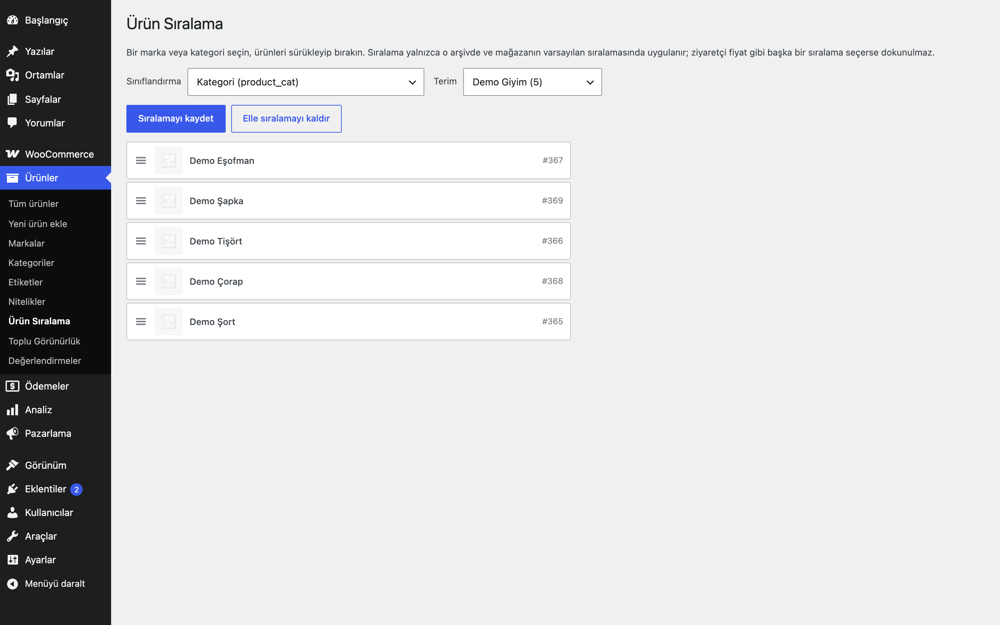
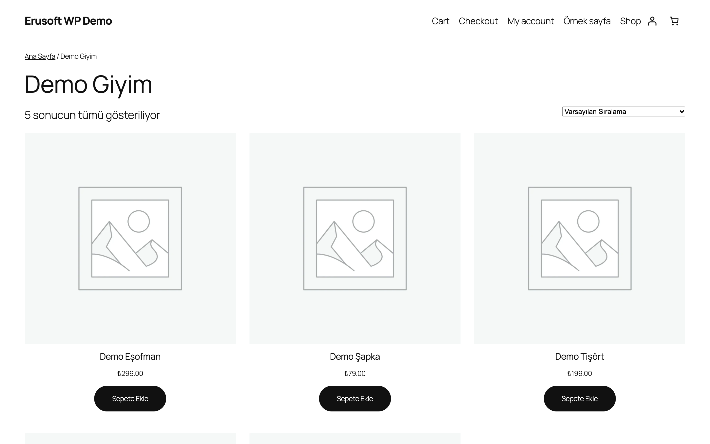
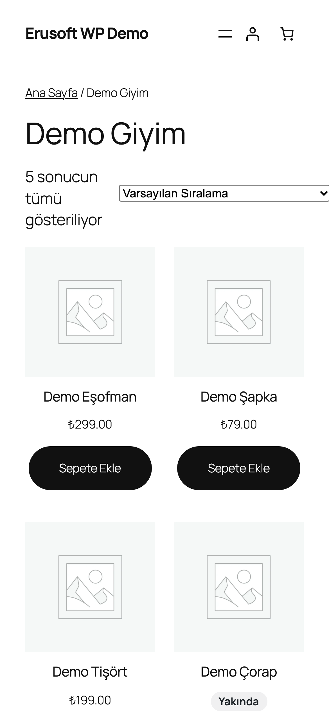

# Brand Product Sorting for WooCommerce

Marka veya kategori arşivindeki ürünleri sürükle-bırak ile sıralayın.

> **English:** Drag and drop the order of products inside a brand, category or any product taxonomy archive. The order is stored per term and applied only to that archive's main query, only under the shop's default sort. Nothing changes until you save an order.

   

## Ne işe yarar

Bir marka ya da kategori arşivinde hangi ürünün hangi sırada görüneceğine siz karar verirsiniz. Ürünleri sürükleyip bırakırsınız; kaydettiğiniz sıra yalnızca o arşivde ve mağazanın varsayılan sıralamasında uygulanır.

## Özellikler

- Sınıflandırma (varsayılan: ürün kategorisi; marka gibi diğer ürün sınıflandırmaları seçilebilir) ve terim seçimi
- Sürükle-bırak liste: küçük görsel, ürün adı, kimlik
- Sıra, terimin kendi meta alanında saklanır (ek tablo yok)
- Kayıtlı listede olmayan (sonradan eklenen) ürünler listenin sonuna gider
- Ziyaretçi fiyat, popülerlik gibi başka bir sıralama seçerse sıralamaya dokunulmaz
- "Elle sıralamayı kaldır" ile varsayılan sıraya dönülür

## Kurulum

1. `brand-product-sorting-for-woocommerce` klasörünü `wp-content/plugins/` altına kopyalayın (veya zip olarak yükleyin).
2. Eklentiler ekranından etkinleştirin (WooCommerce gereklidir).
3. Ürünler → **Ürün Sıralama** ekranından terimi seçip ürünleri sıralayın. Sıra kaydedilene kadar mağazanızda hiçbir şey değişmez.

## Nasıl kullanılır

1. Eklentiyi etkinleştirin ve Ürünler → **Ürün Sıralama** sayfasını açın.
2. **Sınıflandırma** olarak "Ürün kategorisi"ni (marka sınıflandırması kuruluysa onu) ve **Terim** olarak "Demo Kategori"yi seçin; terimdeki ürünler küçük görsel, ad ve kimlikle listelenir.
3. "Demo Ürün"ü sürükleyip listenin en üstüne bırakın.
4. **Sıralamayı kaydet**'e basın.
5. Mağazada "Demo Kategori" arşivini açın: "Demo Ürün" ilk sırada görünür. Ziyaretçi "Fiyata göre" gibi başka bir sıralama seçerse bu sıra uygulanmaz.
6. Varsayılan sıraya dönmek için aynı ekranda **Elle sıralamayı kaldır**'a basın.

## Ayarlar

Ürünler → **Ürün Sıralama**. Yetki: `manage_woocommerce`. Her terimin sırası `_eru_bps_order` terim meta alanında saklanır.

## Kancalar, filtreler ve veri alanları

| Ad | Tür | Açıklama |
|---|---|---|
| `eru_bps_taxonomies` | filtre | Sıralanabilir sınıflandırmalar (varsayılan: ürün türünün tüm sınıflandırmaları) |
| `eru_bps_default_taxonomy` | filtre | Ekran açıldığında seçili sınıflandırma (`product_cat`) |
| `eru_bps_max_products` | filtre | Bir terimde işlenecek en fazla ürün (2000) |
| `_eru_bps_order` | terim meta | Sıralı ürün kimlikleri |

## Entegrasyonlar ve gereksinimler

WordPress 6.5+, PHP 8.0+, WooCommerce 9.0+. HPOS uyumludur. Harici servis kullanmaz. Başka bir eklenti gerekmez.

## Sınırlamalar

- Sıra yalnızca mağazanın varsayılan sıralamasında ("Varsayılan sıralama") uygulanır.
- Yalnızca arşivin ana sorgusuna uygulanır; kısa kodlar ve bloklar etkilenmez.
- Çok sayıda ürünü olan terimlerde ekran en fazla 2000 ürün gösterir (`eru_bps_max_products`). Mağazada da yalnızca kayıtlı sıranın ilk 2000 ürünü SQL `FIELD()` ile sıralanır; kalan ürünler bunlardan sonra varsayılan sırayla gelir (çok büyük listeler sorguyu yavaşlatır).
- Eklenti silindiğinde kayıtlı sıralar da silinir.

## SSS

**Stokta olmayanlar sona gitsin istiyorum.** [Stokta Olmayanlar Sonda](../out-of-stock-last-for-woocommerce/) ile birlikte kullanılabilir: önce stok durumu, sonra sizin sıranız gelir.

**Sıralama neden arşivimde görünmüyor?** Mağazanın varsayılan ürün sıralaması "Varsayılan sıralama" (`menu_order`) olmalıdır ve ziyaretçi başka bir sıralama seçmemiş olmalıdır. Sıra yalnızca arşivin ana sorgusunda uygulanır; kısa kod ve bloklarla çizilen listeler etkilenmez.

**Sonradan eklenen ürünler nereye gider?** Kayıtlı listede olmayan ürünler, kayıtlı sıranın arkasına varsayılan sıralarıyla gelir. Yeni ürünü istediğiniz yere koymak için ekranda yeniden sıralayıp kaydedin.

**Eklentiyi devre dışı bırakırsam veya silersem ne olur?** Devre dışı bırakınca arşivler varsayılan sırayla görünür; kayıtlı sıralar korunur ve yeniden etkinleştirince geri gelir. Eklenti silinirken bütün `_eru_bps_order` terim meta alanları silinir; ürünler, terimler ve diğer veriler etkilenmez. Silmeden önce kayıtlı sıralar yedeklenmediyse geri getirilemez.

**HPOS ve blok Sepet/Ödeme ile ilgisi var mı?** HPOS uyumluluğu bildirilir, ancak eklenti siparişlere dokunmaz; yalnızca arşiv sorgusunu ve yönetim ekranını etkiler. Sepet/Ödeme bloklarıyla ilgisi yoktur.

**Önbellek eklentileri ve performans?** Sıra, arşiv sorgusuna SQL `FIELD()` sıralaması olarak eklenir; sayfa önbelleğiniz varsa sıralamayı kaydettikten sonra arşiv sayfalarının önbelleğini temizleyin. Çok büyük listeler sorguyu yavaşlatabilir (bkz. Sınırlamalar).

## Değişiklik geçmişi

Bkz. [CHANGELOG.md](CHANGELOG.md).

## Destek

- Önce bu sayfadaki **SSS** ve **Sınırlamalar** bölümlerine göz atın; sık karşılaşılan durumlar orada.
- Hata mı buldunuz? [GitHub Issues](https://github.com/erayusta/erusoft-wp/issues) üzerinden bildirin. WordPress, WooCommerce, PHP ve eklenti sürümünü, adımları ve beklenen/gerçekleşen sonucu yazmanız işi hızlandırır.
- Kurulum, yapılandırma, özel geliştirme veya entegrasyon desteği için **[hello@erusoft.com](mailto:hello@erusoft.com)** adresine yazın. Erusoft hakkında: [erusoft.com](https://erusoft.com).
- Lütfen şifre, API anahtarı veya müşteri verisi (ad, telefon, TCKN, sipariş dökümü) göndermeyin; ekran görüntülerindeki kişisel verileri karartın.

## Lisans

GPL-2.0-or-later.

Diğer Erusoft eklentileri: https://wordpress.erusoft.com/
