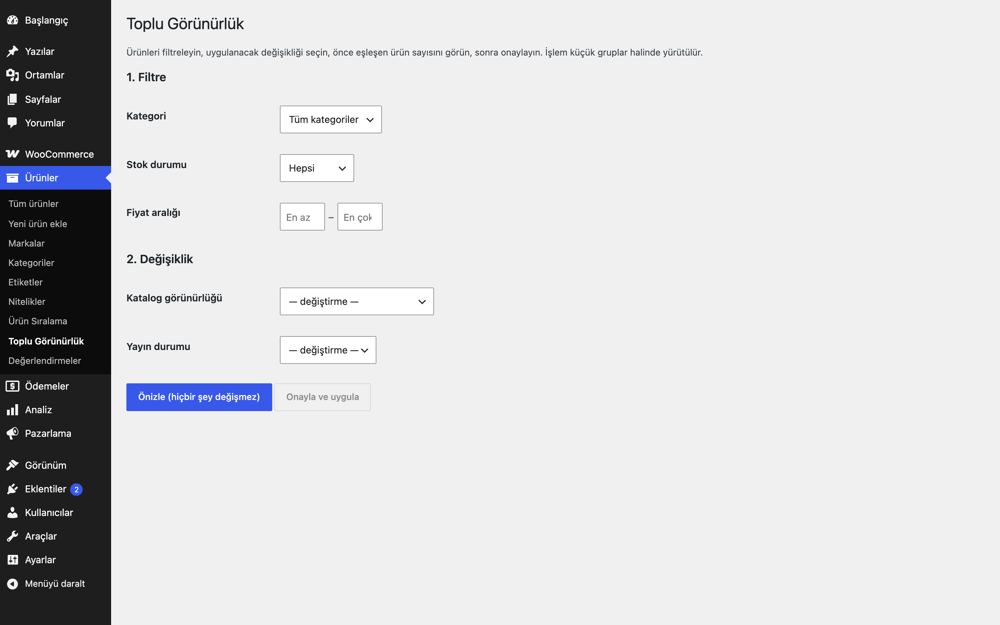

# Bulk Product Visibility for WooCommerce

Ürünlerin katalog görünürlüğünü veya yayın durumunu kategori, stok ve fiyata göre toplu değiştirin.

> **English:** An admin tool to change catalog visibility or status of many products at once, filtered by category, stock status and price. A dry-run count must be shown before anything is applied, and the work runs in small AJAX batches.

   

## Ne işe yarar

Binlerce ürünü tek tek açmadan: kategori, stok durumu ve fiyat aralığına göre filtreleyin, uygulanacak değişikliği seçin, önce kaç ürünün etkileneceğini görün, sonra onaylayın. İşlem küçük gruplar halinde yürütülür.

## Özellikler

- Filtreler: kategori (alt kategoriler dahil), stok durumu, en az / en çok fiyat
- Değişiklikler: katalog görünürlüğü (görünür, yalnızca mağaza, yalnızca arama, gizli) ve yayın durumu (yayında, taslak, özel)
- Zorunlu önizleme: eşleşen ürün sayısı ve örnek adlar; önizleme yapılmadan uygulama çalışmaz
- Gruplar halinde (varsayılan 50 ürün) AJAX ile uygulama, ilerleme çubuğu
- Yetki: `manage_woocommerce`; her istekte nonce doğrulaması

## Kurulum

1. `bulk-product-visibility-for-woocommerce` klasörünü `wp-content/plugins/` altına kopyalayın (veya zip olarak yükleyin).
2. Eklentiler ekranından etkinleştirin (WooCommerce gereklidir).
3. Ürünler → **Toplu Görünürlük** ekranını açın.

## Nasıl kullanılır

1. Ürünler → **Toplu Görünürlük** ekranını açın.
2. **1. Filtre** bölümünde kategori olarak "Demo Kategori"yi, stok durumu olarak "Stokta yok"u seçin; fiyat aralığına en çok `250` yazın.
3. **2. Değişiklik** bölümünde *Katalog görünürlüğü* için "Gizli"yi seçin; yayın durumunu "— değiştirme —" bırakın.
4. **Önizle (hiçbir şey değişmez)** düğmesine basın: "N ürün eşleşti." mesajı ve ilk örnek ürün adları görünür. Bu adımda hiçbir ürün değişmez.
5. Sonuç beklediğiniz gibiyse **Onayla ve uygula**'ya basın; ilerleme çubuğu "İşleniyor: x / N" diye ilerler ve "Tamamlandı" mesajıyla biter.
6. Mağazada bu ürünlerin katalogdan kalktığını kontrol edin. Geri almak için yeni bir önizleme ve ters değişiklikle aynı yolu izleyin.

## Ayarlar

Ürünler → **Toplu Görünürlük**. Kalıcı ayar yoktur; önizleme belirteci bir saat geçerli bir geçici veridir (transient) ve kullanıcıya bağlıdır.

## Kancalar, filtreler ve veri alanları

| Ad | Tür | Açıklama |
|---|---|---|
| `eru_bpv_batch_size` | filtre | Grup başına ürün sayısı (50) |
| `Eru_BPV_Engine::preview()` | PHP | Filtre ve değişiklikle kuru çalıştırma, belirteç döner |
| `Eru_BPV_Engine::run_batch()` | PHP | Belirteç ve konumla bir grubu uygular |

## Entegrasyonlar ve gereksinimler

WordPress 6.5+, PHP 8.0+, WooCommerce 9.0+. HPOS uyumludur. Harici servis kullanmaz; Action Scheduler gerektirmez.

## Sınırlamalar

- Yalnızca ana ürünlere uygulanır; varyasyonlar ana ürünün görünürlüğünü izler.
- Fiyat filtresi ürünün `_price` değerine bakar. Varyasyonlu üründe her varyasyon fiyatı ayrı tutulduğu için herhangi bir varyasyon fiyatı sınırı sağlıyorsa ürün eşleşir (alt ve üst sınırı farklı varyasyonlar sağlayabilir); önizlemeyi kontrol edin.
- Önizleme ile uygulama arasında yeni ürün eklenirse bu ürünler o işleme dahil olmaz.
- Değişiklik geri alınamaz; önce küçük bir filtreyle deneyin.
- Bir işlemde en fazla 5000 ürün değiştirilir (`eru_bpv_max_products` filtresi); daha fazlasıyla eşleşen filtre önizlemede reddedilir.

## SSS

**Sayfayı kapatırsam ne olur?** İşlem o ana kadar uygulanan gruplarla durur; önizlemeyi yeniden yapıp devam edebilirsiniz (zaten uygulanmış ürünler aynı değeri alır).

**Eklentiyi silersem ya da devre dışı bırakırsam ne olur?** Kalıcı ayarı yoktur. Silince yalnızca `eru_bpv_` önekli geçici önizleme verileri (transient) temizlenir. Daha önce uygulanmış görünürlük ve yayın durumu değişiklikleri ürünlerde kalır; eklenti onları geri almaz.

**HPOS ile uyumlu mu?** Evet, eklenti `custom_order_tables` uyumluluğunu bildirir (siparişlere dokunmaz).

**Dışarıya istek yapıyor mu?** Hayır. Harici servis kullanmaz.

**Çok büyük kataloglarda yavaşlar mı?** İşlem AJAX ile gruplar halinde (varsayılan 50 ürün) yürür, bu yüzden tek istek zaman aşımına uğramaz; bir işlemde en fazla 5000 ürün değiştirilir. Daha büyük eşleşmeler önizlemede reddedilir, filtreyi daraltarak parçalayın.

**Değişikliği geri alabilir miyim?** Eklentide geri alma yoktur; önce küçük bir filtreyle deneyin.

## Değişiklik geçmişi

Bkz. [CHANGELOG.md](CHANGELOG.md).

## Destek

- Önce bu sayfadaki **SSS** ve **Sınırlamalar** bölümlerine göz atın; sık karşılaşılan durumlar orada.
- Hata mı buldunuz? [GitHub Issues](https://github.com/erayusta/erusoft-wp/issues) üzerinden bildirin. WordPress, WooCommerce, PHP ve eklenti sürümünü, adımları ve beklenen/gerçekleşen sonucu yazmanız işi hızlandırır.
- Kurulum, yapılandırma, özel geliştirme veya entegrasyon desteği için **[hello@erusoft.com](mailto:hello@erusoft.com)** adresine yazın. Erusoft hakkında: [erusoft.com](https://erusoft.com).
- Lütfen şifre, API anahtarı veya müşteri verisi (ad, telefon, TCKN, sipariş dökümü) göndermeyin; ekran görüntülerindeki kişisel verileri karartın.

## Lisans

GPL-2.0-or-later.

Diğer Erusoft eklentileri: https://wordpress.erusoft.com/
