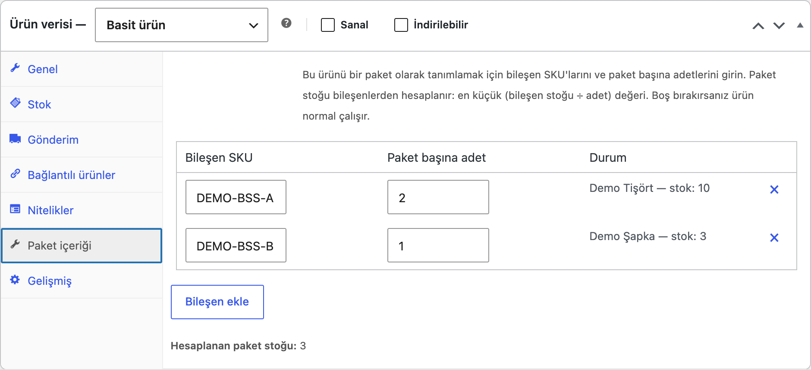
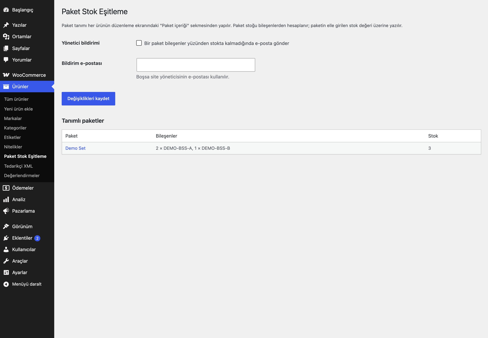

# Bundle Stock Sync for WooCommerce

Bileşen SKU ve adetleriyle paket ürünler tanımlayın; paket stoğu bileşenlerden hesaplansın ve satışlarla tutarlı kalsın.

> **English:** Define a simple product as a bundle of component SKUs and quantities. Bundle stock = min(component stock ÷ quantity). Selling a bundle reduces its components; selling, restocking, unpublishing or refunding a component recalculates every bundle that contains it. Guarded against recursion; bundles cannot contain bundles.

   

## Ne işe yarar

"Set" ürünlerinizin stoğunu elle yönetmeyin. Ürün düzenleme ekranındaki **Paket içeriği** sekmesine bileşen SKU'larını ve paket başına adetleri girin; paketin stoğu otomatik hesaplanır. Örnek: A (stok 10) ×2 ve B (stok 3) ×1 → paket stoğu 3. 1 paket satılınca A 8, B 2, paket 2 olur.

## Özellikler

- Basit ürüne bileşen listesi (SKU + adet); durum sütunu SKU'nun bulunup bulunmadığını ve bileşen stoğunu gösterir
- Paket stoğu = en küçük (bileşen stoğu ÷ adet); stok takibi olmayan bileşenler sınırlamaz
- Paket satılınca bileşen stoğu düşer (HPOS uyumlu; WooCommerce stok düşürme akışına bağlanır)
- Sipariş iptali / beklemeye dönme ve iade (stoğa geri ekle) bileşenleri geri yükler; işlem kalem başına kaydedilir, iki kez geri yüklenmez
- Bileşen stoğu, durumu, yayın durumu (taslak/çöp) değişince bu bileşeni içeren tüm paketler yeniden hesaplanır
- Özyineleme koruması; paket içinde paket (ve kendini içerme) reddedilir
- İsteğe bağlı yönetici e-postası (varsayılan kapalı)

## Kurulum

1. `bundle-stock-sync-for-woocommerce` klasörünü `wp-content/plugins/` altına kopyalayın.
2. Etkinleştirin (WooCommerce gereklidir).
3. Bir ürünü düzenleyin → Ürün verisi → **Paket içeriği**.

## Ayarlar

Ürünler → **Paket Stok Eşitleme**: yönetici bildirimi ve alıcı e-posta (boşsa site yöneticisi). Tanımlı paketlerin listesi aynı ekrandadır. Paket tanımlanmadıkça eklenti hiçbir şeyi değiştirmez.

## Kancalar, filtreler ve veri alanları

| Ad | Tür | Açıklama |
|---|---|---|
| `eru_bss_max_depth` | filtre | Yeniden hesaplama derinlik sınırı (1) |
| `eru_bss_lock_seconds` | filtre | Paket başına kilit süresi (30) |
| `eru_bss_before_save` | eylem | Paket kaydedilmeden hemen önce (bileşenler bundan sonra yeniden okunur) |
| `Eru_BSS_Bundles::set_components()` | PHP | Paket tanımla (SKU + adet listesi); `WP_Error` dönebilir |
| `Eru_BSS_Sync::recalc()` | PHP | Bir paketi yeniden hesapla |
| `_eru_bss_components` | ürün meta | Bileşen listesi |

## Entegrasyonlar ve gereksinimler

WordPress 6.5+, PHP 8.0+, WooCommerce 9.0+. HPOS uyumludur. Harici servis yok. WooCommerce Product Bundles gibi başka paket eklentileriyle birlikte kullanılmak üzere tasarlanmamıştır.

## Sınırlamalar

- Yalnızca basit ürünler paket olabilir; bileşen basit ürün ya da varyasyon olabilir (SKU ile bulunur). Paket içinde paket desteklenmez.
- Paketin elle girilen stok değeri üzerine yazılır. Paketin yalnızca stok takibi olmayan bileşenleri varsa paket stok takibi kapatılır.
- Bileşen SKU'su sonradan değişir ya da bileşen sonradan oluşturulursa, paketi bir kez kaydedin.
- Stoğu bitmiş ama ön sipariş (backorder) izni olan bileşen paketi sınırlamaz.
- Eşzamanlı siparişlerde her paket kısa bir kilitle (varsayılan 30 sn, `eru_bss_lock_seconds`) yeniden hesaplanır ve kaydetmeden hemen önce bileşen stoğu yeniden okunur. Kilit alınamazsa o hesap atlanır ve paket bir sonraki stok olayında düzelir; çok yoğun trafikte kısa süreli (saniyeler) sapma kalma riski vardır.

## SSS

**Bileşen taslağa alınırsa?** Paket stokta yok olur; yeniden yayınlayınca geri döner.

## Değişiklik geçmişi

Bkz. [CHANGELOG.md](CHANGELOG.md).

## Lisans

GPL-2.0-or-later.

Diğer Erusoft eklentileri: https://wordpress.erusoft.com/
