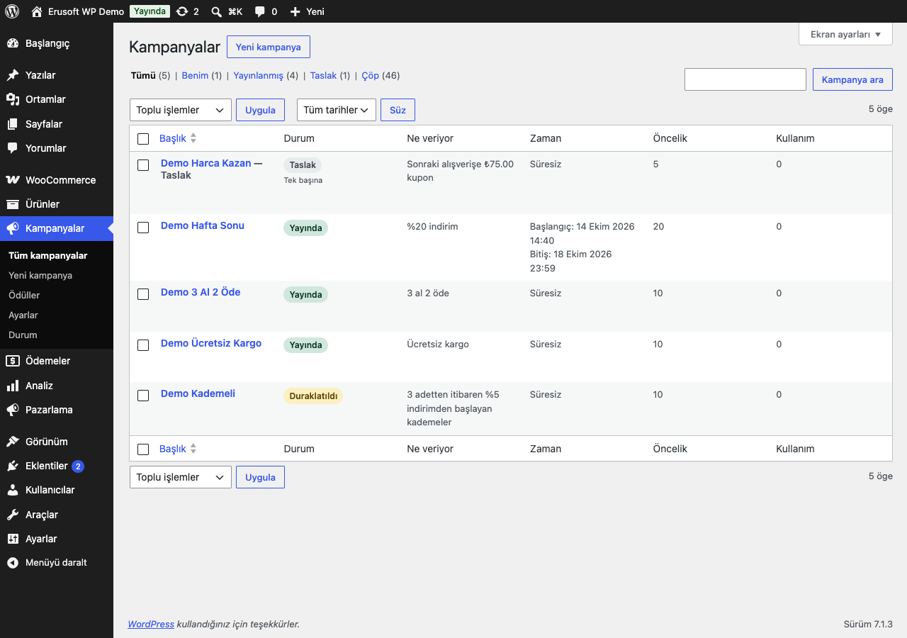
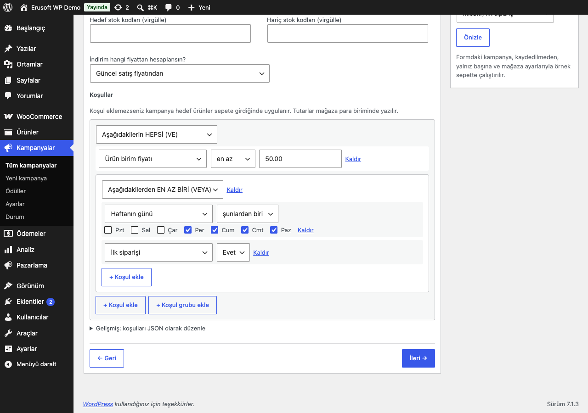
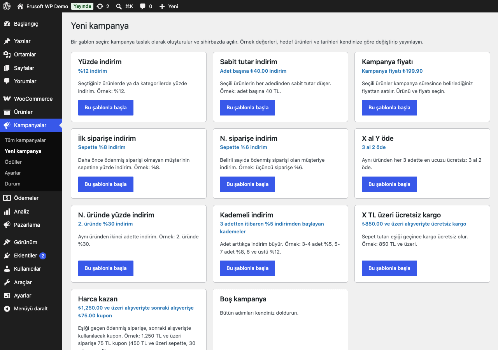
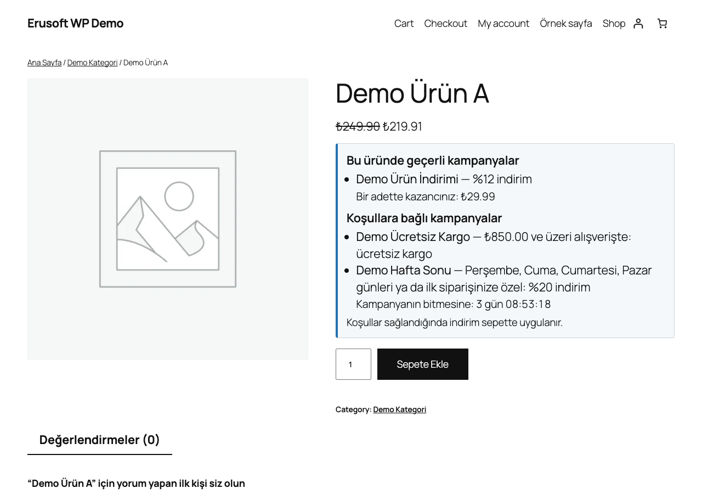
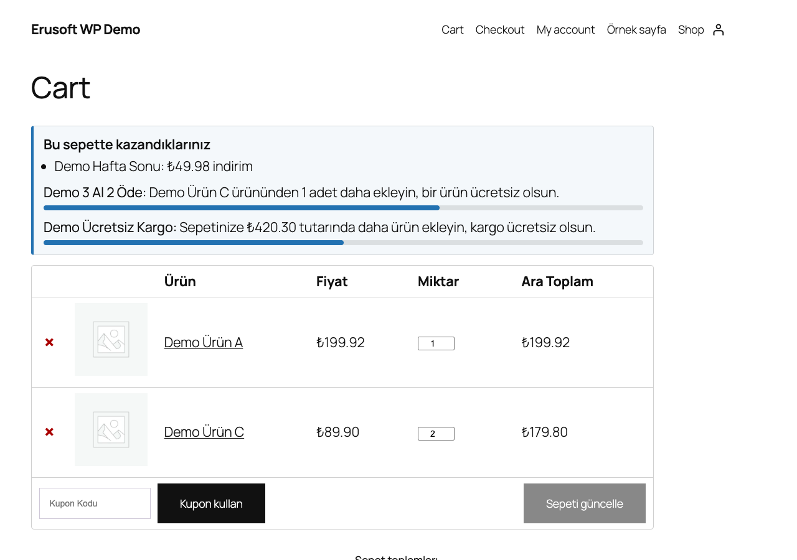
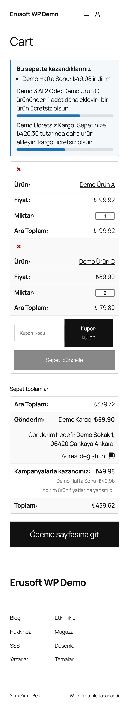
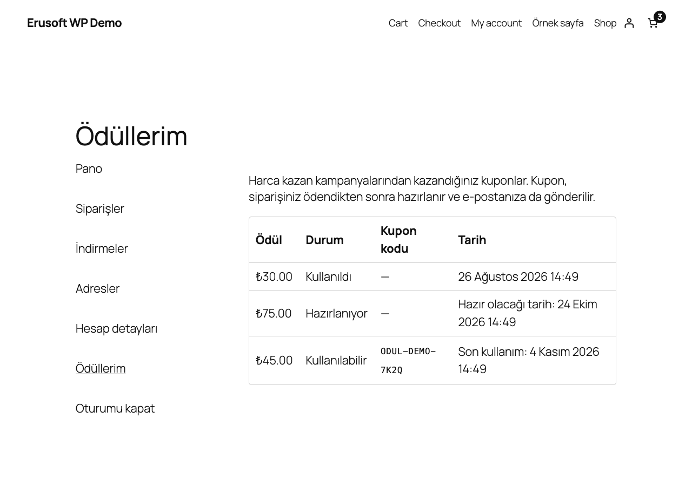

# Campaign Engine for WooCommerce

> **English:** A condition-and-action campaign engine for WooCommerce. Campaigns are built in a four-step wizard (type → conditions → reward → schedule and limits) or started from ten ready templates, checked with a live preview on a sample cart, and run on AND/OR rules over the cart, products, customer and time. Actions: percentage, fixed amount, campaign price, cart percentage/amount, quantity or amount tiers, "buy 3 pay 2" style sets, free shipping and spend-and-earn reward coupons. Priorities, exclusive campaigns and a store-wide stacking policy decide what combines; money is exact to the minor unit. Optional storefront modules (all off by default): list badges, struck-through prices, a product page gain box with a countdown to the campaign's real end, smart cart offers with a progress bar, a cart/checkout summary row, a thank-you box, campaign pages and a My Account rewards tab. A status screen, an overlap notice and WP-CLI (`wp eru-ce`) complete it. Requires PHP 8.1 and WooCommerce 9.9.

[](https://www.gnu.org/licenses/gpl-2.0.html)   

Kupon kodu gerektirmeyen kampanyaları tek bir yerden kurarsınız: hangi ürünlerde, hangi koşulda, ne kazandıracağı, ne zaman ve kaç kez geçerli olacağı. İndirim sepette ürün fiyatına yansır; sipariş, kampanyanın o anki hâlinin bir kopyasını saklar.



## Özellikler

- **Kural motoru:** VE/VEYA grupları, 30 koşul (sepet tutarı ve adedi, ürün, kategori, etiket, marka, özellik, stok, fiyat, müşteri rolü, sipariş sayısı, ilk sipariş, toplam harcama, ödeme ve kargo yöntemi, tarih, gün, saat).
- **Aksiyonlar:** üründe yüzde/sabit indirim, kampanya fiyatı, sepette yüzde/sabit indirim, adet ya da tutar kademeleri, "3 al 2 öde" ve "2. üründe %30" türü setler, ücretsiz kargo, harca-kazan ödül kuponu.
- **Dört adımlı sihirbaz**, on hazır şablon ve kaydetmeden çalışan **canlı önizleme**.
- **Zamanlama:** başlangıç ve bitiş, her gün / haftanın günleri / haftalık aralık / ayın günleri gibi tekrar eden saatler; toplam ve müşteri başına kullanım sınırı.
- **Birleştirme:** öncelik, "tek başına" kampanyalar, en avantajlı / en öncelikli / toplanan politika, kampanya ve sepet indirim sınırları, en düşük birim fiyat.
- **Mağaza önü modülleri** (hepsi kapalı başlar): ürün rozeti, üstü çizili fiyat, ürün sayfası kazanç kutusu, akıllı sepet teklifleri ve ilerleme çubuğu, sepet ve ödeme özeti satırı, teşekkür kutusu, kampanya sayfaları, Hesabım → Ödüllerim.
- **Durum ekranı**, benzer eklenti uyarısı ve **WP-CLI** (`wp eru-ce doctor`, `campaign evaluate`, `rewards expire`).
- Ürün kaydına hiçbir şey yazılmaz; HPOS uyumludur. Etkinleştirildiğinde mağaza önünde hiçbir şey değişmez, zamanlanmış iş oluşmaz ve dış istek yapılmaz.

## Kurulum

1. `campaign-engine-for-woocommerce` klasörünü `wp-content/plugins/` altına kopyalayın ve etkinleştirin. WooCommerce 9.9 ve PHP 8.1 gerekir.
2. Yönetim menüsünde **Kampanyalar → Yeni kampanya** ile bir şablon seçin ya da boş kampanya açın.
3. Sihirbazı doldurun, sağdaki **Canlı önizleme** ile örnek sepette deneyin, **Yayınla**'ya basın.
4. Müşteriye göstermek istediğiniz modülleri **Kampanyalar → Ayarlar → Mağaza önü** bölümünden açın. İndirim, modüller kapalıyken de sepette uygulanır.

Menü ve ekranlar `manage_woocommerce` yetkisi olan herkese (yönetici, mağaza yöneticisi) açıktır; eklenti rollere yetki yazmaz, yetkiyi çalışma anında verir.

## Sihirbaz

Bir kampanya dört adımdan oluşur; adımlar tek bir form olduğu için adım değiştirmek girdiyi kaybettirmez:

1. **Tür:** kampanya ne yapacak (yüzde, sabit tutar, kampanya fiyatı, sepet indirimi, kademe, set, ücretsiz kargo, harca kazan).
2. **Koşullar:** hedef ve hariç ürünler, kategoriler, stok kodları; indirimin hangi fiyattan hesaplanacağı (güncel fiyat, normal fiyat, indirimdeki ürünler hariç); VE/VEYA koşul grupları. Koşullar görsel olarak kurulur, istenirse "Gelişmiş" alanında JSON olarak düzenlenir. Tutarlar mağaza para biriminde yazılır ("1.250,00" ya da "1250.5").
3. **Ödül:** yüzde, tutar, kademe tablosu, set ayarları ya da kupon değeri; isteğe bağlı "ayrıca kargo ücretsiz", rozet metni ve kampanya sayfası açıklaması.
4. **Zamanlama ve sınırlar:** başlangıç, bitiş, tekrar eden saatler, öncelik, kampanya başına en yüksek indirim, kullanım sınırları, "tek başına", kampanya sayfasında listeleme, duraklatma.



*Görselde 2. adımın koşul kurucusu var; adım sekmeleri ve hedef ürün seçicileri bu bölümün üstündedir.*

Kaydederken her alan motorun kendi okuyucularıyla denetlenir. Hatalı bir alan kaydı durdurur: hiçbir şey yazılmaz, kampanyanın durumu değişmez (taslak yayınlanmaz, yayındaki kampanya önceki hâliyle çalışmaya devam eder), form yazdıklarınızla ve alan bazında Türkçe hata mesajıyla geri gelir. Bozuk bir ürün numarası hiçbir zaman sessizce atılmaz; atılsaydı kampanya bütün mağazaya yayılabilirdi.

**Canlı önizleme**, formdaki kampanyayı kaydetmeden, yalnız başına ve mağaza ayarlarıyla bir örnek sepette çalıştırır: satır satır indirim, ücretsiz kargo, ödül kuponu ve kampanya uygulanmıyorsa nedeni (ör. "Koşullar sağlanmadı", "Set tamamlanmadı"). Örnek sepetler mağazanızdaki gerçek ürünlerden kurulur; "Kendi sepetim" seçeneğinde `12 x 3` biçiminde ürün ve adet yazarsınız.

Liste ekranında **Duraklat / Devam ettir** toplu işlemleri, durum (Yayında, Zamanı bekleniyor, Duraklatıldı, Süresi doldu, Hatalı), ne verdiği, zamanı, önceliği ve kullanım sayısı görünür.

## Şablonlar

**Kampanyalar → Yeni kampanya** ekranındaki her şablon bir taslak kampanya oluşturur ve sihirbazda açar. Değerler örnektir; hedef ürünleri, tutarları ve tarihleri değiştirip yayınlayın.

| Şablon | Örnek değer |
|---|---|
| Yüzde indirim | Seçili ürünlerde %12 |
| Sabit tutar indirim | Adet başına 40 TL |
| Kampanya fiyatı | Seçili ürün 199,90 TL |
| İlk siparişe indirim | İlk siparişte sepete %8, müşteri başına 1 kez (ödenmemiş siparişler de hakkı tutar) |
| N. siparişe indirim | Üçüncü siparişte sepete %6 |
| X al Y öde | Aynı üründen 3 al 2 öde |
| N. üründe yüzde indirim | 2. üründe %30 |
| Kademeli indirim | 3-4 adet %5, 5-7 adet %8, 8+ adet %12 |
| X TL üzeri ücretsiz kargo | 850 TL ve üzeri |
| Harca kazan | 1.250 TL ve üzeri siparişe 75 TL kupon (450 TL ve üzeri sepette, 30 gün) |



Geliştiriciler `eru_ce_templates` filtresiyle şablon ekleyebilir; motorun doğrulamasından geçmeyen şablon galeride gösterilmez.

## Kampanyalar birlikte nasıl çalışır

- **Öncelik:** büyük sayı önce değerlendirilir; eşitlikte önce oluşturulan kazanır.
- **Tek başına:** uygulanan en öncelikli "tek başına" kampanya, sepetteki diğer bütün kampanyaları devre dışı bırakır. Bu, yalnızca ücretsiz kargo ya da ödül kuponu veren bir "tek başına" kampanya için de geçerlidir: indirim yapan, önceliği daha düşük kampanyaları da kapatır. Sihirbaz bu durumda uyarır.
- **Birleştirme politikası** (Ayarlar): aynı ürüne birden çok kampanya uyduğunda müşteriye en avantajlı olan (varsayılan), en öncelikli olan ya da hepsi toplanarak uygulanır. "En avantajlı" ve "en öncelikli" politikalarında hiçbir satırda kazanamayan kampanya ücretsiz kargo ve ödülünü de vermez.
- **Sınırlar:** kampanya başına en yüksek indirim tutarı, sepet indirim sınırı (ara toplamın yüzdesi) ve en düşük birim fiyat.
- **Kuponlar:** sepette kupon varken kampanyaların uygulanıp uygulanmayacağı ayardır.
- **Tutar eşikleri:** "Sepet tutarı" ve "Hedef ürünlerin tutarı" koşulları sepetin **kampanya ve kupon indirimlerinden önceki** tutarına bakar. %20 indirimli 900 TL'lik sepet 720 TL ödese de "850 TL ve üzeri" koşulunu karşılar. Akıllı sepetteki "X TL daha ekleyin" hesabı da bu tutara göre yapılır.
- **Misafirler ve sipariş geçmişi:** "N. sipariş", "toplam harcama" ve "son siparişten bu yana gün" koşulları yalnızca giriş yapmış hesabın geçmişine bakar; misafirde hiçbir zaman sağlanmaz. Böylece kimse başkasının e-posta adresini yazarak onun geçmişinden yararlanamaz ya da bir adresin sipariş geçmişini yoklayamaz. "İlk sipariş" koşulu misafirin yazdığı e-postaya bakmaya devam eder; bu yalnızca indirimi kısıtlar.
- **Kesin tutarlar:** bütün hesaplar kuruş cinsinden tam sayıyla yapılır; satır indirimleri toplamı sepet indirimine kuruşu kuruşuna eşittir.

## Mağaza önü

Bütün modüller **Kampanyalar → Ayarlar → Mağaza önü** bölümündedir ve varsayılan olarak kapalıdır. Modül açıkken de etkin kampanya yoksa hiçbir şey yazdırılmaz.

Ürün ve mağaza sayfaları **her ziyaretçiye aynı içeriği** gösterir. Kampanyalar bunun için iki gruba ayrılır:

- **Koşulsuz kampanyalar** yalnızca ürüne, sepete, hedeflere ve kampanya tarihine bağlıdır. Fiyatı ve "geçerli" satırını yalnızca bunlar etkiler; o da yalnızca tek adette gerçekten uygulanıyorlarsa.
- **Ziyaretçiye bağlı kampanyalar** müşteri koşulu (ilk / N. sipariş, rol, üye girişi, sipariş geçmişi), ödeme yöntemi, gün veya saat koşulu, tekrar eden zaman penceresi ya da müşteri başına kullanım sınırı içerir. Bunlar ürün ve mağaza sayfalarında **hiçbir zaman fiyat değiştirmez** ve "geçerli" diye gösterilmez. Kazanç kutusunda koşul notuyla ayrı bir satırda yer alırlar; not kuralların kendisinden üretilir ve her ziyaretçi için aynıdır: "İlk siparişinize özel: sepette %8 indirim", "Üyelere özel", "Hafta sonu", "Havale/EFT ile ödemede". Kargo yöntemi ve teslimat ülkesi koşulları "Kargo seçimine bağlı" / "Teslimat ülkesine bağlı", kendi ifadesi olmayan koşullar ve setler "Koşullara bağlı" notuyla gösterilir; koşulsuz görünen bir satır olmaz. Ziyaretçiye bağlı kampanyalara ürün kartında rozet konmaz.
- Uygulanıp uygulanmadığına sepet karar verir: sepet her kampanyayı o anki müşteri, ödeme yöntemi ve saat için hesaplar.

Modüller:

- **Ürün rozeti:** belirli ürün veya kategorileri hedefleyen koşulsuz kampanyanın rozet metni ya da ne verdiği ("3 al 2 öde", "850,00 ₺ ve üzeri alışverişte ücretsiz kargo"). Tüm mağazaya uygulanan kampanyalar her karta aynı rozeti basmasın diye yalnızca kendi rozet metni yazılmışsa gösterilir.
- **Üstü çizili fiyat:** koşulsuz bir kampanyayla bir adette indirim alan ürünün eski ve yeni fiyatı. Sepet aynı tutarı alır.
- **Kazanç kutusu** (ürün sayfası): "Bu üründe geçerli kampanyalar" (tek adette uygulanan koşulsuz kampanyalar ve bir adetteki kazanç) ile "Koşullara bağlı kampanyalar" (sepet eşiği, set veya kademe isteyenler ve ziyaretçiye bağlı olanlar, koşul notlarıyla). Bitiş zamanı girilmiş kampanyalarda o zamana geri sayım gösterilir.
- **Akıllı sepet** (klasik sepet): bu sepette kazanılanlar ve en fazla iki teklif ("Demo Ürün C ürününden 1 adet daha ekleyin, bir ürün ücretsiz olsun."), indirimler öncesi sepet tutarından hesaplanan ilerleme çubuğuyla.
- **Sepet ve ödeme özeti** (klasik): "Kampanyalarla kazancınız" satırı, kampanya kampanya.
- **Teşekkür kutusu:** siparişteki kazanç ve kazanılan ödül kuponu, gönderileceği tarihle.







Mağaza önünde yalnızca gerçek bilgi gösterilir: kampanyanın kendi ödülü ve koşulu, gerçekten eksik olan tutar ya da adet ve kampanyanın gerçek bitiş zamanı. Stok azlığı, "şu an X kişi bakıyor" gibi sayılar ya da uydurma süreler yoktur. Geri sayım, sunucu saatini `GET /wp-json/eru-ce/v1/clock` adresinden okur (herkese açık, yalnızca okuma); bu yüzden önbellekten gelen sayfada da doğru sayar. Bitişi olmayan kampanyada geri sayım yoktur.

Saat adresi istemci başına dakikada 120 istekle sınırlıdır (`eru_ce_clock_rate_limit`). Sayaç, kalıcı nesne önbelleği olmayan sitelerde seçenekler tablosunda iki dakikalık bir geçici kayıttır. İstemci varsayılan olarak `REMOTE_ADDR` ile tanınır. Gerçek ziyaretçi adresini geri koymayan bir ters vekil sunucu ya da CDN arkasında bütün ziyaretçiler tek sayaca düşer; sınır aşılınca geri sayım sessizce durur ve yerine yazılı bitiş tarihi kalır. Bu durumda güvendiğiniz başlıktan gerçek adresi `eru_ce_clock_client` filtresiyle döndürün.

## Kampanya sayfaları

Modül açıldığında `/kampanyalar/` (liste) ve `/kampanya/<kampanya-adı>/` (detay) adresleri çalışır; ikisi de Ayarlar'dan değiştirilebilir. Yalnızca yayında olan ve "Kampanya sayfasında listelensin" işaretli kampanyalar görünür; diğerlerinin detay adresi 404 döner. Detay sayfası kampanyanın ürünlerini ya da kategorilerini listeler.

Bir sayfanın, ürün ya da kategori temel adresinin zaten kullandığı adres kaydedilmez (sayfa kampanya listesinin arkasında kaybolurdu). Adres ya da modül değiştiğinde kalıcı bağlantı kuralları bir sonraki istekte bir kez kendiliğinden yenilenir. Elle yenilemek gerekirse **Ayarlar → Kalıcı bağlantılar** ekranında **Değişiklikleri kaydet** düğmesine basmanız yeterlidir. Şablonları temanızda `campaign-engine-for-woocommerce/campaign-archive.php` ve `campaign-single.php` dosyalarıyla değiştirebilirsiniz.

## Ödüller

Harca kazan kampanyası sepete bir sonraki alışverişte kullanılacak kupon kazandırır:

1. Sipariş **ödendiğinde** ödül "bekliyor" olarak kaydedilir. Kampanya hiçbir satırda kazanamadıysa ödül de oluşmaz.
2. Ayarlardaki bekleme süresi (hemen, 7, 14 veya 30 gün) dolunca tek kullanımlık, müşterinin e-postasına bağlı, sabit tutarlı bir WooCommerce kuponu oluşur ve "Ödülünüz hazır" e-postası gönderilir (WooCommerce → Ayarlar → E-postalar'dan düzenlenir). Kupon kodları `ODUL` ile başlar (`eru_ce_coupon_prefix` filtresi).
3. Kupon kampanyanın süresi ya da ayardaki süre kadar geçerlidir; kampanyada en düşük sepet tutarı ve kategori varsa kupona da yazılır.
4. **İade:** "iade oranında azalır" politikasında ödül, iade edilmeyen tutar oranında küçülür; "iptal edilir" politikasında her iade ödülü iptal eder. Tam iade, başarısız ya da iptal edilen sipariş ödülü her iki politikada da iptal eder. Kullanılabilir durumdaki kuponun tutarı düşürülür ya da kupon kapatılır; kuponlar hiçbir zaman silinmez.
5. Ödül kuponunu kullanan sipariş iptal edilirse ödül yeniden kullanılabilir olur.

**Hesabım → Ödüllerim** sekmesi (Ayarlar'dan açılır, adres varsayılan olarak `odullerim`) müşterinin kendi ödüllerini, durumunu, kod hazır olduğunda kodunu ve tarihleri listeler. Yalnızca o hesapla kazanılmış ödüller görünür. Misafir siparişinden kazanılan ödül, mağaza o siparişi yönetimden hesaba bağlarsa listeye girer. E-posta adresinin aynı olması yetmez: herkes başka birinin adresiyle hesap açabilir, kodlar ise kullanılabilir kuponlardır. Misafirler ödül kodlarını e-postayla alır. Yönetimde **Kampanyalar → Ödüller** bütün ödülleri listeler.



## Kullanım sınırları

Varsayılan olarak kullanım hakkı sipariş verilirken ayrılır ve sipariş ödenince kesinleşir; aynı anda gelen iki sipariş son hakkı iki kez alamaz. Başarısız ya da iptal edilen sipariş hakkı geri verir; ödenmeyen bekleyen siparişin hakkı ayardaki süre sonunda (varsayılan 24 saat) bırakılır. Havale bekleyen (beklemede) siparişlerin hakkı, sipariş ödenene ya da iptal edilene kadar tutulur. "Yalnızca ödenen siparişler sayılır" seçeneğinde hiçbir hak ayrılmaz; bu seçenekte aynı anda ödenen siparişler sınırı aşabilir, aşım denetim kaydına yazılır. Aynı kampanya için o anda başka bir ödeme işleniyorsa ve kilit birkaç saniye içinde alınamazsa müşteri "Şu anda yoğunluk var, lütfen tekrar deneyin." mesajını görür; kullanım hakkı dolmuş sayılmaz.

Ücretsiz kargo kampanyası, sepetteki **bütün** kargo ücretlerini sıfırlar: ekspres kargo ve mağazadan teslim dahil. Yalnızca belirli bir yöntemi ücretsiz yapmak için kampanyaya "Kargo yöntemi" (`cart.shipping_method`) koşulu ekleyin ya da `eru_ce_free_shipping_rate` filtresini kullanın.

## Ödeme sayfası

- **Klasik ödeme sayfası:** müşterinin gördüğü kampanyalar sipariş anında değiştiyse (ör. koşul artık tutmuyor) sipariş durur ve müşteri güncel tutarı görür.
- **Ödeme bloğu:** sipariş, gönderilen ödeme yöntemiyle yeniden hesaplanır; kampanyalar değiştiyse müşteriden siparişi yeniden göndermesi istenir. Ödemesi yarım kalan ya da reddedilen siparişi WooCommerce aynı sepetle yeniden kullanırsa, kampanya kaydı, yeniden denetim ve kullanım hakkı o deneme için baştan yapılır. Müşterinin kendi siparişi ödeme bağı yüzünden hiçbir zaman reddedilmez; ödeme bağı yalnızca "sipariş öde" sayfası ve adresi için geçerlidir. Ödeme sırasında hesap açan misafirde müşteriye bağlı bir koşul değişirse ilk gönderim bir kez reddedilebilir; ikinci gönderim doğru tutarla geçer (güvenli yönde).
- **Ödeme yöntemine bağlı kampanyalar:** `cart.payment_method` koşullu bir kampanyayla fiyatlanan sipariş daha sonra yalnızca o yöntemle ödenebilir (sipariş öde sayfası ve Store API öde adresi). Yöntem kullanılamaz hâle gelirse müşteri hangi yöntemin gerektiğini görür ve mağazayla iletişime geçmesi istenir. Mağaza, sipariş ekranındaki "Kampanya ödeme bağı" kutusunda **Ödeme bağını kaldır** ile bağı kaldırabilir; tutar değişmez, sipariş notu yazılır. Geliştiriciler `eru_ce_payment_bound` filtresini kullanabilir.

## Önbellek eklentileri

Sepet, ödeme ve sipariş her zaman o anda hesaplanır; önbellek indirimi etkilemez. Ürün ve mağaza sayfalarındaki rozet, fiyat ve kazanç kutusu ziyaretçiye bağlı değildir (bkz. Mağaza önü). Bu yüzden önbellek bir ziyaretçinin fiyatını başka bir ziyaretçiye göstermez; yalnızca kampanya değişikliğinden sonra, önbellek süresince eski kalabilir. Kampanya kaydedildiğinde ilgili sayfaları temizlemek için **Ayarlar → Sayfa önbelleği**:

- **Temizlenmez** (varsayılan).
- **LiteSpeed Cache:** kampanyanın ürünleri (ya da kampanya kategori/stok koduyla tanımlıysa bütün önbellek) LiteSpeed Cache'in kendi eylemleriyle temizlenir.
- **Kendi kodunuz:** `eru_ce_cache_purge` eylemi `( $urun_idleri, $hepsi )` ile tetiklenir; başka bir önbellek eklentisine bağlayın. `eru_ce_cache_adaptor` filtresi kendi adaptörünüzü döndürmenizi sağlar.

Geri sayım sunucu saatini REST adresinden okuduğu için önbellekte de doğru çalışır.

## Diğer fiyat eklentileriyle birlikte

Kampanya indirimi ürün kaydına yazılmaz; sepet hesaplanırken `woocommerce_product_get_price` filtresinde ve `woocommerce_before_calculate_totals` adımında, **`eru_ce_price_priority`** önceliğinde (varsayılan 9999) uygulanır:

- Bu öncelikten **önce** yapılan fiyat değişiklikleri (rol fiyatları, döviz, kendi `before_calculate_totals` kodunuz) kampanyanın tabanıdır; kampanya o fiyatın üzerine çalışır.
- Bu öncelikten **sonra** fiyatı değiştiren bir kod varsa o satırın kampanya indirimi geri çekilir ve siparişe yazılmaz (müşteriye söylenmeyen bir indirim hiçbir zaman kayda geçmez).
- **Kampanyalar → Durum** ekranı bu öncelikten sonra çalışan fiyat kodlarını listeler.
- Abonelik yenilemesi gibi kopya ya da simüle sepetler kendi ürün kopyalarıyla hesaplanır; ana sepetin fiyatları onlardan etkilenmez.

Bilinen sınır: başka bir eklenti fiyatı bu öncelikten sonra ve her hesaplamada farklı bir değere çeviriyorsa o satırlar kampanyasız kalır. Önceliği o eklentiden sonraya alın ya da o eklentinin fiyat değişikliğini daha erken bir önceliğe taşıyın.

## Hangisini seçmeliyim?

Erusoft kataloğunda tek amaçlı daha küçük indirim eklentileri de var. Bu motor hepsinin yaptığını bir arada ve tek bir birleştirme kuralıyla yapar; küçük eklentiler tek bir ihtiyaç için daha hafif seçeneklerdir.

| İhtiyaç | Öneri |
|---|---|
| Birden çok kampanya türü, koşul grupları, öncelik ve birleştirme kuralı, ödüller | **Campaign Engine** (bu eklenti) |
| Yalnızca sepet tutarına veya kategoriden adede göre kodsuz indirim | [Automatic Discounts](../automatic-discounts-for-woocommerce/) |
| Yalnızca sepet tutarı kademeleri ve "X TL daha ekleyin" mesajı | [Cart Campaigns](../cart-campaigns-for-woocommerce/) |
| Ödeme yöntemine göre indirim **ya da ek ücret** (motor ek ücret almaz) | [Payment Method Discounts](../payment-method-discounts-for-woocommerce/) |
| Ürün sayfasında "Hepsini sepete ekle" düğmeli birlikte al setleri | [Bought Together Discounts](../bought-together-discounts-for-woocommerce/) |
| İndirime bağlı olmayan, aktif/yaklaşan/bitmiş kampanya duyuru sayfaları | [Campaign Pages](../campaign-pages-for-wordpress/) |
| Marka veya kategoriye bağlı kuponların tarihli banner'ları | [Brand Coupon Banners](../brand-coupon-banners-for-woocommerce/) |

**Aynı kuralı iki eklentide birden tanımlamayın:** her eklenti kendi indirimini uygular ve sepet iki kez indirim alır. Automatic Discounts, Cart Campaigns ya da Payment Method Discounts bu motorla birlikte etkinse yönetimde bir uyarı çıkar ve Durum ekranı bunu gösterir; eklentiler birbirini kapatmaz, karar sizindir.

## Durum ekranı ve WP-CLI

**Kampanyalar → Durum**: PHP, WooCommerce ve veritabanı sürümü, tablolar, Action Scheduler (bekleyen, geciken, başarısız işler), okunamayan kampanya veya ayar kayıtları, kampanya önceliğinden sonra çalışan fiyat kodları, benzer eklentiler, önbellek ve kampanya sayfası kuralları.

```bash
wp eru-ce doctor                                              # aynı denetimler; hata varsa çıkış kodu 1
wp eru-ce campaign evaluate 123 --cart='[{"product":45,"qty":3}]' [--customer=returning]
wp eru-ce rewards expire [--batch=500]                        # süresi geçen ödülleri kapatır
```

`campaign evaluate` kampanyayı verilen sepette çalıştırır ve hiçbir şey yazmaz.

## Ayarların güvenliği

Ayarlar kaydedilirken motorun okuyucularıyla denetlenir. Kayıtlı bir değer sonradan okunamazsa (elle değiştirilmiş, eski bir sürümden kalmış) sepet hiçbir zaman sınırsız indirime düşmez: birleştirme "en avantajlı"ya, sepet sınırı son geçerli değere ya da güvenli %50'ye, kuponla birlikte çalışma "hayır"a döner ve yönetimde bildirim çıkar. Okunamayan bir kampanya atlanır, diğerleri çalışmaya devam eder.

## Kancalar ve filtreler

| Ad | Tür | Açıklama |
|---|---|---|
| `eru_ce_price_priority` | filtre | Fiyat filtrelerinin ve sepet adımının önceliği (varsayılan 9999) |
| `eru_ce_item_excluded` | filtre | Bir sepet satırını bütün kampanyaların dışında tutar (hediye kartı gibi) |
| `eru_ce_payment_bound` | filtre | Siparişin bağlı olduğu ödeme yöntemi; `false` ya da `''` bağı kaldırır |
| `eru_ce_free_shipping_rate` | filtre | Bir kargo ücretinin ücretsiz kargo kampanyasıyla sıfırlanıp sıfırlanmayacağı |
| `eru_ce_coupon_prefix` | filtre | Ödül kuponu kod öneki (varsayılan `ODUL`) |
| `eru_ce_templates` | filtre | Şablon galerisi |
| `eru_ce_admin_asset_allowlist` | filtre | Kampanya ekranlarında bırakılan betik/stil tutamaç önekleri |
| `eru_ce_campaign_post_type_args` | filtre | Kampanya yazı türü argümanları |
| `eru_ce_cache_adaptor` | filtre | Kendi önbellek adaptörünüz |
| `eru_ce_clock_rate_limit` | filtre | Saat adresinin dakikalık istek sınırı (varsayılan 120) |
| `eru_ce_clock_client` | filtre | Saat adresi hız sınırının istemci anahtarı (varsayılan `REMOTE_ADDR`; vekil sunucu / CDN arkasında gerçek adres) |
| `eru_ce_sweep_batch`, `eru_ce_lock_timeout` | filtre | Günlük süpürme parti boyu, kilit bekleme süresi |
| `eru_ce_cache_purge` | eylem | "Kendi kodunuz" önbellek seçeneğinde tetiklenir |
| `eru_ce_campaign_compiled` | eylem | Kampanya kaydedildi (`$id`, `$etkin`) |
| `eru_ce_reservation_checked` | eylem | Kullanım hakkı sayıldı, kayıttan hemen önce |
| `eru_ce_config_error` | eylem | Okunamayan bir kayıt ilk kez görüldü |

## Kişisel veri silme ve saklama

Eklenti ödüllerde müşterinin e-postasını, kullanım kayıtlarında e-posta özetini, denetim kaydında işlemi yapan kullanıcıyı ve müşteri başına sipariş sayısı ile harcamayı saklar. WordPress'in kişisel veri dışa aktarma ve silme araçlarına `eru-ce` olarak bağlıdır: silmede ödül ve kullanım kayıtları anonimleştirilir (tutar kaydı kalır), müşteri metriği silinir.

**Saklama süresi** (Ayarlar → Kişisel veri saklama, varsayılan 365 gün, 30–3650): günlük iş, bu süreden eski kayıtları parça parça temizler:

- Kullanılmış, süresi dolmuş ya da iptal edilmiş ödüllerin e-postası ve hesap bağı silinir; tutar ve durum kalır.
- Serbest bırakılmış ya da kesinleşmiş kullanım kayıtlarının e-posta özeti ve hesap bağı silinir. Müşteri başına sınırı olan etkin kampanyaların kayıtları bunun dışındadır; o müşterinin kullanımını saymak için gerekirler.
- Denetim kaydı satırları silinir.

Kullanılabilir ya da bekleyen ödüller e-postasını korur, çünkü kuponları o adrese bağlıdır.

## Kaldırma

Eklenti silindiğinde:

- **Her zaman silinir:** ayarlar ve diğer seçenekler, Action Scheduler işleri, müşteri metrikleri tablosu (siparişlerden türetilir), eklentinin geçici verileri ve "uyarıyı gizle" kullanıcı tercihi.
- **`ERU_CE_REMOVE_DATA` tanımlanıp `true` yapılmadıkça korunur:** kampanyalar (yazılar ve derlenmiş satırlar), kullanım kayıtları, ödüller ve denetim kaydı. `wp-config.php` içine `define( 'ERU_CE_REMOVE_DATA', true );` eklerseniz bunlar da silinir.
- **Hiçbir zaman silinmez:** müşterilere verilmiş ödül kuponları, sipariş metası ve sipariş notları.

Veriler korunarak kaldırılıp yeniden kurulduğunda sipariş takibi (kullanım hakları, ödüller, iadeler) hemen kaldığı yerden devam eder.

## PHP 8.1 gerekir

Motor PHP 8.1 özellikleri (salt okunur özellikler, `WeakMap`) kullanır. Daha eski PHP'de eklenti yüklenmez ve yalnızca bir yönetim uyarısı gösterir; site çalışmaya devam eder.

## Gereksinimler

WordPress 6.5+, WooCommerce 9.9+, PHP 8.1+, MySQL 5.7.5+ ya da MariaDB 10.0.2+ (aynı anda birden çok adlandırılmış kilit gerekir: kampanya başına kullanım kilidi, sipariş ve ödül kilidi; daha eski sunucular ilk kilidi sessizce bırakır). HPOS (özel sipariş tabloları) ile uyumludur. WooCommerce yoksa eklenti uyarı gösterir ve hiçbir şey yapmaz.

## Sınırlamalar

- 1.0.0 sürümünde kampanya analitiği ve raporlama ekranı yoktur; önizleme, Durum ekranı ve `wp eru-ce` vardır.
- Sepet ve Ödeme **blokları** kampanya indirimlerini ürün fiyatlarında gösterir ama akıllı sepet kutusunu ve özet satırını göstermez; bu iki modül klasik sepet ve ödeme sayfası içindir.
- Store API, adede tam bölünmeyen bir satır indiriminde yuvarlanmış birim fiyat gösterir (ör. 89,98 / 3 için 29,99); satır toplamları kuruşu kuruşuna doğrudur. Temalarda satır toplamını gösterin.
- Ürün listesindeki fiyat ve rozet bir adet ve misafir ziyaretçi içindir. Adet veya sepet eşiği isteyen kampanyalar fiyatı değiştirmez, rozetinde eşiği söyler. Ziyaretçiye bağlı kampanyalar (ilk sipariş, rol, gün/saat, ödeme yöntemi, müşteri başına sınır) ürün sayfasında yalnızca koşul notuyla gösterilir. Uygulanıp uygulanmadığına sepet karar verir.
- Fiyatı para biriminin basamağından fazla ondalıklı bir ürün (ör. 10,005) kampanyaların dışında kalır (güvenli yön).
- Havale bekleyen siparişlerin kullanım hakkı sipariş ödenene ya da iptal edilene kadar tutulur.
- Müşteri metrikleri (sipariş sayısı, toplam harcama) ilk kampanya kaydedildiğinde başlar; daha eski ödenmiş siparişler müşteri ilk görüldüğünde okunur. Bu kayıttan önce oluşturulup sonra ödenen bir sipariş, müşterinin kaydı zaten açılmışsa sayılmayabilir.
- Ödeme yöntemine bağlı bir sipariş Store API öde adresinden kapatılmış bağlı yöntemle gönderilirse WooCommerce'in kendi "ödeme yöntemi kullanılamıyor" hatası görünür.
- Kazanç kutusu blok temalarda "Sepete ekle formu" bloğundan önce, klasik temalarda ürün özetinde gösterilir; formu kaldırılmış bir şablonda görünmez.

## SSS

**İndirim kupon olarak mı uygulanıyor?** Hayır. İndirim ürün fiyatına yansır; sipariş satırlarında kampanya bazında kayıt tutulur. Ödül kuponları ayrı, sonraki alışveriş içindir.

**Kampanyayı yayına almadan nasıl denerim?** Taslak olarak kaydedin ve Canlı önizleme ile örnek sepetlerde çalıştırın; ya da `wp eru-ce campaign evaluate` kullanın.

**Müşteriye "son 3 ürün" gibi mesajlar gösterebilir miyim?** Hayır, eklenti yalnızca kampanyanın gerçek bilgilerini gösterir.

## Sürüm notları

Bkz. [CHANGELOG.md](CHANGELOG.md).

## Lisans

GPL-2.0-or-later. Diğer Erusoft eklentileri: https://wordpress.erusoft.com
