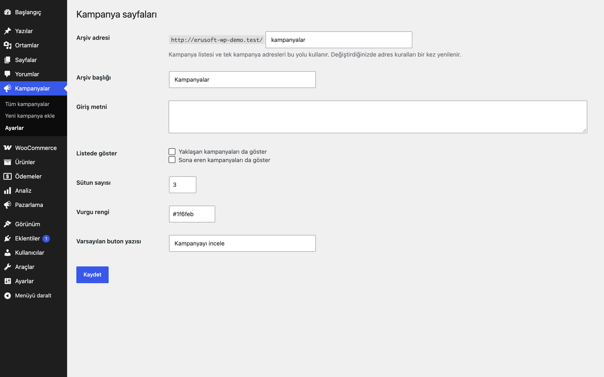
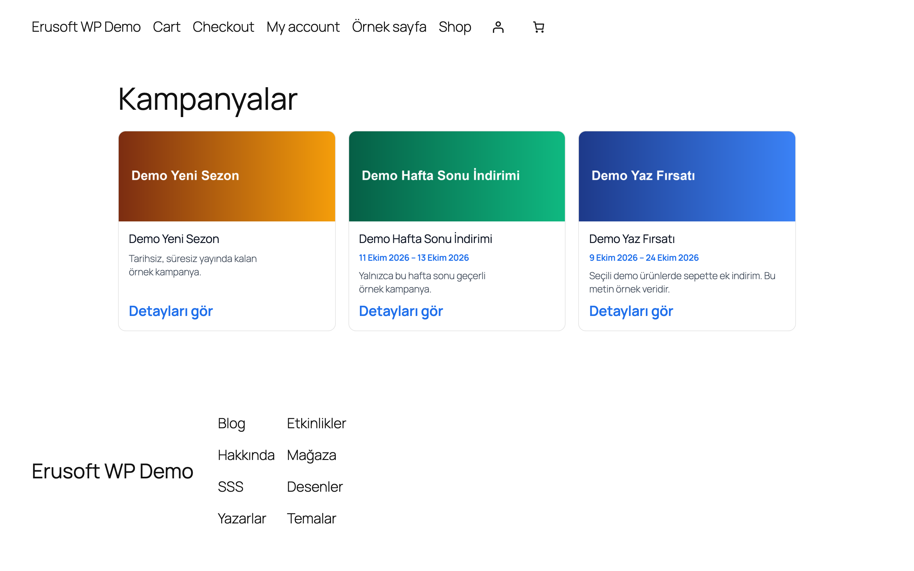
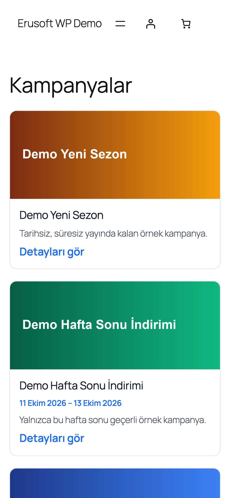
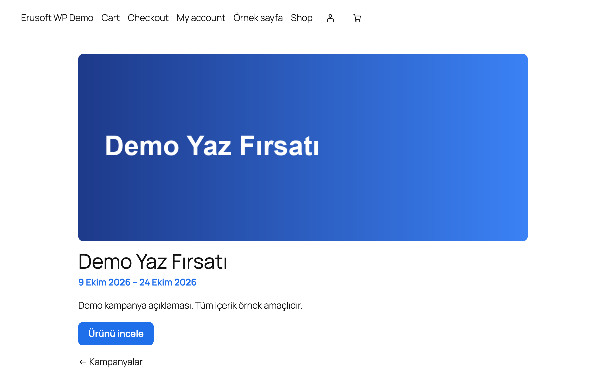

# Campaign Pages for WordPress

Tarih aralıklı kampanya yazı türü, kampanya arşivi ve `[eru_campaigns]` kısa kodu; süresi biten kampanyalar kendiliğinden gizlenir.

> **English:** A campaign post type with start/end dates, banner (featured image), call-to-action and product/category/URL link. Ended and upcoming campaigns hide themselves from the archive and the `[eru_campaigns]` shortcode. The archive slug (default `kampanyalar`) comes from settings; rewrite rules are flushed only on activation or when the slug changes. Works with classic and block themes.

  

## Ne işe yarar

Kampanyalarınızı yazı gibi girersiniz: başlık, banner görseli, açıklama, başlangıç ve bitiş tarihi, isteğe bağlı bir ürüne, kategoriye ya da adrese giden düğme. Eklenti aktif olanları arşiv sayfasında ve `[eru_campaigns]` kısa koduyla listeler; bitiş tarihi geçince kampanya listeden kendiliğinden kalkar.

## Özellikler

- `eru_campaign` yazı türü; arşiv adresi ayardan (varsayılan `/kampanyalar/`)
- Başlangıç ve bitiş tarihi (bitiş günü dahil), elle gizleme
- Durumlar: aktif, yaklaşan, bitmiş; listede yalnızca aktifler görünür (isterseniz yaklaşan ve bitenler de gösterilebilir)
- Banner için öne çıkan görsel; düğme bağlantısı ürün, ürün kategorisi (WooCommerce varsa) veya özel adres
- Kısa kod: `[eru_campaigns limit="6" columns="3" status="active"]`
- Klasik ve blok temalarla çalışır; temada `eru-campaigns/archive.php` ve `eru-campaigns/single.php` ile şablon geçersiz kılınabilir
- Yönetim listesinde durum ve tarih sütunları
- Adres kuralları yalnızca etkinleştirmede ve adres değişince bir kez yenilenir

## Nasıl kullanılır

1. Eklentiyi etkinleştirin; **Kampanyalar → Yeni ekle** ekranını açın.
2. Başlık olarak "Demo Kampanya" yazın, açıklamayı girin ve öne çıkan görsel olarak bir banner seçin.
3. "Kampanya ayarları" kutusunda bugünü başlangıç, bir hafta sonrasını bitiş tarihi yapın; düğme için özel bir adres ya da ürün seçin.
4. Yayınlayın ve **Kampanyalar → Ayarlar**'dan arşiv adresini (varsayılan `/kampanyalar/`) kontrol edin.
5. Arşiv adresini açın: kampanya kart olarak listelenir. Bir sayfaya `[eru_campaigns limit="3" columns="3"]` kısa kodunu ekleyerek aynı listeyi başka yerde gösterin.
6. Bitiş tarihi geçince kampanya listeden kalkar; kendi sayfası "sona erdi" notuyla açık kalır.

## Kurulum

1. `campaign-pages-for-wordpress` klasörünü `wp-content/plugins/` altına kopyalayın (veya zip olarak yükleyin).
2. Eklentiler ekranından etkinleştirin.
3. **Kampanyalar → Yeni ekle** ile kampanya oluşturun; **Kampanyalar → Ayarlar** ekranından arşiv adresini ve görünümü düzenleyin.

## Ayarlar

Kampanyalar → **Ayarlar**: arşiv adresi, başlık, giriş metni, yaklaşan/biten gösterimi, sütun sayısı, vurgu rengi, varsayılan düğme yazısı. Ayarlar `eru_cp_settings` seçeneğinde saklanır. Tarihler ve bağlantı, kampanya düzenleme ekranındaki "Kampanya ayarları" kutusundadır.

## Kısa kodlar, kancalar, filtreler

| Ad | Tür | Açıklama |
|---|---|---|
| `[eru_campaigns]` | kısa kod | `limit`, `columns` (1-4), `status` (`active`, `upcoming`, `ended`) |
| `eru_cp_settings` | seçenek | Eklenti ayarları |
| `eru_cp_cta_url` | filtre | `($url, $post_id)`; düğme adresini değiştirir |
| `_eru_cp_start`, `_eru_cp_end`, `_eru_cp_off` | yazı meta | Başlangıç, bitiş (`YYYY-AA-GG`), elle gizleme |

## Entegrasyonlar ve gereksinimler

WordPress 6.5+, PHP 8.0+. WooCommerce zorunlu değildir; yüklüyse düğme bir ürüne veya ürün kategorisine bağlanabilir. Harici servis kullanmaz.

## Sınırlamalar

- Bitmiş ve henüz başlamamış kampanya sayfaları açık kalır ama `noindex` alır (arama motorlarında listelenmez); `eru_cp_noindex` filtresiyle değiştirilebilir.
- Elementor dinamik etiketleri bu sürümde yoktur.
- Biten kampanyanın kendi adresi açık kalır ve "sona erdi" notu gösterir (arşivden ve kısa koddan çıkar).
- Kampanya sıralaması yayın tarihine göredir.
- Eklenti silindiğinde yalnızca kendi ayarları silinir; kampanya yazıları içerik olduğu için kalır.

## SSS

**Arşiv adresini nasıl değiştiririm?** Kampanyalar → Ayarlar'da "Arşiv adresi"ni değiştirin; adres kuralları kaydederken bir kez yenilenir.

**Tema görünümü bozuyor, ne yapmalıyım?** Şablonları temanızın `eru-campaigns/` klasörüne kopyalayıp düzenleyin.

**Eklentiyi silersem kampanyalar gider mi?** Hayır. Silmede yalnızca `eru_cp_settings` ve `eru_cp_flush` seçenekleri silinir; kampanya yazıları içerik olduğu için kalır. Devre dışı bırakmak adres kurallarını yeniler (`flush_rewrite_rules`), veri silmez.

**Kampanya sayfaları arama motorlarında çıkar mı?** Aktif kampanyalar normal indekslenir; bitmiş ve henüz başlamamış olanlar `noindex` alır. `eru_cp_noindex` filtresiyle değiştirilebilir.

**WooCommerce gerekli mi?** Hayır. Yüklüyse düğme bir ürüne veya ürün kategorisine bağlanabilir.

**Çeviri nasıl yapılır?** Metin alanı `campaign-pages-for-wordpress`; çeviri yolu `/languages`.

## Değişiklik geçmişi

Bkz. [CHANGELOG.md](CHANGELOG.md).

## Destek

- Önce bu sayfadaki **SSS** ve **Sınırlamalar** bölümlerine göz atın; sık karşılaşılan durumlar orada.
- Hata mı buldunuz? [GitHub Issues](https://github.com/erayusta/erusoft-wp/issues) üzerinden bildirin. WordPress, PHP ve eklenti sürümünü, adımları ve beklenen/gerçekleşen sonucu yazmanız işi hızlandırır.
- Kurulum, yapılandırma, özel geliştirme veya entegrasyon desteği için **[hello@erusoft.com](mailto:hello@erusoft.com)** adresine yazın. Erusoft hakkında: [erusoft.com](https://erusoft.com).
- Lütfen şifre, API anahtarı veya müşteri verisi (ad, telefon, TCKN, sipariş dökümü) göndermeyin; ekran görüntülerindeki kişisel verileri karartın.

## Lisans

GPL-2.0-or-later.

Diğer Erusoft eklentileri: https://wordpress.erusoft.com/
