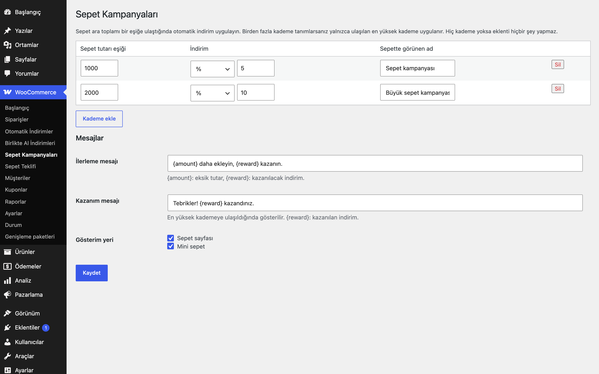

# Cart Campaigns for WooCommerce

Sepet tutarı kademelerine bağlı kampanyalar ve "X TL daha ekleyin, %Y kazanın" ilerleme mesajı.

> **English:** Tiered cart-threshold campaigns with a progress message in the cart and mini-cart ("add X more and get Y off"). Only the highest tier reached applies. With no tiers the plugin does nothing.

[](https://www.gnu.org/licenses/gpl-2.0.html)   



## Ne işe yarar

Sepet tutarı belirli eşiklere ulaştığında müşteriye indirim verir ve bir sonraki kademeye ne kadar kaldığını ilerleme çubuğuyla gösterir. Böylece sepet büyütmeyi teşvik eder.

## Özellikler

- Sınırsız kademe; her biri için eşik, yüzde veya sabit tutar ve sepette görünen ad
- Yalnızca ulaşılan en yüksek kademe uygulanır
- Sepet sayfasında ve mini sepette ilerleme mesajı ve çubuğu
- Mesaj metinleri düzenlenebilir (`{amount}`: eksik tutar, `{reward}`: kazanılacak indirim)
- Sepet sayfası ve mini sepet gösterimi ayrı ayrı açılıp kapatılabilir
- Her toplam hesaplamasında yeniden üretilir; iki kez uygulanmaz

## Kurulum

1. `cart-campaigns-for-woocommerce` klasörünü `wp-content/plugins/` altına kopyalayın (veya zip olarak yükleyin).
2. Eklentiler ekranından etkinleştirin (WooCommerce gereklidir).
3. Aşağıdaki ayar ekranından yapılandırın. Yapılandırma yapılana kadar mağazanızda hiçbir değişiklik olmaz.

## Ayarlar

WooCommerce → **Sepet Kampanyaları**. Ayarlar `eru_cc_settings` seçeneğinde saklanır; varsayılan olarak kademe yoktur. Eşik, kupon öncesi sepet ara toplamına (KDV hariç) bakar; yüzde indirim kupon sonrası tutar üzerinden hesaplanır.

## Nasıl kullanılır

1. WooCommerce → **Sepet Kampanyaları** ekranını açın.
2. **Kademe ekle** ile ilk kademeyi girin: eşik 400 TL, indirim yüzde 5, sepette görünen ad "Demo Kademe 1".
3. İkinci kademe ekleyin: eşik 800 TL, indirim yüzde 8, ad "Demo Kademe 2".
4. **Mesajlar** bölümünde isterseniz ilerleme mesajını düzenleyin (`{amount}` ve `{reward}` kullanılabilir); **Sepet sayfası** ve **Mini sepet** kutularını işaretleyip **Kaydet**'e basın.
5. Mağazada 250 TL'lik "Demo Ürün" ekleyin: sepet sayfasında ilk kademeye ne kadar kaldığını söyleyen mesaj ve çubuk görünür.
6. Sepet ara toplamı 400 TL'ye ulaşınca sepette "Demo Kademe 1" adlı negatif ücret satırı belirir; 800 TL'ye ulaşınca yalnızca "Demo Kademe 2" uygulanır.

## Diğer indirimlerle birlikte kullanım

Bu eklenti indirimini sepete **negatif ücret satırı** olarak ekler; her toplam hesaplamasında satır baştan üretilir, bu yüzden kaç kez yeniden hesaplanırsa hesaplansın sonuç aynıdır. Aynı mantığı kullanan diğer Erusoft indirim eklentileri (Ödeme Yöntemi İndirimleri, Otomatik İndirimler, Sepet Kampanyaları, Birlikte Al İndirimleri) **birlikte çalışır ve indirimler toplanır**: her biri kendi satırını ekler, hiçbiri diğerinin satırını değiştirmez. Her eklentinin yüzdesi satır toplamları üzerinden hesaplanır (diğer eklentilerin ücret satırları taban değeri düşürmez); örneğin 1.000 TL'lik sepette %10 Otomatik İndirim (100 TL) ile %5 Ödeme Yöntemi İndirimi (50 TL) birlikte 850 TL öder. Tek bir eklentinin indirimi sepette ödenecek tutarı aşamaz. Birlikte toplanmasını istemiyorsanız `eru_cc_apply` filtresiyle `false` dönerek bu eklentiyi koşullu olarak devre dışı bırakabilirsiniz (örnek aşağıda).

```php
// Örnek: Ödeme Yöntemi İndirimi uygulanan sepette bu eklentinin indirimini atla.
add_filter( 'eru_cc_apply', function ( $apply, $cart ) {
	foreach ( $cart->get_fees() as $fee ) {
		if ( 'Havale indirimi' === $fee->name ) {
			return false;
		}
	}
	return $apply;
}, 10, 2 );
```

## Kancalar, filtreler ve veri alanları

| Ad | Tür | Açıklama |
|---|---|---|
| `eru_cc_settings` | seçenek | `tiers` (`threshold`, `mode`, `value`, `label`), `progress_text`, `success_text`, `show_cart`, `show_mini` |
| `eru_cc_apply` | filtre | `false` dönerseniz kampanya indirimi uygulanmaz (`$apply`, `$cart`) |
| `eru_cc_discount_amount` | filtre | Pozitif indirim tutarı (`$amount`, `$tier`, `$cart`); 0 dönerseniz satır eklenmez |

## Entegrasyonlar ve gereksinimler

WordPress 6.5+, PHP 8.0+, WooCommerce 9.0+. HPOS (özel sipariş tabloları) ile uyumludur. WooCommerce yoksa eklenti bir uyarı gösterir ve hiçbir şey yapmaz. Harici servis kullanmaz.

## Sınırlamalar

- Birden çok indirim eklentisi birlikte çalışırken toplam indirim sepet tutarını aşmaz: bu eklenti, önce çalışan eklentilerin eklediği indirimleri (negatif ücretler) düşüp kalan tutar kadar indirim yapar.
- Mesaj klasik sepet sayfasında ve mini sepette gösterilir; blok tabanlı sepette yalnızca indirim satırı görünür.
- Koşul yalnızca sepet tutarıdır; ürün veya kategori koşulu için Otomatik İndirimler eklentisini kullanın.
- Kupon kodu üretmez; indirim her zaman ücret satırıdır.
- Eklenti silindiğinde (Eklentiler → Sil) yalnızca kendi ayarı silinir.

## SSS

**Mesaj hangi tutarı gösterir?** Bir sonraki eşik ile kupon öncesi ara toplam arasındaki fark.

**Eklentiyi devre dışı bırakınca ne olur?** İndirim satırı ve mesajlar hemen kalkar; ayarınız (`eru_cc_settings`) yerinde kalır. Eklenti silinince (Eklentiler → Sil) yalnızca bu seçenek silinir; başka tablo, kupon veya sipariş verisi oluşturmaz.

**HPOS ve blok sepet?** HPOS uyumluluğu bildirilir. Blok tabanlı sepette ilerleme mesajı gösterilmez, yalnızca indirim satırı görünür (bkz. Sınırlamalar).

**Eşik KDV dahil mi hariç mi?** Eşik, kupon öncesi sepet ara toplamına bakar (WooCommerce'in `get_subtotal()` değeri, KDV hariç). İndirim satırı vergilendirilmez olarak eklenir.

**Dış servis kullanıyor mu?** Hayır; indirim, WooCommerce'in sepet hesaplaması sırasında yerelde üretilir.

### Hangisini seçmeliyim?

Kademeli sepet indirimi ve ilerleme mesajı için bu eklenti; kategori, tarih ve öncelik kuralları için [Otomatik İndirimler](../automatic-discounts-for-woocommerce/); ürün setleri için [Birlikte Al İndirimleri](../bought-together-discounts-for-woocommerce/) uygundur. Hepsi birlikte etkinse indirimler toplanır.

## Değişiklik geçmişi

Bkz. [CHANGELOG.md](CHANGELOG.md).

## Destek

- Önce bu sayfadaki **SSS** ve **Sınırlamalar** bölümlerine göz atın; sık karşılaşılan durumlar orada.
- Hata mı buldunuz? [GitHub Issues](https://github.com/erayusta/erusoft-wp/issues) üzerinden bildirin. WordPress, WooCommerce, PHP ve eklenti sürümünü, adımları ve beklenen/gerçekleşen sonucu yazmanız işi hızlandırır.
- Kurulum, yapılandırma, özel geliştirme veya entegrasyon desteği için **[hello@erusoft.com](mailto:hello@erusoft.com)** adresine yazın. Erusoft hakkında: [erusoft.com](https://erusoft.com).
- Lütfen şifre, API anahtarı veya müşteri verisi (ad, telefon, TCKN, sipariş dökümü) göndermeyin; ekran görüntülerindeki kişisel verileri karartın.

## Lisans

GPL-2.0-or-later.

Diğer Erusoft eklentileri: https://wordpress.erusoft.com/
