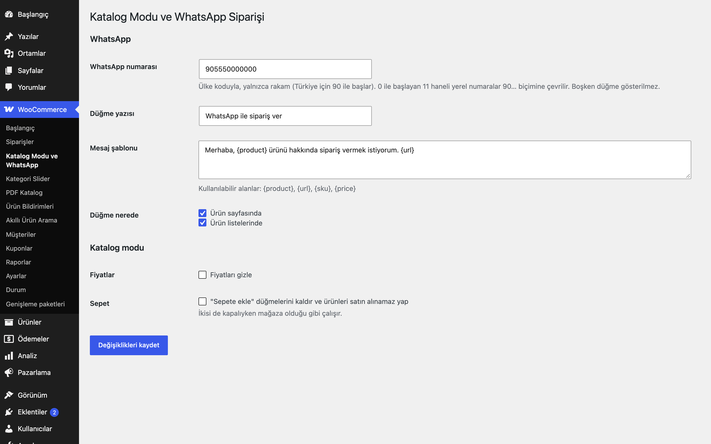
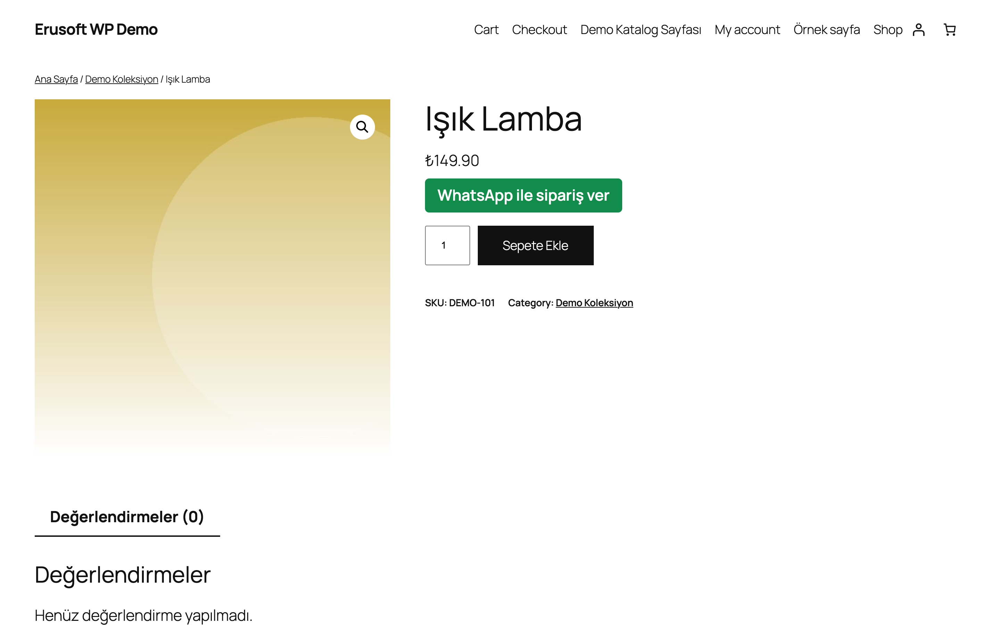
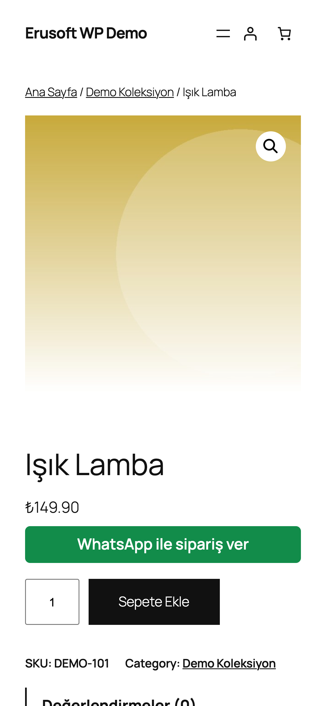

# Catalog Mode & WhatsApp Orders for WooCommerce

İsteğe bağlı katalog modu (fiyat ve/veya sepeti gizle) ve ürün bilgisiyle önceden doldurulmuş "WhatsApp ile sipariş ver" düğmesi.

> **English:** Optional catalog mode (hide prices and/or the cart) plus a "order via WhatsApp" button with a prefilled product message. Default: no number and both switches off, so the store is unchanged.

   

## Ne işe yarar

Ürün sayfasına (ve isterseniz ürün listelerine) WhatsApp düğmesi koyar; tıklayan kişinin WhatsApp'ı ürün adı ve bağlantısı yazılı bir mesajla açılır. Katalog modunu açarsanız fiyatlar ve/veya "Sepete ekle" kaldırılır, ürünler satın alınamaz olur.

## Özellikler

- WhatsApp numarası boşsa düğme yoktur
- Numara normalleştirme: yalnızca rakam; `00…` öneki atılır; `0XXXXXXXXXX` (11 hane) ve `5XXXXXXXXX` (10 hane) → `90…`; geçersizse reddedilir ve uyarı gösterilir
- Mesaj şablonu: `{product}`, `{url}`, `{sku}`, `{price}`
- Varyasyonlu ürünlerde seçilen özellikler mesaja eklenir
- Fiyatları gizle ve/veya sepeti kaldır (ürünler satın alınamaz, sepete URL ile de eklenemez)
- Düğme ürün sayfasında ve/veya listelerde

## Kurulum

1. `catalog-mode-whatsapp-orders-for-woocommerce` klasörünü `wp-content/plugins/` altına kopyalayın (veya zip olarak yükleyin).
2. Eklentiler ekranından etkinleştirin (WooCommerce gereklidir).
3. WooCommerce → **Katalog Modu ve WhatsApp**: numarayı (ülke koduyla, örn. `905550000000`) girin; isterseniz katalog modu kutularını işaretleyin.

## Ayarlar

Seçenek: `eru_cmw_settings` (`number`, `button_text`, `message`, `show_single`, `show_loop`, `hide_price`, `hide_cart`). Numara kaydedilirken normalleştirilir.

## Kısa kodlar, kancalar ve filtreler

| Ad | Tür | Açıklama |
|---|---|---|
| `eru_cmw_message` | filtre | Gönderilecek mesaj metni (`$message`, `$product`) |

## Entegrasyonlar ve gereksinimler

WordPress 6.5+, PHP 8.0+, WooCommerce 9.0+. HPOS uyumludur. WhatsApp'a yalnızca `wa.me` bağlantısı verilir; sunucudan dış çağrı yapılmaz.

## Sınırlamalar

- Özel bir "istek sepeti" ve e-posta ile gönderim yoktur; yalnızca ürün başına WhatsApp bağlantısı sunulur.
- Katalog modu tüm ziyaretçilere aynı uygulanır (kullanıcı rolüne göre ayrım yoktur); önbellekli sayfalarla uyumludur.
- Yönetim ekranları fiyatları göstermeye devam eder. Fiyat gizleme Store API / blok tabanlı fiyat bileşenlerini ve JSON-LD (ürün şeması) çıktısını kapsamaz.
- Fiyat gizleme tema veya eklentilerin fiyat bilgisini WooCommerce fiyat HTML'i dışında bastığı yerleri kapsamaz.

## SSS

**Düğme görünmüyor.** Numara boş veya geçersizdir; ayarlarda ülke koduyla yazın.

**0555… ile başlayan numara kabul ediliyor mu?** Evet, 11 haneli `0` ile başlayan ve 10 haneli `5` ile başlayan Türkiye numaraları otomatik `90…` biçimine çevrilir ve bir bilgi mesajı gösterilir.

## Değişiklik geçmişi

Bkz. [CHANGELOG.md](CHANGELOG.md).

## Lisans

GPL-2.0-or-later.

Diğer Erusoft eklentileri: https://wordpress.erusoft.com/
