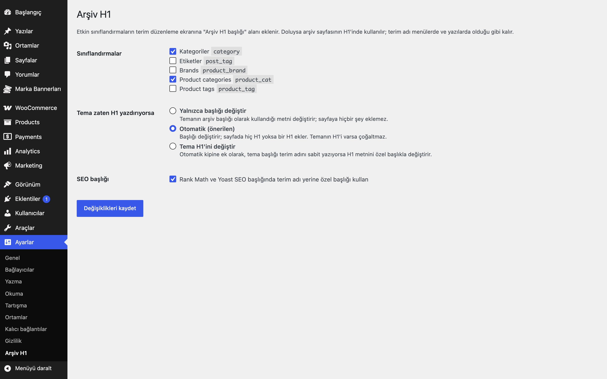

# Category Archive H1 for WordPress

Kategori, etiket ve diğer sınıflandırma arşivleri için terim adından bağımsız bir H1 başlığı alanı ekler. Arşivde tam olarak bir H1 bulunmasını sağlar ve temanın mevcut H1'ini çoğaltmaz.

## Özellikler

- Etkin sınıflandırmaların terim ekle/düzenle ekranında "Arşiv H1 başlığı" alanı (varsayılan: kategoriler)
- Terim adı menülerde ve yazılarda değişmez
- Üç kip: yalnızca başlığı değiştir, otomatik (H1 yoksa ekle), tema H1'ini değiştir
- Başlık, `single_cat_title` / `single_tag_title` / `single_term_title` ile temaya iletilir
- Rank Math ve Yoast SEO başlığında terim adı yerine özel başlık (isteğe bağlı)
- Herhangi bir sınıflandırma arşivinde çalışır (WooCommerce gerekmez)

## Kurulum

1. `category-archive-h1-for-wordpress` klasörünü `wp-content/plugins/` altına kopyalayın (veya zip olarak yükleyin).
2. Eklentiler ekranından etkinleştirin.
3. Ayarlar → Arşiv H1 ekranından sınıflandırmaları seçin; terim düzenleme ekranında başlığı yazın.

## Nasıl kullanılır

1. Eklentiyi etkinleştirin ve **Ayarlar → Arşiv H1** ekranını açın. "Kategoriler"i seçili bırakın, kipi "Otomatik (önerilen)" olarak kaydedin.
2. Yazılar → Kategoriler'de "Demo Kategori"yi düzenleyin. Terim adı "Demo Kategori" kalsın; **Arşiv H1 başlığı** alanına "Demo Ürünler ve Rehberler" yazıp güncelleyin.
3. Kategori arşivini açın (`/category/demo-kategori/`): sayfadaki H1 "Demo Ürünler ve Rehberler" olur. Menüde ve yazılarda kategori adı "Demo Kategori" olarak kalır.
4. Sayfa kaynağında `<h1` arayın: tek bir H1 olmalıdır. Tema hiç H1 yazdırmıyorsa Otomatik kip bir tane ekler.
5. Tema H1'i terim adını sabit yazıyor ve değişmiyorsa kipi "Tema H1'ini değiştir" yapın.
6. İsterseniz aynı ekrandan SEO başlığı seçeneğini açık tutun; Rank Math ya da Yoast SEO kuruluysa başlıkta terim adının yerine özel başlık kullanılır.

## Ayarlar

Ayarlar → Arşiv H1: sınıflandırmalar (`eru_cah_taxonomies`), tema H1 kipi (`eru_cah_mode`: filter / auto / replace), SEO başlığı (`eru_cah_seo_title`). Başlık terim metası `eru_cah_heading`.

## Kancalar ve filtreler

| Ad | Tür | Açıklama |
|---|---|---|
| `eru_cah_heading` | filtre | Terimin arşiv başlığını değiştirir (`$heading`, `$term`); boş dize özel başlığı iptal eder |

## Gereksinimler

WordPress 6.5+, PHP 8.0+. WooCommerce gerekmez.

## Sınırlamalar

- Otomatik ve değiştirme kipleri sayfa çıktısını işler (çıktı tamponu); H1 yoksa `<main>` açılışının, o da yoksa `<body>` açılışının ardına eklenir.
- Temanın logosu H1 ise sayfada H1 var sayılır ve ek H1 eklenmez.
- Tema H1'i terim adını sabit yazıyorsa "Tema H1'ini değiştir" kipi gerekir.
- Eklenti silindiğinde (Eklentiler → Sil) yalnızca kendi ayarları (`eru_cah_*` seçenekleri) silinir; terimlere girilen başlıklar (`eru_cah_heading` terim metası) korunur.

## SSS

**Tema zaten H1 yazdırıyor, çift olur mu?** Hayır. Otomatik kip yalnızca sayfada H1 yoksa ekler.

**Başlık boşsa?** Terim adı kullanılır; hiç H1 yoksa terim adıyla bir H1 eklenir.

**Eklentiyi devre dışı bırakırsam ya da silersem ne olur?** Devre dışı bırakınca arşivler terim adını ve temanın kendi H1'ini kullanmaya döner; girdiğiniz başlıklar durur. Eklentiler → Sil ile `eru_cah_taxonomies`, `eru_cah_mode` ve `eru_cah_seo_title` seçenekleri silinir; terim metası `eru_cah_heading` bilerek korunur, eklentiyi yeniden kurarsanız başlıklar geri gelir.

**WooCommerce kategorilerinde çalışır mı?** Evet, ürün kategorisi gibi herhangi bir sınıflandırmayı ayarlardan seçebilirsiniz; WooCommerce gerekmez. Eklenti sipariş ya da sepetle ilgilenmediği için HPOS ve blok ödeme etkilenmez.

**SEO eklentisi başlığını değiştirir mi?** Evet, "SEO başlığı" seçeneği açıkken (varsayılan) Rank Math ve Yoast SEO başlığında terim adı yerine özel başlık kullanılır. Kapatırsanız yalnızca sayfa H1'i değişir.

**Çeviri, çoklu site, dış servis?** Metin alanı `category-archive-h1-for-wordpress`, alan yolu `/languages`; klasörde hazır çeviri dosyası yoktur, arayüz Türkçedir. Ağ düzeyinde etkinleştirme için özel bir destek yoktur; ayarlar site başınadır. Dış servise bağlanmaz.

**Sayfa önbelleği?** H1 sunucuda sayfa oluşturulurken yazılır; önbellekli sayfalar bir başlık değişikliğinden sonra önbellek temizlenene kadar eski başlığı gösterebilir.

## English summary

Adds an editable H1 heading field to category, tag and other taxonomy archives. Ensures exactly one H1 on the archive and never duplicates a theme H1 (modes: filter only, auto, replace). Filter: `eru_cah_heading`. No WooCommerce required.

## Sürüm notları

Bkz. [CHANGELOG.md](CHANGELOG.md).

## Destek

- Önce bu sayfadaki **SSS** ve **Sınırlamalar** bölümlerine göz atın; sık karşılaşılan durumlar orada.
- Hata mı buldunuz? [GitHub Issues](https://github.com/erayusta/erusoft-wp/issues) üzerinden bildirin. WordPress, PHP ve eklenti sürümünü, adımları ve beklenen/gerçekleşen sonucu yazmanız işi hızlandırır.
- Kurulum, yapılandırma, özel geliştirme veya entegrasyon desteği için **[hello@erusoft.com](mailto:hello@erusoft.com)** adresine yazın. Erusoft hakkında: [erusoft.com](https://erusoft.com).
- Lütfen şifre, API anahtarı veya müşteri verisi (ad, telefon, TCKN, sipariş dökümü) göndermeyin; ekran görüntülerindeki kişisel verileri karartın.

## Lisans

GPL-2.0-or-later. Diğer Erusoft eklentileri: https://wordpress.erusoft.com
