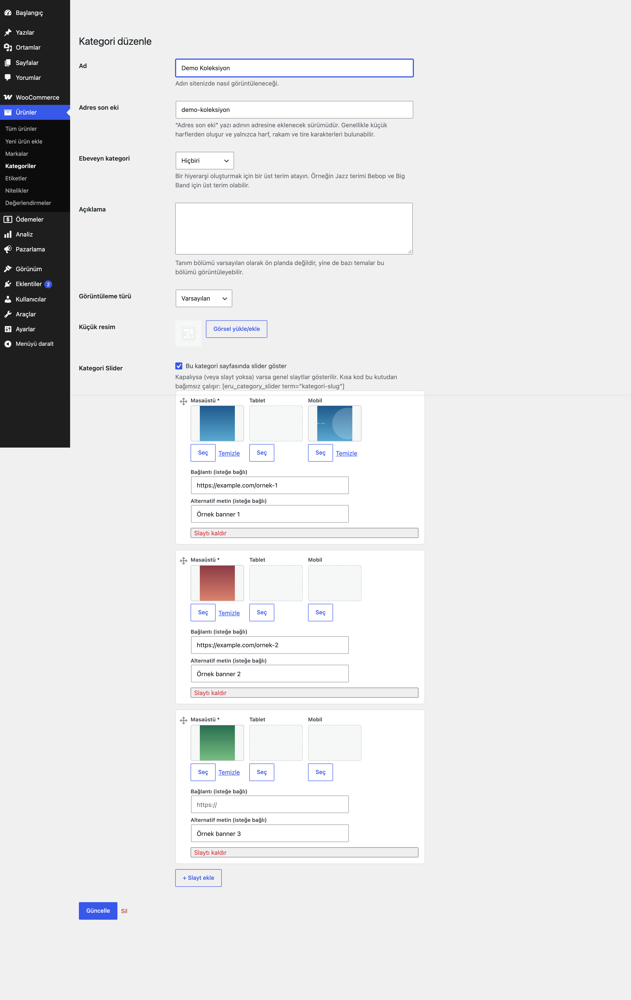
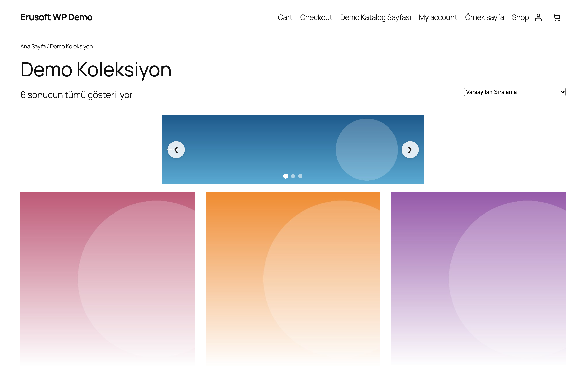
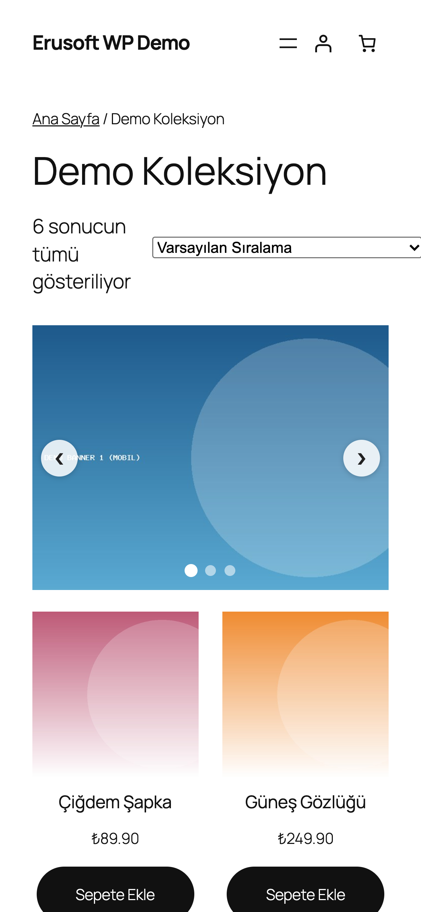

# Category Banner Slider for WooCommerce

Ürün kategorisi sayfalarına masaüstü, tablet ve mobil için ayrı görselli, duyarlı banner slider ekler.

> **English:** Adds a responsive banner slider with separate desktop, tablet and mobile images to product category pages, or anywhere with a shortcode. Default: no position selected, so nothing changes until you choose one.

   

## Ne işe yarar

Her ürün kategorisi için sıralı bir slayt listesi tanımlarsınız (görsel, isteğe bağlı bağlantı ve alternatif metin). Slider kategori sayfasında seçtiğiniz konumda veya `[eru_category_slider]` kısa koduyla istediğiniz yerde görünür.

## Özellikler

- Kategori başına sıralanabilir slaytlar (sürükle-bırak)
- Masaüstü / tablet / mobil için ayrı görsel; eksikse bir üst boyuta döner
- Genel (varsayılan) slaytlar: kendi slideri olmayan kategorilerde gösterilir
- Konum ayarı: içeriğin başı, kategori açıklaması veya ürün listesinden önce
- Kısa kod: `[eru_category_slider term="kategori-slug"]`
- Bağımlılıksız hafif JS (jQuery yok): oklar, noktalar, otomatik geçiş, dokunmatik kaydırma
- Kaldırıldığında ayarlar ve kategori verileri silinir

## Kurulum

1. `category-banner-slider-for-woocommerce` klasörünü `wp-content/plugins/` altına kopyalayın (veya zip olarak yükleyin).
2. Eklentiler ekranından etkinleştirin (WooCommerce gereklidir).
3. WooCommerce → **Kategori Slider**: konumu ve davranışı seçin. Ürünler → Kategoriler → bir kategoriyi düzenleyin → **Kategori Slider** bölümünde slaytları ekleyip kutuyu işaretleyin.

## Nasıl kullanılır

1. Eklentiyi etkinleştirin. WooCommerce → **Kategori Slider** ekranında konumu "ürün listesinden önce" olarak seçin, otomatik geçişi ve okları açıp kaydedin.
2. Ürünler → Kategoriler'de "Demo Kategori"yi düzenleyin ve **Kategori Slider** bölümüne inin.
3. İlk slayt için medya kütüphanesinden masaüstü görselini seçin; isterseniz tablet ve mobil görsellerini, bağlantıyı (`https://example.com/kampanya`) ve alternatif metni ("Demo kampanya bannerı") girin. İkinci slaytı ekleyip sürükleyerek sırayı belirleyin.
4. "Bu kategori sayfasında slider göster" kutusunu işaretleyip kategoriyi güncelleyin.
5. Mağazada "Demo Kategori" sayfasını açın: slider ürün listesinin üstünde görünür. Telefonda ya da dar pencerede mobil görsel kullanılır; yoksa bir üst boyuta dönülür.
6. Başka bir sayfada göstermek için `[eru_category_slider term="demo-kategori"]` kısa kodunu kullanın.

## Ayarlar

Seçenekler: `eru_cbs_settings` (konum, otomatik geçiş, süre, ok/nokta, döngü, yükseklikler), `eru_cbs_global_slides`. Kategori verisi: `_eru_cbs_enabled`, `_eru_cbs_slides` (terim meta).

## Kısa kodlar, kancalar ve filtreler

| Ad | Tür | Açıklama |
|---|---|---|
| `[eru_category_slider term="slug"]` | kısa kod | Belirtilen kategorinin slaytlarını gösterir (kategori sayfasında `term` verilmezse mevcut kategori). Kategorideki "slider göster" kutusundan bağımsızdır. |
| `eru_cbs_settings` | seçenek | Genel davranış ayarları |

## Entegrasyonlar ve gereksinimler

WordPress 6.5+, PHP 8.0+, WooCommerce 9.0+. HPOS uyumludur. Harici servis kullanmaz.

## Sınırlamalar

- Konum seçenekleri bloktan bağımsız klasik WooCommerce kancalarıdır; blok tabanlı temalarda içerik genişliği temanın düzenine bağlı olabilir. Tam genişlik için kısa kodu kendi bloğunuza yerleştirin.
- Görseller medya kütüphanesinden seçilir; harici bağlantılı görsel desteklenmez.

## SSS

**Slider görünmüyor.** Ayarlarda bir konum seçtiğinizden, kategoride kutuyu işaretlediğinizden (veya genel slayt tanımladığınızdan) ve en az bir slaytta masaüstü görseli seçtiğinizden emin olun.

**Kategoride slayt tanımlamadım, yine de bir şey görünür mü?** Genel (varsayılan) slaytlar tanımlıysa kendi slideri olmayan kategorilerde onlar gösterilir; tanımlı değilse hiçbir şey çıkmaz.

**Eklentiyi devre dışı bırakırsam ya da silersem ne olur?** Devre dışı bırakınca slider kalkar, veriler durur. Eklentiler → Sil ile `eru_cbs_settings` ve `eru_cbs_global_slides` seçenekleri ile tüm ürün kategorilerinin `_eru_cbs_enabled` ve `_eru_cbs_slides` terim metası silinir. Medya kütüphanesindeki görseller silinmez.

**HPOS ve Cart/Checkout blokları?** HPOS uyumluluğu bildirilir. Eklenti sipariş, sepet ya da ödemeyle ilgilenmez; blok ödeme ve sepet etkilenmez.

**Sayfa önbelleği, çeviri, çoklu site?** Slider sunucuda sabit HTML olarak basılır, ziyaretçiye özel içerik yoktur; önbellekle çakışmaz. Metin alanı `category-banner-slider-for-woocommerce`, alan yolu `/languages`; klasörde hazır çeviri dosyası yoktur. Ağ düzeyinde etkinleştirme için özel bir destek yoktur.

**Dış servis kullanır mı?** Hayır; jQuery de gerekmez.

## Değişiklik geçmişi

Bkz. [CHANGELOG.md](CHANGELOG.md).

## Destek

- Önce bu sayfadaki **SSS** ve **Sınırlamalar** bölümlerine göz atın; sık karşılaşılan durumlar orada.
- Hata mı buldunuz? [GitHub Issues](https://github.com/erayusta/erusoft-wp/issues) üzerinden bildirin. WordPress, WooCommerce, PHP ve eklenti sürümünü, adımları ve beklenen/gerçekleşen sonucu yazmanız işi hızlandırır.
- Kurulum, yapılandırma, özel geliştirme veya entegrasyon desteği için **[hello@erusoft.com](mailto:hello@erusoft.com)** adresine yazın. Erusoft hakkında: [erusoft.com](https://erusoft.com).
- Lütfen şifre, API anahtarı veya müşteri verisi (ad, telefon, TCKN, sipariş dökümü) göndermeyin; ekran görüntülerindeki kişisel verileri karartın.

## Lisans

GPL-2.0-or-later.

Diğer Erusoft eklentileri: https://wordpress.erusoft.com/
