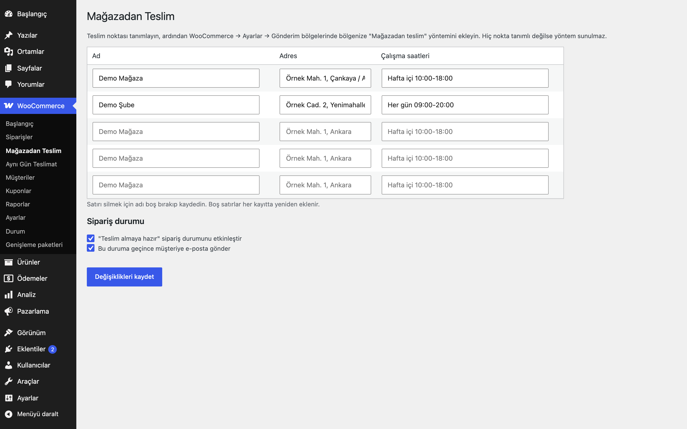

# Click & Collect for WooCommerce

Mağazadan teslim, gerçek bir kargo yöntemi olarak: tanımlı teslim noktaları, ödemede nokta seçimi, siparişte ve e-postalarda gösterim, isteğe bağlı "Teslim almaya hazır" durumu.

> **English:** Store pickup as a proper WooCommerce shipping method (zones compatible). Define pickup locations (name, address, hours); the customer picks one at checkout, it is validated server-side, saved on the order and shown in the admin order, e-mails, thank-you page and My Account. Optional "Ready for pickup" order status. No locations = method not offered.

   

## Ne işe yarar

Müşteri siparişini kargo yerine sizin tanımladığınız bir teslim noktasından alır. Seçilen nokta siparişe kaydedilir ve müşteriye e-postada gösterilir.

## Özellikler

- `WC_Shipping_Method` tabanlı **Mağazadan teslim** yöntemi: gönderim bölgeleriyle çalışır, kendi başlık/ücret/vergi ayarı vardır
- Teslim noktaları: ad, adres, çalışma saatleri (varsayılan: hiç yok → yöntem sunulmaz)
- Ödemede nokta seçimi; sunucuda tanımlı noktalara karşı doğrulanır
- Sipariş metası: `_eru_ccl_location` (ad), `_eru_ccl_location_id`, `_eru_ccl_location_address`, `_eru_ccl_location_hours`
- Yönetici sipariş ekranında, müşteri e-postalarında (HTML ve düz metin), teşekkür sayfasında ve Hesabım'da gösterim
- İsteğe bağlı **Teslim almaya hazır** sipariş durumu (toplu işlem ve müşteri e-postasıyla)
- Tek teslim noktası varsa seçim otomatik atanır

## Kurulum

1. Klasörü `wp-content/plugins/` altına kopyalayın ve etkinleştirin.
2. WooCommerce → **Mağazadan Teslim**: teslim noktalarını girin.
3. WooCommerce → Ayarlar → Gönderim bölgelerinde bölgenize **Mağazadan teslim** yöntemini ekleyin.
4. Ödeme sayfanız klasik `[woocommerce_checkout]` kısa kodunu kullanmalıdır.

## Ayarlar

| Ayar | Varsayılan |
|---|---|
| Teslim noktaları (`eru_ccl_locations`) | boş |
| "Teslim almaya hazır" durumu | kapalı |
| Hazır olunca müşteriye e-posta | açık (durum etkinse) |

**Diğer eklentilerle arayüz:** Teslim noktası adı sipariş metasında `_eru_ccl_location` anahtarında tutulur; Shipping Method Report for WooCommerce bu alanı okuyarak rapora teslim noktası kırılımı ekler.

## Kısa kodlar, kancalar ve filtreler

| Ad | Tür | Açıklama |
|---|---|---|
| `eru_ccl_locations` | filtre | Teslim noktaları dizisi (id, name, address, hours) |
| `woocommerce_shipping_eru_ccl_is_available` | filtre | Yöntemin uygunluğu |

## Entegrasyonlar ve gereksinimler

WordPress 6.5+, PHP 8.0+, WooCommerce 9.0+, HPOS uyumlu. Klasik ödeme sayfası.

## Sınırlamalar

- Blok tabanlı ödeme sayfasında nokta seçici gösterilemez: tek nokta tanımlıysa otomatik atanır; birden fazla nokta varsa yöntem blok ödemede sunulmaz ve konumsuz bir teslim alma siparişi reddedilir (`eru_ccl_location` hatası). Birden fazla nokta için klasik ödeme kullanın.
- Stoğa göre nokta uygunluğu yoktur; her nokta her sepet için sunulur.
- "Teslim almaya hazır" e-postası basit bir bildirimdir; WooCommerce e-posta şablonları ayarlarına bağlı değildir.

## SSS

**Hiç teslim noktası yoksa?** Yöntem müşteriye sunulmaz.

**Teslim noktasını sipariş sonrası değiştirebilir miyim?** Sipariş metasını değiştirmek için kendi koduna ihtiyaç vardır; arayüz yoktur.

Kaldırma: `eru_ccl_locations` ve `eru_ccl_settings` silinir; sipariş metası korunur.

## Değişiklik geçmişi

Bkz. [CHANGELOG.md](CHANGELOG.md).

## Lisans

GPL-2.0-or-later. Diğer Erusoft eklentileri: https://wordpress.erusoft.com/
