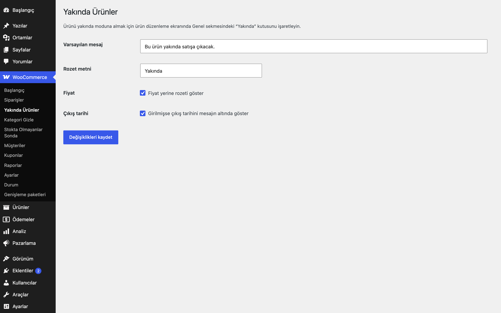
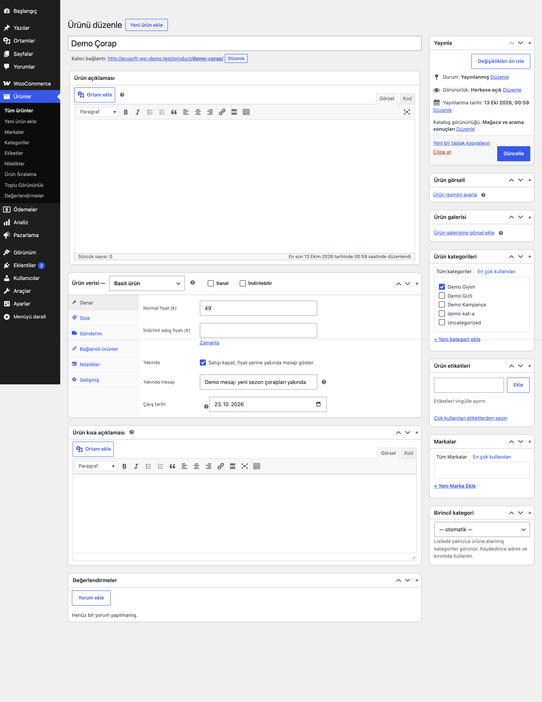
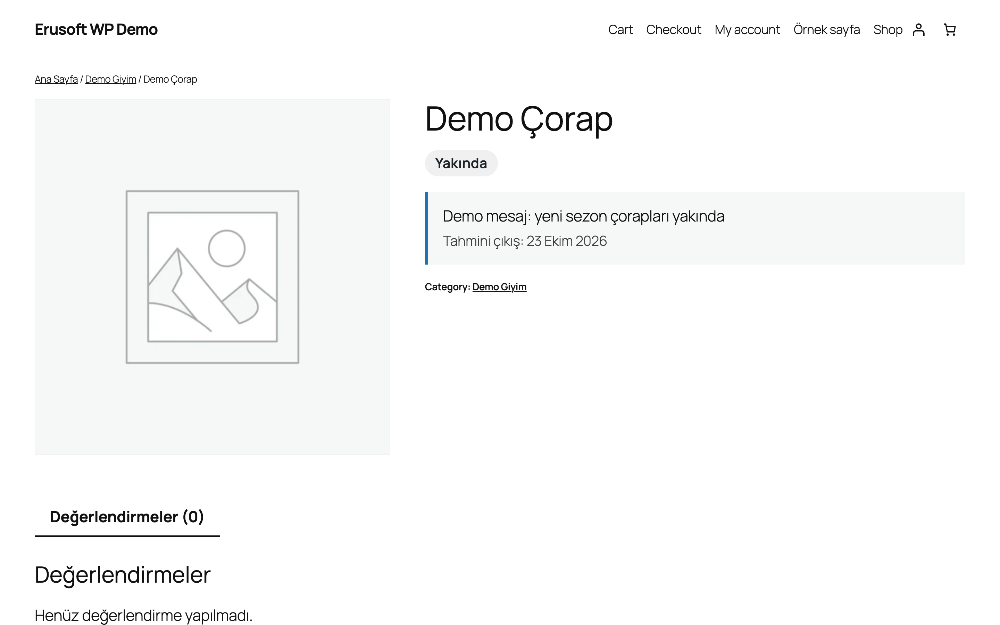
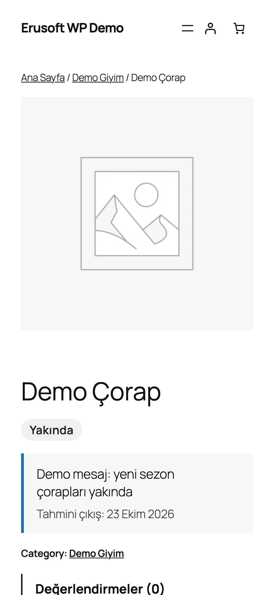

# Coming Soon Products for WooCommerce

Ürünü "yakında" olarak işaretler; fiyat yerine rozet ve mesaj gösterir, satışı kapatır.

> **English:** Mark individual products as coming soon: purchase is blocked, add-to-cart is hidden and a badge plus message (with an optional release date) is shown instead of the price. Nothing changes until a product is flagged.

   

## Ne işe yarar

Henüz satışa açmadığınız ürünler için ürün sayfasında "Yakında" rozeti ve mesajı gösterilir, sepete ekleme kapanır. İsterseniz çıkış tarihi girersiniz; tarih gelince ürün kendiliğinden satışa açılır.

## Özellikler

- Ürün başına onay kutusu, mesaj ve çıkış tarihi (Genel sekmesi)
- Genel varsayılan mesaj ve rozet metni ayarlardan değiştirilebilir
- Ürün satın alınamaz hâle gelir (varyasyonlar dahil); sepete eklenemez
- Mağaza listelerinde ve ürün sayfasında fiyat yerine rozet, ürün sayfasında mesaj ve tahmini çıkış tarihi
- Çıkış tarihi gelince mod kendiliğinden biter
- Hiçbir ürün işaretlenmedikçe ön yüzde değişiklik olmaz

## Kurulum

1. `coming-soon-products-for-woocommerce` klasörünü `wp-content/plugins/` altına kopyalayın (veya zip olarak yükleyin).
2. Eklentiler ekranından etkinleştirin (WooCommerce gereklidir).
3. Ürün düzenleme ekranında Genel sekmesindeki "Yakında" kutusunu işaretleyin.

## Ayarlar

WooCommerce → **Yakında Ürünler**: varsayılan mesaj, rozet metni, fiyat yerine rozet, çıkış tarihini göster. Ayarlar `eru_csp_settings` seçeneğinde, ürün alanları `_eru_csp_enabled`, `_eru_csp_message`, `_eru_csp_date` meta alanlarında saklanır.

## Kancalar, filtreler ve veri alanları

| Ad | Tür | Açıklama |
|---|---|---|
| `Eru_CSP::is_active( $product )` | PHP | Ürün şu an yakında modunda mı |
| `_eru_csp_enabled / _eru_csp_message / _eru_csp_date` | ürün meta | `yes`, metin, `YYYY-AA-GG` |
| `.eru-csp-badge, .eru-csp-notice` | CSS | Rozet ve mesaj kutusu sınıfları |

## Entegrasyonlar ve gereksinimler

WordPress 6.5+, PHP 8.0+, WooCommerce 9.0+. HPOS uyumludur. Harici servis kullanmaz.

## Sınırlamalar

- Mesaj ve rozet klasik (şablon tabanlı) ürün sayfası kancalarıyla gösterilir; blok tabanlı ürün sayfası şablonlarında mesaj kutusu görünmeyebilir, satış engeli yine çalışır.
- Çıkış tarihi mağaza saat dilimine göre gün olarak değerlendirilir.
- Ürün için hatırlatma e-postası veya bekleme listesi yoktur.

## SSS

**Çıkış tarihi geçince ne olur?** Ürün kendiliğinden normal satışa döner; işaret kutusunun kaldırılması gerekmez.

## Değişiklik geçmişi

Bkz. [CHANGELOG.md](CHANGELOG.md).

## Lisans

GPL-2.0-or-later.

Diğer Erusoft eklentileri: https://wordpress.erusoft.com/
