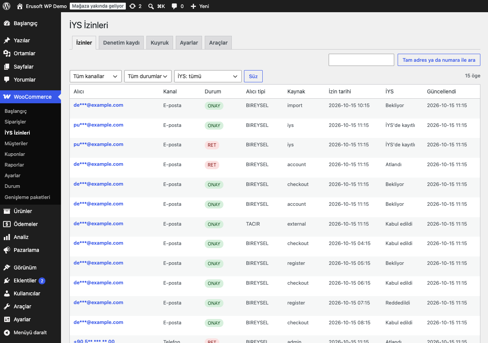
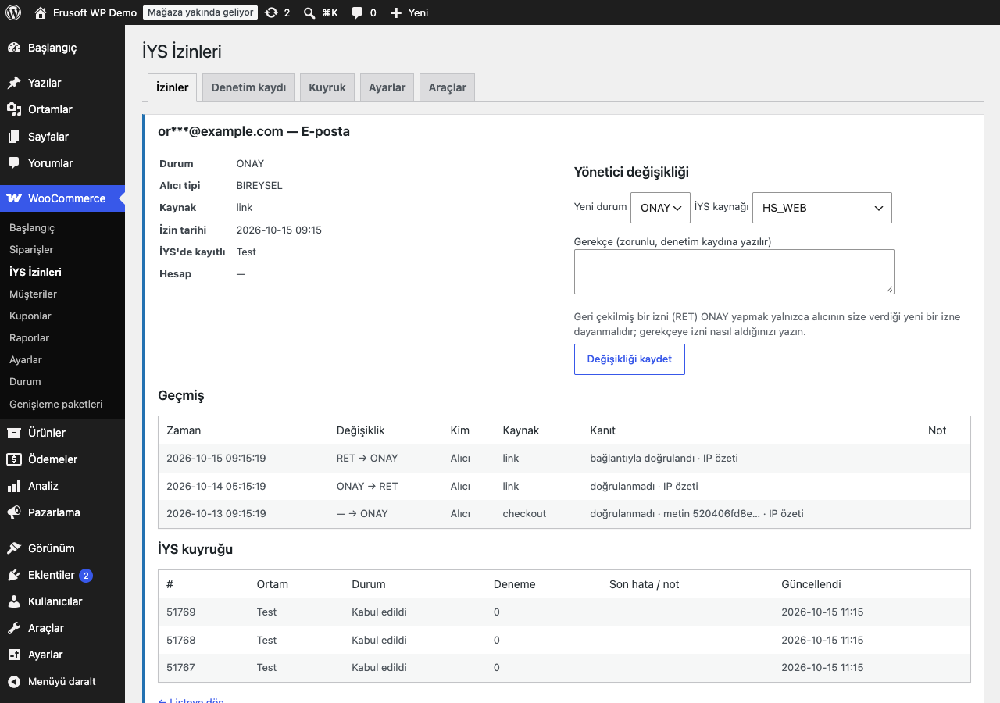
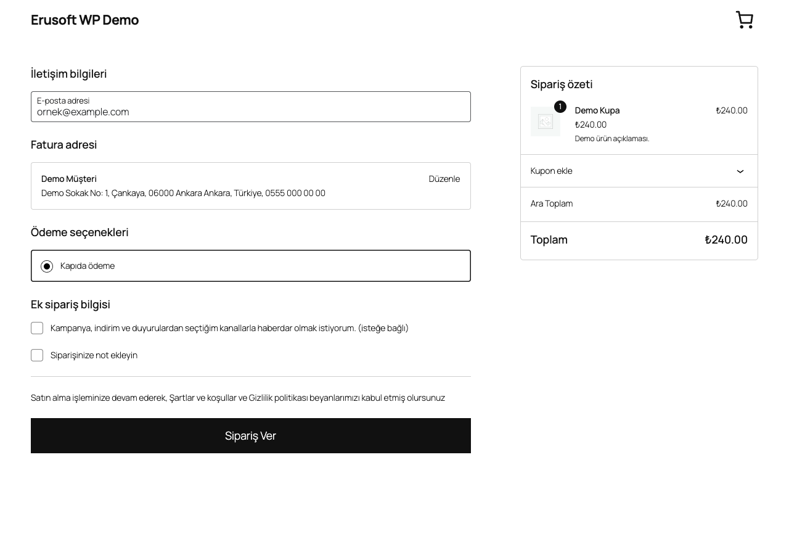
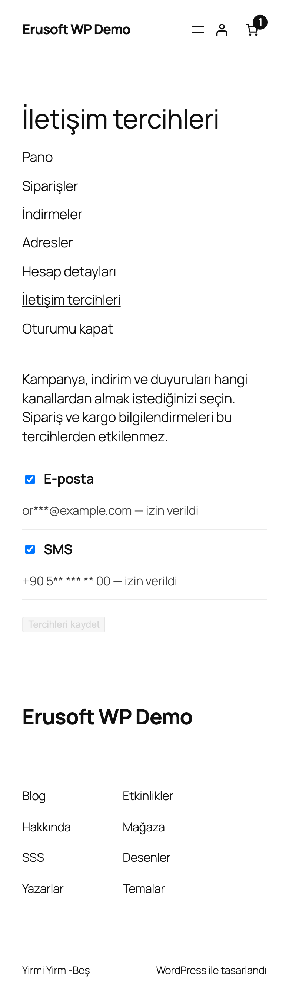
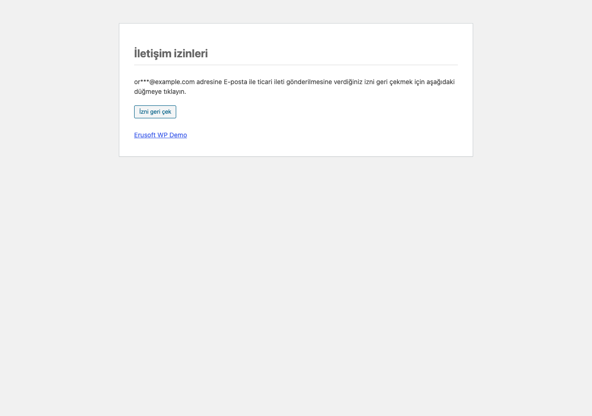
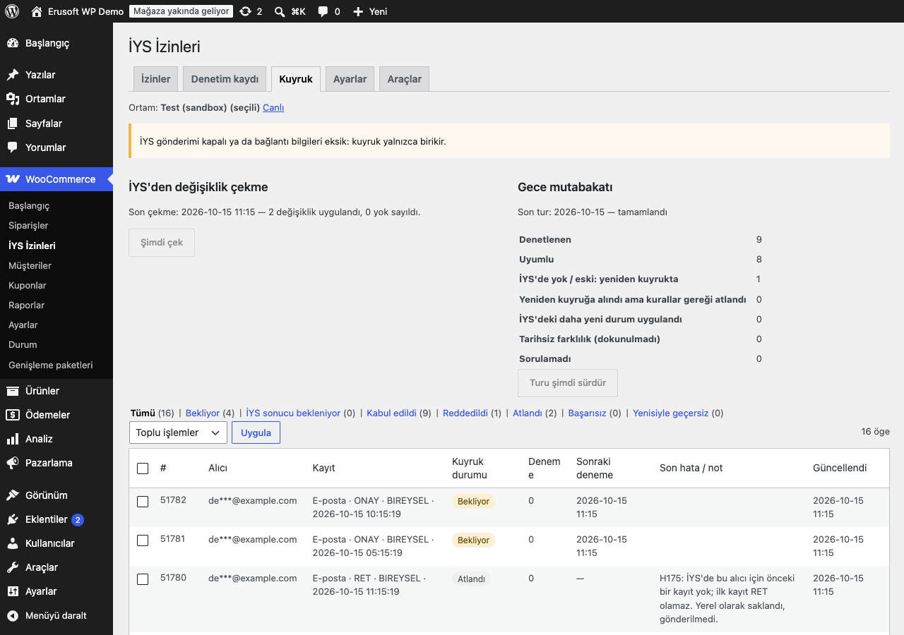

# Consent Manager for İYS

> **English:** A consent store with an audit trail for Turkey's İYS (İleti Yönetim Sistemi): e-mail, SMS and call permissions captured at checkout (classic and block), on the registration form and in a My Account tab; signed, expiring opt-out and re-consent links; a batched, rate-limited İYS queue that follows İYS's rules (H175, H467) with retries and backoff; an hourly pull of changes made at İYS and a nightly reconcile; CSV import/export, an importer for an append-only consent-log table (you map its columns) and a write-only, HMAC-signed external endpoint. Everything stays local until the İYS connection is configured and switched on.

[](https://www.gnu.org/licenses/gpl-2.0.html)   

> **Beta:** canlı API ile kendi hesabınızla doğrulayın.

İletişim izinlerini (e-posta, SMS, arama) sitede kimin, ne zaman ve hangi kaynaktan verdiğini kanıtlarıyla saklar; İYS'nin kurallarına uyan, hız sınırlı bir kuyrukla İYS'ye bildirir ve İYS'de yapılan değişiklikleri geri çeker.



## İYS nedir, bu eklenti ne yapar?

İYS (İleti Yönetim Sistemi), Türkiye'de ticari elektronik ileti (kampanya e-postası, SMS, arama) gönderen işletmelerin alıcı izinlerini kaydettiği merkezi sistemdir. İzin İYS'de kayıtlı değilse ileti gönderilemez; alıcı iznini İYS'nin kendi kanallarından da geri çekebilir.

Eklenti:

- **İzin deposu ve denetim kaydı** tutar: alıcı + kanal başına bir kayıt (ONAY/RET), her değişiklik için silinmeyen bir geçmiş satırı (kim, ne zaman, hangi kaynaktan, kanıtıyla).
- **İzni toplar:** ödeme sayfası kutusu (klasik ve Ödeme bloğu), üyelik formu kutusu, Hesabım → İletişim tercihleri sekmesi; hepsi varsayılan olarak kapalıdır.
- **İYS'ye bildirir:** toplu, hız sınırlı kuyruk; H175 ve H467 kuralları; kayıt başına sonuç takibi; 5, 20, 60, 180 ve 600 dakika arayla en fazla 6 deneme.
- **İYS'den çeker ve denetler:** saatlik değişiklik çekme ve gece mutabakatı.
- **Toplu aktarır:** CSV içe/dışa aktarma, sütunları eşleştirilerek bir izin kayıt tablosundan aktarım, WP-CLI ve imzalı, yalnızca yazan harici uç.



İleti gönderen sisteminiz izni `eru_cmi_is_consented( $alici, 'EPOSTA' )` ile sorar. Eklenti kendisi e-posta ya da SMS göndermez ve başka eklentilerin gönderdiği iletileri engellemez.

## Kurulum (IP beyaz listesi)

1. `consent-manager-for-iys` klasörünü `wp-content/plugins/` altına kopyalayın ve etkinleştirin. WooCommerce gereklidir.
2. **WooCommerce → İYS İzinleri → Ayarlar → Bağlantı:** test (sandbox) ve canlı ortam için İYS'nin verdiği kullanıcı adı, şifre, İYS kodu ve marka kodunu girin. Şifre ekranda gösterilmez; boş bırakılırsa kayıtlı şifre korunur.
3. **IP beyaz listesi:** İYS, istekleri yalnızca bildirilmiş IP adreslerinden kabul eder. Sunucunuzun çıkış IP adresini barındırma sağlayıcınızın panelinden öğrenip İYS'ye bildirin. "Bağlantıyı test et" düğmesi arka planda yeni bir oturum açar ve sonucu gösterir.
4. Önce **Test (sandbox)** ortamında deneyin; sonra ortamı **Canlı** yapın. Kuyruk satırları kuyruğa alındıkları ortama aittir: ortam değişince diğer ortamın satırları gönderilmez, Kuyruk sekmesinde ayrı görünür.
5. **Toplama** bölümünden kutuları ve Hesabım sekmesini, **Senkron ve saklama** bölümünden çekme ve mutabakatı açın.

Etkinleştirildiğinde sitenin ön yüzünde hiçbir şey değişmez, İYS'ye istek gitmez ve zamanlanmış iş oluşmaz. Ana anahtar kapalıyken izinler yalnızca sitede saklanır. **Açık uçlar:** REST ucu (`eru-cmi/v1/consent`) ve imzalı bağlantı sayfaları etkinleştirmeyle birlikte çalışır; anahtarlar kapalıyken de daha önce gönderilmiş bağlantılar geçerli kalır. Uç yalnızca imzalı bağlantı ya da giriş yapmış hesabın kendi bilgileriyle çalışır.

## H175 ve H467

- **H175 — ilk kayıt RET olamaz.** İYS, bir alıcı için hiç kaydı yokken gelen RET'i reddeder. Eklenti bu durumda RET'i sitede saklar ama İYS'ye göndermez (kuyrukta "atlandı"). İYS'de kayıt olup olmadığı ortam başına izlenir (önceden kabul edilmiş ya da yolda olan bir kayıt). TACIR alıcılar önceden izin olmadan ileti alabildiği ve yalnızca ret bildirebildiği için ilk TACIR RET'i gönderilir; İYS reddederse satır "atlandı" olur.
- **H467 — tarih 3 iş gününden eski olamaz.** İş günü Türkiye saatine göre pazartesi–cuma, `eru_cmi_holidays` filtresiyle verilen tatil günleri hariç sayılır (izin günü sayılmaz). Son an, izinden 3 iş günü sonra aynı saattir (cuma 10:00 → çarşamba 10:00). Eklenti 6 saatlik bir güvenlik payı bırakır: kayıt bu andan 6 saat önce "eski" sayılır.
  - **Geri çekme (RET) her zaman gider.** Eskimiş bir RET (ör. İYS günlerce erişilemedi ya da ana anahtar kapalıydı) İYS'ye gönderim anının tarihiyle bildirilir; sitedeki asıl tarih kanıt olarak kalır. Daha geç bir geri çekme tarihi alıcının aleyhine olamaz, İYS ise geri çekilmiş bir ONAY'ı tutmaya devam etmemelidir. Bu, içe aktarılan ve harici uçtan gelen RET için de geçerlidir.
  - **Eskimiş ONAY atlanır.** "Eski tarihli ONAY'ları yeniden damgala" açıksa bu sitede verilmiş böyle bir ONAY gönderim anının tarihiyle bildirilir. Göndermeden önce kayıt İYS'ye sorulur: kişi izni İYS'nin kendi kanallarından sonradan geri çektiyse (İYS'de ONAY'ın kendi tarihinden yeni ya da aynı tarihli bir RET varsa) ONAY gönderilmez, İYS'deki RET siteye işlenir. Sorgu yapılamazsa ONAY gönderilmez, yeniden denenir. İçe aktarılan ve İYS'den gelen ONAY'lar yeniden damgalanmaz; sitedeki asıl tarih hiçbir durumda değişmez.
- Aynı alıcı ve kanal için eski bir durum hiçbir zaman yenisinden sonra gönderilmez; yolda kalan eski satır yenisiyle "geçersiz" olur. Yanıtı kaybolan bir istek, yeniden gönderilmeden önce İYS'ye sorulur (çift kayıt yok).
- **Oturum açılamazsa** (yanlış ya da süresi dolmuş şifre, IP izni; İYS'nin oturum ucu 2xx dışında ne dönerse dönsün, OAuth2 `400 invalid_grant` dahil) istek hiç gitmemiş sayılır: satırlar bekleme süresine göre ertelenir, parti bölünmez, hiçbir kayıt "reddedildi" ya da "İYS'de yok" sayılmaz. Şifre düzeltilince aynı satırlar kendiliğinden gider.

## İzin kutusu ve Hesabım



- **Ödeme sayfası:** kutu işaretsiz gelir; işaretlenmeyen kutu ret sayılmaz, hiçbir şey yazılmaz. İşaretlenirse fatura e-postası (EPOSTA) ve fatura telefonu (MESAJ, ARAMA) için, sunulan kanallarda ONAY yazılır. Ödeme bloğunda kutu "sipariş" bölümünde, düz metin etiketle görünür; politika sayfasının adı etikete eklenir ama bağlantı olarak gösterilmez. Klasik ödeme sayfasında bağlantı gösterilir.
- **Üyelik formu:** yalnızca e-posta kanalı; WooCommerce'in üyelik formu.
- **Hesabım → İletişim tercihleri:** müşteri kendi hesap e-postası ve fatura telefonu için kanalları açıp kapatır. Adresler sekmede maskeli görünür. Sekme adresi ayarlardan değişir; şablon temada `consent-manager-for-iys/account-tab.php` ile değiştirilebilir.



**İlk izin ve kanıt.** Daha önce ret yoksa ödeme sayfası ve üyelik formundaki kutu izni doğrudan kaydeder (İYS kaynağı HS_WEB). Kayıt "doğrulanmamış" olarak işaretlenir. Kanıt olarak şunlar saklanır: zaman, gösterilen izin metninin kendisi ve SHA-256 özeti, IP ve tarayıcı bilgisinin tuzlanmış özeti, kaynak. Özet, kutunun etiketi ile politika sayfasının başlığı, adresi ve son değişiklik zamanından oluşan **kanonik izin metninin** özetidir; sayfadaki HTML'in birebir kopyası değildir (Ödeme bloğunda etiket biraz farklı görünür). Kişisel veri dışa aktarımı bu kanıtları içerir.

**Geri çekilmiş izin.** Sitede giriş yapmış olmak sahiplik kanıtı sayılmaz; WooCommerce hesap e-postasını doğrulamaz, fatura telefonu serbest metindir.

- E-posta için verilmiş bir ret yalnızca adrese gönderilen onay bağlantısıyla kaldırılır (ödeme sayfası, üyelik, Hesabım ve REST hep bu e-postayı gönderir). Onay e-postası bir adrese günde en fazla bir kez, bir istemciden 10 dakikada en fazla 10 kez gider; gönderilemeyen e-posta günlük hakkı harcamaz.
- SMS ve arama reddi sitede kaldırılamaz: müşteri İYS üzerinden yeniden izin verir ya da yönetici gerekçe yazarak kaldırır; gerekçe geçmişe kaydedilir.

## Bağlantılar ve güvenlik (imzalı jeton)



- `eru_cmi_optout_url( $alici, 'EPOSTA' )` imzalı ve süreli bir bağlantı döndürür (varsayılan 30 gün, ayardan 1–365). Bağlantıyı açmak bir şey değiştirmez; düğmeye basınca izin geri çekilir. Süresi dolmuş bağlantı, kayıtlı adrese yeni bir bağlantı göndermeyi önerir.
- Jeton alıcının tuzlanmış özetini, kanalı ve bitiş zamanını taşır; HMAC-SHA256 ile siteye özel bir sırla imzalanır. Düz e-posta adresi bağlantı yerine geçmez.
- Yeniden izin (onay) bağlantıları 48 saat geçerlidir ve adresi şifreli taşır (libsodium; yoksa OpenSSL AES-256-GCM). Bağlantı gönderildikten sonra izin durumu değiştiyse ya da kişisel veri silme yapıldıysa bağlantı geçersizdir; eski bir bağlantı silinmiş adresi geri getiremez. **Sunucu libsodium ile OpenSSL arasında değişirse** (ör. PHP eklentisi kaldırıldı) daha önce gönderilmiş onay bağlantıları geçersiz olur; alıcı yeni bir bağlantı ister.
- Bağlantı sayfalarındaki POST istekleri hız sınırlıdır (istemci başına 10 dakikada 20) ve başka bir siteden gelen isteği reddeder.
- REST ucu `eru-cmi/v1/consent` (GET, POST, DELETE) yalnızca imzalı jetonla ya da giriş yapmış kullanıcının kendi adresleriyle çalışır; başka bir kişinin verisini hiçbir zaman döndürmez, adresleri maskeli verir.

## İYS'den çekme ve gece mutabakatı



- **Çekme (saatte bir):** alıcının İYS'nin kendi kanallarından yaptığı değişiklikler, İYS'nin imleciyle sayfa sayfa (en fazla 999 kayıt) okunur ve "İYS" kaynağıyla işlenir; tekrar İYS'ye gönderilmez. İzin tarihi sitedeki kayıttan eski olan değişiklik yok sayılır; tarihler eşitse, sitedeki değişiklik henüz İYS'ye gidiyorsa (kuyrukta ya da sonuç bekliyor) site kazanır, gitmişse İYS'deki uygulanır.
- **Gece mutabakatı (ayarlanan saatte, site saat dilimiyle; tur adımı `eru_cmi_reconcile_budget` filtresiyle küçültülebilir):** bu sitede İYS'ye kaydedilmiş görünen izinler tek tek İYS'ye sorulur (tur başına 500 kayıt, imleçle devam eder). İYS'de olmayan ya da İYS'deki hali daha eski olan izin **bir kez** yeniden kuyruğa alınır; İYS'deki daha yeni (ya da aynı tarihli) farklı durum siteye işlenir; tarihi olmayan farklılığa dokunulmaz; sorulamayan kayıt "eksik" sayılmaz. İYS hız sınırı (429) gelirse tur durur ve bir saat sonra kaldığı yerden sürer. Aynı gece ikinci kez çalıştırılırsa bir şey yapmaz. Son turun özeti Kuyruk sekmesinde görünür.
- **Kuyruk sekmesi:** ortam başına satırlar, durum süzgeci ("yenisiyle geçersiz" dahil), toplu "yeniden dene" ve "atla", maskeli son API hataları.

## Toplu aktarım

**CSV içe aktarma (Araçlar):** sütunlar `recipient,type,status,consent_date,source,recipient_type`; ilk dördü zorunlu. Ayraç virgül, noktalı virgül ya da sekme olabilir.

- `consent_date` dosyadan alınır (Türkiye saati, `YYYY-AA-GG SS:DD:ss`); boş ya da okunamayan tarih satırı reddedilir, tarih uydurulmaz.
- `source` bir İYS kaynağıdır (`HS_WEB`, `HS_FIZIKSEL_ORTAM`, `HS_CAGRI_MERKEZI` …; boşsa `HS_WEB`).
- Hatalar satır numarası ve kısa koduyla listelenir; adres yazılmaz. Sitedeki kayıttan eski satırlar atlanır, aynısı değişmez sayılır (aynı dosyayı yeniden yüklemek bir şey eklemez). İçe aktarma bir reddi asla kaldırmaz.
- "Bu kayıtlar İYS'de zaten var" seçilirse kayıtlar kuyruğa alınmaz, İYS'de kayıtlı sayılır. Seçilmezse kurallar uygulanır: 3 iş gününden eski ONAY İYS'ye gönderilmez (H467) ama sitede saklanır; eski bir RET bugünün tarihiyle gönderilir.
- Ekranda dosya başına en fazla 1.000 satır; büyük dosyalar için `wp eru-cmi import --file=…`.

**CSV dışa aktarma:** alıcılar varsayılan olarak maskelenir; tam adresler için ek bir onay kutusu gerekir. `=`, `+`, `-`, `@`, sekme ya da satır başıyla başlayan hücrelerin önüne kesme işareti eklenir (formül enjeksiyonu). Dosya bir rapordur: `source` sütunu sitedeki kaynağı, `iys_status` seçili ortamdaki son durumu gösterir.

**WP-CLI:**

```
wp eru-cmi queue status|flush|retry [--id=<id>] [--rejected]
wp eru-cmi status <alıcı>
wp eru-cmi pull [--pages=<n>]
wp eru-cmi reconcile [--dry-run]
wp eru-cmi export --file=<yol> [--full]
wp eru-cmi import --file=<yol> [--at-iys] [--dry-run]
wp eru-cmi import-table --table=<ad> --id=<sütun> --recipient=<sütun> --status=<sütun> --date=<sütun> [--type=<sütun> | --channel=EPOSTA|MESAJ|ARAMA] [--source=<sütun>] [--recipient-type=<sütun>] [--dry-run]
```

## İzin kayıt tablosundan aktarım

İzinleri bu veritabanında, her değişikliği yeni bir satır olarak yazan bir tabloda tutuyorsanız (bir izin günlüğü), tabloyu sütun adları ne olursa olsun aktarabilirsiniz:

- **Araçlar → İzin kayıt tablosundan aktar:** tablo adını yazıp "Sütunları getir"e basın, sonra her alanın hangi sütunda olduğunu seçin: sıra (artan tam sayı, ör. birincil anahtar), alıcı (e-posta ya da telefon), kanal, durum (`ONAY`/`RET`), izin tarihi; isteğe bağlı İYS kaynağı ve alıcı tipi. Tabloda kanal sütunu yoksa (ör. yalnızca e-posta adresleri) tüm satırlar için bir kanal seçin.
- WP-CLI: `wp eru-cmi import-table --table=<ad> --id=<sütun> --recipient=<sütun> --status=<sütun> --date=<sütun> --channel=EPOSTA --dry-run`.
- Her alıcı ve kanal için sıra sütunu en büyük satır geçerlidir; geçmişe "içe aktarma" olarak, kaynak `table` ile yazılır. İYS kaynağı olarak tanınmayan değerler `HS_WEB` olur.
- Tarih tablodan alınır (Türkiye saati); tarihsiz ya da geçersiz satırlar sayılıp atlanır. Sitede zaten olan bir ret asla kaldırılmaz; sitedeki daha yeni kayıt ezilmez.
- Ekrandaki aktarım arka planda 500'er satır işler; "Deneme" seçiliyken hiçbir şey yazılmaz. Aynı aktarımı yeniden çalıştırmak bir şey eklemez.

## Harici API

Başka bir sisteminizin (CRM, çağrı merkezi, mağaza) topladığı izinleri buraya yazması için. **Yalnızca yazar**: kimin izni olduğunu okumaya yarayan bir uç yoktur.

- **Ayarlar → Harici API:** varsayılan kapalı; kapalıyken uç hiç yoktur (404). "Anahtar üret" bir API anahtarı ve bir imza sırrı üretir ve **yalnızca o anda bir kez** gösterir. Anahtar sitede yalnızca SHA-256 özeti olarak saklanır; imza sırrı ise HMAC hesaplamak için gerektiğinden ayarlarda (otomatik yüklenmeyen seçenek) açık olarak durur ve ekranda bir daha gösterilmez. Yenilemek ikisini de hemen geçersiz kılar.
- `POST /wp-json/eru-cmi/v1/external/consents`, gövde en fazla 999 kayıtlık JSON listesi (ya da `{"consents": [...]}`):

  ```json
  [{"recipient":"ornek@example.com","type":"EPOSTA","status":"ONAY","consentDate":"2026-10-15 10:30:00","source":"HS_CAGRI_MERKEZI","recipientType":"BIREYSEL"}]
  ```

- Başlıklar: `X-Eru-Cmi-Key` (anahtar), `X-Eru-Cmi-Timestamp` (Unix zamanı, ±5 dakika), `X-Eru-Cmi-Signature` = `hex(HMAC-SHA256(sır, "<zaman>.<ham gövde>"))`. İmza zamanı ve gövdeyi kapsar (tek bir POST ucu vardır). Aynı imza zaman penceresi içinde ikinci kez kabul edilmez; bu denetim bir önbellek kaydıdır (yaklaşık 11 dakika), önbellek boşaltılırsa sıfırlanır. Anahtar, zaman, imza ya da tekrar hatası hep aynı 401'dir; 1.000 ve üzeri kayıt 413'tür; istemci başına 10 dakikada 60 istek.
- Yanıt yalnızca sayılar ve satır kodlarıdır: `{"accepted":1,"rejected":1,"errors":[{"index":1,"code":"recipient"}]}`. Kodlar yalnızca gönderilen kaydı anlatır: `recipient`, `type`, `status`, `date_required`, `date`, `source`, `recipient_type`. Geçerli olduğu halde yazılmayan her kayıt (ret bu uçla kaldırılamaz, sitedeki daha yeni kayıt ezilmez, aynı anda başka bir değişiklik) aynı kodu alır: `not_applied`. Yanıt reddin nedenini (ret, daha yeni kayıt) söylemez; yine de bir kaydın yazılıp yazılmadığı görünür, bu yüzden anahtarı yalnızca güvendiğiniz kendi sisteminize verin.
- Kayıtlar "API" kaynağıyla (sitedeki kaynak `external`) yazılır ve kurallarla kuyruğa girer.

## Growth Automations ile

Growth Automations etkinse eklenti `eru_gra_has_marketing_consent` filtresine 20 önceliğiyle bağlanır. Conversion Boosters aynı filtreye 10 önceliğiyle bağlanıp onaylı bülten abonelerine `true` döner.

- Bu eklentide e-posta için RET kaydı varsa sonuç her zaman `false` olur, ONAY varsa `true`. Kayıt yoksa önceki kaynakların cevabı değişmez.
- Growth Automations kendi kutularında izin bulduğunda filtreye hiç sormaz. Bu yüzden burada verilen e-posta reddi Growth Automations'ın engel listesine de yazılır. Adres sahibinin kanıtladığı yeni bir onay (e-postadaki onay bağlantısı) bu engeli kaldırır; misafir siparişindeki işaret ya da doğrulanmamış ilk izin kaldırmaz.
- Growth Automations sonradan etkinleştirilirse (ya da kapatılıp yeniden açılırsa) bu eklentideki mevcut e-posta retleri bir kez, arka planda 200'er kayıtla onun engel listesine kopyalanır (`suppress()` ile). Kopyalanacak ret yoksa iş oluşturulmaz.

## Kancalar ve filtreler

| Ad | Tür | Açıklama |
|---|---|---|
| `eru_cmi_is_consented( $alici, $tip )` | fonksiyon | ONAY → `true`, RET → `false`, kayıt yok → `null` |
| `eru_cmi_optout_url( $alici, $kanal )` | fonksiyon | İmzalı, süreli geri çekme bağlantısı |
| `eru_cmi_consent_changed` | eylem | Durum oluştu ya da değişti (`$result`, `$previous`, `$context`); CRM'e aktarmak için |
| `eru_cmi_record` | filtre | İYS'ye gidecek kayıt; `false` dönerse değişiklik yalnızca yerel kalır |
| `eru_cmi_holidays` | filtre | İş günü dışı tarihler (`Y-m-d`) |
| `eru_cmi_fingerprint` | filtre | Hız sınırı için istemci parmak izi (ör. güvenilir vekil başlığı) |
| `eru_cmi_reconcile_budget` | filtre | Bir mutabakat adımında İYS'ye sorulan kayıt sayısı (1–500, varsayılan 500) |

## Kişisel veri silme ve saklama

- İYS izin kaydı, gönderenin saklaması gereken bir kanıttır ve geri çekilmiş bir izin silindikten sonra da geçerli kalmalıdır. Bu yüzden silme talebinde kayıt silinmez, anonimleştirilir: adres yerine tuzlanmış özeti kalır; durum, tarih ve kaynak saklanır; geçmiş satırlarında kullanıcı numarası silinir ve silme bir geçmiş satırıyla işaretlenir (önceki onay bağlantıları geçersiz olur).
- **Silme talebi aynı zamanda geri çekmedir:** kişinin etkin izinleri (ONAY) anonimleştirmeden önce RET yapılır (geçmişte "privacy" kaynağıyla) ve İYS'ye gönderilmek üzere kuyruğa alınır; İYS'nin hiç almadığı bir ONAY için RET gönderilmez (H175). O anda başka bir işlemin kullandığı bir kayıt geri çekilemezse anonimleştirilmez; WordPress silme işlemini birkaç kez yeniden dener, yine olmazsa silme mesajlarında bildirilir. Silmeden sonra eski bir geri çekme bağlantısı kullanılırsa geri çekme yalnızca sitede (adres özetiyle) kaydedilir; adres artık bilinmediği için İYS'ye bildirilemez.
- İYS'ye gönderilmeyi ya da İYS yanıtını bekleyen satırlar adresi tamamlanana kadar tutar; günlük temizlik iş bitince adresi kendiliğinden siler.
- **Senkron ve saklama:** API kaydı varsayılan 7 gün (1–90) tutulur; denetim kaydındaki IP ve tarayıcı özetleri isterseniz belirli bir süre sonra silinir (varsayılan: silinmez). Değişikliğin kendisi (kim, ne zaman, kaynak, metin özeti, not) kalır.

## Kaldırma

Eklenti silindiğinde (Eklentiler → Sil) ayarlar, harici API anahtarının özeti ve imza sırrı, önbellekler, kilitler, zamanlanmış işler, çekme ve mutabakat durumu, kuyruk tablosu ve API kaydı silinir. **İzin deposu, denetim kaydı, adres özetlerinin tuzu, bağlantı imza sırrı ve izin metinleri saklanır** (önceden gönderilmiş geri çekme bağlantıları yeniden kurulumdan sonra da çalışır). Bunları da silmek için `wp-config.php` dosyasına `define( 'ERU_CMI_REMOVE_DATA', true );` ekleyip sonra silin.

## Gereksinimler

WordPress 6.5+, PHP 8.0+, WooCommerce 9.0+. HPOS (özel sipariş tabloları) ile uyumludur. Arka plan işleri WooCommerce ile gelen Action Scheduler'la çalışır. WooCommerce yoksa eklenti bir uyarı gösterir ve hiçbir şey yapmaz.

## Sınırlamalar

- **Beta:** İYS istemcisi (oturum ve yenileme, toplu istek, istek durumu, değişiklik akışı, tek kayıt sorgusu), kuyruk, çekme ve mutabakat yalnızca İYS'nin belgelediği biçimde **uydurma (mock) yanıtlarla** sınandı. Önce test (sandbox) ortamında, kendi hesabınızla doğrulayın.
- Yalnızca mock ile doğrulananlar arasında şunlar da var: oturum ucunun hatalı şifreye verdiği kod, H467'nin gün mü yoksa saat mi saydığı (eklenti saat sayar ve 6 saat pay bırakır, bu yüzden İYS'nin kabul edeceği bir kaydı birkaç saat erken "eski" sayabilir) ve H467'nin RET'e uygulanıp uygulanmadığı (eklenti eskimiş RET'i her durumda bugünün tarihiyle gönderir).
- E-posta ya da SMS göndermez ve başka sistemlerin gönderdiği iletileri engellemez (gönderim koruması yok); gönderen sisteminiz `eru_cmi_is_consented()` ile sormalıdır.
- CRM, e-posta pazarlama ya da SMS servislerine hazır entegrasyon yoktur; bunun yerine `eru_cmi_consent_changed` eylemi ve `eru_cmi_record` filtresi vardır.
- Ödeme bloğundaki kutunun etiketi düz metindir.
- Üyelik kutusu yalnızca WooCommerce'in formundadır; WordPress'in `wp-login.php?action=register` formu kapsanmaz.
- Yeniden izin ve yeni bağlantı e-postaları `wp_mail` ile, WooCommerce e-posta şablonu içinde gider.
- Tek marka kodu desteklenir.

## SSS

**İşaretlenmemiş kutu ret sayılır mı?** Hayır; hiçbir kayıt yazılmaz.

**İYS'ye bağlanmadan kullanılabilir mi?** Evet. Ana anahtar kapalıyken izinler, geçmiş ve bağlantılar sitede çalışır; kuyruk birikir ve anahtar açılınca gönderilir. 3 iş gününü geçen ONAY'lar H467 nedeniyle atlanır (yeniden damgalama açık değilse); geri çekmeler (RET) ise her zaman gönderim anının tarihiyle gider.

## Sürüm notları

Bkz. [CHANGELOG.md](CHANGELOG.md).

## Lisans

GPL-2.0-or-later. Diğer Erusoft eklentileri: https://wordpress.erusoft.com
