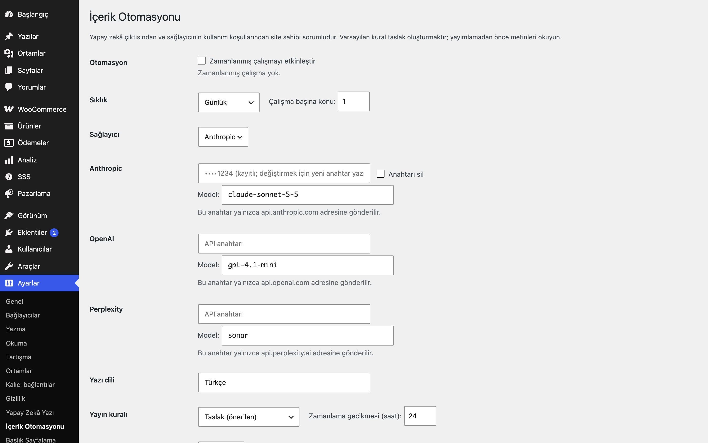

# Content Automation for WordPress

Konu kuyruğunu WP-Cron ile yapay zekâya yazdırır; varsayılan olarak taslak kaydeder.

> **English:** A scheduled content pipeline: a topic queue is turned into posts by OpenAI, Anthropic or Perplexity on a WP-Cron schedule. Disabled by default; bring your own key (host-bound, never echoed back); drafts by default, bounded batch per run, overlap lock, daily request cap. Site owners are responsible for AI output and provider terms.

  

## Ne işe yarar

Konuları (isteğe bağlı anahtar kelimelerle) kuyruğa eklersiniz; açtığınızda her çalışmada sınırlı sayıda konu için yazı üretilir. Varsayılan kural taslaktır; zamanlı yayın ya da hemen yayın seçilebilir.

## Özellikler

- Konu kuyruğu (her satıra bir konu, `konu | anahtar kelime`), durum izleme ve temizleme
- WP-Cron ile saatlik / günde iki kez / günlük çalışma; yalnızca etkinleştirilince zamanlanır
- Çalışma başına en çok 1-3 konu, çakışmayı önleyen kilit, 3 başarısız denemeden sonra "başarısız"
- Yayın kuralı: taslak (varsayılan), incelemede, zamanla (gecikmeli) veya hemen yayımla
- OpenAI, Anthropic (`claude-sonnet-5-5`) ve Perplexity; anahtarlar parola alanı, autoload kapalı, sağlayıcı adresine bağlı
- Günlük istek sınırı ve istek başına token sınırı
- İsteğe bağlı öne çıkan görsel (yalnızca OpenAI görsel yanıtı)
- Çakışmayı önleyen atomik kilit (belirteçli, süresi dolunca devralınır)
- "Zamanla" ve "hemen yayımla" kurallarında harici adresli `` etiketleri kaldırılır; taslaklarda kalır (karar sizindir)
- Çıktı `wp_kses_post` ile temizlenir; anahtar yoksa hiçbir istek gönderilmez

## Kurulum

1. `content-automation-for-wordpress` klasörünü `wp-content/plugins/` altına kopyalayın (veya zip olarak yükleyin).
2. Eklentiler ekranından etkinleştirin.
3. Ayarları yapın (aşağıya bakın).

## Ayarlar

Ayarlar → **İçerik Otomasyonu**: etkinleştirme, sıklık, çalışma başına konu, sağlayıcı/anahtar/model, dil, yayın kuralı, kategori, sınırlar, görsel; aynı ekranda kuyruk ve "Şimdi çalıştır". Seçenekler: `eru_ca_settings`, `eru_ca_keys`, `eru_ca_queue`, `eru_ca_usage`, `eru_ca_lock`.

## Kısa kodlar, kancalar, filtreler

| Ad | Tür | Açıklama |
|---|---|---|
| `eru_ca_tick` | eylem (cron) | Boru hattının zamanlanmış çalışması |
| `eru_ca_endpoint` | filtre | `($url, $sağlayıcı)`; adres sağlayıcı sunucusuyla eşleşmek zorundadır |
| `_eru_ca_item` | yazı meta | Kuyruk öğesi numarası |

## Entegrasyonlar ve gereksinimler

WordPress 6.5+, PHP 8.0+. WP-Cron çalışmalıdır (düşük trafikli sitelerde sunucu cron'u önerilir). Seçtiğiniz sağlayıcının kendi API anahtarı gerekir; ücretlendirme sağlayıcıya aittir.

## Hangisini seçmeliyim?

- **AI Post Generator for WordPress**: tek seferlik taslaklar.
- **Content Automation** (bu eklenti): zamanlanmış konu kuyruğu hattı.
- **Site Content Generator** (ileride): toplu site içeriği üretimi.

> **Sorumluluk:** Yapay zekâ çıktısından ve sağlayıcıların kullanım koşullarından site sahibi sorumludur; yayımlamadan önce metni okuyup doğrulayın.

## Sınırlamalar

- Zamanlama yalnızca WP-Cron ile yapılır.
- Üretilen metin yanlış olabilir; "hemen yayımla" kuralını yalnızca metinleri kontrol edecekseniz seçin.
- Kuyruk en fazla 200 öğe tutar.
- Markdown dönüştürücü ve üçüncü taraf görsel servisleri (stok fotoğraf siteleri) yoktur; öne çıkan görsel yalnızca sağlayıcının döndürdüğü görselden oluşturulur.

## SSS

**Etkinleştirdim ama yazı çıkmıyor.** Anahtarın girildiğinden, kuyrukta bekleyen konu olduğundan ve günlük sınırın dolmadığından emin olun; "Şimdi çalıştır" ile deneyebilirsiniz.

## Değişiklik geçmişi

Bkz. [CHANGELOG.md](CHANGELOG.md).

## Lisans

GPL-2.0-or-later.

Diğer Erusoft eklentileri: https://wordpress.erusoft.com/
