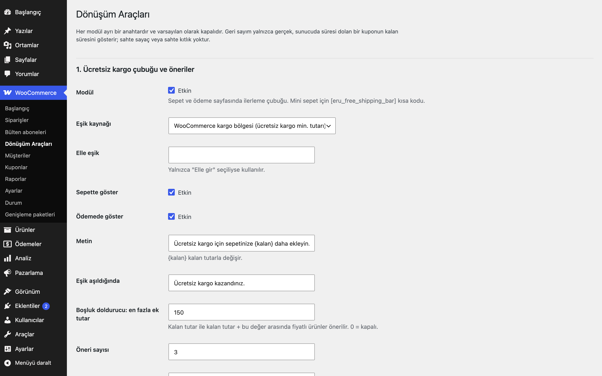
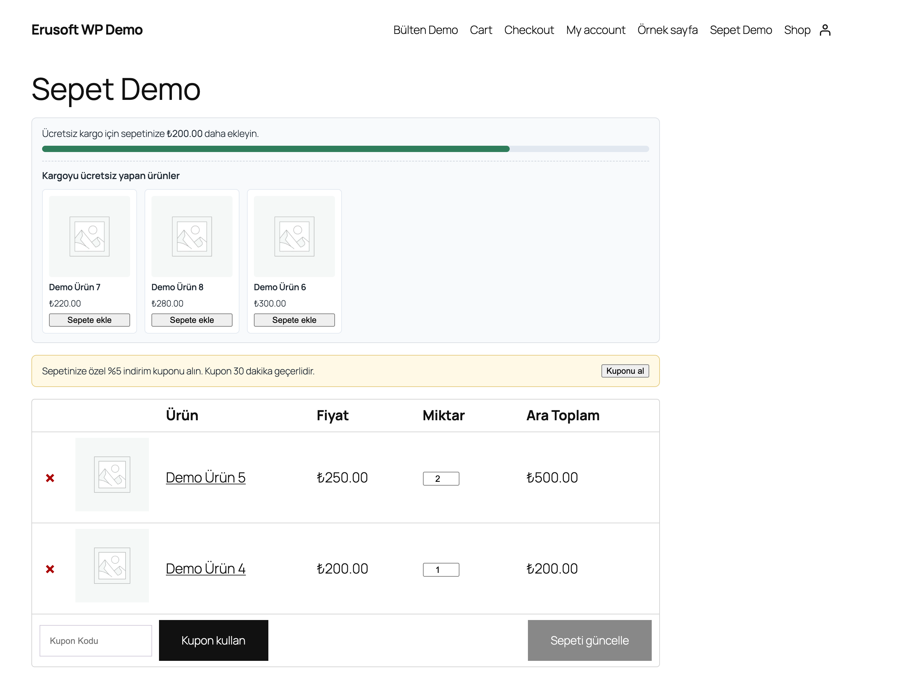

# Conversion Boosters for WooCommerce

> **English:** Four independent, opt-in modules for the classic cart and checkout: a free-shipping progress bar whose threshold comes from your WooCommerce shipping zone (with product suggestions that close the gap), same-category cart recommendations when there are no cross-sells, a double opt-in newsletter that issues a unique single-use welcome coupon after the e-mail owner confirms, and a real expiring cart coupon whose countdown shows the coupon's own server-side expiry. All modules are off by default; there are no fake timers, no fake scarcity and no invented social proof.

   

Sepet tutarını ücretsiz kargo eşiğine yaklaştıran, e-posta toplayıp kişiye özel kupon veren ve süreli gerçek bir sepet kuponu sunan dönüşüm araçları. Her modülün kendi anahtarı vardır ve varsayılan olarak **kapalıdır**; etkinleştirmeden önce ön yüzde hiçbir değişiklik olmaz.

## Özellikler

- Ürün önerili ücretsiz kargo çubuğu (eşik WooCommerce kargo ayarından) · Sepet ve ödeme sayfasında ilerleme çubuğu ve kalan tutar
- Onaylı e-posta aboneliği ve kişiye özel hoş geldin kuponu
- Süreli (geri sayımlı) sepet kuponu
- Çapraz satış yoksa sepette tamamlayıcı ürün önerileri

## Dürüst pazarlama

Eklenti sahte sayaç, sahte kıtlık ("son 2 ürün") ya da uydurma sosyal kanıt üretmez. Geri sayım, müşteriye üretilen gerçek WooCommerce kuponunun `date_expires` değerinden hesaplanan kalan süredir; süre dolduğunda WooCommerce kuponu kendisi reddeder. Sayfayı yenilemek veya çerezi silmek sayacı sıfırlamaz.

## Modüller

### 1. Ücretsiz kargo çubuğu ve öneriler

- **Eşik:** varsayılan olarak müşterinin kargo bölgesindeki `free_shipping` yönteminin `min_amount` değeri (en düşüğü); isterseniz elle girilir.
- **Gösterim:** sepet ve ödeme sayfası (her biri ayrı anahtar). Mini sepet ya da widget alanı için `[eru_free_shipping_bar]`; sepete ürün eklenince WooCommerce parçacıklarıyla (`wc_fragments`) yenilenir.
- **Boşluk doldurucu:** "en fazla ek tutar" 0'dan büyükse, kalan tutar ile kalan tutar + ek tutar arasında fiyatlı, stokta, satın alınabilir, görünür ve basit ürünlerden en fazla N tanesi (varsayılan 3) önerilir. Kaynak sırası: sepet ürünlerinin çapraz satışları, sepetle aynı kategori, elle liste. Ürün ve kategori hariç tutulabilir. Tek sınırlı sorgu çalışır; sonuç, fiyat aralığına göre 10 dakika önbelleğe alınır.
- Öneri kartlarındaki "Sepete ekle" düğmesi WooCommerce'in kendi AJAX uç noktasını kullanır.

### 2. Sepet önerileri

Sepette çapraz satış yoksa, sepettekilerle aynı kategorilerden (sepettekiler hariç, stokta) en fazla 4 ürün gösterilir.

### 3. Hoş geldin kuponlu bülten

- `[eru_cb_newsletter]` kısa kodu; isteğe bağlı olarak sayfa altına otomatik eklenir (ya da kendi şablonunuzda kısa kodu kullanın).
- **Çift onay (double opt-in):** onay kutusu zorunludur. Form gönderilince `pending` (beklemede) bir abone kaydı oluşur ve WooCommerce e-posta şablonuyla bir onay bağlantısı gönderilir (tek kullanımlık, varsayılan 48 saat geçerli, veritabanında yalnızca özeti saklanır). **Bağlantıya tıklamak yalnızca "Aboneliğimi onayla" düğmesini gösterir (e-posta tarayıcılarının bağlantıyı önceden açması bir şey onaylamaz); onay yalnızca aynı siteden gelen düğme gönderimiyle (POST) olur. Bu adım tamamlanmadan onay tarihi yazılmaz, kupon oluşturulmaz** ve yanıtta/ekranda kupon kodu hiçbir zaman görünmez. Onaydan sonra durum `confirmed` olur, kupon üretilir ve e-postayla gönderilir. Süresi dolan onaysız kayıtlar günlük işle silinir.
- Abone kaydı (`eru_cb_subscriber`): e-posta, durum, onay zamanı, onay metni ve özeti, kaynak ve IP'nin tuzlu özeti (ham IP saklanmaz).
- Onaylayan her aboneye **benzersiz** kupon: `<önek><6 karakter>`, tek kullanım, yalnızca o e-postaya kısıtlı, bitiş tarihli (varsayılan: %8, asgari sepet yok, 30 gün). İsterseniz var olan sabit bir kupon da verilebilir.
- Aynı e-posta tekrar abone olursa "Zaten abonesiniz" yanıtı alır. Benzersizlik için e-posta küçük harfe çevrilir ve yerel kısmındaki `+etiket` atılır (`ad+a@` ve `ad+b@` aynı kişidir); böylece artı adresleme ile çok kupon toplanamaz.
- Yeni abonelikler ve süreli kuponlar için ayarlanabilir **saatlik toplam sınır** (varsayılan 60) dağıtık kötüye kullanıma karşı devre kesicidir.
- Önbelleğe alınan sayfalarda nonce çalışmaz; bu yüzden form bal küpü (honeypot) alanı, aynı kaynak (Origin/Referer) denetimi ve IP özeti başına saatte 5 deneme sınırıyla korunur.
- Growth Automations etkinse `eru_gra_has_marketing_consent` filtresi yalnızca **onaylanmış** (`confirmed`) aboneler için `true` döner; beklemedeki kayıtlar için asla.

### 4. Süreli sepet kuponu

- Sepet tutarı asgari değere ulaşınca (isteğe bağlı olarak ödemede de) bir kutu çıkar. "Kuponu al" tıklamasında oturuma bağlı, tek kullanımlık, `date_expires = şimdi + geçerlilik` (varsayılan 30 dakika) olan gerçek bir kupon oluşturulur ve sepete uygulanır.
- Sayaç kuponun kalan süresini sunucudan alır. Süre dolunca kutu "Kupon süresi doldu" der ve aynı oturuma **bekleme süresi** (varsayılan 24 saat, süre bitiminden itibaren) boyunca yeni kupon sunulmaz. Girişli kullanıcılarda bekleme süresi kullanıcıya da yazılır.
- Çerez silerek kupon üretmek IP özeti başına saatlik sınırla (varsayılan 5) kısıtlanır.
- Günlük Action Scheduler işi (`eru-cb` grubu), süresi dolmuş **ve hiç kullanılmamış** üretilmiş kuponları (`_eru_cb_generated`) ve süresi dolan abone kayıtlarını gruplar hâlinde siler; iş kalırsa kendini yeniden zamanlar. Kupon üreten bir modül açıkken ya da abone verisi varken (modüller kapatılsa bile saklama süresi işlesin diye) zamanlanır.

## Kurulum

1. `conversion-boosters-for-woocommerce` klasörünü `wp-content/plugins/` altına kopyalayın (veya zip olarak yükleyin).
2. Eklentiler ekranından etkinleştirin. WooCommerce gereklidir.
3. WooCommerce → **Dönüşüm Araçları** ekranından istediğiniz modülü açın.

## Ayarlar

Tek seçenek: `eru_cb_settings` (autoload kapalı). Varsayılanlar:

| Ayar | Varsayılan |
|---|---|
| Tüm modül anahtarları | kapalı |
| Eşik kaynağı | WooCommerce kargo bölgesi |
| Boşluk doldurucu ek tutar / sayı | 0 (kapalı) / 3 |
| Sepet önerisi sayısı | 4 |
| Bülten kupon öneki / indirim / geçerlilik | `BULTEN` / %8 / 30 gün |
| Abone saklama süresi | 730 gün |
| Onay bağlantısı geçerliliği | 48 saat |
| Saatlik toplam sınır (yeni abonelik ve süreli kupon, ayrı sayaçlar) | 60 |
| Süreli kupon asgari sepet / geçerlilik / bekleme | 600 / 30 dk / 24 saat |
| Süreli kupon IP sınırı | 5 / saat |

## Kancalar ve filtreler

| Ad | Tür | Açıklama |
|---|---|---|
| `[eru_cb_newsletter]` | kısa kod | Bülten formu (`source` niteliği kayıtta kaynak olarak saklanır) |
| `[eru_free_shipping_bar]` | kısa kod | Ücretsiz kargo çubuğu |
| `eru_cb_client_ip` | filtre | Sınırlar için ziyaretçi IP'si (vekil/CDN arkasında gerçek adresi döndürün) |
| `eru_cb_batch_size` | filtre | Günlük temizlik ve saklama işlerinin bir turda işlediği kayıt sayısı (200) |
| `eru_cb_subscribed` | eylem | Abone onaylanıp kupon verildikten sonra (`$email`, `$coupon`, `$id`) |
| `eru_gra_has_marketing_consent` | filtre | Growth Automations izin kaynağı; onaylı abone için `true` döner (`$has`, `$email`, `$context`) |

## Kişisel veri

Abone e-postası ve onay kaydı saklanır. WordPress gizlilik araçlarının dışa aktarıcısı aboneyi ve e-postaya bağlı kuponları listeler; silici aboneyi siler, kullanılmamış üretilmiş kuponları siler, kullanılmış kuponlarda ise e-posta kısıtı ve kullanan e-postası kaydını temizler (kupon sayacı muhasebe için kalır). Saklama süresi dolan aboneler günlük işle silinir.

## Gereksinimler

WordPress 6.5+, PHP 8.0+, WooCommerce 9.0+ (Action Scheduler WooCommerce ile gelir). HPOS ile uyumludur. WooCommerce yoksa eklenti bir uyarı gösterir ve hiçbir şey yapmaz.

## Sınırlamalar

- **Sepet/Ödeme blokları:** çubuk, öneriler ve süreli kupon kutusu klasik (`[woocommerce_cart]`, `[woocommerce_checkout]`) sayfalara bağlanır. Blok sepette yalnızca `[eru_free_shipping_bar]` ve `[eru_cb_newsletter]` kısa kodları bir blok alanına konularak kullanılabilir; süreli kupon ve öneriler blok sepette gösterilmez.
- E-posta kampanyaları (sepet terk, yeniden kazanım, toplu gönderim) bu eklentinin işi değildir; Growth Automations kullanın. Eklenti yalnızca onay ve hoş geldin e-postalarını gönderir.
- Boşluk doldurucu ve sepet önerileri yalnızca basit ürünleri sepete AJAX ile ekler; değişken ürünlerde "İncele" bağlantısı gösterilir.
- Çerez ve IP sınırları ortak IP'li (kurumsal ağ) ziyaretçileri etkileyebilir. CDN/vekil arkasında `eru_cb_client_ip` filtresiyle gerçek ziyaretçi IP'sini döndürmezseniz tüm ziyaretçiler tek IP sayılır ve saatte 5 deneme sınırı site geneline dönüşür.
- Eklenti silindiğinde (Eklentiler → Sil) ayarlar, aboneler, zamanlanmış işler ve eklentinin ürettiği kuponlardan (`_eru_cb_generated`) süresi dolmuş ve hiç kullanılmamış olanlar silinir. Süresi dolmamış kuponlar (müşteriye e-postayla ya da sepette verilmiş olabilir) ve kullanılmış kuponlar ile sipariş verisi korunur. Bunları da silmek için `wp-config.php` içinde `define( 'ERU_CB_REMOVE_DATA', true );` tanımlayın.

## SSS

**Geri sayım sıfırlanır mı?** Hayır; kuponun gerçek bitiş zamanını gösterir.

**Kupon süresi dolunca ne olur?** WooCommerce kuponu reddeder, kutu "süresi doldu" der ve bekleme süresi boyunca yeni kupon sunulmaz.

## English summary

All four modules are independent switches (default off). The threshold is read from the customer's shipping-zone `free_shipping` method unless set manually. Gap suggestions run one bounded query cached for ten minutes. The newsletter is double opt-in: a pending row and a confirmation e-mail first; consent is recorded and the unique single-use, e-mail-restricted, expiring coupon is created and e-mailed only after the link is followed (never shown in a response). Plus-addressing cannot farm coupons, and a global hourly cap limits distributed abuse. The cart coupon is a genuine WooCommerce coupon with `date_expires`; after expiry the session is not offered another one for a configurable cool-down. Privacy exporter/eraser and retention purge included. Classic cart/checkout only (see Sınırlamalar).

## Sürüm notları

Bkz. [CHANGELOG.md](CHANGELOG.md).

## Lisans

GPL-2.0-or-later. Erusoft — https://erusoft.com
