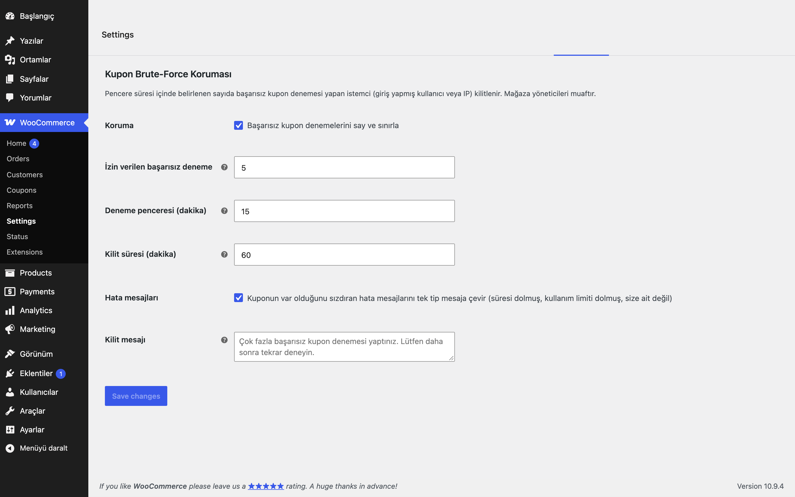

# Coupon Brute-Force Guard for WooCommerce

Kupon kodu deneme-yanılma saldırılarını durdurur. Kısa sürede çok sayıda başarısız kupon deneyen ziyaretçi geçici olarak kilitlenir; hata mesajları da kuponun var olup olmadığını sızdırmaz.

## Özellikler

- Yalnızca açık kupon uygulama denemeleri sayılır (klasik sepet/ödeme AJAX ve formu, Store API `/cart/apply-coupon`); sepetteki kuponların yeniden doğrulanması sayılmaz, gerçek müşteriler sayfa yenilemekle kilitlenmez
- Başarısız kupon denemesi sayacı; eşik aşılınca istemci kilitlenir (varsayılan 5 deneme / 15 dk pencere / 60 dk kilit)
- Kilitliyken geçerli kuponlar da reddedilir
- İstemci anahtarı: giriş yapmış kullanıcıda hem kullanıcı kimliği hem tuzlanmış IP özeti, misafirde IP özeti (ham IP saklanmaz); biri eşiği aşarsa kilitlenir
- "Süresi dolmuş", "kullanım limiti dolmuş", "size ait değil" mesajlarını tek tip mesaja çevirir
- Mağaza yöneticileri muaftır; sayaçlar atomiktir (kalıcı object cache varsa `wp_cache_incr`, yoksa tek SQL UPDATE)
- Klasik sepet, blok sepet ve Store API ile çalışır (WooCommerce kupon hata kancası üzerinden)

## Kurulum

1. `coupon-brute-force-guard-for-woocommerce` klasörünü `wp-content/plugins/` altına kopyalayın (veya zip olarak yükleyin).
2. Eklentiler ekranından etkinleştirin.
3. WooCommerce → Ayarlar → **Kupon Koruması** sekmesinden eşikleri gözden geçirin.

## Ayarlar

WooCommerce → Ayarlar → Kupon Koruması:

| Seçenek | Varsayılan |
|---|---|
| `eru_cbg_enabled` Koruma | açık |
| `eru_cbg_attempts` İzin verilen başarısız deneme | 5 |
| `eru_cbg_window` Deneme penceresi (dk) | 15 |
| `eru_cbg_lockout` Kilit süresi (dk) | 60 |
| `eru_cbg_uniform_errors` Hata mesajlarını tek tipe indir | açık |
| `eru_cbg_message` Kilit mesajı | boş (varsayılan metin) |

## Kancalar ve filtreler

| Ad | Tür | Açıklama |
|---|---|---|
| `eru_cbg_limits` | filtre | `['attempts'=>5,'window'=>15,'lockout'=>60]` (dakika); seçenekleri geçersiz kılar |
| `eru_cbg_is_apply_request` | filtre | Bir isteğin kupon uygulama denemesi sayılıp sayılmayacağını belirler |
| `eru_cbg_is_exempt` | filtre | `true` dönerse istek korumadan muaf tutulur (varsayılan: `manage_woocommerce`) |
| `eru_cbg_client_ip` | filtre | İstemci IP'sini değiştirir (ters vekil arkasında) |
| `eru_cbg_locked` | eylem | Bir istemci kilitlendiğinde (`$fingerprint`, `$limits`) |

## Gereksinimler

WordPress 6.5+, PHP 8.0+, WooCommerce 9.0+. HPOS (özel sipariş tabloları) ile uyumludur. WooCommerce yoksa eklenti bir uyarı gösterir ve hiçbir şey yapmaz.

## Sınırlamalar

- IP yalnızca `REMOTE_ADDR` üzerinden alınır; ters vekil/CDN arkasında gerçek IP için `eru_cbg_client_ip` filtresini kullanın (üstbilgiler taklit edilebilir, bu yüzden varsayılan olarak güvenilmez).
- Misafirler için kilit IP başınadır; paylaşılan IP'lerde (ofis, mobil operatör) birden fazla kişi etkilenebilir.
- Kilit transient'tir; veritabanı temizlenirse sıfırlanır.
- Eklenti silindiğinde (Eklentiler → Sil) yalnızca kendi ayarları ve geçici verileri (`eru_cbg_*` seçenekleri ve transient'leri) silinir; eklenti başka kalıcı veri saklamaz.

## SSS

**Yöneticiler kilitlenir mi?** Hayır, `manage_woocommerce` yetkisi olanlar muaftır.

**Kilidi nasıl kaldırırım?** Süre dolunca kalkar; acil durumda `eru_cbg_lock_*` transient'lerini silin.

## English summary

Locks out clients after too many failed coupon attempts (default 5 attempts in 15 minutes, locked for 60 minutes) and replaces coupon error messages that reveal whether a code exists. Settings live at WooCommerce > Settings > Kupon Koruması; limits can be overridden with the `eru_cbg_limits` filter.

## Sürüm notları

Bkz. [CHANGELOG.md](CHANGELOG.md).

## Lisans

GPL-2.0-or-later. Diğer Erusoft eklentileri: https://wordpress.erusoft.com
