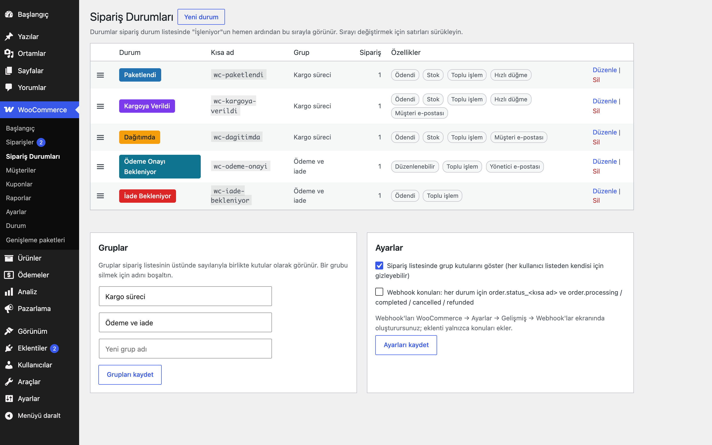
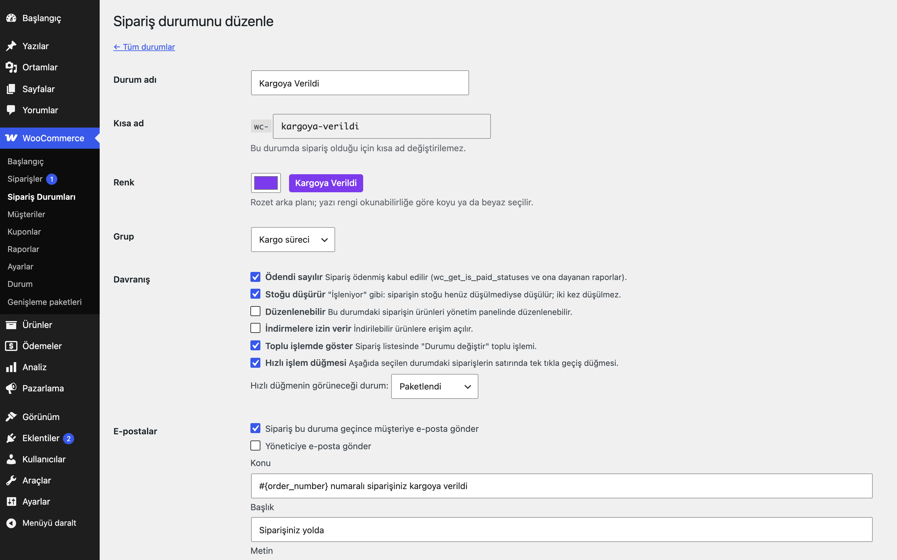
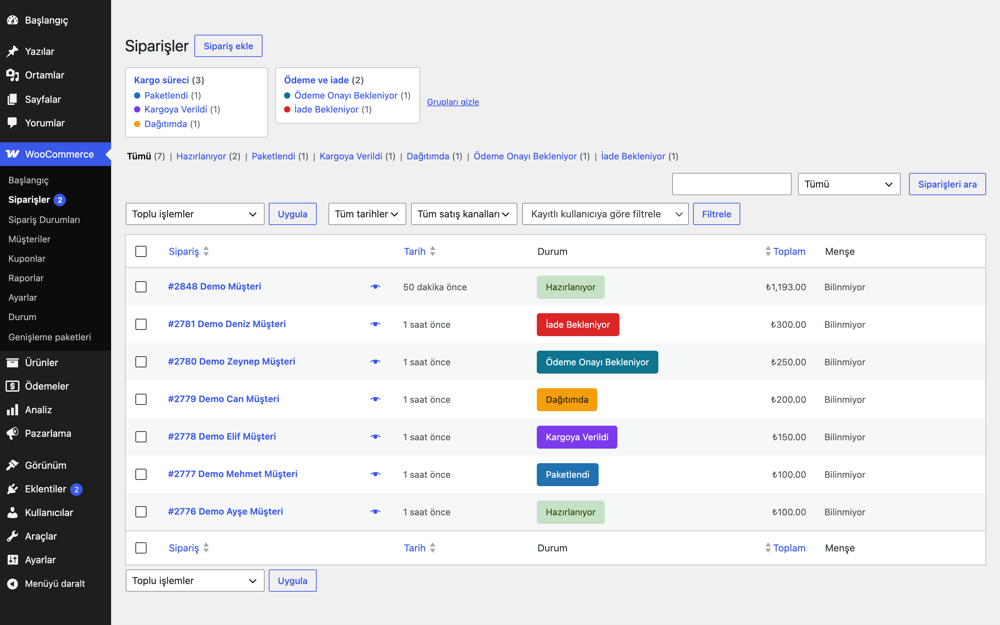
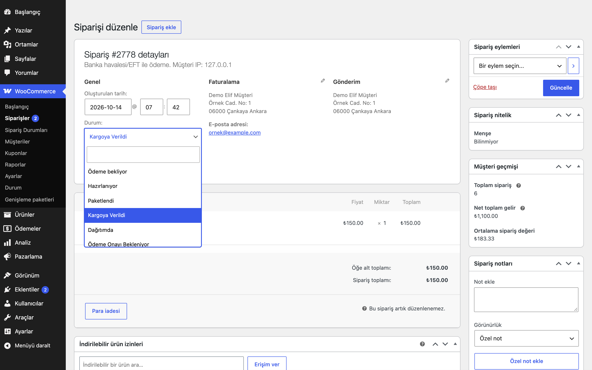

# Custom Order Statuses for WooCommerce

Yönetim panelinden WooCommerce'e kendi sipariş durumlarınızı ekleyin: renk, sıra, grup, "ödendi / stok / düzenlenebilir" davranışı, WooCommerce e-postaları, toplu işlem ve hızlı düğme. Siparişi olan bir durum, siparişler başka bir duruma taşınmadan silinemez.

> **English:** Adds custom WooCommerce order statuses from the admin: colour badge, order, groups, paid / reduces-stock / editable / downloads flags, per-status customer and admin e-mails as real `WC_Email` classes, bulk actions and a quick action button, grouped tab boxes above the order list (HPOS and legacy), safe delete with order migration (Action Scheduler for large sets), optional webhook topics per status and a `wp eru-cos` WP-CLI command. Nothing changes until you add a status.

[](https://www.gnu.org/licenses/gpl-2.0.html)   



## Ne işe yarar

"Paketlendi", "Kargoya verildi", "Ödeme Onayı Bekleniyor" gibi mağazanıza özgü adımları gerçek WooCommerce sipariş durumları olarak tanımlar. Durumlar sipariş listesinde renkli rozetle görünür, sipariş ekranındaki durum listesinde "Hazırlanıyor"dan hemen sonra sizin belirlediğiniz sırayla yer alır ve müşteri Hesabım → Siparişler'de durum adını görür.

## Özellikler

- **Durum yönetimi** (WooCommerce → Sipariş Durumları): ad, kısa ad, renk, grup; satırları sürükleyerek sıralama; her durumun sipariş sayısı.
- **Kısa ad kuralları:** addan otomatik oluşur, Türkçe harfler sadeleştirilir (`Kargoya Verildi` → `kargoya-verildi`), yalnızca `a-z 0-9 -`, en çok 17 karakter (veritabanındaki `wc-` önekiyle 20). WooCommerce'in kendi durumları, başka eklentilerin kaydettiği durumlar ve aynı kısa ad reddedilir. Durumda sipariş varsa kısa ad değiştirilemez; siparişsiz bir durumun kısa adı değişince WooCommerce e-posta ayarları da yeni ada taşınır.
- **Renk:** rozet arka planı seçilir, yazı rengi okunabilirliğe göre otomatik (koyu/beyaz).
- **Davranış bayrakları:**
  - *Ödendi sayılır*: `wc_get_is_paid_statuses()` listesine eklenir, `$order->is_paid()` doğru döner.
  - *Stoğu düşürür*: "İşleniyor" gibi davranır; siparişin stoğu henüz düşülmediyse düşülür. WooCommerce'in `_order_stock_reduced` işareti sayesinde sonra "İşleniyor"a geçmek stoğu ikinci kez düşürmez; iptalde stok iadesi WooCommerce'in kendisine bırakılır.
  - *Düzenlenebilir*: sipariş kalemleri panelden düzenlenebilir.
  - *İndirmelere izin verir*: indirilebilir ürün erişimi açılır.
  - *Toplu işlemde göster*: sipariş listesinde "Durumu değiştir: <ad>".
  - *Hızlı işlem düğmesi*: seçtiğiniz kaynak durumdaki siparişlerin satırında tek tıkla geçiş.
- **E-postalar:** her durum için isteğe bağlı müşteri ve yönetici e-postası. Bunlar gerçek `WC_Email` sınıflarıdır (`Eru_COS_Email_Customer`, `Eru_COS_Email_Admin`): WooCommerce → Ayarlar → E-postalar'da listelenir, açma/kapama, konu, başlık, ek içerik, biçim ve yönetici alıcısı orada da ayarlanır, WooCommerce e-posta tasarımı uygulanır. Yer tutucular: `{order_number}`, `{customer_name}`, `{order_total}`, `{order_date}`, `{site_title}`.
- **Sipariş listesi:** renkli rozetler (HPOS ve klasik liste), grup kutuları (her grubun ve durumunun sayısı; tıklayınca o grubun siparişleri listelenir; sayılar önbellekte tutulur ve sipariş durumu değişince yenilenir). Her kullanıcı kutuları kendisi için gizleyebilir; ayarlardan tamamen kapatılabilir.
- **Güvenli silme ve taşıma** (aşağıda).
- **Webhook modülü** (isteğe bağlı, varsayılan kapalı; aşağıda).
- **WP-CLI:** `wp eru-cos list|add|update|delete|migrate|export|import`.







## Kurulum

1. `custom-order-statuses-for-woocommerce` klasörünü `wp-content/plugins/` altına kopyalayın (veya zip olarak yükleyin) ve etkinleştirin.
2. WooCommerce → **Sipariş Durumları** → *Yeni durum*.
3. İsterseniz alttaki *Gruplar* kutusundan grup ekleyip durumları gruplara atayın.

Etkinleştirince hiçbir şey değişmez; ilk durumu siz eklediğinizde devreye girer. Müşteri tarafında yalnızca WooCommerce'in kendi gösterdiği durum adı görünür, dış HTTP isteği yapılmaz (webhook modülünü açıp webhook tanımlamadıkça).

## Ayarlar

| Seçenek | İçerik |
|---|---|
| `eru_cos_statuses` | Durumlar, kayıtlı sırayla, kısa ada göre anahtarlı |
| `eru_cos_groups` | Grup kimliği → grup adı |
| `eru_cos_settings` | `group_tabs` (1), `webhooks` (0) |
| `woocommerce_eru_cos_{customer,admin}_<kısa_ad>_settings` | WooCommerce e-posta ayarları (WooCommerce'in kendi kaydı) |

Durumlar `register_post_status( 'wc-<kısa ad>' )` ile `public => false` olarak kaydedilir ve `wc_order_statuses` listesine "Hazırlanıyor"dan sonra eklenir.

## Silme ve taşıma

- Siparişi olmayan bir durum doğrudan silinir.
- Siparişi olan bir durumu silmek için siparişlerin taşınacağı **hedef durumu seçmek zorunludur**; seçilmeden silme reddedilir (panelde ve WP-CLI'da). Böylece siparişler hiçbir zaman kayıtsız bir durumda kalıp listeden kaybolmaz.
- 50 siparişe kadar taşıma hemen yapılır; daha fazlası Action Scheduler ile 50'lik partiler hâlinde arka planda yapılır ve durum, son sipariş taşınınca silinir. Parti boyutu `eru_cos_migrate_batch_size` filtresiyle değiştirilebilir. Bu sürede durum listede "Siliniyor" olarak görünür, toplu işlemden, hızlı düğmeden ve sipariş ekranındaki durum seçiminden kalkar (o durumdaki siparişlerde seçili kalır). Aynı durum için ikinci bir silme isteği reddedilir.
- Taşıma her zaman biter: kaydedilemeyen siparişler (ör. başka bir eklentinin kaydı engellemesi) atlanır, bir tur hiçbir siparişi taşıyamazsa işlem durur. Panelde ve WP-CLI'da `eru_cos_migrate_failed` hatası gösterilir ve durum silinmez; arka plandaki silme durdurulur, "Siliniyor" işareti kalkar, bir sonraki yönetim sayfasında tek seferlik uyarı gösterilir ve WooCommerce → Durum → Günlükler'e kayıt düşülür. Hedef durum bu arada kaldırılmışsa da aynısı olur.
- Taşıma normal bir durum değişikliğidir (`$order->update_status()`): hedef durumun e-postaları, stok kuralları ve webhook'ları çalışır, siparişe not düşülür.
- WP-CLI'da taşıma her zaman eşzamanlıdır: `wp eru-cos delete <kısa-ad> --to=processing` veya yalnızca taşımak için `wp eru-cos migrate --from=<kısa-ad> --to=<kısa-ad>`.
- **Eklentiyi devre dışı bırakmadan veya kaldırmadan önce** özel durumdaki siparişleri taşıyın: eklenti kapalıyken bu siparişlerin durumu veritabanında kalır ama WooCommerce onu tanımaz. Özel durumlarda sipariş varken Eklentiler ekranında eklentinin satırında durum başına sipariş sayılarıyla bir uyarı görünür ve "Devre dışı bırak" bağlantısı onay ister (devre dışı bırakıldıktan sonra eklentinin kodu çalışmadığı için uyarı önceden verilir).

## Webhook modülü

Ayarlar → *Webhook konuları* açıldığında WooCommerce → Ayarlar → Gelişmiş → Webhook'lar ekranındaki *Konu* listesine şunlar eklenir:

- her özel durum için `order.status_<kısa ad>` (sipariş o duruma geçince tetiklenir),
- `order.processing`, `order.completed`, `order.cancelled`, `order.refunded`.

Yük (payload) WooCommerce'in standart sipariş verisidir. Modül yalnızca konu ekler; webhook'u ve adresini siz tanımlarsınız. Modül kapalıyken bu konular listede de doğrulamada da yoktur.

Başka bir eklenti de `order.processing`, `order.completed`, `order.cancelled` veya `order.refunded` konularını ekliyorsa ikisi birlikte çalışabilir: konu anahtarları aynıdır, listede her konu bir kez görünür.

## WP-CLI

```bash
wp eru-cos list
wp eru-cos add "Paketlendi" --bg=#2271b1 --is_paid=1 --reduces_stock=1 --email_customer=1
wp eru-cos update paketlendi --group=kargo
wp eru-cos migrate --from=paketlendi --to=completed
wp eru-cos delete paketlendi --to=processing
wp eru-cos export > durumlar.json
wp eru-cos import durumlar.json
```

## Kısa kodlar, kancalar ve filtreler

| Ad | Tür | Açıklama |
|---|---|---|
| `eru_cos_statuses` | filtre | Çalışma anında kullanılan durum listesi |
| `eru_cos_email_placeholders` | filtre | E-posta yer tutucuları (`$placeholders, $order, $email`) |
| `eru_cos_badge_colors` | filtre | Kısa ad → `[arka plan, yazı]` rozet renkleri |
| `eru_cos_migrate_batch_size` | filtre | Taşıma partisi boyutu (varsayılan 50) |
| `eru_cos_status_registered` | eylem | Her durum kaydedildikten sonra (`$slug, $status`) |
| `woocommerce_order_status_<kısa ad>` | eylem (WooCommerce) | Sipariş duruma girince |

E-posta şablonları: `templates/emails/eru-cos-status.php` ve `templates/emails/plain/eru-cos-status.php`. Temada `custom-order-statuses-for-woocommerce/emails/…` yoluna kopyalayarak değiştirebilirsiniz.

## Entegrasyonlar ve gereksinimler

WordPress 6.5+, PHP 8.0+, WooCommerce 9.0+, HPOS uyumlu (klasik sipariş listesi de desteklenir). Arka plan taşıma için WooCommerce ile gelen Action Scheduler kullanılır.

## Sınırlamalar

- WooCommerce Analiz için ayrı bir özel durum raporu yoktur; özel durumların Analiz'e dahil edilip edilmeyeceğini WooCommerce → Ayarlar → Analiz'deki "Hariç tutulan durumlar" / "İşlem gerektiren durumlar" ayarlarıyla siz belirlersiniz.
- "Ödendi sayılır" yalnızca `wc_get_is_paid_statuses()` listesini etkiler; ödeme alınabilecek durumlar (`woocommerce_valid_order_statuses_for_payment`) değişmez.
- E-postalar sipariş duruma girdiği istekte gönderilir (WooCommerce'in "işlemsel e-postaları ertele" kuyruğu kullanılmaz).
- WooCommerce'in e-posta önizlemesi e-postaları sınıf adına göre seçtiği için, aynı türdeki (müşteri/yönetici) birden fazla durumun önizlemesi tek bir durumu gösterir; gönderilen e-postalar her durum için doğrudur.
- Toplu işlemler WooCommerce'in kendi `mark_<durum>` işleyicisiyle yapılır; WooCommerce'in durum geçiş kurallarına uyulur.

## SSS

**Kısa ad neden 17 karakterle sınırlı?** Sipariş durumu veritabanında `wc-` önekiyle en çok 20 karakter tutulur; daha uzun adlar kesilir ve sipariş kaybolmuş gibi görünür.

**Bir duruma geçen sipariş stoğu iki kez düşürür mü?** Hayır. Stok yalnızca siparişin stoğu henüz düşülmemişse düşer; sonraki "İşleniyor" veya başka bir stok düşüren duruma geçiş tekrar düşürmez.

**Kaldırınca ne olur?** `eru_cos_statuses`, `eru_cos_groups`, `eru_cos_settings`, eklentinin WooCommerce e-posta ayarları, sayı önbelleği ve kullanıcıların grup gizleme tercihi silinir. Siparişlerin durumları değiştirilmez; kaldırmadan önce siparişleri taşıyın (bkz. *Silme ve taşıma*).

## Değişiklik geçmişi

Bkz. [CHANGELOG.md](CHANGELOG.md).

## Lisans

GPL-2.0-or-later. Diğer Erusoft eklentileri: https://wordpress.erusoft.com/
