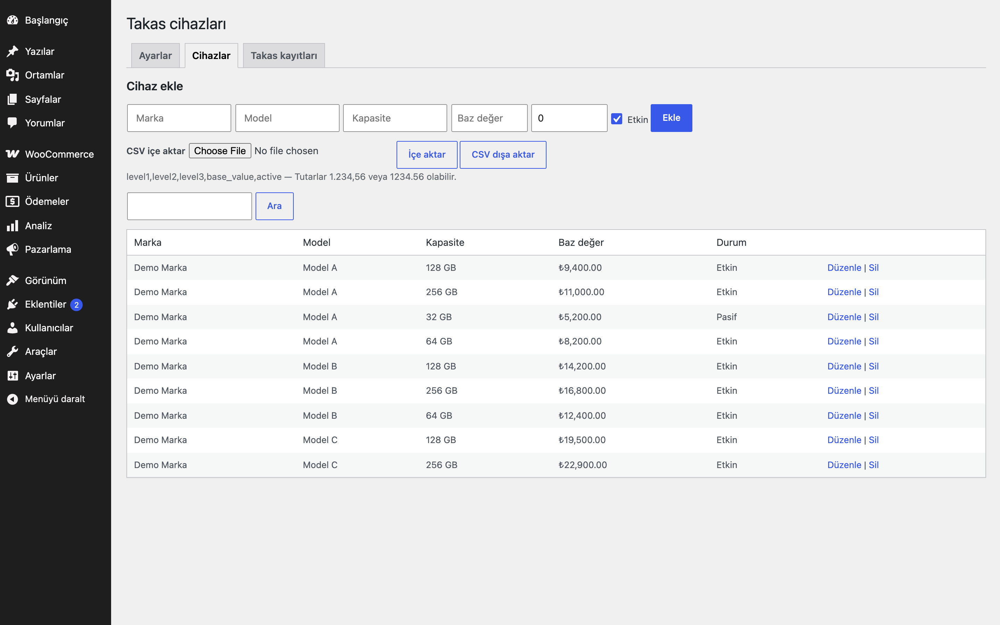
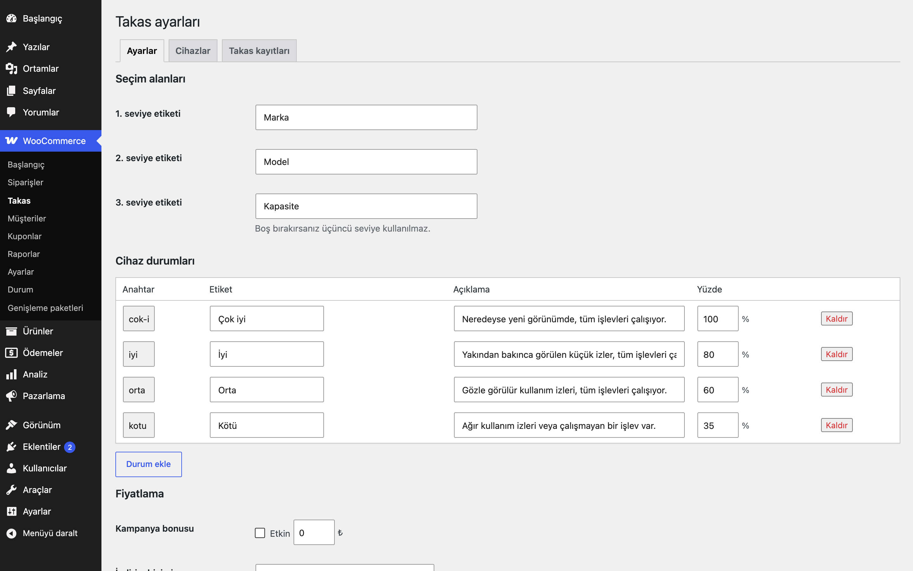
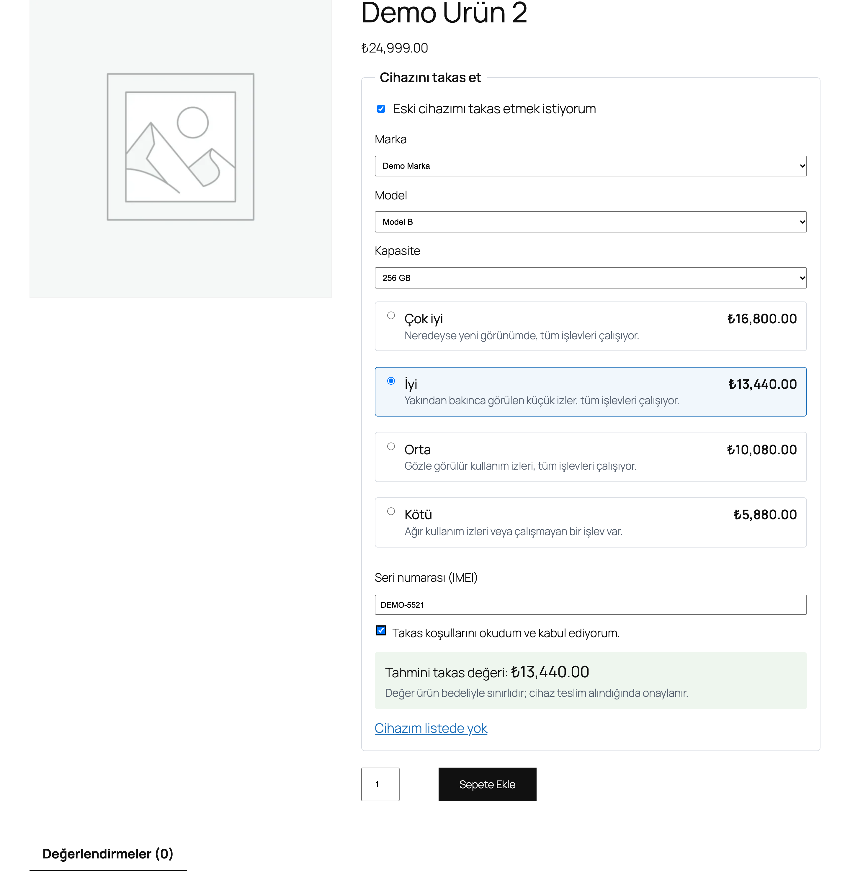
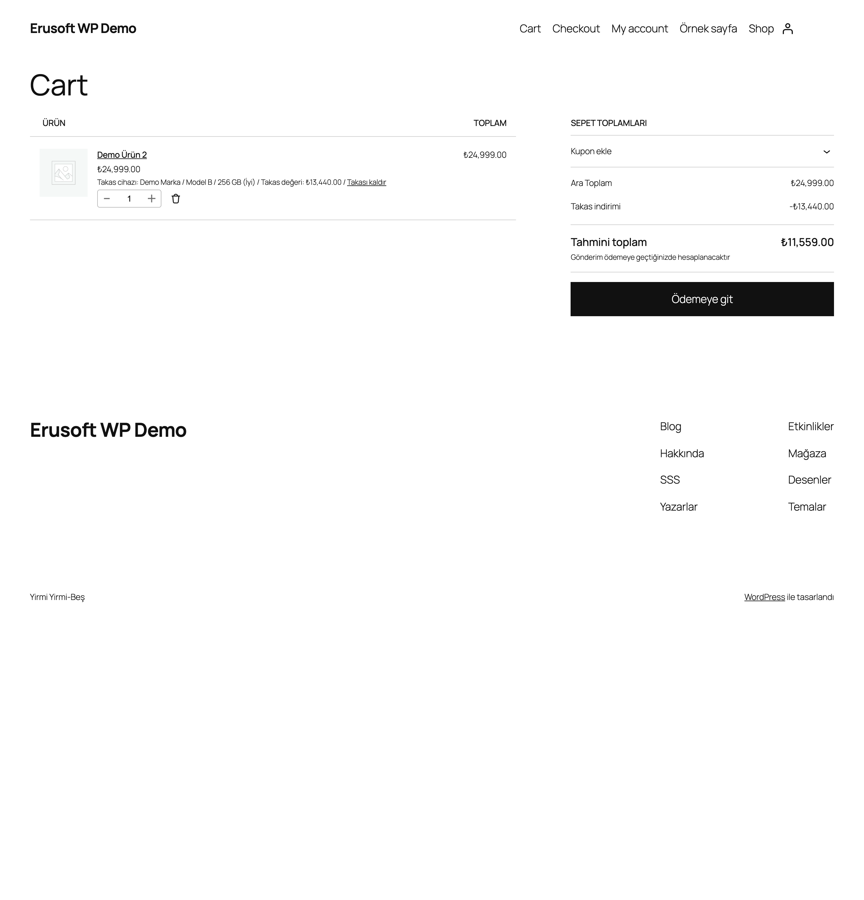
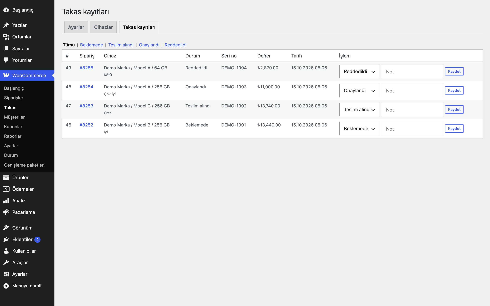

# Device Trade-In for WooCommerce

> **English:** Lets customers trade in an old device while buying. They pick brand / model / capacity (labels are configurable) and a condition from an admin-managed value table, see a live estimate, and the value is deducted in the cart (capped at the product price, re-resolved from the database on every recalculation). Includes a per-order trade-in record with an approval flow, an optional "hold the order until the device is approved" mode, overdue reminders (Action Scheduler), CSV import/export of the value table, an "unlisted device" request form, privacy exporters/erasers and a retention purge. Inert until you enable categories or products. No seed data and no carrier integration.

   

Müşteri ürün sayfasında eski cihazını seçer, durumunu işaretler ve tahmini takas değerini anında görür. Değer sepette indirim olarak düşer; sipariş oluşunca bir takas kaydı açılır, siz cihazı teslim alıp onaylarsınız.

## Kurulum

1. `device-trade-in-for-woocommerce` klasörünü `wp-content/plugins/` altına kopyalayın (veya zip olarak yükleyin) ve etkinleştirin. WooCommerce gereklidir; yoksa eklenti bir uyarı gösterir.
2. **WooCommerce → Takas** ekranında Ayarlar, Cihazlar ve Takas kayıtları sekmeleri bulunur. Aşağıdaki "Nasıl çalışır" adımlarını sırayla izleyin.

## Ayarlar

Ayarlar **WooCommerce → Takas → Ayarlar** sekmesindedir: takas açılacak kategori ve ürünler, durum adları ve yüzdeleri, indirim biçimi (negatif ücret ya da satır indirimi), kampanya bonusu, "Siparişi beklet" ve "Reddedilen takasta iptal et", gecikme hatırlatma günü, gönderim talimatı ve saklama süresi. Ayrıntılar aşağıdaki ilgili bölümlerde anlatılır.

## Nasıl çalışır

1. **Cihaz tablosunu girin** (WooCommerce → Takas → Cihazlar): marka, model, kapasite ve baz değer. Elle ekleyebilir ya da CSV içe aktarabilirsiniz. Eklenti hiçbir cihaz veya fiyat listesiyle gelmez.
2. **Durumları ayarlayın** (WooCommerce → Takas): her durumun adı, açıklaması ve baz değerin yüzdesi. Varsayılan dört genel seviye vardır (Çok iyi %100, İyi %80, Orta %60, Kötü %35); düzenleyebilirsiniz.
3. **Kategori veya ürün seçin.** Seçim yapılmadıkça ön yüzde hiçbir şey görünmez.
4. Müşteri ürün sayfasında "Eski cihazımı takas etmek istiyorum"u işaretler; bağımlı listelerden (marka → model → kapasite) cihazı, ardından durumu seçer, seri numarasını girer ve koşulları kabul eder.

## Değer hesabı

`değer = yuvarla(baz × durum% / 100 + bonus, fiyat ondalığı)`

- Kampanya bonusu sabit bir tutardır; varsayılan kapalı ve 0'dır.
- Müşterinin gönderdiği tutara güvenilmez: cihaz kimliği ve durum anahtarı gönderilir, değer **her sepet hesaplamasında veritabanından yeniden çözülür**.
- Cihaz pasife alınmış veya silinmişse, durum kaldırılmışsa ya da ürün kapsam dışına çıkmışsa takas sepetten uyarıyla kaldırılır; ürün sepette kalır.
- Değer, ürünün **birim başına KDV hariç fiyatıyla sınırlanır**. 6.000 TL'lik üründe 8.000 TL'lik takas 6.000 TL düşer.
- Sepette yalnızca bir takas olabilir; ikincisi uyarıyla reddedilir. Sepette "Takası kaldır" bağlantısı (nonce'lu) vardır.

## Vergi

Takas değeri iki biçimde uygulanabilir (WooCommerce → Takas → İndirim biçimi):

| | Negatif ücret (`fee`, varsayılan) | Satır indirimi (`line_discount`) |
|---|---|---|
| Sepette görünüm | "Takas indirimi" adlı negatif satır | Ürünün birim fiyatı düşer |
| KDV matrahı | **Değişmez**; KDV, indirimsiz fiyat üzerinden hesaplanır | **Düşer**; KDV, indirimli fiyat üzerinden hesaplanır |
| Toplam | Düşer | Düşer |

Not: WooCommerce çekirdeği negatif ücretlerin vergisini kalemlere "gerçek indirim" gibi dağıtır. `fee` modunda bu davranış eklenti tarafından engellenir; böylece ücret gerçekten vergisiz kalır. Takasın fatura ve e-fatura karşılığı (ikinci el alım mı, indirim mi) işletmenize ve mevzuata göre değişir; **hangi biçimin sizin için doğru olduğunu muhasebecinize danışın.** Eklenti vergi danışmanlığı vermez.

## Sipariş ve onay akışı

- Ödeme sayfasında sipariş oluşurken (klasik ödeme ve Store API) bir takas kaydı yazılır; sipariş metasında `_eru_dti_tradein_id` ve siparişin satırında görünür bir "Takas cihazı / Takas değeri" bilgisi bulunur.
- WooCommerce → **Takas** (sekmeler: Ayarlar, Cihazlar, Takas kayıtları) → **Takas kayıtları**: durumlar `beklemede`, `teslim-alindi`, `onaylandi`, `reddedildi`; not alanı; siparişe bağlantı. Sipariş ekranında "Takas" kutusu kaydı gösterir.
- **Siparişi beklet** (isteğe bağlı, varsayılan kapalı): sipariş tetikleyici durumlardan birine (varsayılan `processing`) geçtiğinde ve takas onaylanmamışsa, sipariş "Takas onayı bekleniyor" durumuna (`wc-eru-dti-hold`) ya da WooCommerce'in "Beklemede" durumuna alınır. Takas listesinde **onaylandı** seçilince sipariş, bekletilmeden önceki duruma döner. **Reddedilen cihaz:** Takas kaydı "reddedildi" yapılınca kredi siparişe zaten uygulanmış olduğundan sipariş ilerlemez: "Reddedilen takasta iptal et" açıksa sipariş iptal edilir; değilse bekletme açıkken sipariş beklemeye alınır (bekletme kapalıysa yalnızca sipariş notu eklenir). Her durumda sipariş notu ve yönetici uyarısı gösterilir; reddedilmiş kayıtlı bir sipariş sonradan tetikleyici duruma geçse de (onaylanmadığı için) yeniden bekletilir. Yönetici paneline giriş yapmış yetkili bir kullanıcının elle yaptığı durum değişikliği korunur, yeniden bekletilmez. Bekletme `woocommerce_order_status_changed` üzerinde çalışır; ödeme ağ geçitlerine dokunmaz.
- **Gecikme hatırlatması:** Action Scheduler'daki günlük iş (`eru-dti` grubu), "beklemede" kalan ve ayarlanan günden eski kayıtlar için müşteriye ve ekibe birer e-posta gönderir (`WC()->mailer()`); her kayıt yalnızca bir kez hatırlatılır. 0 = kapalı. İş, bir kategori ya da ürün etkinken veya takas/talep kaydı (kişisel veri) bulunduğu sürece zamanlanır; böylece tüm ürünler kapatılsa da saklama süresi dolan kayıtlar silinmeye devam eder.
- **Gönderim talimatı:** `{days}` (hatırlatma günü), `{order}` (sipariş numarası) ve `{reference}` yer tutucuları desteklenir; sipariş tamamlandı sayfasında ve hatırlatma e-postasında gösterilir. Varsayılan boştur; `{reference}` değeri (ör. kargo anlaşma numaranız) ayarlardan girilir.

## CSV

Başlıklar: `level1,level2,level3,base_value,active`. Ayırıcı virgül ya da noktalı virgül olabilir (başlık satırından anlaşılır). Tutarlar `1.234,56` ve `1234.56` biçimlerinde okunur; `1.234` Türkçe binlik ayırıcı sayılır (1234). Marka+model+kapasite aynıysa satır güncellenir, değilse eklenir. Hatalı satırlar satır numarasıyla bildirilir ve atlanır. Dışa aktarılan dosyada `=`, `+`, `-`, `@` ile başlayan hücrelerin başına `'` konur (elektronik tablo formülü enjeksiyonuna karşı).

## "Cihazım listede yok"

Açıksa, seçicide bir talep formu açılır (ad, e-posta, telefon, cihaz). AJAX + nonce, IP başına saatte 3 gönderim sınırı ve bal küpü (honeypot) alanı vardır. Talepler tabloya yazılır ve bildirim e-postasına (varsayılan: site yöneticisi) iletilir.

## Kısa kod

`[eru_device_trade_in]` ürün sayfasındaki seçiciyi başka bir konuma koyar. Seçici sepete ekle formunun **içinde** olmalıdır; aksi hâlde alanlar gönderilmez.

## Kancalar ve filtreler

| Ad | Tür | Açıklama |
|---|---|---|
| `[eru_device_trade_in]` | kısa kod | Takas seçicisi (sepete ekle formunun içinde) |
| `eru_dti_client_ip` | filtre | "Cihazım listede yok" formunun saatlik sınırı için ziyaretçi IP'si (`$ip`, varsayılan `REMOTE_ADDR`); vekil/CDN arkasında gerçek adresi döndürün |
| `eru_dti_is_admin_change` | filtre | Durum değişikliğini yetkili bir yöneticinin elle yaptığını söyler (`$is`, varsayılan: yönetim panelinde `manage_woocommerce` yetkisi). `true` ise takaslı sipariş tetikleyici duruma geçince beklemeye alınmaz |

## Kişisel veri

Takas kaydı e-posta ve seri numarası (seri numarası **yalnızca takas tablosunda** tutulur, sipariş satırı metasına kopyalanmaz), talepler ad/e-posta/telefon saklar. WordPress gizlilik araçlarına dışa aktarıcı ve silici kaydedilir (talepler silinir; takas kayıtlarında e-posta ve seri no temizlenir). Sipariş verisinde (`_eru_dti` satır metası) seri numarası bulunmaz; cihaz adı, durum ve değer ise sipariş kaydının parçası olarak kalır. Saklama süresi (varsayılan 365 gün) dolan talepler ile karara bağlanmış (onaylandı/reddedildi) takas kayıtları günlük işle silinir.

## Gereksinimler

WordPress 6.5+, PHP 8.0+, WooCommerce 9.0+ (Action Scheduler WooCommerce ile gelir). HPOS ile uyumludur; sipariş verisi yalnızca `WC_Order` üzerinden okunur ve yazılır. Sipariş meta alanları: `_eru_dti_tradein_id`, `_eru_dti_held_from`; satır meta alanı `_eru_dti`.

## Sınırlamalar

- Kargo veya taşıyıcı entegrasyonu yoktur; gönderim talimatı yalnızca metindir.
- **Blok tabanlı tekil ürün şablonu desteklenmez:** seçici `woocommerce_before_add_to_cart_button` kancasına bağlıdır. Blok şablonunda sepete ekle bloğunun içine kısa kodu yerleştirmek mümkün olmayabilir; klasik ürün şablonu kullanın.
- Ürün başına yalnızca bir cihaz takas edilir; sepette toplam bir takas olabilir. Birden çok adetli satırda takas yine tek cihaz içindir (değer adetlere yayılarak düşülür).
- `line_discount` modunda birim fiyat, adede bölünmüş indirimle azaltılır; çok adetli satırlarda kuruş yuvarlaması olabilir.
- Üç seviyeli seçimde üçüncü seviye boşsa (kapasite etiketi boş) aynı marka+modelin ilk cihazı seçilir.
- Mağaza API'si (Store API) ile sepete ekleme takas verisi taşımaz; seçici klasik ürün sayfası formu içindir. Ödeme tamamlanırken Store API üzerinden gelen siparişler takas kaydı alır.
- Takas listesi sınırlı sayfalama ile (50 / 30 satır) gösterilir; çok büyük tablolar için CSV kullanın.
- Eklenti silindiğinde (Eklentiler → Sil) ayarlar, üç tablo (cihazlar, takas kayıtları, talepler) ve zamanlanmış işler silinir; sipariş metası (`_eru_dti_*`) ve sipariş notları korunur.

## SSS

**Eklentiyi devre dışı bırakırsam ne olur?** Günlük zamanlanmış iş (`eru_dti_daily`) kaldırılır; veriler durur. Ön yüzde seçici görünmez, takaslı siparişler siparişte kalır.

**Eklentiyi silersem takas kayıtları gider mi?** Evet: ayarlar, üç tablo (cihazlar, takas kayıtları, talepler), geçici kayıtlar ve zamanlanmış işler silinir. Sipariş metası (`_eru_dti_*`) ve sipariş notları korunur. Silmeden önce gerekiyorsa cihaz tablosunu CSV olarak dışa aktarın. Bu eklentide veriyi koruyan bir sabit yoktur.

**HPOS ve Sepet/Ödeme blokları?** Eklenti HPOS uyumluluğunu (`custom_order_tables`) bildirir. Ödeme sırasında Store API üzerinden gelen siparişler de takas kaydı alır; ancak seçici klasik ürün sayfasındaki sepete ekle formu içindir ve blok tabanlı tekil ürün şablonu desteklenmez (bkz. Sınırlamalar).

**Müşteri değeri değiştirebilir mi?** Hayır. Tarayıcıdan yalnızca cihaz kimliği ve durum anahtarı gelir; değer her sepet hesaplamasında veritabanından yeniden hesaplanır.

**Dış servise bağlanıyor mu?** Hayır; cihaz fiyat listesi ya da başka bir servis çağrılmaz. Tablo sizin girdiğiniz verilerden oluşur.

**Önbellek eklentisiyle sorun olur mu?** Seçici ürün sayfasında çalışır; sepet ve ödeme sayfalarını önbellekten hariç tutmanız, bu sayfalar herkeste olduğu gibi, önerilir.

## English summary

Customers choose their old device and its condition on the product page; the value (base × condition % + optional bonus) is re-resolved from the database on every cart calculation, capped at the per-unit ex-tax product price, and applied as a non-taxable negative fee or as a line discount (which reduces the tax base). Ask your accountant which fits your invoicing. Orders get a trade-in record with an approval flow, optional order hold, overdue reminders, privacy tools and retention purge. Nothing is shown until categories or products are enabled.

## Sürüm notları

Bkz. [CHANGELOG.md](CHANGELOG.md).

## Destek

- Önce bu sayfadaki **SSS** ve **Sınırlamalar** bölümlerine göz atın; sık karşılaşılan durumlar orada.
- Hata mı buldunuz? [GitHub Issues](https://github.com/erayusta/erusoft-wp/issues) üzerinden bildirin. WordPress, WooCommerce, PHP ve eklenti sürümünü, adımları ve beklenen/gerçekleşen sonucu yazmanız işi hızlandırır.
- Kurulum, yapılandırma, özel geliştirme veya entegrasyon desteği için **[hello@erusoft.com](mailto:hello@erusoft.com)** adresine yazın. Erusoft hakkında: [erusoft.com](https://erusoft.com).
- Lütfen şifre, API anahtarı veya müşteri verisi (ad, telefon, TCKN, sipariş dökümü) göndermeyin; ekran görüntülerindeki kişisel verileri karartın.

## Lisans

GPL-2.0-or-later. Diğer Erusoft eklentileri: https://wordpress.erusoft.com
