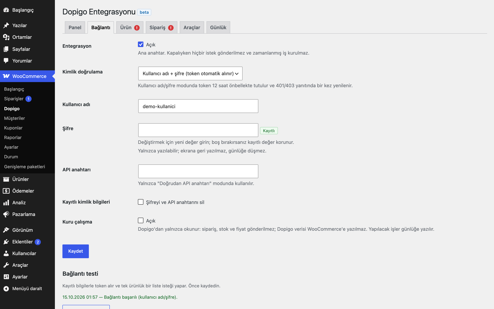

# Dopigo Integration for WooCommerce

> **English:** Connects WooCommerce to the Dopigo panel API. Stock and price sync in the direction you choose (off, Dopigo → Woo, Woo → Dopigo, both), order push with VAT-inclusive lines and a per-order lock, two-way order status sync through a mapping table, a time-budgeted product importer (simple and variable products, categories, images), SKU audit and repair tools, a dashboard and a filterable log. Woo → Dopigo updates are queued in Action Scheduler; rate limits are retried with backoff instead of sleeping. Inert until you enable it and save credentials.

[](https://www.gnu.org/licenses/gpl-2.0.html)   

> **Beta:** canlı API ile kendi hesabınızla doğrulayın.

WooCommerce mağazanızı Dopigo ile bağlar: stok ve fiyatı seçtiğiniz yönde eşitler, siparişleri KDV'siyle Dopigo'ya gönderir, sipariş durumlarını iki yönlü taşır ve Dopigo kataloğunu zaman bütçesiyle içe aktarır.



## Özellikler

- Stok ve fiyat için ayrı yön seçimi: Kapalı, Dopigo → Woo, Woo → Dopigo, İki yönlü
- Woo → Dopigo güncellemeleri kuyruktan gider: ürün kaydı sırasında istek yapılmaz, ürün başına tek Action Scheduler işi kurulur
- Siparişleri KDV dahil satır fiyatı ve satır KDV oranıyla gönderme; aynı sipariş için iki olay tek Dopigo siparişi oluşturur
- Sipariş durumu senkronu (iki yönlü, eşleme tablosu)
- Zaman, sayfa ve görsel bütçeli ürün içe aktarma; basit ve varyasyonlu ürün, kategori ve görsel
- SKU eşleştirme denetimi, SKU'ya göre yeniden bağlama ve yinelenen kayıt bulucu
- Gösterge paneli, süzülebilir günlük, sipariş ekranında Dopigo kutusu ve WP-CLI komutları

## Kurulum

1. `dopigo-integration-for-woocommerce` klasörünü `wp-content/plugins/` altına kopyalayın (veya zip olarak yükleyin).
2. Eklentiler ekranından etkinleştirin. WooCommerce gereklidir.
3. WooCommerce → **Dopigo** → **Bağlantı**: kimlik doğrulama yöntemini seçin, bilgileri girin, **Entegrasyon**'u açın ve kaydedin.
4. **Bağlantıyı test et** düğmesiyle token alınıp alınamadığını görün. Sonra Ürün ve Sipariş sekmelerinden yönleri açın.

Etkinleştirme sonrası eklenti pasiftir: ana anahtar açılıp kimlik bilgileri kaydedilene kadar dış istek, zamanlanmış iş veya ön yüz çıktısı yoktur. Hiçbir sekmeyi görüntülemek Dopigo'ya istek göndermez; yalnızca "Bağlantıyı test et" düğmesi doğrudan istek yapar.

## Bağlantı

| Ayar | Açıklama |
|---|---|
| Kimlik doğrulama | **Kullanıcı adı + şifre**: `POST /users/get_auth_token/` ile token alınır, 12 saat önbellekte tutulur (`autoload=no`), 401/403 yanıtında bir kez yenilenip istek tekrarlanır. **Doğrudan API anahtarı**: girilen token kullanılır, yenileme yapılmaz. |
| Şifre / API anahtarı | Yalnızca yazılabilir: ekrana geri yazılmaz ("Kayıtlı" rozeti görünür), boş bırakılırsa korunur, günlüğe düşmez, adrese (GET) eklenmez. |
| Kuru çalışma | Dopigo'dan yalnızca okunur. Sipariş, stok ve fiyat gönderilmez; Dopigo verisi WooCommerce'e yazılmaz; yapılacak işler günlüğe yazılır. |

## Senkron yönleri

| Veri | Dopigo → Woo | Woo → Dopigo | Ne zaman |
|---|---|---|---|
| Stok | Dopigo `available_stock` (yoksa `stock`) WooCommerce stoğuna yazılır | Stok miktarı (negatifse 0) foreign SKU ile gönderilir | Dopigo → Woo: 5 dakikada bir; Woo → Dopigo: ürün kaydı / stok değişimi, kuyruktan |
| Fiyat | Dopigo fiyatı seçili alana (normal / indirimli) yazılır | Etkin fiyat `price`, normal fiyat `listing_price` olarak gönderilir | Aynı |
| Sipariş | — | Seçilen tetikte (sipariş oluşunca / ödeme alınınca) oluşturulur | Kuyruktan |
| Sipariş durumu | Eşleme tablosuna göre, yalnızca bu sitenin gönderdiği siparişlerde | Eşleme tablosuna göre | Dopigo → Woo: 5 dakikada bir; Woo → Dopigo: durum değişince, kuyruktan |
| Ürün | Zaman bütçeli içe aktarma | — | Seçilen aralıkta veya Araçlar'dan |

Eşleşme: WooCommerce SKU'su Dopigo `foreign_sku` (yoksa `sku`) ile eşleşir. İçe aktarılan ürünlerde Dopigo varyant kimliği `_eru_dpg_variant_id` olarak saklanır ve önce o kullanılır. Dopigo → Woo yazımları sırasında Woo → Dopigo kancaları susturulur; değişiklik geri yankılanmaz. İki yönlü kullanımda, bir ürün veya sipariş için Woo → Dopigo gönderimi kuyrukta beklerken 5 dakikalık çekme o kaydın stok/fiyatını ya da durumunu **değiştirmez** (WooCommerce'teki değer daha yenidir); gönderim çalıştıktan sonraki turda yeniden eşitlenir.

**KDV:** Dopigo fiyatları KDV dahildir. Ürün sekmesinde Woo fiyatlarınızın KDV dahil (brüt) mi hariç (net) mi olduğunu seçin; net seçilirse gönderirken KDV eklenir, alırken düşülür (oran WooCommerce vergi ayarından, yoksa "Varsayılan KDV"den). Siparişte satırın vergisi varsa oran satırdan hesaplanır (`vergi / net`), yoksa ürün oranı kullanılır.

## Çift stok düşümü

Woo → Dopigo stok senkronu ile sipariş gönderimi **birlikte açıksa**, bir satış iki kez düşebilir: Dopigo, kendisine gönderilen siparişin stoğunu düşer; WooCommerce de kendi stoğunu düşürüp yeni miktarı ayrıca Dopigo'ya gönderir.

Bu durumda tüm yönetim ekranlarında bir uyarı, Ürün ve Sipariş sekmelerinde "!" rozeti görünür. **Yalnızca sipariş gönder** düğmesi sipariş gönderimini açık bırakır ve stok yönünü "İki yönlü" ise "Dopigo → Woo"ya, "Woo → Dopigo" ise "Kapalı"ya çeker. Sipariş gönderiyorsanız stoğu Dopigo'dan alın.

## Sipariş gönderimi

- Tetik: **ödeme alınınca** (`woocommerce_payment_complete`, İşleniyor, Tamamlandı) veya **sipariş oluşunca** (ödeme adımı, Store API ve yeni sipariş; 1 dakika gecikmeli). Olay yalnızca kuyruğa iş ekler; aynı sipariş için bekleyen iş varsa yenisi eklenmez.
- Gönderim, sipariş başına bir kilit (`INSERT IGNORE` ile yazılan seçenek satırı) ve HTTP isteğinden **önce** kaydedilen `_eru_dpg_order_state = pending` altında yapılır. Kilit alındıktan sonra sipariş veritabanından yeniden okunur: Dopigo kimliği yazılmışsa ya da başka bir istek 10 dakikadan yeni bir "pending" bırakmışsa gönderim atlanır. 10 dakikadan eski kilit veya "pending" terk edilmiş sayılır ve yeniden denenir.
- Dopigo sipariş kimliği `_eru_dpg_order_id` yazıldıktan sonraki olaylar yeni sipariş oluşturmaz.
- **Belirsiz sonuç:** oluşturma isteği gönderildikten sonra zaman aşımı veya 5xx (503 hariç) gelirse Dopigo siparişi yine de kaydetmiş olabilir. Sipariş "belirsiz" işaretlenir ve bir sonraki denemede yeni POST'tan **önce** Dopigo'da `service_order_id` ile aranır: bulunursa o kimlik bağlanır, bulunamazsa gönderilir. Arama yapılamazsa otomatik deneme durur ve sipariş **İnceleme gerekli** olur (sipariş kutusunda, Panel'de ve günlükte görünür); Dopigo'yu kontrol edip sipariş kutusundan elle gönderirsiniz. 429 ve 503 "işlenmedi" sayılır ve doğrudan yeniden denenir. 10 dakikadan eski "pending" (yarıda kalmış gönderim) de belirsiz kabul edilip önce aranır.
- Sipariş kutusundaki düğme sipariş formunu göndermez; arka planda (admin-ajax, ayrı nonce, `manage_woocommerce`) gönderimi kuyruğa alır. Dopigo'da var olan sipariş güncellenir (PUT), henüz gönderilmemiş sipariş oluşturulur.
- Gönderilen alanlar: satış kanalı (boşsa site başlığı), müşteri, fatura/teslimat adresi (il adı WooCommerce il kodundan, ör. `TR35` → İzmir; ilçe = şehir alanı), telefon `+90` ve son 10 hane (`+905XXXXXXXXX`; ülke kodu, baştaki 0, boşluk ve parantezler önce atılır), KDV dahil satır fiyatı ve oranı, kargo (`service_fee`, KDV dahil), indirim ve toplam.
- Firma adı doluysa müşteri kurumsal sayılır; vergi no/dairesi `_billing_tax_number` / `_billing_tax_office` metasından okunur. Başka bir fatura eklentisi için `eru_dpg_order_customer_tax_info` filtresini kullanın.

## Ürün içe aktarma

- Dopigo kataloğunu sayfa sayfa okur ve kaldığı sayfa/konumdan devam eder; her adım zaman, sayfa ve görsel bütçesine uyar.
- Tek varyantlı kayıt basit ürün, çok varyantlı kayıt varyasyonlu ürün olur. Var olan ürün önce Dopigo varyant kimliğiyle, sonra SKU ile, sonra Dopigo ürün kimliğiyle bulunur ve güncellenir; `updated_at` değişmemişse dokunulmaz.
- SKU: yalnızca bir varyantta geçen `foreign_sku`, yoksa Dopigo `sku`, o da yoksa `DP-<varyant kimliği>`. SKU başka bir üründe varsa her çalışmada aynı sonuç veren `-<varyant kimliği>` (gerekirse `-2`, `-3` …) eki alınır.
- Kategori adı Dopigo'dan alınır, ayarlanan üst kategorinin altında aranır, yoksa oluşturulur. "Ekle" modu mevcut kategorilere dokunmaz.
- Ürünler görsellerden önce kaydedilir. Görseller kaynak adres özetiyle tekrar indirilmez; bütçe bitince kuyruğa alınır ve iki aşamada tamamlanır: önce her ürüne bir kapak, sonra galeriler. Görsel yoksa WooCommerce yer tutucusu kullanılır.
- Yeni ürünlerin durumu ayardır (varsayılan **Taslak**).

## Araçlar

Düğmeler işi yalnızca kuyruğa alır; Action Scheduler, zaman bütçesine uyan adımlarla tamamlar.

- **Ürün içe aktarma**, **Dopigo'dan şimdi çek**, **Tüm stok/fiyatı Dopigo'ya gönder**
- **SKU eşleştirme denetimi:** Dopigo kataloğundan hafif bir indeks kurar, her WooCommerce biriminin eşleşip eşleşmediğini sayar ve bulunamayanlardan örnek listeler.
- **SKU'ya göre yeniden bağla:** denetim indeksine göre Dopigo varyant kimliğini ürünlere yazar; birden çok varyantın paylaştığı `foreign_sku` belirsiz sayılır ve atlanır.
- **Yinelenenleri bul:** aynı SKU'yu taşıyan ürünler, aynı Dopigo varyantına bağlı birden çok ürün ve Dopigo'da paylaşılan `foreign_sku` değerleri.

## Yeniden deneme

İstemci her çağrıda tek istek yapar ve **beklemez** (`sleep` yoktur). 429, 503, diğer 5xx ve bağlantı hataları "yeniden denenebilir" hata döner; ilgili Action Scheduler işi 1, 2, 4, 8, 16 dakika sonra, en fazla 30 dakika aralıkla, toplam 8 deneme yeniden kurulur (`Retry-After` daha uzunsa o kullanılır). Diğer 4xx yanıtlar kalıcı hatadır.

## Günlük

`{önek}eru_dpg_log` tablosu: zaman, düzey, kanal, yön, referans (sipariş no, SKU), mesaj ve ayrıntı. Kanal, düzey ve metinle süzülür. Kayda yazılmadan önce şifre, token, `Authorization` başlığı, e-posta adresleri ve 10+ haneli numaralar maskelenir. Saklama süresi (varsayılan 30 gün) günlük bir işle, 1000'erli partilerle uygulanır.

## WP-CLI

```
wp eru-dpg test
wp eru-dpg pull
wp eru-dpg push-stock
wp eru-dpg import [--pages=<n>]
wp eru-dpg order <id>
```

## Kancalar ve filtreler

| Ad | Tür | Açıklama |
|---|---|---|
| `eru_dpg_order_payload` | filtre | Dopigo'ya gidecek sipariş gövdesi (`$payload`, `$order`) |
| `eru_dpg_order_payment_type` | filtre | `payment_type` (varsayılan `undefined`) |
| `eru_dpg_order_customer_tax_info` | filtre | Hesap türü, vergi no, vergi dairesi, firma |
| `eru_dpg_product_payload` | filtre | Woo → Dopigo stok/fiyat gövdesi (`$payload`, `$product`) |
| `eru_dpg_category_term` | filtre | Dopigo kategori adını belirli bir WooCommerce terimine bağlar (`$term_id`, `$name`, `$meta`) |
| `eru_dpg_import_image_sizes` | filtre | İçe aktarmada üretilecek görsel boyutları |
| `eru_dpg_api_base` | filtre | API kök adresi (varsayılan `https://panel.dopigo.com`) |

## Gereksinimler

WordPress 6.5+, PHP 8.0+, WooCommerce 9.0+ (Action Scheduler WooCommerce ile gelir). HPOS ile uyumludur; sipariş verisi yalnızca `WC_Order` üzerinden okunur ve yazılır. Sipariş meta alanları: `_eru_dpg_order_id`, `_eru_dpg_order_state` (`pending`, `sent`, `failed`, `unknown`, `needs_review`), `_eru_dpg_order_pending_at`, `_eru_dpg_order_error`, `_eru_dpg_synced_at`. Ürün meta alanları: `_eru_dpg_variant_id`, `_eru_dpg_product_id`, `_eru_dpg_updated_at`, `_eru_dpg_img_sig`, `_eru_dpg_img_todo`.

## Kişisel veri

Sipariş gönderimi açıksa siparişteki ad, e-posta, telefon, adres ve varsa vergi bilgisi Dopigo'ya aktarılır (eklenti gizlilik politikası sayfasına bir öneri metni ekler). Eklentinin kendi tablosu (günlük) e-posta ve telefon tutmaz; bu yüzden ayrı bir dışa aktarıcı/silici kaydedilmez.

## Sınırlamalar

- **Beta:** Dopigo'nun herkese açık bir test (sandbox) ortamı yoktur. İstemci, sipariş, içe aktarma ve durum akışları yalnızca belgelenen yanıt biçiminde **sahte (mock) HTTP yanıtlarıyla** sınandı. Canlı API ile kendi hesabınızla, önce **Kuru çalışma** açıkken doğrulayın.
- Woo → Dopigo stok/fiyat güncellemesi `update_product_by_foreign_sku` ile yapılır ve o `foreign_sku`'yu paylaşan **tüm** Dopigo kayıtlarını günceller. Paylaşılan `foreign_sku` değerlerini denetim ve yinelenen bulucu gösterir.
- Woo → Dopigo yönünde yalnızca stok ve fiyat gönderilir; WooCommerce'te oluşturulan ürünler Dopigo'da oluşturulmaz.
- Dopigo → Woo sipariş durumu, Dopigo'dan son siparişleri (sayfa boyutu kadar) okur; daha eski siparişlerdeki durum değişiklikleri bu turda görülmez.
- Dopigo'da görseli olmayan içe aktarılmış ürünlerde WooCommerce'in kendi yer tutucu görseli görünür; eklenti başka bir yer tutucu adresi kullanmaz.
- Eklenti silindiğinde (Eklentiler → Sil) ayarlar, token önbelleği, günlük tablosu, kilitler, zamanlanmış işler ve ürün/görsel metası silinir; **sipariş metası (`_eru_dpg_*`) ve sipariş notları korunur.**

## English summary

Two-way Dopigo sync for WooCommerce. Stock and price directions are chosen separately; Woo → Dopigo updates are queued (one Action Scheduler action per product, nothing sent during the product save). Orders are pushed with VAT-inclusive lines under a per-order lock plus a persisted pending state, so two events in two requests create one Dopigo order and a retry after the Dopigo id is stored never creates a second one. Order statuses sync both ways through a mapping table; an unmapped status changes nothing. The importer is cursor-based and time-budgeted with deterministic unique SKUs, parent-constrained categories and two-phase, hash-deduplicated image sideloading. 429/503/5xx are retried through Action Scheduler with 1–30 minute backoff; nothing sleeps. A warning and a one-click preset cover the double stock decrement when Woo → Dopigo stock and order push are both on. Credentials are write-only and never logged. Beta: verified against mocked HTTP only.

## Sürüm notları

Bkz. [CHANGELOG.md](CHANGELOG.md).

## Lisans

GPL-2.0-or-later. Diğer Erusoft eklentileri: https://wordpress.erusoft.com
