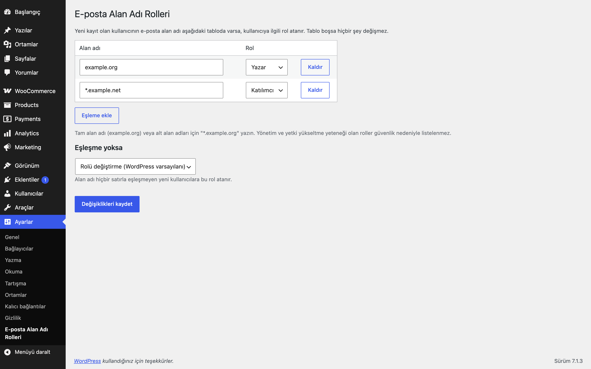

# Email Domain Roles for WordPress

Yeni kayıt olan kullanıcıya e-posta alan adına göre otomatik rol atar. Eşleme tablosu Ayarlar → E-posta Alan Adı Rolleri ekranından yönetilir ve varsayılan olarak boştur.

## Özellikler

- Alan adı → rol eşleme tablosu (varsayılan boş)
- `*.example.org` ile alt alan adı eşleşmesi
- İsteğe bağlı "eşleşme yoksa" rolü (varsayılan: rolü değiştirme)
- Yönetici bilinçli olarak seçtiği (varsayılan dışı) rollere dokunmaz
- `manage_options`, `promote_users`, `edit_users`, `create_users`, `unfiltered_html`, `install_plugins`, `edit_theme_options`, `manage_woocommerce` gibi yetkili yeteneklere sahip roller listelenmez ve atanamaz
- Bir yönetici kullanıcıyı elle eklerken (kullanıcı oluşturma yetkisiyle) rol değiştirilmez; yalnızca kayıt formu, WooCommerce hesap kaydı ve benzeri otomatik kayıtlar eşlenir

## Kurulum

1. `email-domain-roles-for-wordpress` klasörünü `wp-content/plugins/` altına kopyalayın (veya zip olarak yükleyin).
2. Eklentiler ekranından etkinleştirin.
3. Ayarlar → **E-posta Alan Adı Rolleri** ekranından eşlemeleri ekleyin.

## Ayarlar

Ayarlar → E-posta Alan Adı Rolleri: eşleme tablosu (`eru_edr_mappings`, boş) ve eşleşme yoksa rol (`eru_edr_fallback_role`, boş = değiştirme).

## Nasıl kullanılır

1. Eklentiyi etkinleştirin ve Ayarlar → **E-posta Alan Adı Rolleri** ekranını açın.
2. Eşleme ekleyin: alan adı `example.com`, rol "Müşteri" (veya sitenizde tanımlı yetkisiz bir rol). Alt alan adlarını da kapsamak için `*.example.org` biçimini kullanabilirsiniz.
3. İsterseniz "eşleşme yoksa" rolünü seçin; boş bırakırsanız eşleşmeyen kullanıcılar olduğu gibi kalır.
4. Kaydedin.
5. Çıkış yapmış bir tarayıcıda `kisi@example.com` adresiyle kayıt olun.
6. Yeni kullanıcı Kullanıcılar listesinde tanımladığınız rolle görünür. Eşleşmeyen alan adıyla kayıt olan kullanıcı varsayılan rolünü korur (ya da eşleşme yoksa rolü atanmışsa onu alır).

## Kancalar ve filtreler

| Ad | Tür | Açıklama |
|---|---|---|
| `eru_edr_allowed_roles` | filtre | Atanabilir roller (rol anahtarı => ad) |
| `eru_edr_replaceable_roles` | filtre | Üzerine yazılabilen mevcut roller (varsayılan: WordPress varsayılan rolü ve `customer`) |
| `eru_edr_assign_for_admin_created` | filtre | `true` dönerse yönetici tarafından eklenen kullanıcılar da eşlenir (varsayılan `false`) |
| `eru_edr_role_assigned` | eylem | Rol atandıktan sonra (`$user_id`, `$role`, `$email`) |

## Gereksinimler

WordPress 6.5+, PHP 8.0+. WooCommerce gerekmez.

## Sınırlamalar

- Kayıt sırasındaki e-posta adresi doğrulanmamıştır; birine yetki verilecek bir alan adı eşlemesi yaparsanız e-posta doğrulaması (ör. onay bağlantısı) kullanmanız önerilir.
- Yalnızca kullanıcı oluşturulurken çalışır; sonradan e-posta değiştirmek rolü etkilemez.
- Eklenti silindiğinde (Eklentiler → Sil) yalnızca kendi ayarları (`eru_edr_*` seçenekleri) silinir; kullanıcılara daha önce atanmış roller değişmez.

## SSS

**Kullanıcıyı yönetici yapabilir miyim?** Hayır, yönetim ve yetki yükseltme yeteneği olan roller güvenlik nedeniyle atanamaz (`eru_edr_allowed_roles` filtresiyle değiştirilebilir).

**Yönetici ekranından seçtiğim rol ezilir mi?** Varsayılan rol dışında bir rol seçtiyseniz ezilmez.

**Eşleşmelerde hangisi geçerli olur?** Tablo yukarıdan aşağı taranır ve ilk eşleşen satır kazanır. `*.example.org` yalnızca alt alan adlarını (ör. `a.example.org`) kapsar; `example.org` için ayrı bir satır ekleyin.

**Eklentiyi devre dışı bırakınca ne olur?** Yeni kayıtlara rol atanmaz; ayarlar ve daha önce atanmış roller olduğu gibi kalır. Eklenti silinince (Eklentiler → Sil) yalnızca `eru_edr_mappings` ve `eru_edr_fallback_role` seçenekleri silinir.

**WooCommerce hesap kaydı ile çalışır mı?** Evet; eklenti WordPress'in kullanıcı oluşturma olayına bağlanır, bu yüzden WooCommerce hesap kaydı da kapsanır. WooCommerce gerekmez, ancak varsa müşteri (`customer`) rolü de değiştirilebilir roller arasındadır.

**Dış servis kullanıyor mu?** Hayır; yalnızca kayıt anında e-posta adresinin alan adı kısmına bakılır, hiçbir veri dışarı gitmez.

## English summary

Assigns a role to newly registered users based on their e-mail domain. The domain-to-role table (Settings > E-posta Alan Adı Rolleri) is empty by default; wildcard `*.example.org` is supported and roles with administrative or privilege-escalation capabilities (manage_options, promote_users, edit_users, create_users, unfiltered_html, install_plugins, edit_theme_options, manage_woocommerce) are excluded.

## Sürüm notları

Bkz. [CHANGELOG.md](CHANGELOG.md).

## Destek

- Önce bu sayfadaki **SSS** ve **Sınırlamalar** bölümlerine göz atın; sık karşılaşılan durumlar orada.
- Hata mı buldunuz? [GitHub Issues](https://github.com/erayusta/erusoft-wp/issues) üzerinden bildirin. WordPress, PHP ve eklenti sürümünü, adımları ve beklenen/gerçekleşen sonucu yazmanız işi hızlandırır.
- Kurulum, yapılandırma, özel geliştirme veya entegrasyon desteği için **[hello@erusoft.com](mailto:hello@erusoft.com)** adresine yazın. Erusoft hakkında: [erusoft.com](https://erusoft.com).
- Lütfen şifre, API anahtarı veya müşteri verisi (ad, telefon, TCKN, sipariş dökümü) göndermeyin; ekran görüntülerindeki kişisel verileri karartın.

## Lisans

GPL-2.0-or-later. Diğer Erusoft eklentileri: https://wordpress.erusoft.com
