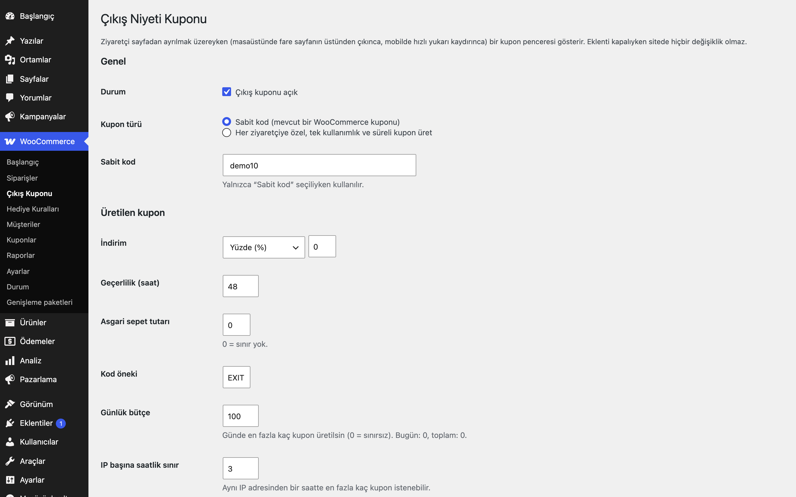
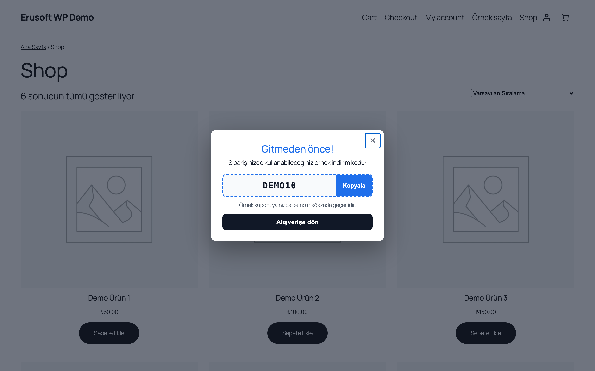
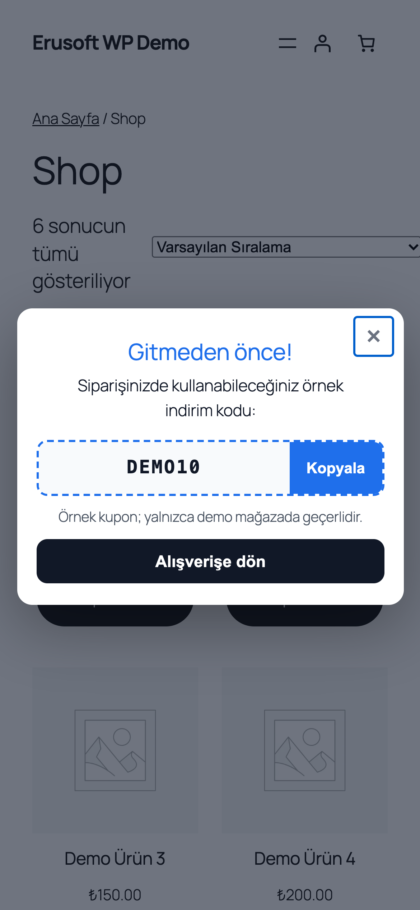

# Exit-Intent Coupons for WooCommerce

Sayfadan ayrılmak üzere olan ziyaretçiye kupon penceresi gösterir: sabit kod ya da kişiye özel, tek kullanımlık ve süreli kupon.

> **English:** Shows a coupon pop-up when a visitor is about to leave (pointer leaves through the top edge on desktop, quick scroll-up heuristic on touch devices). Either a fixed coupon code, or a single-use, time-limited coupon generated per visitor within a daily budget and a per-IP rate limit. Shown once per visitor (cookie days). Disabled by default.

   

## Ne işe yarar

Ziyaretçi sepete ya da ödemeye varmadan siteyi terk etmeden önce ona bir indirim kodu sunarsınız. Kod ya sizin tanımladığınız bir WooCommerce kuponudur ya da her ziyaretçi için ayrı üretilen, bir kez kullanılabilen ve birkaç saat geçerli bir kupondur; günlük bütçe ve IP sınırı kötüye kullanımı sınırlar.

## Özellikler

- Masaüstü: fare sayfanın üst kenarından çıkarken; mobil: gecikme ve kaydırma sonrası hızlı yukarı kaydırma
- İki kupon türü: sabit kod veya üretilen kupon (yüzde ya da sabit tutar, geçerlilik saati, asgari sepet, kod öneki; tek kullanım)
- Günlük bütçe (üretilen kupon sayısı) ve IP başına saatlik sınır
- Ziyaretçi başına sıklık: gösterildikten sonra belirlenen gün boyunca tekrar gösterilmez (çerez)
- Ödeme ve sepet sayfalarını hariç tutma; yalnızca sepeti dolu ziyaretçilere gösterme
- Başlık, metin, koşul notu, düğme ve vurgu rengi ayardan
- Süresi dolan üretilmiş kuponlar günlük işle temizlenir (iş yalnızca pencere açıkken zamanlanır)
- Klavye ve ekran okuyucu uyumlu pencere (Esc ile kapanır, odak yakalanır)
- Varsayılan kapalıdır; kapalıyken hiçbir betik veya biçim dosyası yüklenmez

## Kurulum

1. `exit-intent-coupons-for-woocommerce` klasörünü `wp-content/plugins/` altına kopyalayın (veya zip olarak yükleyin).
2. Eklentiler ekranından etkinleştirin (WooCommerce gereklidir).
3. WooCommerce → **Çıkış Kuponu** ekranında kupon türünü seçin, kodu girin ve "açık" işaretleyin.

## Ayarlar

WooCommerce → **Çıkış Kuponu**. Ayarlar `eru_eic_settings` seçeneğinde, günlük sayaçlar `eru_eic_stats` seçeneğinde saklanır. Sabit kod için kuponu önce WooCommerce → Pazarlama → Kuponlar'dan oluşturun; kod bulunamazsa ayar ekranı uyarır.

## Kancalar, filtreler ve veri alanları

| Ad | Tür | Açıklama |
|---|---|---|
| `eru_eic_settings` | seçenek | Tüm ayarlar (varsayılan: kapalı) |
| `eru_eic_active` | filtre | `($active, $settings)`; pencereyi belirli sayfalarda kapatmak için |
| `eru_eic_client_ip` | filtre | IP başına saatlik kupon sınırı için ziyaretçi IP'si (varsayılan `REMOTE_ADDR`); proxy/CDN arkasında gerçek adresi döndürün |
| `POST /wp-json/eru-eic/v1/coupon` | REST | Üretilen kupon modunda kodu verir (herkese açık, sınırlı) |
| `_eru_eic_generated` | kupon meta | Üretilen kuponların işareti (temizlik bununla yapılır) |
| `window.eruEic.open()` | JS | Pencereyi elle tetikler (deneme için) |

## Entegrasyonlar ve gereksinimler

WordPress 6.5+, PHP 8.0+, WooCommerce 9.0+. HPOS ile uyumludur. Harici servis kullanmaz; dış HTTP isteği yapmaz. Sabit kod modunda kod sayfa HTML'inde bulunur; üretilen kupon modunda kod sayfada yoktur, pencere açılırken istenir (sayfa önbelleğiyle uyumludur).

## Sınırlamalar

- Mobilde "ayrılmak üzere" olmayı güvenilir biçimde bilmek mümkün değildir; yöntem, kaydırma davranışına dayalı bir sezgidir ve geri tuşunu engellemez.
- Çerez silen veya gizli sekme kullanan ziyaretçi pencereyi yeniden görebilir; üretilen kuponlarda IP sınırı ve günlük bütçe devrededir.
- Kupon otomatik olarak sepete uygulanmaz; ziyaretçi kodu kopyalayıp girer.
- Ayarlardaki bütçe, üretilen kupon sayısını sınırlar; harcanan tutarı takip etmez.
- Eklenti silindiğinde yalnızca kendi ayarları ve zamanlanmış görevi silinir; üretilmiş kuponlar süresi dolunca temizlenir veya Kuponlar ekranından silinebilir.

## SSS

**Sayfa önbelleği (cache) kullanıyorum, sorun olur mu?** Üretilen kupon modunda HTML'e kişiye özel hiçbir şey gömülmez; kod REST isteğiyle alınır ve yanıt önbelleğe alınmaz. "Gösterildi" çerezi yalnızca tarayıcıda kontrol edilir, form nonce kullanmaz; bu yüzden önbellekteki HTML herkes için aynıdır. "Sepet boşken gösterme" seçeneği sunucuda değerlendirilir; bu seçeneği kullanıyorsanız sepeti dolu ziyaretçilere önbellekten sayfa sunulmadığından emin olun. Proxy/CDN arkasında IP sınırı için `eru_eic_client_ip` filtresini kullanın.

**Kupon kuralları nasıl belirlenir?** Sabit kod modunda WooCommerce kuponunun kendi kuralları geçerlidir. Üretilen modda kupon tek kullanımlıktır, diğer kuponlarla birleştirilemez (bireysel kullanım) ve ayarladığınız asgari sepet tutarını taşır.

## Değişiklik geçmişi

Bkz. [CHANGELOG.md](CHANGELOG.md).

## Lisans

GPL-2.0-or-later.

Diğer Erusoft eklentileri: https://wordpress.erusoft.com/
