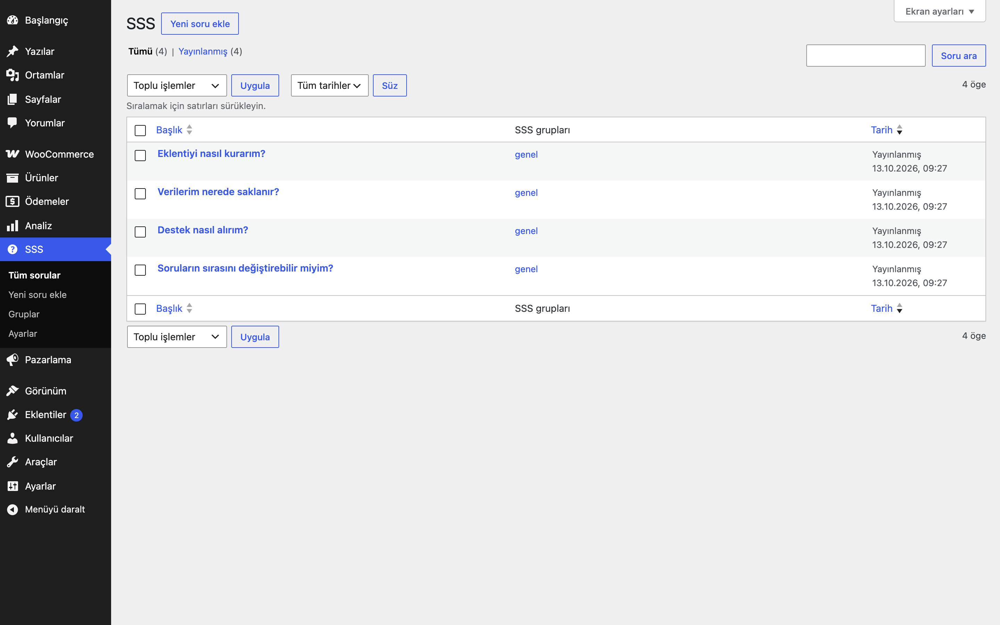
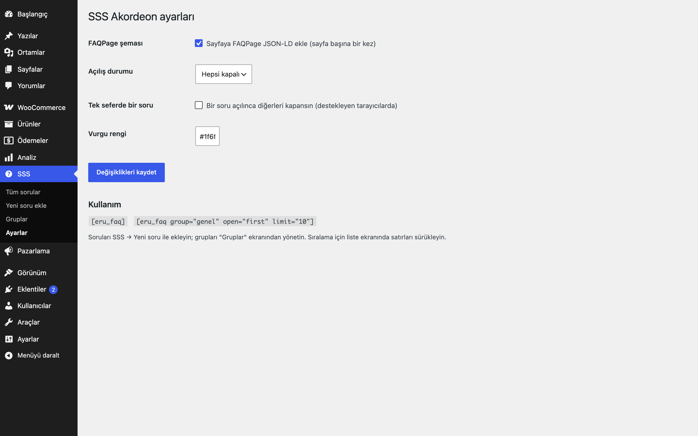
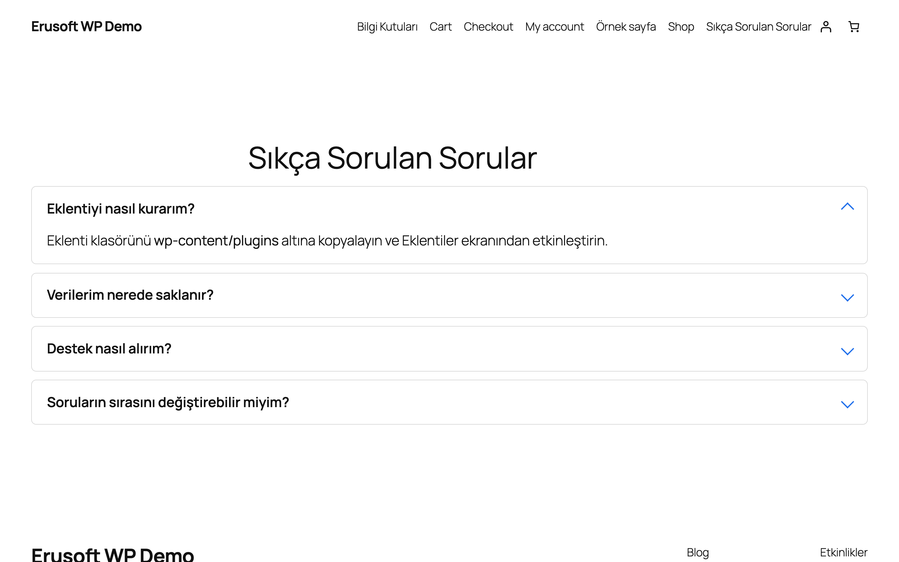
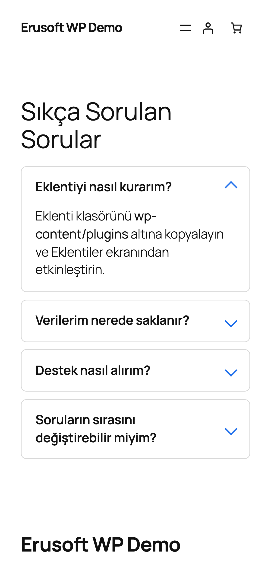

# FAQ Accordion for WordPress

Sıkça sorulan soruları gruplayıp erişilebilir akordeon olarak gösterir; isteğe bağlı FAQPage şeması ekler.

> **English:** Manage FAQs as sortable items grouped by category and show them with the accessible `[eru_faq]` accordion (native `
/
`). Optional FAQPage JSON-LD (default on) is printed once per page.

  

## Ne işe yarar

Sorularınızı yönetim panelinde SSS içerik türü olarak girer, gruplara ayırır ve sürükleyerek sıralarsınız. `[eru_faq]` kısa kodu bunları klavyeyle de kullanılabilen bir akordeon olarak gösterir; arama motorları için FAQPage şeması sayfaya bir kez eklenir.

## Özellikler

- SSS içerik türü ve grup sınıflandırması; liste ekranında sürükle-bırak sıralama
- `
/
` tabanlı, JavaScript gerektirmeyen erişilebilir akordeon
- İsteğe bağlı "tek seferde bir soru" davranışı (destekleyen tarayıcılarda)
- FAQPage JSON-LD (varsayılan açık) sayfa başına yalnızca bir kez basılır
- Cevaplar `wp_kses_post` ile temizlenir; koyu/açık temada çalışan sade CSS

## Kurulum

1. `faq-accordion-for-wordpress` klasörünü `wp-content/plugins/` altına kopyalayın (veya zip olarak yükleyin).
2. Eklentiler ekranından etkinleştirin.
3. Ayarları yapın (aşağıya bakın).

## Ayarlar

SSS → **Ayarlar**: şema açık/kapalı, açılış durumu (hepsi kapalı / ilk açık / hepsi açık), tek seferde bir soru, vurgu rengi. Ayarlar `eru_faq_settings` seçeneğinde saklanır.

## Kısa kodlar, kancalar, filtreler

| Ad | Tür | Açıklama |
|---|---|---|
| `[eru_faq]` | kısa kod | `group` (grup kısa adı), `limit`, `open` (`none`/`first`/`all`), `schema` (`1`/`0`) |
| `eru_faq_print_schema` | filtre | `($yazdır, $öğeler)`; şema çıktısını koşullu kapatır |
| `eru_faq` / `eru_faq_group` | içerik türü / sınıflandırma | Sorular ve gruplar |

## Entegrasyonlar ve gereksinimler

WordPress 6.5+, PHP 8.0+. WooCommerce gerekmez. Harici servis kullanmaz.

## Sınırlamalar

- Aynı sayfadaki birden çok kısa kod için FAQPage şeması yalnızca ilk kısa kodun sorularını içerir (arama motorları sayfa başına tek FAQPage ister).
- Blok sürümü yoktur; kısa kod bloğu içinde kullanın.

## SSS

**Şemayı kapatabilir miyim?** Evet: Ayarlar'dan ya da `[eru_faq schema="0"]` ile.

## Değişiklik geçmişi

Bkz. [CHANGELOG.md](CHANGELOG.md).

## Lisans

GPL-2.0-or-later.

Diğer Erusoft eklentileri: https://wordpress.erusoft.com/
