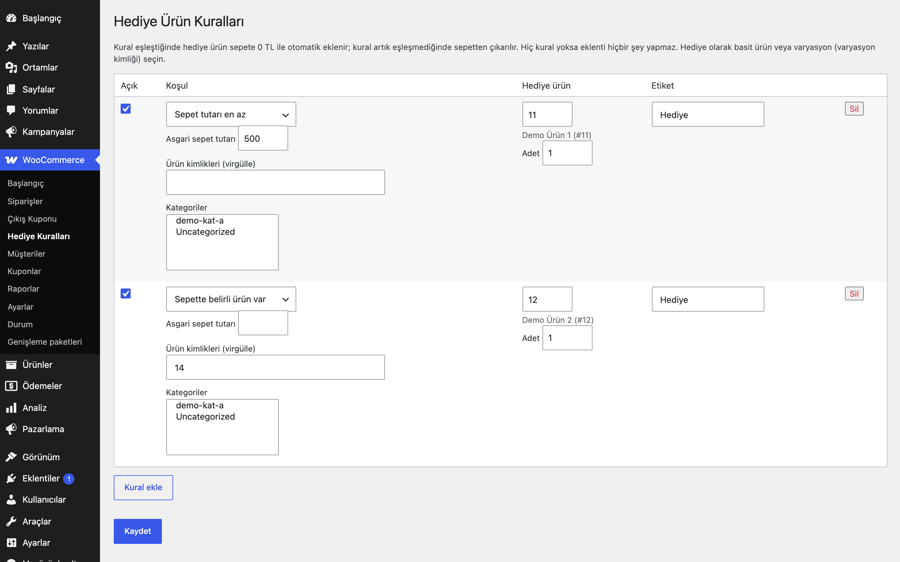
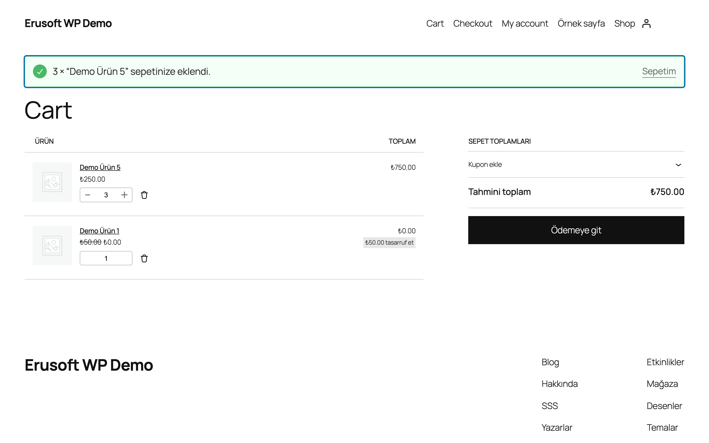
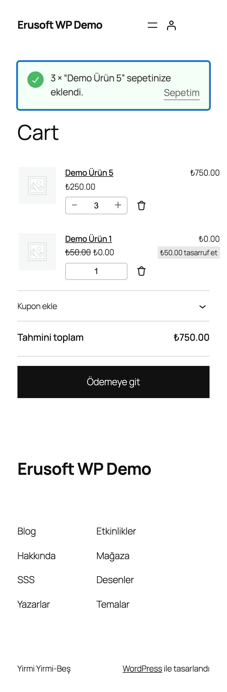

# Gift Product Rules for WooCommerce

Koşul sağlandığında hediye ürünü sepete 0 TL ile otomatik ekler, koşul bozulunca çıkarır.

> **English:** Rules (cart total, a product in the cart, a category in the cart) automatically add a free gift product to the cart and remove it again when the rule stops matching. Gift lines have a locked quantity and a fixed 0 price. With no rules the plugin does nothing.

   

## Ne işe yarar

"Sepet 500 TL'yi geçerse hediye", "şu ürünü alana şu hediye" ya da "şu kategoriden alışverişe hediye" gibi kampanyaları kuralla tanımlarsınız. Müşteri ürünü sepete eklediğinde hediye otomatik gelir; sepet koşulun altına düşerse otomatik kalkar. Hediye satırının fiyatı her hesaplamada 0'a sabitlenir, adedi kural tarafından belirlenir.

## Özellikler

- Üç koşul türü: sepet tutarı en az X, sepette belirli ürün(ler), sepette belirli kategori(ler) (alt kategoriler dahil)
- Her koşula isteğe bağlı asgari sepet tutarı eklenebilir
- Hediye olarak basit ürün veya varyasyon (varyasyon kimliği); adet kuraldan gelir
- Hediye satırının adedi müşteri tarafından değiştirilemez; sepette "Hediye" (etiket ayardan) görünür
- Müşterinin aynı üründen ayrıca eklediği satır tam fiyatlı kalır
- Stokta olmayan veya satın alınamayan hediye eklenmez
- Toplamlar kaç kez yeniden hesaplanırsa hesaplansın aynı sonucu verir
- Sipariş kaleminde `_eru_gpr_gift` meta alanı ve görünür "Kampanya" notu bulunur

## Kurulum

1. `gift-product-rules-for-woocommerce` klasörünü `wp-content/plugins/` altına kopyalayın (veya zip olarak yükleyin).
2. Eklentiler ekranından etkinleştirin (WooCommerce gereklidir).
3. WooCommerce → **Hediye Kuralları** ekranından kural ekleyin. Kural eklenene kadar mağazanızda hiçbir değişiklik olmaz.

## Ayarlar

WooCommerce → **Hediye Kuralları**. Kurallar `eru_gpr_rules` seçeneğinde saklanır; varsayılan boştur. Tutar karşılaştırması, sepetteki hediye olmayan satırların birim fiyatı × adet toplamıdır (fiyatın vergi dahil/hariç olması mağaza ayarınıza uyar).

## Kancalar, filtreler ve veri alanları

| Ad | Tür | Açıklama |
|---|---|---|
| `eru_gpr_rules` | seçenek | Kural listesi (`enabled`, `label`, `trigger`, `min_total`, `product_ids`, `category_ids`, `gift_id`, `qty`) |
| `eru_gpr_active_rules` | filtre | Sepet için eşleşen kurallar (`$rules`, `$cart`); ek koşul eklemek için kullanın |
| `_eru_gpr_gift` | sepet satırı / sipariş kalemi meta | Hediye satırının işareti (değer: kural kimliği) |

## Entegrasyonlar ve gereksinimler

WordPress 6.5+, PHP 8.0+, WooCommerce 9.0+. HPOS ile uyumludur. Klasik ve blok tabanlı sepette çalışır. Harici servis kullanmaz. **[Gift Line Guard](../../mu-plugins/gift-line-guard-for-woocommerce/)** (mu-plugin) ile birlikte kullanılabilir: aynı `_eru_gpr_gift` işaretini okuyup hediye satırlarına ek bir koruma katmanı ekler.

## Sınırlamalar

- "Sepet tutarı en az" eşiği kupon ve indirim ücretlerinden **önceki** ürün tutarına (satır fiyatı × adet, hediye satırları hariç, KDV ayarınıza göre mağaza fiyatı) bakar; kupon sepeti eşiğin altına düşürse de hediye kalır.
- Hediye ürün olarak değişken ürünün kendisi seçilemez; tek bir varyasyon kimliği girin.
- Blok tabanlı sepette hediye satırında sil düğmesi görünebilir; silinen hediye kural hâlâ eşleştiği için bir sonraki hesaplamada geri eklenir.
- Her kural için yalnızca bir hediye satırı oluşur.
- Eklenti silindiğinde (Eklentiler → Sil) yalnızca kendi ayarı (`eru_gpr_rules`) silinir; sipariş meta alanları kalır.

## SSS

**Hediye ücretlendirilir mi?** Hayır; satır fiyatı her hesaplamada 0'dır, toplama eklenmez.

**Hangi eklentiyle birlikte kullanılır?** [Otomatik İndirimler](../automatic-discounts-for-woocommerce/) ve [Sepet Kampanyaları](../cart-campaigns-for-woocommerce/) ile birlikte çalışabilir; hediye satırı tutar karşılaştırmasına dahil edilmez.

## Değişiklik geçmişi

Bkz. [CHANGELOG.md](CHANGELOG.md).

## Lisans

GPL-2.0-or-later.

Diğer Erusoft eklentileri: https://wordpress.erusoft.com/
