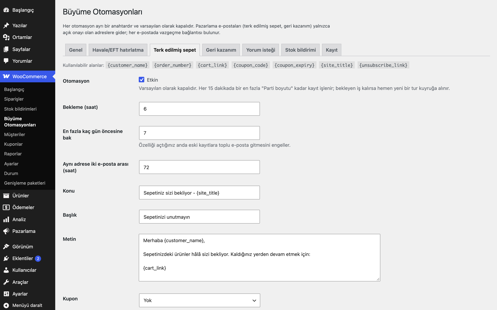
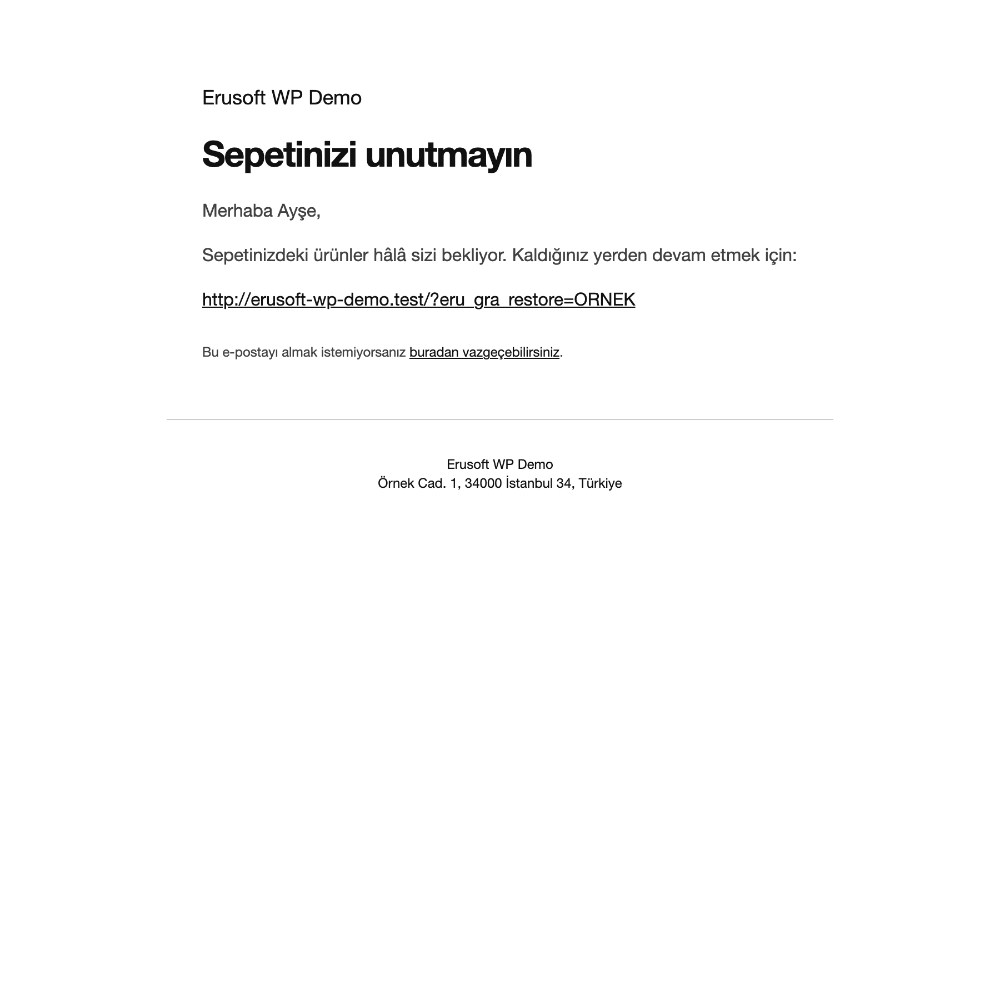

# Growth Automations for WooCommerce

> **English:** Five opt-in automations for WooCommerce, all off by default: a bank-transfer payment reminder, a consent-based abandoned-cart e-mail with a restore link, a win-back e-mail with a unique, expiring, single-use coupon created before the mail is sent, a post-delivery review request, and variation-aware "notify me when back in stock" with double opt-in. Backlogs are processed completely in Action Scheduler batches. Every marketing e-mail carries a working unsubscribe link, nothing is stored before consent, and personal data has an exporter, an eraser and a retention purge.

[](https://www.gnu.org/licenses/gpl-2.0.html)   

Havale/EFT ödemesini bekleyen siparişleri hatırlatan, terk edilen sepeti yalnızca onayla kaydeden, geri kazanım e-postasına kişiye özel kupon üreten, teslimattan sonra yorum isteyen ve varyasyon bazında "stoğa gelince haber ver" sunan otomasyonlar. Her otomasyonun kendi anahtarı vardır ve varsayılan olarak **kapalıdır**; etkinleştirmeden önce ön yüzde hiçbir değişiklik olmaz, hiçbir zamanlanmış iş oluşmaz.



## Özellikler

- **Havale/EFT hatırlatma** (işlem e-postası): banka havalesi ile ödenen ve "beklemede" kalan siparişler için, bekleme süresi (varsayılan 3 saat) dolduktan sonra tek hatırlatma. WooCommerce'in kendi banka hesap bilgileri e-postaya eklenir. Sipariş başına bir kez (`_eru_gra_bacs_reminded`).
- **Terk edilmiş sepet:** sepet yalnızca ödeme sayfasındaki onay kutusu işaretlendiğinde, Hesabım'daki "pazarlama e-postaları" izniyle ya da bir izin sağlayıcı filtreyle kaydedilir. Bekleme süresinden (varsayılan 6 saat) sonra tek e-posta ve `/?eru_gra_restore=<jeton>` geri yükleme bağlantısı. Geri yükleme mevcut sepeti boşaltmaz, ürünleri ekler; bağlantı tek kullanımlıktır. Aynı e-postayla sipariş verilince kayıt "kurtarıldı" olur.
- **Geri kazanım:** son tamamlanmış siparişi N günden (varsayılan 60) eski olan ve izni bulunan müşteriye, müşteri başına N günde bir e-posta. İsteğe bağlı olarak her alıcıya özel kupon üretilir.
- **Yorum isteği** (işlem e-postası): tamamlanan siparişten N gün (varsayılan 7) sonra, ürünlerin yorum bölümüne giden bağlantılarla; sipariş başına bir kez.
- **Stoğa gelince haber ver:** stokta olmayan basit ürünlerde ve her varyasyonda form. Önce çift onay e-postası gider; yalnızca onaylanan istekler, yalnızca o varyasyon (ya da ürün) stoğa girince, bir kez bildirilir.
- **Kuponlar:** e-posta bir kupon vaat ediyorsa kupon gönderimden önce oluşturulur: `<ÖNEK>-<8 karakter>`, tek kullanımlık, bitiş tarihli, alıcının e-postasına bağlı. Oluşturulamazsa e-posta gönderilmez ve kayıt ekranına yazılır. Süresi dolmuş, kullanılmamış üretilen kuponlar günlük işte silinir.
- **E-postalar** WooCommerce'in kendi e-posta şablonuyla (logo, renkler, alt bilgi: WooCommerce > Ayarlar > E-postalar) gönderilir; renk eklentide sabitlenmemiştir. Şablon `woocommerce/emails/eru-gra-message.php` ile temada geçersiz kılınabilir.
- **Kayıt ekranı:** son 200 işlem (otomasyon, maskeli e-posta, sonuç). **WP-CLI:** `wp eru-gra run <otomasyon> [--dry-run]`.



## Kurulum

1. `growth-automations-for-woocommerce` klasörünü `wp-content/plugins/` altına kopyalayın (veya zip olarak yükleyin).
2. Eklentiler ekranından etkinleştirin. WooCommerce gereklidir.
3. WooCommerce > **Büyüme Otomasyonları** ekranından ihtiyacınız olan sekmeyi açıp otomasyonu etkinleştirin. Metinler, bekleme süreleri ve kupon ayarları sekme başına yapılır.

Etkinleştirme yalnızca iki tablo (`{önek}eru_gra_carts`, `{önek}eru_gra_log`) oluşturur. Bir otomasyon açılana kadar zamanlanmış iş, dış HTTP isteği ya da ön yüz çıktısı olmaz.

## Ayarlar

Her otomasyon sekmesinde aynı alanlar bulunur: açık/kapalı, bekleme (Havale ve sepet için saat, geri kazanım ve yorum için gün), "en fazla kaç gün öncesine bak" (özelliği açtığınız anda eski kayıtlara toplu e-posta gitmesini önler), konu, başlık, metin, kupon (yok / var olan kod / her alıcıya özel üret: tür, tutar, asgari sepet, geçerlilik günü, önek) ve parti boyutu (varsayılan 50).

Metinlerde kullanılabilir alanlar: `{customer_name}`, `{order_number}`, `{cart_link}`, `{coupon_code}`, `{coupon_expiry}`, `{site_title}`, `{unsubscribe_link}`. Stok bildiriminde ayrıca `{product_name}`, `{product_link}` (onay e-postasında `{confirm_link}`). Metin `{coupon_code}` içeriyorsa ama kupon sağlanamıyorsa e-posta gönderilmez.

| Seçenek | Varsayılan |
|---|---|
| Havale hatırlatma bekleme / en fazla yaş | 3 saat / 14 gün |
| Sepet e-postası bekleme / en fazla yaş / aynı adrese iki e-posta arası | 6 saat / 7 gün / 72 saat |
| Geri kazanım bekleme / en fazla yaş | 60 gün / 180 gün |
| Yorum isteği bekleme / en fazla yaş | 7 gün / 30 gün |
| Saklama süresi (sepet kayıtları, stok bildirimleri) | 90 gün |
| Parti boyutu | 50 |

Ayarlar tek seçenekte (`eru_gra_settings`, otomatik yüklenmez) tutulur. Sipariş meta alanları: `_eru_gra_bacs_reminded`, `_eru_gra_review_requested`, `_eru_gra_winback_at`, `_eru_gra_marketing_consent`.

## Nasıl çalışır

Etkin her otomasyon için 15 dakikada bir Action Scheduler işi (`eru_gra_run`, grup `eru-gra`) çalışır. İş, "yapıldı" işaretini sorguda taşıyan seçimle en fazla parti boyutu kadar kaydı işler; hâlâ bekleyen kayıt varsa hemen yeni bir tur kuyruğa alır. Böylece binlerce bekleyen kayıt olsa bile hepsi işlenir, "en yeni 20 kayıt" penceresi yoktur. Otomasyon başına kilit, aynı anda iki turun çalışmasını engeller. Geri kazanımda her müşterinin yalnızca son siparişi dikkate alınır.

## İzin ve İYS

- Ticari elektronik ileti göndermek için alıcının onayı gerekir (Türkiye'de ETK ve İYS). **Bu eklenti İYS kaydı yapmaz, İYS ile konuşmaz.** İzni nasıl topladığınız ve kaydettiğiniz sizin sorumluluğunuzdadır.
- **Terk edilmiş sepet** ve **geri kazanım** ticari e-postadır ve yalnızca izin varsa çalışır. İzin şu kaynaklardan biriyle sağlanır: ödeme sayfasındaki (varsayılan işaretsiz) onay kutusu, Hesabım'daki "pazarlama e-postaları" kutusu ya da `eru_gra_has_marketing_consent` filtresi.
- **Havale hatırlatma** ve **stok bildirimi** işlem e-postasıdır (açık siparişiniz ya da onayladığınız istek hakkında); izin kaydı gerektirmez. **Yorum isteği** işlem e-postası olarak ele alınır ama vazgeçenlere gönderilmez.
- Vazgeçmiş (engellenmiş) bir adres ancak adresin sahibinin taze ve açık izniyle geri açılır: Hesabım'daki kutunun hesap sahibince yeniden işaretlenmesi ya da ödeme sayfasındaki kutunun **adresin sahibi olarak oturum açmış** kullanıcı tarafından işaretlenmesi. Kutuyu misafir ya da başka bir hesap (hesap e-postası fatura e-postasından farklı) işaretlerse engel kalkmaz; siparişin ödenmesi de kaldırmaz. Bunun yerine o adrese tek bir onay e-postası gider (imzalı, tek kullanımlık, 48 saat geçerli bağlantı; aynı adrese 24 saatte en fazla bir e-posta). Bağlantıyı açmak (GET) yalnızca "E-postaları yeniden almak istiyorum" düğmesini gösterir; engel yalnızca aynı siteden gelen düğme gönderimiyle (POST) kalkar. Kutusu işaretlenmemiş bir sipariş engeli hiçbir zaman kaldırmaz.
- Her pazarlama e-postasında imzalı bir vazgeçme bağlantısı ve `List-Unsubscribe` başlığı bulunur. Bağlantıya tıklamak (GET) yalnızca bir düğme gösterir, durumu değiştirmez; düğme (POST) adresi engelleme listesine (`eru_gra_suppressed`, yalnızca tek yönlü özet) ekler. Engelleme her izin kaynağından önce gelir.
- Sepet bağlantısı da aynı şekilde çalışır: GET düğme gösterir, POST sepeti geri yükler. Bağlantı kimseyi oturum açmış yapmaz ve sepet içeriğini göstermez.
- İYS eklentileri filtre ile izin sağlayabilir:

```php
add_filter( 'eru_gra_has_marketing_consent', function ( $has, $email, $context ) {
    return $has || my_consent_store_has( $email ); // yalnızca açık, kanıtlanabilir izin için true döndürün
}, 10, 3 );
```

`$context` kontrolün nerede yapıldığını söyler: `capture` (sepet kaydı) ya da `send` (pazarlama e-postasından hemen önceki yeniden kontrol). Varsayılan değer `false`'tur. Conversion Boosters etkinse, yalnızca çift onayı tamamlamış bülten abonelerini kapsayan bir sağlayıcıdır.

## Kişisel veri

Saklananlar: onayla kaydedilen sepet satırları (yalnızca ürün/varyasyon kimliği ve adet, e-posta, onay kaynağı), stok bildirimi istekleri, üretilen kuponlar (e-postaya bağlı), maskelenmiş işlem kaydı ve bekleyen yeniden onay istekleri (`eru_gra_reconsent`: yalnızca adresin tek yönlü özeti, belirtecin özeti ve bitiş zamanı; süresi dolanlar yeni istek yazılırken silinir). WordPress'in kişisel veri dışa aktarma ve silme araçlarına kayıtlıdır. Saklama süresi (varsayılan 90 gün) dolunca sepet kayıtları ve gönderilmiş stok bildirimleri günlük işle partiler halinde silinir; onaylanmış ama henüz bildirilmemiş stok bildirimleri ürün stoğa girene kadar tutulur, onaylanmayanlar onay süresi dolunca silinir. Sepet yakalama için saatlik genel bir üst sınır vardır (`eru_gra_capture_hourly_cap`, varsayılan 300).

## Hangisini seçmeliyim?

| İhtiyaç | Bu eklenti | [Conversion Boosters](../conversion-boosters-for-woocommerce) | [Abandoned Checkout Call List](../abandoned-checkout-call-list-for-woocommerce) |
|---|---|---|---|
| Terk edilen sepete otomatik e-posta | Evet (izinle) | Hayır | Hayır |
| Terk edilen sepetleri aramak için liste | Hayır | Hayır | Evet |
| Çift onaylı bülten ve hoş geldin kuponu | Hayır | Evet | Hayır |
| Ücretsiz kargo çubuğu, sepet önerileri, süreli sepet kuponu | Hayır | Evet | Hayır |
| Havale hatırlatma, yorum isteği | Evet | Hayır | Hayır |
| Geri kazanım e-postası, kişiye özel kupon | Evet | Hayır | Hayır |
| Stoğa gelince haber ver | Evet | Hayır | Hayır |

Eklentiler birbirinden bağımsızdır, ayrı tablo ve ayarlar kullanır; birlikte çalışabilir. Örneğin Conversion Boosters'ın çift onaylı aboneleri bu eklentide `eru_gra_has_marketing_consent` filtresiyle pazarlama izni sayılır. Abandoned Checkout Call List arama listesi içindir, e-posta göndermez; bu eklenti kendi onay kutusunu ve kendi tablosunu kullanır.

## Kancalar ve filtreler

| Ad | Tür | Açıklama |
|---|---|---|
| `eru_gra_has_marketing_consent` | filtre | Pazarlama izni (`$has`, `$email`, `$context` = `capture` / `send`); varsayılan `false` |
| `eru_gra_capture_hourly_cap` | filtre | Misafir sepet yakalama için saatlik genel üst sınır (varsayılan 300) |
| `eru_gra_batch_size` | filtre | Temizlik ve saklama işlerinin parti boyutu (varsayılan 200) |
| `eru_gra_client_ip` | filtre | Hız sınırı için ziyaretçi IP'si (proxy arkasında gerçek adresi döndürün) |
| `eru_gra_restore_ttl` | filtre | Sepet bağlantısının geçerlilik süresi (saniye, varsayılan 30 gün) |
| `eru_gra_coupon_candidate` | filtre | Üretilecek kupon kodu adayı |

## Gereksinimler

WordPress 6.5+, PHP 8.0+, WooCommerce 9.0+ (Action Scheduler WooCommerce ile gelir). HPOS ile uyumludur; sipariş verisi yalnızca `WC_Order` üzerinden okunur ve yazılır. WooCommerce yoksa eklenti bir uyarı gösterir ve hiçbir şey yapmaz.

## Sınırlamalar

- Onay kutusu çift onaylı değildir: ödeme sayfasında başkasının adresi girilip kutu işaretlenebilir; bu yüzden gönderim hız sınırı ve e-posta arası bekleme süresiyle sınırlanır, her e-postada vazgeçme bağlantısı vardır.
- Ödeme sayfasındaki onay kutusu ve sepet yakalama **klasik** ödeme sayfası içindir (`[woocommerce_checkout]`). Blok ödeme sayfasında kutu gösterilmez; orada yalnızca Hesabım izni ve izin filtresi çalışır. Sipariş kurtarma blok ödemede de çalışır.
- Stok bildirimi formu JavaScript gerektirir.
- E-postalar `wp_mail` ile gider; teslim edilebilirlik (SPF, DKIM) sitenizin e-posta kurulumuna bağlıdır.
- Geri kazanımda müşteri, fatura e-postasıyla tanınır; farklı e-postalarla verilmiş siparişler ayrı müşteri sayılır.
- Eklenti silindiğinde (Eklentiler > Sil) kendi ayarları, tabloları, stok bildirimleri, zamanlanmış işleri ve üretilen kuponlardan süresi dolmuş, hiç kullanılmamış olanlar silinir. Vazgeçme (engelleme) listesi, müşteriye e-postayla gönderilmiş ve süresi dolmamış kuponlar ile kullanılmış kuponlar yeniden kurulumda korunur; bunlar yalnızca `wp-config.php`'de `define( 'ERU_GRA_REMOVE_DATA', true );` tanımlıysa silinir. Siparişlere yazılmış işaretler (`_eru_gra_*` sipariş metası) ve sipariş notları her durumda korunur.
- Google alışveriş beslemesi bu eklentinin kapsamında değildir.

## SSS

**Etkinleştirince e-posta gider mi?** Hayır. Tüm otomasyonlar kapalı gelir.

**Eski siparişlere toplu e-posta gider mi?** Hayır; "en fazla kaç gün öncesine bak" sınırı dışındaki kayıtlar işlenmez.

**Kupon yoksa e-posta ne olur?** Metin `{coupon_code}` içeriyor ama kupon sağlanamıyorsa e-posta gönderilmez ve neden kayıt ekranında görünür.

## English summary

Opt-in automations for WooCommerce, off by default, with one tab per automation under WooCommerce > Büyüme Otomasyonları. Transactional: bank-transfer reminder, review request, double-opt-in back-in-stock alerts (simple products and single variations). Marketing (consent required): abandoned-cart e-mail with a single-use restore link, win-back with a unique coupon bound to the recipient and created before sending. Unsubscribe is signed and confirmed with a POST; suppression always wins. Selection queries carry the "done" flag and every run re-arms itself while work remains. A filter lets consent platforms grant consent; no İYS registration is performed. WP-CLI: `wp eru-gra run <automation> [--dry-run]`.

## Sürüm notları

Bkz. [CHANGELOG.md](CHANGELOG.md).

## Lisans

GPL-2.0-or-later. Diğer Erusoft eklentileri: https://wordpress.erusoft.com
