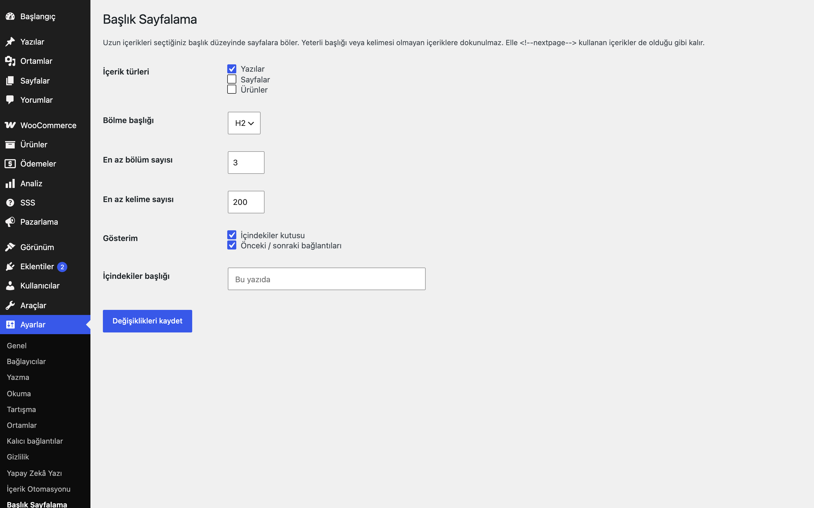
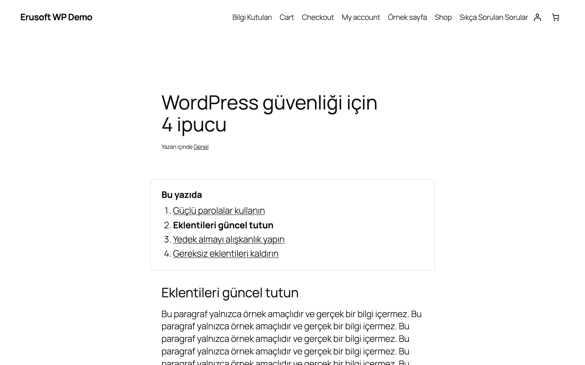
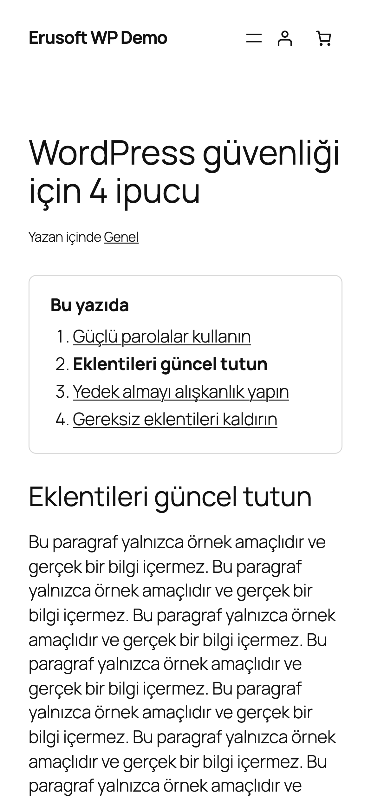

# Heading Pagination for WordPress

Uzun yazıları seçtiğiniz başlık düzeyinde sayfalara böler; içindekiler ve önceki/sonraki bağlantıları ekler.

> **English:** Splits long posts into pages at a chosen heading level (H2–H4) using WordPress's own pagination, adds a table of contents and prev/next links. Posts with too few headings or words are left untouched.

  

## Ne işe yarar

Çok uzun bir yazıyı her başlıkta ayrı sayfaya böler. Okuyucu içindekiler kutusundan istediği bölüme geçer; altta önceki/sonraki bağlantıları bulunur. Yeterli başlığı ya da kelimesi olmayan içeriğe hiç dokunulmaz.

## Özellikler

- Bölme başlığı H2, H3 veya H4 (varsayılan H2)
- En az bölüm sayısı ve en az kelime sayısı eşiği; altındaki içerik değişmez
- WordPress'in kendi sayfalamasını kullanır (`/yazi/2/`); adresler kalıcı bağlantı yapısını izler
- İçindekiler kutusu ve önceki/sonraki bağlantıları (ayrı ayrı kapatılabilir)
- Blok editörü başlık bloklarıyla uyumlu; elle `<!--nextpage-->` kullanan içeriğe dokunmaz
- İçerik türü seçimi (varsayılan yalnızca yazılar)

## Kurulum

1. `heading-pagination-for-wordpress` klasörünü `wp-content/plugins/` altına kopyalayın (veya zip olarak yükleyin).
2. Eklentiler ekranından etkinleştirin.
3. Ayarları yapın (aşağıya bakın).

## Ayarlar

Ayarlar → **Başlık Sayfalama**: içerik türleri, bölme başlığı, en az bölüm (varsayılan 3), en az kelime (varsayılan 600), içindekiler/gezinti, içindekiler başlığı. Seçenek: `eru_hp_settings`.

## Kısa kodlar, kancalar, filtreler

| Ad | Tür | Açıklama |
|---|---|---|
| `eru_hp_applies` | filtre | `($uygula, $yazı)`; belirli içeriklerde sayfalamayı kapatır/açar |
| `eru_hp_settings` | seçenek | Eklenti ayarları |

## Entegrasyonlar ve gereksinimler

WordPress 6.5+, PHP 8.0+. Harici servis kullanmaz.

## SEO notu

Bölüm sayfaları (`/yazi/2/`, `/yazi/3/`) kendi adreslerini canonical olarak taşır ve ayrı sayfalar olarak indekslenir; ilk sayfadaki içindekiler kutusu bu sayfalara bağlanır. Son bölümün ötesindeki adresler (`/yazi/9/`) gerçek 404 döndürür. Tüm yazının tek sayfada indekslenmesini isterseniz bu içerik için `eru_hp_applies` filtresiyle sayfalamayı kapatın.

## Sınırlamalar

- Sonraki bölümler AJAX ile değil, normal sayfa yenilemesiyle yüklenir.
- Bölüm başlıkları içerikte kullandığınız başlık düzeyine göre belirlenir; başlıksız giriş metni ilk sayfada kalır.
- Her sayfa ayrı sayfa görüntülemesi sayılır; analiz araçlarınızı buna göre yorumlayın.

## SSS

**Kısa yazılar etkilenir mi?** Hayır. Eşiklerin altındaki içerikler olduğu gibi tek sayfada gösterilir.

## Değişiklik geçmişi

Bkz. [CHANGELOG.md](CHANGELOG.md).

## Lisans

GPL-2.0-or-later.

Diğer Erusoft eklentileri: https://wordpress.erusoft.com/
