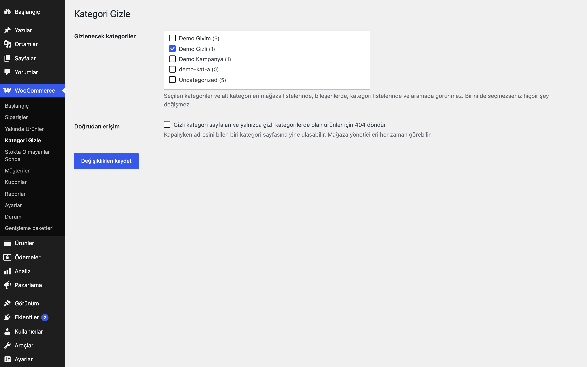

# Hide Categories for WooCommerce

Seçili kategorileri mağaza listelerinden, bileşenlerden, aramadan ve (isteğe bağlı) doğrudan erişimden gizler.

> **English:** Hides selected product categories (and their sub-categories) from shop loops, widgets, category lists and product search, with an optional 404 for direct access. Default: no category hidden, so nothing changes until you choose.

   

## Ne işe yarar

Seçtiğiniz kategoriler ve alt kategorileri; mağaza listelerinde, kategori bileşenlerinde, kategori listelerinde ve aramada görünmez. İsterseniz kategori sayfası ve yalnızca bu kategorilerde bulunan ürünler için 404 döndürülür.

## Özellikler

- Ağaç görünümünde kategori seçimi; alt kategoriler otomatik gizlenir
- Mağaza ve arşiv sorguları ile ürün aramasından ürünleri çıkarır
- Kategori bileşeni, blok ve alt kategori listelerinden kategoriyi çıkarır
- İlgili ürünler, yukarı satış (upsell) ve çapraz satış (cross-sell) listelerinden gizli kategorideki ürünleri çıkarır
- Smart Product Search for WooCommerce etkinse canlı arama açılır listesinden de gizli ürünleri ve kategorileri çıkarır
- İsteğe bağlı 404: gizli kategori sayfası ve yalnızca gizli kategorilerdeki ürünler
- Mağaza yöneticileri 404'ten etkilenmez
- Yönetim ekranı ve REST etkilenmez; Store API'de yalnızca çapraz satış/ilgili ürün listeleri süzülür

## Kurulum

1. `hide-categories-for-woocommerce` klasörünü `wp-content/plugins/` altına kopyalayın (veya zip olarak yükleyin).
2. Eklentiler ekranından etkinleştirin (WooCommerce gereklidir).
3. WooCommerce → **Kategori Gizle** ekranından kategorileri işaretleyin.

## Nasıl kullanılır

1. Eklentiyi etkinleştirin ve WooCommerce → **Kategori Gizle** ekranını açın.
2. Ağaçta "Demo Kategori"yi işaretleyin; alt kategorileri de otomatik gizlenir. Kaydedin.
3. Mağaza sayfasında, kategori bileşeninde ve arama sonuçlarında "Demo Kategori" ile bu kategorideki ürünlerin artık görünmediğini kontrol edin.
4. Kategori adresini adres çubuğuna yazarsanız sayfa hâlâ açılır; bunu da kapatmak için 404 kutusunu işaretleyip kaydedin.
5. Çıkış yapmış bir ziyaretçi olarak (ya da gizli pencerede) aynı adresi açın; 404 sayfasını görmelisiniz.

## Ayarlar

WooCommerce → **Kategori Gizle**. Seçenek: `eru_hc_settings` (`ids`, `block`). Varsayılan boştur.

## Kancalar, filtreler ve veri alanları

| Ad | Tür | Açıklama |
|---|---|---|
| `eru_hc_hidden_ids` | filtre | Gizlenecek kategori kimlikleri (`$ids`) |
| `eru_hc_apply_to_query` | filtre | Bir ürün sorgusunda filtrenin uygulanıp uygulanmayacağı (`$apply`, `$query`) |
| `eru_hc_filter_product_lists` | filtre | İlgili ürün, upsell ve cross-sell listelerinin süzülüp süzülmeyeceği (`$apply`, varsayılan `true`) |
| `eru_hc_skip => 1` | sorgu / terim argümanı | Tek bir `WP_Query` veya `get_terms` çağrısını kapsam dışı bırakır |

## Entegrasyonlar ve gereksinimler

WordPress 6.5+, PHP 8.0+, WooCommerce 9.0+. HPOS uyumludur. Harici servis kullanmaz. Smart Product Search for WooCommerce ile birlikte çalışır (`eru_sps_exclude_term_ids`, `eru_sps_categories`, `eru_sps_categories_version` filtrelerine bağlanır).

## Sınırlamalar

- Gizli kategoride olan bir ürün, başka bir kategoride de olsa mağaza listelerinde görünmez; ürün sayfası adresi yine açılır (404 seçeneği yalnızca tüm kategorileri gizli olan ürünleri kapatır).
- Doğrudan ürün bağlantıları, site haritası ve harici akışlar bu eklentinin kapsamı dışındadır.
- Tek ürün sayfasındaki "Kategori:" satırı ürünün kendi kategorilerini gösterir.

## SSS

**Kategori sayfası hâlâ açılıyor.** Kapalıyken adresi bilen herkes sayfaya ulaşabilir; "Gizli kategori sayfaları ve yalnızca gizli kategorilerde olan ürünler için 404 döndür" kutusunu işaretleyin. Ürün düzenleme yetkisi (`edit_products`) olan kullanıcılar 404'ten etkilenmez.

**Eklentiyi silersem ne olur?** Eklenti silindiğinde yalnızca `eru_hc_settings` seçeneği silinir; kategorileriniz ve ürünleriniz değişmez ve yeniden görünür olur. Devre dışı bırakmak da gizlemeyi hemen durdurur, ayar saklanır.

**HPOS ile uyumlu mu?** Evet, eklenti özel sipariş tabloları uyumluluğunu bildirir; siparişlere dokunmaz.

**Dış servis kullanıyor mu?** Hayır, dış istek yapmaz.

**Bir ürünü başka kategorideyken de gizler miyim?** Evet: gizli kategorideki ürün mağaza listelerinde görünmez. Ürün sayfası adresi ise, ürünün tüm kategorileri gizli olmadıkça ve 404 seçeneği açık olmadıkça açılmaya devam eder.

**Belirli bir sorguyu etkilememesini nasıl sağlarım?** `WP_Query` ya da `get_terms` argümanına `eru_hc_skip => 1` ekleyin.

## Değişiklik geçmişi

Bkz. [CHANGELOG.md](CHANGELOG.md).

## Destek

- Önce bu sayfadaki **SSS** ve **Sınırlamalar** bölümlerine göz atın; sık karşılaşılan durumlar orada.
- Hata mı buldunuz? [GitHub Issues](https://github.com/erayusta/erusoft-wp/issues) üzerinden bildirin. WordPress, WooCommerce, PHP ve eklenti sürümünü, adımları ve beklenen/gerçekleşen sonucu yazmanız işi hızlandırır.
- Kurulum, yapılandırma, özel geliştirme veya entegrasyon desteği için **[hello@erusoft.com](mailto:hello@erusoft.com)** adresine yazın. Erusoft hakkında: [erusoft.com](https://erusoft.com).
- Lütfen şifre, API anahtarı veya müşteri verisi (ad, telefon, TCKN, sipariş dökümü) göndermeyin; ekran görüntülerindeki kişisel verileri karartın.

## Lisans

GPL-2.0-or-later.

Diğer Erusoft eklentileri: https://wordpress.erusoft.com/
