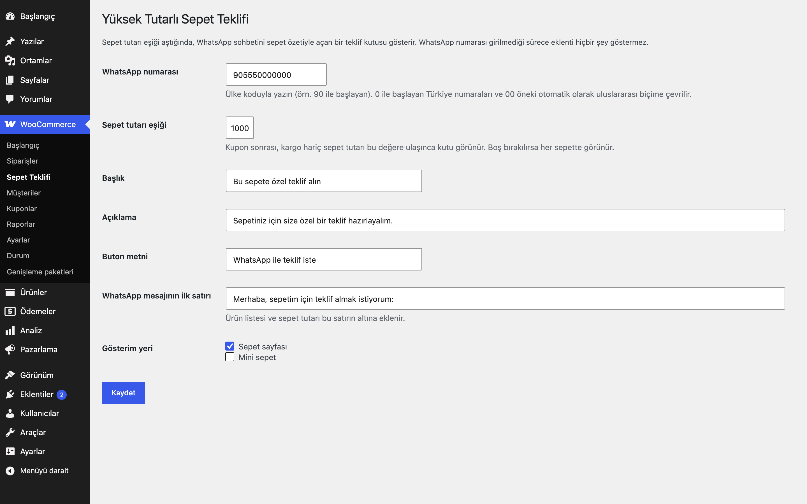

# High-Value Cart Offer for WooCommerce

Sepet tutarı eşiği aşıldığında sepet özetiyle WhatsApp sohbeti açan "Bu sepete özel teklif alın" kutusu.

> **English:** When the cart total reaches a configurable amount, shows an offer box whose button opens a WhatsApp chat (`wa.me`) pre-filled with the cart summary. Number, threshold and all texts are settings; nothing is shown until a WhatsApp number is set.

   

## Ne işe yarar

Yüksek tutarlı sepetlerde müşteriyi satış ekibine yönlendirir: kutudaki buton, ürün listesini ve sepet tutarını hazır yazılmış mesaj olarak WhatsApp'ta açar. Toplu alımlarda pazarlık veya özel teklif isteyen müşteriler için uygundur.

## Özellikler

- Sepet tutarı eşiği (boşsa her sepette görünür)
- WhatsApp numarası, başlık, açıklama, buton metni ve mesajın ilk satırı ayarlardan
- Mesaj: ilk satır + `- Ürün adı x adet` satırları + sepet tutarı (URL kodlu `wa.me` bağlantısı)
- Sepet sayfasında ve isteğe bağlı olarak mini sepette gösterim
- **Numara girilmedikçe hiçbir çıktı yoktur**

## Kurulum

1. `high-value-cart-offer-for-woocommerce` klasörünü `wp-content/plugins/` altına kopyalayın (veya zip olarak yükleyin).
2. Eklentiler ekranından etkinleştirin (WooCommerce gereklidir).
3. Aşağıdaki ayar ekranından yapılandırın. Yapılandırma yapılana kadar mağazanızda hiçbir değişiklik olmaz.

## Ayarlar

WooCommerce → **Sepet Teklifi**. Ayarlar `eru_hvco_settings` seçeneğinde saklanır. Numara ülke koduyla girilir (ör. `905550000000`); 0 ile başlayan Türkiye numaraları, başında 5 olan 10 haneli cep numaraları ve `00` öneki Catalog Mode & WhatsApp Orders ile aynı kurallarla uluslararası biçime çevrilir. Eşik, kupon sonrası ve kargo hariç sepet tutarına (KDV dahil) bakar.

## Kancalar, filtreler ve veri alanları

| Ad | Tür | Açıklama |
|---|---|---|
| `eru_hvco_settings` | seçenek | `number`, `threshold`, `title`, `message`, `button`, `intro`, `show_cart`, `show_mini` |
| `eru_hvco_cart_value` | filtre | Eşik karşılaştırmasında kullanılan sepet değeri (`$value`, `$cart`) |

## Entegrasyonlar ve gereksinimler

WordPress 6.5+, PHP 8.0+, WooCommerce 9.0+. HPOS (özel sipariş tabloları) ile uyumludur. WooCommerce yoksa eklenti bir uyarı gösterir ve hiçbir şey yapmaz. Harici servis kullanmaz.

## Sınırlamalar

- Yalnızca bir bağlantı gösterir; WhatsApp Business API ile mesaj göndermez ve dış HTTP isteği yapmaz.
- Kutu klasik sepet sayfasında ve mini sepette çıkar; blok tabanlı sepette görünmez.
- Yüzen WhatsApp butonu içermez.
- Eklenti silindiğinde (Eklentiler → Sil) yalnızca kendi ayarı silinir.

## SSS

**Müşterinin telefonu paylaşılır mı?** Hayır; bağlantı yalnızca sizin numaranızı ve sepet özetini içerir, sohbeti müşteri kendi WhatsApp hesabıyla başlatır.

## Değişiklik geçmişi

Bkz. [CHANGELOG.md](CHANGELOG.md).

## Lisans

GPL-2.0-or-later.

Diğer Erusoft eklentileri: https://wordpress.erusoft.com/
