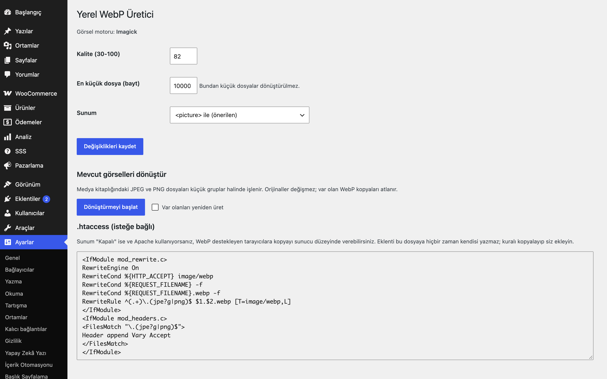

# Local WebP Generator for WordPress

Yüklenen görsellerin her boyutu için sunucunuzda WebP kopyası üretir ve `<picture>` ile sunar; orijinallere dokunmaz.

> **English:** Creates a `.webp` copy of every uploaded JPEG/PNG and each generated size with GD or Imagick, regenerates existing media in batches with a progress bar, serves via `<picture>` (or swapped URLs) and shows an `.htaccess` snippet that it never writes itself. No external service.

  

## Ne işe yarar

Her yüklemede orijinal ve tüm ara boyutlar için `dosya.jpg.webp` kardeşi üretilir. Sayfalarda görsel `<picture>` ile WebP destekleyen tarayıcılara verilir, diğerleri orijinali almaya devam eder. Mevcut medya kitaplığı küçük gruplar halinde dönüştürülür.

## Özellikler

- GD (`imagewebp`) veya Imagick ile yerel üretim; motor yoksa yönetim panelinde uyarı
- Kalite ayarı ve en küçük dosya eşiği; WebP orijinalden büyük çıkarsa saklanmaz
- Dönüştürme hataları (bellek, bozuk dosya) yüklemeyi asla bozmaz; yol, uploads klasörünün dışına çıkamaz
- Orijinal dosyalar asla değiştirilmez veya üzerine yazılmaz
- Mevcut görseller için gruplar halinde toplu dönüştürme ve ilerleme çubuğu (var olanları atlar)
- Ek silinince WebP kardeşleri de silinir
- Sunum: `<picture>` (varsayılan), doğrudan `.webp` adresi veya kapalı; Apache için `.htaccess` kuralı yalnızca gösterilir

## Kurulum

1. `local-webp-generator-for-wordpress` klasörünü `wp-content/plugins/` altına kopyalayın (veya zip olarak yükleyin).
2. Eklentiler ekranından etkinleştirin.
3. Ayarları yapın (aşağıya bakın).

## Nasıl kullanılır

Örnek senaryo: mevcut medya kitaplığınızı WebP'ye çevirmek.

1. Eklentiyi etkinleştirin ve **Ayarlar → Yerel WebP** ekranını açın. "Görsel motoru" satırında GD ya da Imagick yazmalıdır; "Yok" yazıyorsa barındırma sağlayıcınızdan WebP desteği isteyin.
2. Kaliteyi varsayılan 82'de bırakın (30-100 arası), en küçük dosya eşiği varsayılan 10000 bayttır; sunum olarak `<picture>` ile (önerilen) seçili kalsın ve kaydedin.
3. **Dönüştürmeyi başlat**'a basın. İlerleme çubuğu gruplar hâlinde ilerler; yeniden üretmek istemiyorsanız "Var olanları yeniden üret" kutusunu boş bırakın.
4. Medya kitaplığına `demo-gorsel.jpg` adlı yeni bir görsel yükleyin. Yüklenen dosya ve her ara boyutu için `demo-gorsel.jpg.webp` gibi kardeş dosyalar uploads klasöründe oluşur.
5. Bu görseli bir yazıya ekleyip sayfayı açın ve sayfa kaynağına bakın: görsel `<picture>` içinde, WebP kaynağıyla birlikte verilir; WebP desteklemeyen tarayıcı orijinal dosyayı alır.

## Ayarlar

Ayarlar → **Yerel WebP**: kalite (30-100), en küçük dosya (bayt), sunum biçimi, toplu dönüştürme düğmesi ve `.htaccess` örneği. Seçenek: `eru_webp_settings`.

## Kısa kodlar, kancalar, filtreler

| Ad | Tür | Açıklama |
|---|---|---|
| `eru_webp_settings` | seçenek | Eklenti ayarları |
| `eru_webp_max_megapixels` | filtre | `($mp, $yol)`; bundan büyük görseller dönüştürülmez (varsayılan 40 MP, bellek koruması) |
| `eru_webp_serve_in_admin` | filtre | `<picture>` çıktısını yönetim ekranlarında da açar (varsayılan kapalı) |
| `wp_ajax_eru_webp_bulk` | AJAX | Toplu dönüştürme (yalnızca `manage_options`, nonce'lu) |

## Entegrasyonlar ve gereksinimler

WordPress 6.5+, PHP 8.0+, GD (WebP destekli) veya Imagick (WEBP biçimi). Harici servis kullanmaz.

## Sınırlamalar

- Yalnızca JPEG ve PNG dönüştürülür; GIF ve SVG atlanır.
- Tema CSS'i `picture` etiketini hedefliyorsa kontrol edin; sorun olursa sunumu "Adresleri doğrudan .webp yap" yapın.
- `.htaccess` kuralı hiçbir zaman otomatik yazılmaz.
- Eklenti silinince üretilmiş `.webp` dosyaları uploads içinde kalır.
- `<picture>` dönüşümü WordPress'in `wp_get_attachment_image` ve içerik görseli (`wp_content_img_tag`) çıktısına uygulanır; temanızın elle yazdığı `` etiketleri veya CSS arka plan görselleri bu yolla değişmez.

## SSS

**Orijinal görseller silinir mi?** Hayır, orijinaller hiç değiştirilmez; WebP kopyaları yanlarında durur.

**Devre dışı bırakırsam ya da silersem ne olur?** Devre dışı bırakınca sunum durur; sayfalar yine orijinal görselleri kullanır, yeni yüklemelerde WebP üretilmez. Eklentiyi silerseniz yalnızca `eru_webp_settings` seçeneği silinir. Üretilmiş `.webp` kardeş dosyaları uploads içinde kalır ve elle silinebilir; bir görsel medya kitaplığından silinirse WebP kardeşleri de silinir.

**WooCommerce, HPOS, blok ödeme?** Eklenti WooCommerce'e bağlı değildir ve sipariş verisine dokunmaz; ürün görselleri WordPress'in standart görsel işlevlerinden geçiyorsa WebP'den yararlanır. HPOS ya da blok sepet/ödeme için ayrı bir bildirimi yoktur.

**Dış servis kullanıyor mu?** Hayır, dönüştürme sunucunuzda GD ya da Imagick ile yapılır; görseller hiçbir yere gönderilmez.

**Önbellek ve CDN?** WebP bir `<picture>` etiketiyle HTML'de sunulduğu için tarayıcıya göre değişen bir yanıt başlığı gerekmez; sunum biçimini değiştirirseniz sayfa önbelleğinizi temizleyin. Sunum "Kapalı" ise Apache için `.htaccess` örneğini siz ekleyin; CDN ya da önbellek yapınız bunu hesaba katmalıdır.

**WebP orijinalden büyük çıkarsa?** Kopya saklanmaz, orijinal kullanılır.

## Değişiklik geçmişi

Bkz. [CHANGELOG.md](CHANGELOG.md).

## Destek

- Önce bu sayfadaki **SSS** ve **Sınırlamalar** bölümlerine göz atın; sık karşılaşılan durumlar orada.
- Hata mı buldunuz? [GitHub Issues](https://github.com/erayusta/erusoft-wp/issues) üzerinden bildirin. WordPress, PHP ve eklenti sürümünü, adımları ve beklenen/gerçekleşen sonucu yazmanız işi hızlandırır.
- Kurulum, yapılandırma, özel geliştirme veya entegrasyon desteği için **[hello@erusoft.com](mailto:hello@erusoft.com)** adresine yazın. Erusoft hakkında: [erusoft.com](https://erusoft.com).
- Lütfen şifre, API anahtarı veya müşteri verisi (ad, telefon, TCKN, sipariş dökümü) göndermeyin; ekran görüntülerindeki kişisel verileri karartın.

## Lisans

GPL-2.0-or-later.

Diğer Erusoft eklentileri: https://wordpress.erusoft.com/
