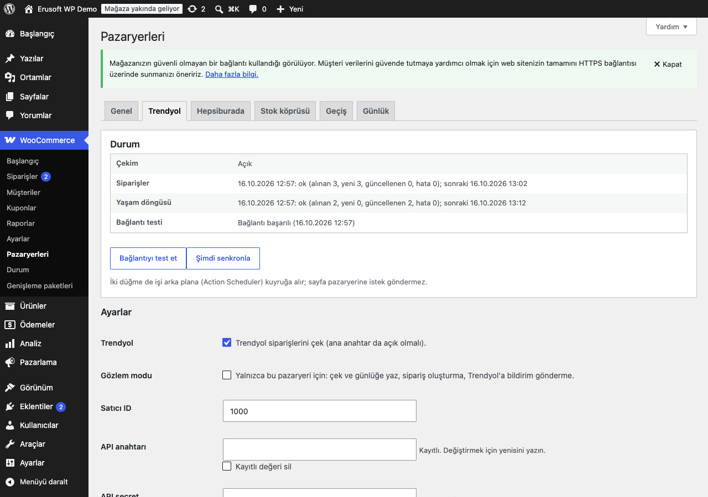

# Marketplace Orders for WooCommerce

> **English:** Imports Trendyol and Hepsiburada orders into WooCommerce through pluggable adapters, without duplicates. Each package gets an atomic lock and a unique map row. Orders are saved with the shop's order listeners muted. Marketplace statuses only move forward, and lifecycle events (cargo, delivery, cancel, partial cancel, return) are applied once. WooCommerce stock is either left alone or reduced once per order and restored on cancel. An optional acknowledgement ("Picking" on Trendyol, auto-pack on Hepsiburada) is queued with retries that never send twice. A stock bridge module pushes stock and prices with rules (excluded categories, brands and SKUs, floor and ceiling, quantity for untracked stock, multiplier, fixed amount, rounding to ,90/,99) in debounced Action Scheduler batches and refreshes the marketplace listings every hour. Observe mode logs what would be imported or sent. Raw payloads live in their own table with a retention period. The plugin also has a non-destructive, re-runnable migrator from the older Erusoft Trendyol and Hepsiburada plugins, an order list column and filter (HPOS and classic), an order box, a log viewer, WP-CLI and a privacy exporter/eraser. It is inert until you switch it on.

[](https://www.gnu.org/licenses/gpl-2.0.html)   

> **Beta:** canlı API ile kendi hesabınızla doğrulayın.

Trendyol ve Hepsiburada siparişleri WooCommerce'e bir kez aktarılır: eklenti aynı paketi ikinci kez sipariş yapmaz, mağazanın e-posta ve otomasyonlarını pazaryeri siparişleri için çalıştırmaz. Kargo, teslim, iptal ve iade güncellemelerini aynı siparişe işler. İsterseniz WooCommerce stoğunu ve fiyatını kurallarla pazaryerlerine geri gönderir.



## Özellikler

- Pazaryeri adaptör yapısı: Trendyol ve Hepsiburada hazır gelir, `eru_mpo_adapters` filtresiyle yeni pazaryeri eklenebilir.
- Tekrar-güvenli sipariş aktarımı ve gözlem modu. Her paket için atomik kilit ve benzersiz eşleme satırı tutulur. Kayıt izole yapılır, yarım kalan sipariş geri alınır. Gözlem modu aktarılacakları yalnızca günlüğe yazar.
- Birleşik durumlar ve yaşam döngüsü. Kargo, teslim, iptal, kısmi iptal ve iade aynı siparişe bir kez işlenir; durumlar yalnızca ileri gider.
- Kurallı stok ve fiyat köprüsü. Hariç kategori, marka ve SKU, alt/üst stok sınırı, çarpan, sabit tutar ve ,90/,99 yuvarlama uygulanır. Değişiklikler toplu ve gecikmeli gönderilir; ilanlar saatte bir yenilenir.
- Eski Trendyol/Hepsiburada eklentisinden geçiş. Kuru çalıştırma raporu verir, eski veriyi silmez ve yeniden çalıştırılabilir.

## Kurulum

1. `marketplace-orders-for-woocommerce` klasörünü `wp-content/plugins/` altına kopyalayın (veya zip olarak yükleyin) ve etkinleştirin. WooCommerce gereklidir.
2. Eski Erusoft Trendyol veya Hepsiburada eklentisi kuruluysa önce onu **devre dışı bırakın**. Eski eklenti etkinken o pazaryerinden sipariş çekilmez, geçiş de başlatılamaz.
3. WooCommerce → **Pazaryerleri** → **Trendyol** (veya **Hepsiburada**): API bilgilerini girin, pazaryerini işaretleyin, kaydedin, **Bağlantıyı test et** ile kontrol edin.
4. **Genel** sekmesi:
   - **Ana anahtar**ı açın. **Gözlem modu** açık kalsın.
   - **İçe aktarımda stok** ve **Sipariş durumları** seçimlerini yapın.
   - Bir süre günlükte "aktarılırdı" satırlarını izleyin. Doğruysa gözlem modunu kapatın.
5. Eski eklentiden geliyorsanız **Geçiş** sekmesindeki kuru çalıştırma raporuna bakın ve **Geçişi başlat**'a basın.
6. İsterseniz **Stok köprüsü** sekmesinde stok ve fiyat gönderimini açın, kuralları girin, ilk seferde **Tüm stok ve fiyatları gönder**'i kullanın.

Etkinleştirme sonrası eklenti pasiftir:

- Tabloları oluşturur, ama ana anahtar açılıp bir pazaryeri yapılandırılana kadar pazaryerine istek gitmez.
- Zamanlanmış iş kurulmaz, ön yüzde hiçbir şey değişmez.
- Gözlem modu varsayılan olarak açıktır; stok ve fiyat gönderimi varsayılan olarak kapalıdır.

API anahtarı, secret ve şifre alanları yalnızca yazılabilir: ekrana geri yazılmaz, "Kayıtlı" görünür, boş bırakılırsa korunur. Yazıldığı gibi saklanır (boşluklar ve kontrol karakterleri dışında değiştirilmez). Ayarlar `autoload=no` saklanır.

## Pazaryerleri

### Trendyol

- Kimlik doğrulama `Authorization: Basic` (API anahtarı : secret) başlığıyla yapılır. `User-Agent: <satıcı ID> - <entegrasyon referansı>` gönderilir; referans boşsa `SelfIntegration` kullanılır. Kimlik bilgisi asla adrese yazılmaz.
- API adresi, canlı ve test (stage) için Trendyol'un yayımladığı adreslerdir. Ekrandan (yalnızca `trendyol.com` alan adında https) ya da `eru_mpo_trendyol_base_url` filtresiyle değiştirilebilir.
- **Bir paket bir siparişe karşılık gelir** (eşleme anahtarı paket numarasıdır).
  - Paketler, seçilen durumlara göre (varsayılan Created, Picking, Invoiced) en çok 14 günlük dilimlerle ve her sayfa okunarak çekilir.
  - Yaşam döngüsü durumları ayrı çekilir.
  - Satırlar indirimden önceki birim fiyat ve satır indirimiyle yazılır, böylece toplam paket toplamına eşit olur. Satıcı ve pazaryeri indirimleri, komisyon oranı ve KDV satır alanlarında kalır.
- Durum eşlemesi (`eru_mpo_trendyol_status_map`):

  | Trendyol | Sipariş |
  |---|---|
  | Created | Yeni |
  | Picking | Onaylandı |
  | Invoiced | Hazırlanıyor |
  | Shipped, AtCollectionPoint, UnDelivered | Kargoda |
  | Delivered | Teslim edildi |
  | Cancelled, UnSupplied, UnPacked | İptal |
  | Returned | İade |
- **"İşleme alındı" bildirimi** (paketi Picking yapar):
  - Modlar: Gönderme (varsayılan), Sipariş içe aktarılınca, Sipariş seçilen duruma geçince. Durum tetikleyicisi, "Bildirimleri sustur" açıkken yalnızca mağazanın kendi durum değişikliklerinde çalışır; eklentinin izole kayıtları onu tetiklemez (ayar kapalıyken eklentinin kendi durum değişiklikleri de tetikleyebilir). Bildirim başarılı olunca sipariş "Onaylandı"ya ilerletilir, ama hiçbir zaman geri alınmaz: mağaza siparişi elle daha ileri bir duruma taşıdıysa olduğu yerde kalır.
  - Bildirim Action Scheduler kuyruğunda, sipariş başına kilitle gönderilir. Geçici hatada 1, 5, 15 ve 60 dakika sonra yeniden denenir, en çok 5 deneme yapılır.
  - İstekten önce siparişe bir kontrol işareti yazılır. Zaman aşımı ya da 5xx gibi belirsiz bir sonuçtan sonra paket önce sipariş numarasıyla okunur ve yalnızca hâlâ Created ise yeniden gönderilir. Paket iki kez Picking yapılmaz.
- **Yeniden oluşturulan ve bölünen paketler.** Trendyol bir paketi iptal edip (Cancelled, UnSupplied, UnPacked) aynı sipariş numarasıyla yeni paketler açabilir.
  - Yeni paketin etkin satırları (SKU × adet) eski siparişin kalan satırlarıyla aynıysa paket yeniden oluşturulmuş sayılır. Aynı sipariş yeni pakete bağlanır, ikinci sipariş açılmaz. İptal edilmiş sipariş yeniden açılır, toplam veya satır sayısı farklıysa "incelenmeli" işaretlenir.
  - Satırlar farklıysa paket bölünmüştür. Her yeni paket kendi siparişi olur. Eski sipariş iptal edilir; satırları ve toplamı sıfırlanır (eski tutar alanlarda saklanır), stoğu bir kez iade edilir. Siparişler birbirine bağlantıyla gösterilir. Değiştirme iki paketin kilidini de alır: eski paket o anda başka bir çalışmada (ör. yaşam döngüsü güncellemesi) işleniyorsa iki sipariş "incelenmeli" işaretlenir ve değiştirme birkaç dakika sonra bir kez yeniden denenir.
  - Eski paket okunamazsa aktarım bir sonraki çekime kalır. Belki-mükerrer sipariş açılmaz.
  - Bağlama kaydı yarıda kalırsa yeni paketin eşlemesi geri alınır; bir sonraki çekim bağlama kararını yeniden verir (sipariş yeniden açılır, stok bir kez düşülür).

### Hepsiburada

- Kimlik doğrulama `Authorization: Basic` (mağaza ID : şifre) başlığıyla yapılır; `User-Agent` geliştirici kullanıcı adıdır.
- OMS adresi (canlı ve SIT) ekrandan (yalnızca `hepsiburada.com` alan adında https) ya da `eru_mpo_hepsiburada_base_url` filtresiyle değiştirilebilir. Tarihler Türkiye saatiyle gönderilir.
- **Sipariş satırları sipariş numarasına göre gruplanır**, bir sipariş numarası bir sipariştir.
  - Sayfalar arasında kayan aynı satır bir kez alınır.
  - Satıcı ve Hepsiburada indirimleri satır indirimidir.
  - Raporlanan komisyon tutarı satırda saklanır; oran raporlanmamışsa tutardan hesaplanır.
- **Yaşam döngüsü** yalnızca bilinen siparişleri günceller:
  - shipped, delivered ve undelivered paket uçları, iptal edilen satırlar okunur.
  - UnDelivered (teslim edilemedi) "Kargoda" kalır, iade sayılmaz.
  - Tüm etkin satırları iptal edilen sipariş iptal olur, tek satır iptali yalnızca o satırın stoğunu iade eder.
  - Bir uç hata verirse diğerleri yine uygulanır. Hatalı uç 1 → 30 dakika kendi başına bekler, bekleyen uçlar pazaryeri sekmesinde görünür.
  - Kargo bilgisi gelmemiş siparişler çalışma başına en çok 20 adet yeniden sorulur (`eru_mpo_hepsiburada_cargo_budget`).
- **Sonradan gelen satırlar** bilinen bir siparişe eklenmez: bir not düşülür ve sipariş "incelenmeli" işaretlenir.
- **Otomatik paketleme** Hepsiburada'nın bildirimidir.
  - Modları Trendyol bildirimiyle aynıdır, varsayılan "Gönderme". Gerekirse önce birlikte paketlenebilecek satırlar sorulur, sonra paket oluşturulur.
  - Belirsiz bir sonuçtan sonra siparişin açık paketlerine bakılır. Satırları görünen paket "paketlendi" sayılır.
  - Siparişin satırlarını göstermeyen bir paket varsa yeniden gönderilmez; sipariş "incelenmeli" işaretlenir.
- **Listeleme API adresi**: stok köprüsü için (ilanlar, stok ve fiyat) ayrı bir adres gerekir. Bu adresin varsayılanı yoktur; Hepsiburada'nın size verdiği adresi girmeden Hepsiburada için stok köprüsü çalışmaz.

### Hız sınırı, tekrar deneme ve istek günlüğü

- Her istek `wp_remote_request` ile tek denemedir: 30 sn zaman aşımı, yönlendirme yok, `sleep` yok.
- Sipariş çekimi 5 dakikada, yaşam döngüsü 15 dakikada bir Action Scheduler ile çalışır (`eru_mpo_sync_interval`).
  - 429, 5xx ya da zaman aşımında bir sonraki çalışma 1, 2, 4 … dakika sonraya kayar (en çok 30 dakika). `Retry-After` bu sınıra kadar dikkate alınır.
  - Her çalışma, bir sonrakini çekimden önce kurar; süreç ölse bile zincir kopmaz.
- İstek günlüğü (Günlük sekmesi):
  - Her zaman yazılanlar: başarısız istekler ve yazma istekleri (POST/PUT). Başarılı okumalar yalnızca `eru_mpo_http_log_reads` filtresi `true` dönerse yazılır.
  - Satırda yöntem, yol, durum kodu ve süre tutulur; sunucu adı ve başlıklar yazılmaz.
  - Gövdelerde kimlik bilgisi, kimlik numarası ve vergi numarası anahtarları `[gizli]` olur. 11 haneli sayılar, IBAN, e-posta ve telefonlar maskelenir. Her gövde en çok 8 KB tutulur.

## Durumlar

"Sipariş durumları" ayarı iki seçenek sunar:

- **Pazaryeri durumları** (varsayılan). Kendi durumları kullanılır: `eru-mpo-new`, `-accepted`, `-ready`, `-shipped`, `-delivered`, `-cancelled`, `-returned`. Ekranda "Pazaryeri: Yeni", "Pazaryeri: Kargoda" … olarak görünürler.
- **WooCommerce çekirdek durumları**:
  - Yeni, Onaylandı ve Hazırlanıyor → İşleniyor.
  - Kargoda ve Teslim edildi → Tamamlandı.
  - İade → İade edildi; İptal → İptal edildi.
  - Eşleme `eru_mpo_status_core_map` filtresiyle değişir.

Kurallar:

- **Durumlar yalnızca ileri gider.** Sıra: Yeni < Onaylandı < Hazırlanıyor < Kargoda < Teslim edildi < İade < İptal. Geç gelen eski bir durum siparişi geri almaz. İptal ve İade son durumlardır.
- **Mağazanın elle yaptığı değişiklikler de sayılır.** Sipariş yönetim ekranından, toplu işlemle ya da başka bir eklentiyle başka bir duruma taşındığında mantıksal durum da ona göre güncellenir; pazaryerinden gelen daha eski bir durum veya bildirim onu geri almaz. Eşleme: eklentinin kendi durumları birebir, "İptal edildi" → İptal, "İade edildi" → İade; çekirdek durum modunda ayrıca "Tamamlandı" → Kargoda, "İşleniyor" → Yeni. "Beklemede" gibi karşılığı olmayan durumlar mantıksal durumu değiştirmez.
  - **Elle iptal** ("Pazaryeri: İptal" ya da "İptal edildi"): "içe aktarırken düş" modunda stok bir kez iade edilir. Pazaryeri siparişi hâlâ etkin gösterse bile sipariş **yeniden açılmaz** ve stok yeniden düşülmez; yalnızca bir kez "incelenmeli" işaretlenir ve not düşülür. Pazaryerinde de iptal edin ya da siparişi elle yeniden açın.
  - **Elle yeniden açma** (iptalden başka bir duruma): "içe aktarırken düş" modunda stok yeniden, bir kez düşülür.
- **Raporlar.** Pazaryeri tahsilatı önceden yaptığı için Yeni … Teslim edildi durumları WooCommerce'in "ödendi" durumlarına eklenir (`woocommerce_order_is_paid_statuses`). Eski raporlarda (`woocommerce_reports_order_statuses`) yalnızca ödenmiş durumları sayan listelere eklenir; örneğin yalnızca iadeleri sayan bir rapor değişmez. İptal ve İade, WooCommerce Analytics'in dışarıda bıraktığı durumlara eklenir. Liste `eru_mpo_paid_statuses` filtresiyle değişir.
- Eski eklentilerin durumları (`trendyol-*`, `hepsiburada-*`) yalnızca geçiş bitmemişken kayıtlı tutulur, sonra emekliye ayrılır (aşağıya bakın).

## Sipariş aktarımı nasıl tekrar-güvenli?

- **Mükerrer kontrolü.** Her paket için önce atomik bir kilit alınır, sonra `{prefix}eru_mpo_orders` tablosunda benzersiz bir eşleme satırı açılır (pazaryeri + paket). İki çekim aynı anda çalışsa da tek sipariş oluşur.
- **Silinen ve çöpteki siparişler.** Sipariş WooCommerce'te silinirse eşleme temizlenir ve paket yeniden aktarılabilir. Çöpteki sipariş ne güncellenir ne yeniden oluşturulur.
- **İzole kayıt** ("Bildirimleri sustur", varsayılan açık). Kayıt sırasında `woocommerce_new_order`, `woocommerce_order_edit_status` ve tüm `woocommerce_order_status_*` dinleyicileri susturulur. Yeni sipariş e-postası, ödeme, kargo ve ERP otomasyonları çalışmaz.
  - WooCommerce'in kendi defter tutması çalışmaya devam eder: sipariş sayısı önbelleği, HPOS veri eşitleyicisi, sipariş önbellek sürümü ve ürün satış sayacı.
  - `eru_mpo_isolated_save_keep` filtresi başka bir dinleyiciyi çalıştırır, `eru_mpo_isolated_save_hooks` susturulan kancaları değiştirir. Bir istisna olsa da tüm kancalar geri yüklenir.
  - `woocommerce_update_order` ve `woocommerce_after_order_object_save` dinleyicileri susturulmaz. Gerekirse `woocommerce_update_order`'ı `eru_mpo_isolated_save_hooks` ile ekleyin (HPOS eşitleyicisi ve önbellek sürümü dinleyicileri izin listesinde olduğu için güvenlidir). `woocommerce_after_order_object_save` filtreyle eklense de susturulmaz: eklenti kaydın tamamlandığını orada denetler.
- **Yarım kayıt kalmaz.** Satırlar kaydedilmeden biten sipariş silinir, paket geri çekilmeli olarak işaretlenir (1 → 60 dakika). Kayıt tamamlandıktan sonra bir dinleyici hata verirse sipariş korunur ve not düşülür. Toplam pazaryeri toplamından farklıysa sipariş "incelenmeli" işaretlenir.
- **Eşleşmeyen satırlar.** SKU, barkod ya da GTIN ile eşleşmeyen satır ürünsüz yazılır ve sipariş "incelenmeli" olur. Satırlar önce stok köprüsünün ilan tablosuyla eşleştirilir.
- **Ödeme yöntemi** siparişte pazaryerinin adıdır ("Trendyol", "Hepsiburada"); sipariş ekranında "Trendyol ile ödeme" görünür. Siparişin kaynağı (`created_via`) `eru-mpo-<pazaryeri>`'dir. Geçişle gelen eski siparişlerin boş ya da eski ödeme yöntemi de aynı biçime getirilir.
- **Gözlem modu** (genel ya da pazaryeri başına):
  - Siparişler çekilir ve günlüğe "aktarılırdı" yazılır (paket başına günde bir kez).
  - Sipariş, eşleme ya da ham veri satırı oluşmaz; bildirim, paketleme ve stok/fiyat gönderimi yapılmaz.

## Stok köprüsü ve çift düşüm

İki ayrı ayar vardır:

**1. İçe aktarımda stok** (Genel sekmesi):

- **WooCommerce stoğuna dokunma** (varsayılan). Pazaryeri siparişleri stoğu hiç düşürmez. WooCommerce'in kendi düşümleri de (İşleniyor/Tamamlandı'ya geçiş, `payment_complete`) bu siparişler için engellenir.
- **İçe aktarırken düş, iptalde iade et**:
  - Sipariş başına stok bir kez düşer; yeniden çekim, durum güncellemesi ya da bağlantı tekrar düşürmez.
  - Tam iptal stoğu bir kez iade eder. Kısmi iptal yalnızca iptal edilen satırın düştüğü kadarını iade eder.
  - Pazaryerinde zaten iptal gelen satırlar hiç düşmez; bunlar sıfır tutarlı ve ürünsüz yazılır.
  - İade (Returned) stok iade etmez; iade ürününü elle stoğa alın.

**2. Stok köprüsü** (Stok köprüsü sekmesi, pazaryeri başına; **Stok gönder** ve **Fiyat gönder** varsayılan kapalı):

- **Kuyruğa alma.** WooCommerce'te stok (`woocommerce_product_set_stock`, `woocommerce_variation_set_stock`), fiyat, SKU veya durum değişince ürün `{prefix}eru_mpo_sync_queue` tablosuna yazılır. Kuyrukta ürün + pazaryeri + tür başına tek satır vardır. Değişken ürün varyasyonlarını kuyruğa alır; çöpe atılan ürün 0 stokla gider.
- **Gönderim.** İlk değişiklikten 15 saniye sonra tek bir Action Scheduler işi kuyruktakileri 100'lük gruplarla gönderir. Arada gelen değişiklikler aynı işe katılır. Değerler gönderim anında okunur, yani her zaman en güncel stok ve fiyat gider.
- **Hata.** Gönderilemeyen satırlar 1, 2, 4 … 30 dakika arayla yeniden denenir. 8 denemeden sonra durur, ürün yeniden değişince baştan başlar.
- **Güvenlik taraması.** 10 dakikada bir, işi kaybolmuş kuyruk satırları için gönderim kurulur.
- **İlanlar saatte bir yenilenir.** Pazaryerindeki ilanlar `{prefix}eru_mpo_listings` tablosuna okunur: Trendyol'da onaylı ürünlerin stockCode ve barkodu, Hepsiburada'da satıcı SKU'su, Hepsiburada SKU'su ve satılabilirliği. Ürünle SKU, sonra GTIN üzerinden eşlenir.
  - Trendyol'a stok ve fiyat **barkodla** gider: ilandaki barkod, yoksa ürünün GTIN'i. İkisi de yoksa o ürün gönderilmez ve günlüğe yazılır.
  - Hepsiburada'ya satıcı SKU'suyla gider.
  - Yenileme bütün ilan sayfalarını okur: sayfa sınırı yoktur, uzun listeler arka planda devam eden işlerle (`eru_mpo_listings_next`, çalışma başına 50 sayfa, `eru_mpo_listings_pages_per_run`) okunur.
  - **Hiçbir stok güncellemesi düşürülmez.** Yalnızca son yenileme tüm sayfaları hatasız okuduysa ("tam"), pazaryerinde ilanı olmayan ürünler gönderilmez: kuyruk satırları silinmez, "ilan bekliyor" olarak bekler. Bir sonraki tam yenileme ya da ürünün yeni bir değişikliği onları yeniden sıraya koyar; ürün o arada pazaryerinde listelendiyse gönderilir. Yenileme hiç bitmemişse, sürüyorsa ya da yarıda kaldıysa her ürün gönderilir.
- **Tam gönderim.** "Tüm stok ve fiyatları gönder" yayındaki bütün ürünleri **yalnızca o pazaryeri için** arka planda 200'lük gruplarla kuyruğa alır (`eru_mpo_full_sync_batch`).
- **Kuralları değiştirdikten sonra tam senkron çalıştırın.** Kurallar yalnızca bundan sonra gönderilen değerlere uygulanır; kaydettikten sonra sekmede çıkan **Kuralları uygula (tam senkron)** düğmesi mevcut ürünleri yeniden gönderir. Hariç bırakılan bir ürün bundan sonra gönderilmez, pazaryerindeki son stoğu kendiliğinden sıfırlanmaz.
- **Silinen ürünler.** Çöpe atılan ürün 0 stokla gönderilir. Kalıcı olarak silinen ürünün kuyruk ve ilan satırları temizlenir, ama pazaryerine 0 gitmez: önce stoğunu 0 yapın ya da çöpe atın.
- Ana anahtar kapalıyken, pazaryeri yapılandırılmamışken ya da eski eklentisi etkinken hiçbir şey kuyruğa alınmaz ve iş kurulmaz.

**Kurallar** (pazaryeri başına, gerçek alanlar):

| Kural | Etki |
|---|---|
| Hariç kategoriler / markalar | Bu kategorilerdeki (alt kategoriler dahil) ya da markalardaki ürünler gönderilmez. Marka taksonomisi `product_brand`'dır, yoksa bilinen marka eklentilerinin taksonomisi kullanılır (`eru_mpo_brand_taxonomy`). |
| Hariç SKU'lar | Her satıra bir SKU. `ABC*` ABC ile başlayan tüm SKU'lar demektir. Değişken ürünün SKU'su varyasyonlarını da hariç tutar. |
| Stok alt sınırı | Stok bu değerin altındaysa 0 gönderilir (ör. alt sınır 5, stok 3 → 0). |
| Stok üst sınırı | En fazla bu kadar gönderilir (ör. üst sınır 50, stok 80 → 50). |
| Stok takibi olmayan ürün | Stok takibi kapalı ve stokta olan ürün için gönderilen adet (varsayılan 5). |
| Fiyat çarpanı, sabit ekleme, yuvarlama | Fiyat kuruş cinsinden hesaplanır: önce çarpan, sonra sabit tutar, sonra en yakın ,90 / ,99'a yuvarlama (ör. 100 × 1,15 + 5 = 120,00 → 119,90). Liste fiyatı normal fiyattan aynı kurallarla hesaplanır, satış fiyatının altına inmez. Yayında olmayan ürün 0 stokla gider. |

**Çift düşüm.** Pazaryeri kendi stoğunu satış anında zaten düşürür. Stok gönderimi açıkken bu iki ayar şöyle birleşir:

- **"İçe aktarırken düş" + stok gönderimi.**
  - Sipariş WooCommerce stoğunu bir kez düşürür (10 → 8), köprü de güncel değeri (8) bir kez gönderir.
  - Gönderilen değer farka göre değil, mutlak değerdir; tek başına çift düşüm olmaz.
  - **Ama** aynı siparişi WooCommerce stoğundan başka bir sistem de düşüyorsa (bir ERP, başka bir eklenti) stok iki kez düşer ve pazaryerine eksik stok gider. Bu durumda ya o sistemi ya da içe aktarımdaki düşümü kapatın.
- **"WooCommerce stoğuna dokunma" + stok gönderimi.** Pazaryeri satışları WooCommerce stoğundan düşülmezse köprü, pazaryerinin düşürdüğü stoğu yeniden yükseltir ve fazla satış olabilir. Bu birleşim yalnızca stoğu WooCommerce'e başka bir sistem (ERP) işliyorsa doğrudur.

Stok köprüsü sekmesi, stok gönderimi açık her pazaryeri için bu iki durumdan uygun olanı uyarı olarak gösterir.

## Eski Trendyol/Hepsiburada eklentisinden geçiş

Bu eklenti, eski **Erusoft Trendyol** ve **Erusoft Hepsiburada** WooCommerce eklentilerinin bakımı süren devamıdır. Eskileri artık geliştirilmiyor.

**Taşınanlar:**

- Siparişin pazaryeri alanları: paket ve sipariş numarası, eski durum, kargo, vergi bilgisi, aktarım ve bildirim zamanları. Yerel saatler UTC'ye çevrilir.
- Satır alanları: SKU, barkod, satır numarası, komisyon, eşleşmeyen satır işareti.
- Eski durumlar, bu eklentinin karşılıklarına çevrilir (ör. `trendyol-kargo` → Pazaryeri: Kargoda).
- Eski tekrar-engelleme tablolarındaki (`eru_trendyol_orders`, `eru_hepsiburada_orders`) eşlemeler. Yalnız tabloda kalan siparişler de bulunur.
- Hepsiburada'nın not düştüğü iptal ve sonradan gelen satırlar, aynı notların tekrar düşmemesi için taşınır.
- Kimlik numarası yalnızca "e-Arşiv için TC kimlik no sakla" açıksa kopyalanır. 11 haneli eski vergi numaraları da kimlik numarası sayılır.

**Silinmeyenler:** eski sipariş alanları, eski satır alanları, eski tablolar ve eski ham veriler olduğu gibi kalır; eski eklenti yeniden etkinleştirilirse kendi siparişlerini yine okuyabilir. Otomatik bir geri alma yoktur: geçişin yazdığı `_eru_mpo_*` alanları ve durumlar yerinde kalır. Geçiş tekrar çalıştırılabilir; ikinci çalıştırma yeni bir şey taşımaz.

**Nasıl çalışır?**

1. Eski eklentiyi devre dışı bırakın; etkinken geçiş başlamaz ve o pazaryerinden sipariş çekilmez.
2. **Geçiş** sekmesindeki **Kuru çalıştırma** raporu hiçbir şey yazmadan şunları sayar: eski sipariş, taşınacak, taşınmış, durumu onarılacak, yalnız tabloda kalan, siparişi olmayan satır ve durumlar.
3. **Geçişi başlat** işi Action Scheduler'a 100 siparişlik gruplarla verir (`eru_mpo_migrate_batch`); ilerleme sekmede görünür. `wp eru-mpo migrate` aynı işi komut satırında yapar.

**Diğer davranışlar:**

- Henüz taşınmamış eski bir sipariş için yeni çekim ikinci sipariş açmaz, eski siparişi sahiplenir. Eşleme anahtarı iki eklentide de aynıdır: Trendyol paket numarası, Hepsiburada sipariş numarası.
- **Eski eklentiyi sonradan yeniden etkinleştirirseniz** o eklenti kendi alanlarını bulur ve aynı siparişleri güncellemeye devam eder; mükerrer sipariş açılmaz. Ama taşınmış siparişleri eski durumlarına geri çekebilir. Eski eklentiyi yeniden kapatıp geçişi tekrar çalıştırın: onarım adımı bu siparişleri yalnızca ileri yönde doğru duruma taşır ve iptalde stoğu bir kez iade eder.
- Eski durumlar, geçiş bitip hiçbir sipariş eski durumda kalmayınca emekliye ayrılır. Eski eklenti yeniden etkin olursa geri gelirler.

## Product Push for Trendyol ile

- **Product Push for Trendyol ürünü oluşturur, bu eklenti stok ve fiyatı eşitler.**
  - Product Push ürünleri Trendyol'a gönderir (oluşturma, onaylı/onay bekleyen güncelleme); stok ve fiyatı yalnızca ilk oluşturmada gönderir.
  - Sonrasındaki stok ve fiyat değişikliklerini bu eklentinin stok köprüsü price-and-inventory ucuna, aynı barkodla gönderir.
  - İlan yenilemesi onaylı ürünlerin barkodunu stockCode (sizin SKU'nuz) üzerinden bulur. Product Push'un gönderdiği barkod ve SKU kullanılır; ayrıca eşleme gerekmez.
- **Kimlik bilgileri iki eklentide ayrı ayrı girilebilir.** İsterseniz Trendyol sekmesindeki **Product Push for Trendyol** kutusuyla bu eklentinin bilgileri Product Push'a ödünç verilir (varsayılan kapalı). Bu, Product Push'un kendi `eru_ppt_credentials` filtresiyle yapılır:
  - Yalnızca Product Push'ta **boş bırakılan** alanlar doldurulur; orada girilmiş bir değer asla değişmez.
  - Product Push'ta girilmiş her alan (satıcı ID, API anahtarı, secret, entegrasyon referansı) bu eklentidekiyle **aynı hesaba** ait değilse hiçbir şey doldurulmaz. İki hesabın bilgileri karışmaz.
  - Satıcı ID'si buradan geldiyse ve Product Push'ta hâlâ `SelfIntegration` yer tutucusu varsa entegrasyon referansı da doldurulur.
  - Değerler hiçbir yere yazılmaz ve günlüğe girmez.
- Ürün oluşturma, ürün içeriği ve kategori/özellik eşleme bu eklentide yoktur; onlar için Product Push for Trendyol'u kullanın.

## ERP/CRM entegrasyonu: eylemler

Eklenti hiçbir ERP veya CRM'e bağlı değildir. Kendi sisteminizi şu eylemlere bağlayın:

| Eylem | Ne zaman |
|---|---|
| `eru_mpo_order_imported( WC_Order $order, Eru_MPO_Order_DTO $dto )` | Yeni sipariş aktarıldı (bir kez). ERP'ye aktarım için doğru yer. |
| `eru_mpo_order_status_advanced( WC_Order $order, string $from, string $to )` | Pazaryeri durumu ilerledi (her mantıksal durum için bir kez). |
| `eru_mpo_order_cancelled_lines( WC_Order $order, array $lines )` | Kısmi iptal (satır başına bir kez). |
| `eru_mpo_order_acknowledged( WC_Order $order, string $marketplace )` | "İşleme alındı" bildirimi / paketleme tamamlandı. |
| `eru_mpo_order_relinked( WC_Order $order, string $old_ref, Eru_MPO_Order_DTO $dto )` | Sipariş yeniden oluşturulan pakete bağlandı. |
| `eru_mpo_order_reopened( WC_Order $order, string $from, string $to )` | İptal edilmiş sipariş yeni paketle yeniden açıldı. |
| `eru_mpo_order_replaced( WC_Order $order, int $new_id, Eru_MPO_Order_DTO $dto )` | Bölünen paket: eski sipariş yenisiyle değiştirildi. |
| `eru_mpo_order_before_save( WC_Order $order, Eru_MPO_Order_DTO $dto, Eru_MPO_Adapter $adapter )` | İlk kayıttan önce (ek alan yazmak için). |

Stokun ERP'de tutulduğu mağazalarda "İçe aktarımda stok"u "WooCommerce stoğuna dokunma" bırakın. Stoğu WooCommerce'e ERP işler, stok köprüsü de pazaryerine gönderir.

## Yönetim ekranı

WooCommerce → **Pazaryerleri**:

| Sekme | İçerik |
|---|---|
| **Genel** | Ana anahtar, gözlem modu, tarama ve yaşam döngüsü pencereleri, içe aktarımda stok, durum modu, bildirimleri sustur, e-Arşiv için TC kimlik no, ham veri ve günlük saklama süreleri. Altında pazaryeri başına durum tablosu. |
| **Trendyol / Hepsiburada** | Son çekimler ve sonuçları, sonraki çalışma, bekleyen uçlar, bağlantı testinin sonucu. **Bağlantıyı test et** ve **Şimdi senkronla** işi arka plana kuyruğa alır; sayfa pazaryerine istek göndermez. Altında API bilgileri, durumlar, bildirim/paketleme modu ve adresler. |
| **Stok köprüsü** | Çift düşüm uyarıları. Pazaryeri başına stok/fiyat gönderimi, kurallar, kuyruk sayıları, son gönderim, ilanlar, tam gönderim. |
| **Geçiş** | Kuru çalıştırma raporu, çalıştırma durumu, **Geçişi başlat**. |
| **Günlük** | Pazaryeri, düzey ve metinle süzme, sayfalama, temizleme (arka planda; "Tümü" için onay kutusu gerekir). Kayıtlar yazılırken ve gösterilirken yeniden gizlenir. Paket numarası, ham verisi saklanan paketler için ham veri görünümüne bağlanır. |

- **Sipariş listesi**: HPOS ve klasik listede **Pazaryeri** sütunu vardır: rozet, pazaryeri sipariş numarası, "incelenmeli" işareti. Liste "Tüm pazaryerleri" ya da tek bir pazaryeriyle süzülebilir.
- **Sipariş ekranı** (Pazaryeri kutusu):
  - Gösterilenler: pazaryeri, sipariş ve paket numarası, önceki paketler, durum (pazaryerindeki ham durumla), kargo ve takip bağlantısı, Hepsiburada paketleri, bildirim/paketleme durumu ve deneme sayısı, son hata, yerine geçen ve yerine geçtiği siparişler, sonradan gelen satırlar, aktarım zamanı.
  - **Ham veriyi göster** bağlantısı yalnızca `manage_woocommerce` yetkisi olana ve ham veri saklandığı sürece görünür.
  - **Yeniden çek** (Trendyol) yalnızca bu siparişi sipariş numarasıyla pazaryerinden okur ve günceller. Tek sipariş sorgusu sunmayan pazaryerlerinde (Hepsiburada) düğme **Pazaryerini şimdi çek** adını taşır ve o pazaryerinin tüm sipariş ve yaşam döngüsü çekimini tarama pencereleri içinde çalıştırır.
  - **Pazaryerine bildir** bildirim modu açıksa görünür ve başarısız bir bildirimi yeniden başlatır. İki düğme de işi kuyruğa alır.

Bütün formlar `manage_woocommerce` yetkisi ve nonce ister; pazaryerine giden her iş Action Scheduler'da (`eru-mpo` grubu) çalışır.

## WP-CLI

```bash
wp eru-mpo pull [--marketplace=<anahtar>]                # yeni siparişleri şimdi çek
wp eru-mpo lifecycle [--marketplace=<anahtar>]           # kargo/teslim/iptal/iade güncellemelerini şimdi çek
wp eru-mpo push-stock [--marketplace=<anahtar>] [--all]  # kuyruktaki stok/fiyatı şimdi gönder; --all önce tüm ürünleri o pazaryeri için kuyruğa alır
wp eru-mpo migrate [--dry-run]                           # eski eklentiden geçiş (--dry-run yalnızca sayar)
wp eru-mpo status                                        # anahtarlar, son çalışmalar, kuyruklar, geçiş durumu
```

Komutlar zamanlanmış işlerle aynı anahtarlara uyar: ana anahtar, pazaryeri anahtarı ve gözlem modu.

## Kişisel veriler (ham veri saklama süresi)

- **Ham veri** pazaryerinden gelen son paket verisidir. Sipariş verisine yazılmaz; `{prefix}eru_mpo_raw` tablosunda durur.
  - Kimlik numarası ve kimlik bilgisi alanları ile 11 haneli bütün sayılar yazılırken **her zaman** maskelenir.
  - **Ham veri saklama** süresi varsayılan 30 gündür (1–365); süre paketin son değişikliğinden sayılır. Günlük iş süresi dolan satırları gruplar halinde siler.
- **TC kimlik no** sipariş verisine yalnızca "e-Arşiv için TC kimlik no sakla" açıksa kopyalanır (varsayılan kapalı). 11 haneli vergi numarası da kimlik numarası sayılır.
- **Günlük** varsayılan 14 gün saklanır. Kimlik bilgileri, kimlik numaraları, IBAN, e-posta ve telefonlar yazılırken gizlenir.
- **WordPress gizlilik araçları** (Araçlar → Kişisel veriyi dışa aktar / sil) pazaryeri siparişlerini (eski eklentilerin henüz taşınmamış siparişleri dahil) fatura e-postasıyla bulur. E-postayı içeren ham veri satırları da, siparişi silinmiş olsa bile bulunur.
  - Dışa aktarma: pazaryeri, sipariş ve paket numarası, maskeli kimlik/vergi numarası, vergi dairesi ve ham veri.
  - Silme: kimlik numarası alanı, 11 haneli vergi numarası, ham veri ve o paketlerin günlük satırları; eski eklentilerin kimlik numarası, 11 haneli vergi numarası ve ham veri alanları da.
  - Bu silici WooCommerce'in sipariş silicisinden **önce** çalışır (WooCommerce "Kişisel verileri siparişlerden kaldır" açıkken e-postayı anonimleştirir, sonra sipariş e-postayla bulunamaz). Ayrıca WooCommerce bir siparişin kişisel verisini her kaldırdığında (`woocommerce_privacy_remove_order_personal_data`) aynı temizlik o sipariş için de yapılır.
  - Siparişin kendisi (adres, ad, notlar) WooCommerce'in kendi kişisel veri ayarına göre işlenir. Bu eklenti sipariş silmez.

## Kancalar ve filtreler

| Kanca | Açıklama |
|---|---|
| `eru_mpo_adapters` | Pazaryeri adaptörleri (`anahtar => Eru_MPO_Adapter`). |
| `eru_mpo_trendyol_base_url`, `eru_mpo_hepsiburada_base_url`, `eru_mpo_hepsiburada_listing_url` | API adresleri (`$url`, `$environment`). |
| `eru_mpo_trendyol_status_map`, `eru_mpo_trendyol_time_offset` | Trendyol durum eşlemesi; sipariş saatinin UTC farkı (varsayılan 3 saat). |
| `eru_mpo_status_core_map`, `eru_mpo_paid_statuses` | Çekirdek durum eşlemesi; "ödendi" sayılan pazaryeri durumları. |
| `eru_mpo_isolated_save_keep`, `eru_mpo_isolated_save_hooks` | İzole kayıtta çalışmaya devam eden dinleyiciler; susturulan kancalar. |
| `eru_mpo_match_product` | Sipariş satırının eşleştiği ürün (`$id`, `$line`, `$marketplace`). |
| `eru_mpo_link_order`, `eru_mpo_replaced_orders` | Yeniden oluşturulan paketin bağlanacağı sipariş; bölünmede değiştirilen siparişler. |
| `eru_mpo_sync_interval` | Çekim aralığı (`$saniye`, `$tür`, `$pazaryeri`). |
| `eru_mpo_http_log_reads` | Başarılı okuma isteklerini de günlüğe yaz. |
| `eru_mpo_hepsiburada_page_limit`, `eru_mpo_hepsiburada_cargo_budget` | Hepsiburada sayfa boyutu (yalnızca düşürür); çalışma başına kargo sorgusu. |
| `eru_mpo_remote_item` | Stok köprüsünde ürünün pazaryeri kimliği (`sku`, `barcode`). |
| `eru_mpo_brand_taxonomy`, `eru_mpo_full_sync_batch`, `eru_mpo_listings_pages_per_run` | Marka taksonomisi; tam gönderimde grup boyutu; ilan yenilemesinde çalışma başına sayfa (varsayılan 50). |
| `eru_mpo_migrate_batch`, `eru_mpo_legacy_active`, `eru_mpo_purge_batches` | Geçiş grubu; eski eklenti algılama; saklama temizliğinde grup sayısı. |
| `eru_mpo_admin_tabs`, `eru_mpo_admin_tab_<sekme>` | Yönetim sekmeleri. |

## Yeni pazaryeri eklemek

`Eru_MPO_Adapter_Base`'i genişletip `eru_mpo_adapters` filtresiyle kaydedin.

- Uygulanması gerekenler: `key()` (`[a-z0-9_]{2,20}`), `label()`, `is_configured()`, `fetch_orders( $since, $until )`, `fetch_lifecycle( $since, $until )`. İsteğe bağlı: `push_acknowledge()`, `fetch_listings()`, `push_inventory()`, `push_price()`, `test_connection()`.
- Adaptör WooCommerce verisine yazmaz; normalize edilmiş `Eru_MPO_Order_DTO` döndürür. Tutarlar KDV dahil ondalık, zamanlar UTC Unix zamanıdır.
- `remote_ref` tekrar-engelleme anahtarıdır: pazaryerinde siparişin değişmeyen kimliği.
- `totals.discount` satır indirimlerine **ek** sipariş düzeyi indirimdir. Satır indirimini burada ikinci kez saymayın.
- Kısmi iptal olayı kimliği `cancel-line-<satır numarası>` biçimindedir (satır numarası yoksa `cancel-line-#<sıra>-<sku>`). Aynı iptalin iki kez stok iade etmemesi buna bağlıdır. DTO satırının durumunu `cancelled` yapmak da aynı olayı üretir.
- HTTP için `wp_remote_*` kullanın. Kimlik bilgisi yalnızca başlıkta gider; `Eru_MPO_Http::request()` günlüğü ve gizlemeyi sağlar.

## Gereksinimler

WordPress 6.5+, PHP 8.0+, WooCommerce 9.0+ (Action Scheduler WooCommerce ile gelir). HPOS ile uyumludur; sipariş verisi yalnızca `WC_Order` üzerinden yazılır.

## Sınırlamalar

- **Beta, yalnızca uydurma (mock) yanıtlarla doğrulandı.** Trendyol ve Hepsiburada uçlarının hiçbiri canlı hesapla denenmedi; alan adları belgelenen biçimden alındı. Önce test ortamında, gözlem moduyla, kendi hesabınızla doğrulayın. Özellikle doğrulanmamış biçimler:
  - Trendyol:
    - Sipariş numarasıyla tarih aralığı vermeden okuma; sipariş saatinin 3 saatlik farkı.
    - Onaylı ürün listesinin (`products/approved`) varyant yapısı.
    - price-and-inventory ucunun yalnızca stok ya da yalnızca fiyat kalemi kabul etmesi.
  - Hepsiburada:
    - Birlikte paketlenebilir satırlar yanıtının biçimi; UnDelivered → Kargoda eşlemesi.
    - Açık paket listesindeki satır alanları (`lineItems` / `items` / `lines`). Bu alanlar gelmezse belirsiz bir paketleme "paketlendi" sayılmaz, sipariş incelemede kalır.
    - Listeleme ucunun (`listings`, `stock-uploads`, `price-uploads`) yanıt biçimi. Listeleme API'sinin OMS ile aynı kimlik bilgilerini (mağaza ID ve şifre ile Basic) ve aynı geliştirici User-Agent'ını kabul ettiği varsayıldı.
- Stok ve fiyat gönderimi pazaryerinde toplu iş olarak işlenir. Eklenti iş numarasını günlüğe yazar ama sonucunu sorgulamaz; ürün düzeyindeki reddi pazaryeri panelinden kontrol edin.
- Bilinen bir siparişin satırları yeniden kurulmaz. Sonradan gelen Hepsiburada satırları ve yeniden oluşturulan Trendyol paketinin farklı satırları yalnızca not edilir ve "incelenmeli" işaretlenir.
- Trendyol'da paketin yeniden oluşturulup oluşturulmadığı kalan satır adetlerine göre anlaşılır. Kısmi iptalden sonra yeniden oluşturulan bir paket bölünme sayılabilir. Bu güvenli taraftır: yeni sipariş açılır, eskisi sıfırlanır, hiçbir şey iki kez sayılmaz.
- Fatura yükleme (e-Arşiv/e-Fatura gönderimi) yoktur; kimlik numarası yalnızca isteğe bağlı olarak saklanır.
- Pazaryerinde ürün oluşturma yoktur: Product Push for Trendyol'u kullanın.
- İade (Returned) stok iade etmez.

## Kaldırma

Eklenti silindiğinde (Eklentiler → Sil) şunlar silinir:

- Ayarlar, pazaryeri seçenekleri (kimlik bilgileri dahil), kilitler, geçiş ve çalışma durumu.
- Bütün zamanlanmış işler.
- Ham veri, ilan ve stok kuyruğu tabloları.

**Sipariş eşleme tablosu ve günlük iş kaydı olarak korunur.** Onları da silmek için `wp-config.php` içinde `define( 'ERU_MPO_REMOVE_DATA', true );` tanımlayın.

Siparişlerdeki `_eru_mpo_*` alanları ve sipariş notları her durumda korunur. Eski eklentilerin verilerine hiç dokunulmaz. Devre dışı bırakmak yalnızca zamanlanmış işleri kaldırır; yeniden etkinleştirince kalan işler (geçiş, bildirimler, çekimler) yeniden kurulur.

**Eklenti kapalıyken `eru-mpo-*` durumundaki siparişler sipariş listesinde görünmez** (durumlar eklentiyle kayıtlıdır); eklentiyi yeniden açınca geri dönerler. Eklentiyi kalıcı olarak kaldırmadan önce siparişleri çekirdek durumlara taşıyın (ör. "Sipariş durumları" ayarını çekirdek durumlara alıp toplu işlemle güncelleyin).

## Sürüm notları

Bkz. [CHANGELOG.md](CHANGELOG.md).

## Lisans

GPL-2.0-or-later. Diğer Erusoft eklentileri: https://wordpress.erusoft.com
