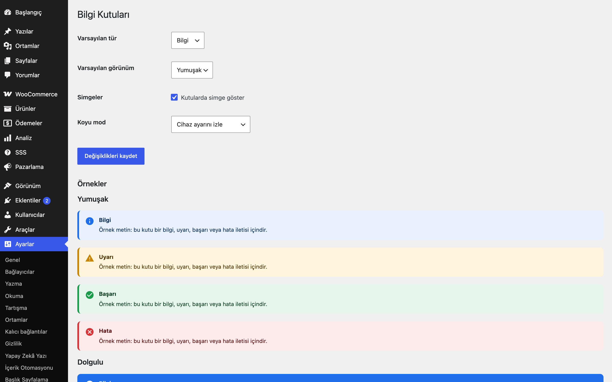
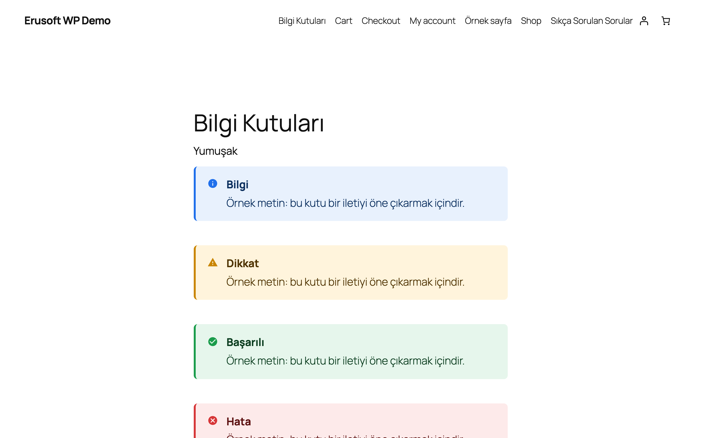
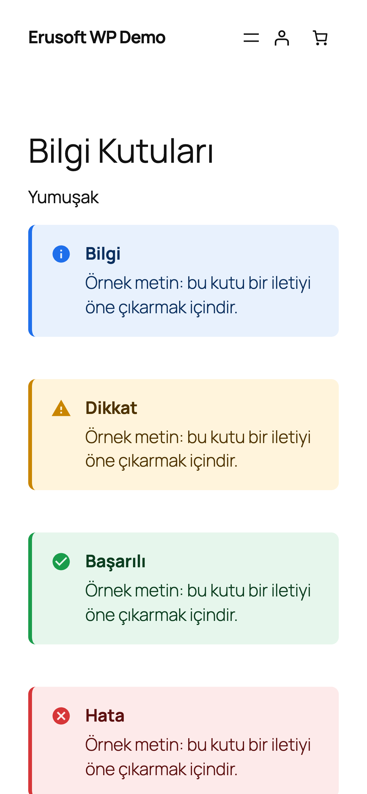

# Notice Boxes for WordPress

Bilgi, uyarı, başarı ve hata kutuları: 4 tür × 3 görünüm, kısa kod ve blok olarak.

> **English:** Info/warning/success/error boxes in three style presets (soft, solid, outline) as the `[eru_notice]` shortcode and a server-rendered Gutenberg block (`eru/notice-box`, no build step). Dark-mode aware.

  

## Ne işe yarar

Yazı içinde dikkat çekmesi gereken notları şık kutular olarak gösterir. Aynı çıktıyı hem kısa kod hem blok üretir; koyu mod desteklidir.

## Özellikler

- 4 tür (bilgi, uyarı, başarı, hata) × 3 görünüm (yumuşak, dolgulu, çerçeveli)
- Kısa kod ve blok aynı sunucu tarafı çıktıyı kullanır
- Blok `block.json` + sade JavaScript ile kayıtlıdır (derleme adımı yok)
- Cihazın koyu moduna uyar; istenirse kapatılabilir
- Başlık kaçışlanır, içerik `wp_kses_post` ile temizlenir

## Kurulum

1. `notice-boxes-for-wordpress` klasörünü `wp-content/plugins/` altına kopyalayın (veya zip olarak yükleyin).
2. Eklentiler ekranından etkinleştirin.
3. Ayarları yapın (aşağıya bakın).

## Ayarlar

Ayarlar → **Bilgi Kutuları**: varsayılan tür ve görünüm, simgeler, koyu mod. Aynı ekranda 12 kombinasyonun önizlemesi vardır. Seçenek: `eru_nb_settings`.

## Kısa kodlar, kancalar, filtreler

| Ad | Tür | Açıklama |
|---|---|---|
| `[eru_notice]` | kısa kod | `type` (`info`/`warning`/`success`/`error`), `title`, `style` (`soft`/`solid`/`outline`) |
| `eru/notice-box` | blok | Nitelikler: `type`, `title`, `variant`; iç bloklarla içerik |
| `eru_nb_settings` | seçenek | Eklenti ayarları |

## Entegrasyonlar ve gereksinimler

WordPress 6.5+, PHP 8.0+. Harici servis kullanmaz.

## Sınırlamalar

- Kutu içeriği blok olarak iç bloklardan oluşur; kısa kodda iç içe aynı kısa kod desteklenmez.
- Koyu mod yalnızca cihaz/tarayıcı ayarını izler; temanıza özel koyu mod sınıfı tanımlı değildir.

## SSS

**Eski kısa kodum yeni kutuyla uyumlu mu?** Kısa kod adı `[eru_notice]`'dir; öznitelikler yukarıdaki tabloda.

## Değişiklik geçmişi

Bkz. [CHANGELOG.md](CHANGELOG.md).

## Lisans

GPL-2.0-or-later.

Diğer Erusoft eklentileri: https://wordpress.erusoft.com/
