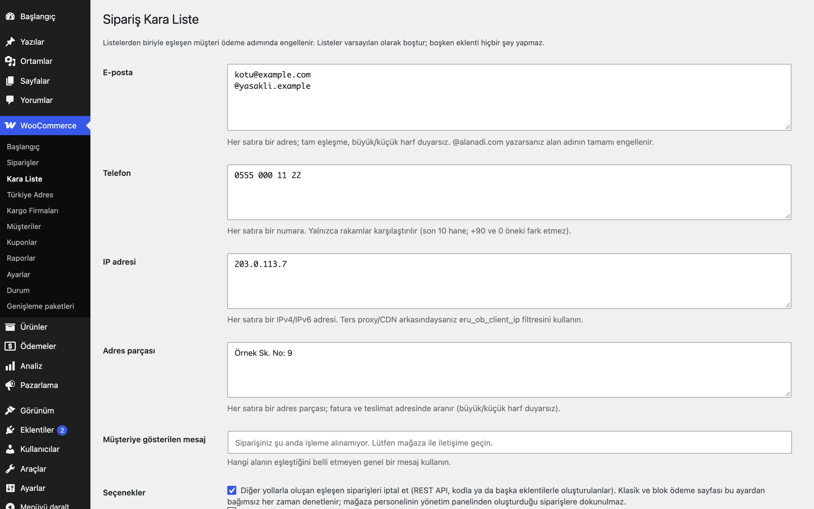

# Order Blacklist for WooCommerce

E-posta, telefon, IP veya adres parçasına göre kara liste ile ödeme adımında sipariş engeller; engellenen denemeleri kısa bir günlükte tutar.

> **English:** Blocks checkout for blocklisted e-mails (or whole domains), phone numbers, IP addresses or address fragments. Lists are empty by default. A log keeps the last 100 blocked attempts (matched rule only, no visitor data).

[](https://www.gnu.org/licenses/gpl-2.0.html)   



## Ne işe yarar

Sorunlu müşterilerin sipariş vermesini ödeme adımında engeller. Listeler boş başlar; boşken eklenti hiçbir şey yapmaz.

## Özellikler

- Dört liste: e-posta (tam eşleşme veya `@alanadi.com`), telefon (son 10 hane), IP, adres parçası
- Klasik ödeme doğrulamasında genel bir hata mesajı (hangi alanın eşleştiğini belli etmez); mesaj ayarlanabilir
- **Blok ödeme (Store API):** eşleşmede sipariş iptal edilir ve istek `eru_ob_blocked` hatasıyla (400) reddedilir; ödeme adımına geçilmez, sipariş işleme alınmaz
- Klasik ve blok ödeme sayfası her zaman denetlenir (blok ödemede istek hata mesajıyla durur)
- Diğer yollarla (REST API, kod, başka eklentiler) oluşan siparişler için isteğe bağlı "yedek" otomatik iptal; mağaza personelinin (`manage_woocommerce`) yönetim panelinden oluşturduğu siparişler hariç
- Engellenen denemeler için WooCommerce'in "İptal edilen sipariş" yönetici e-postası gönderilmez; deneme eklentinin günlüğüne yazılır
- Son 100 engellenen deneme günlüğü (`autoload=no`); yalnızca sizin listenize yazdığınız eşleşen kural saklanır (kuralın kendisi e-posta veya telefon gibi kişisel veri olabilir); ziyaretçinin diğer bilgileri saklanmaz
- Eşleşmede ziyaretçi IP'sini listeye ekleme: **isteğe bağlı**, varsayılan kapalı
- WordPress kişisel veri dışa aktarma/silme araçlarına bağlanır (e-posta anahtarı)

## Nasıl kullanılır

1. Eklentiyi etkinleştirin; WooCommerce → **Kara Liste** ekranını açın.
2. E-posta listesine her satıra bir adres olacak şekilde `ornek@example.com` ve alan adının tamamını engellemek için `@example.net` yazın.
3. İsterseniz telefon listesine örnek bir numara, adres parçası listesine "Demo Mahallesi" yazın.
4. Engelleme mesajını değiştirin (boşsa varsayılan metin kullanılır) ve kaydedin.
5. Mağazada `ornek@example.com` ile ödeme yapmayı deneyin: klasik ödemede genel bir hata mesajı görünür, sipariş oluşmaz.
6. Ekrandaki günlükte engellenen denemeyi (eşleşen kural, tür, zaman) görün.

## Kurulum

1. Klasörü `wp-content/plugins/` altına kopyalayın ve etkinleştirin.
2. WooCommerce → **Kara Liste** ekranında listeleri doldurun.

## Ayarlar

Ayarlar `eru_ob_settings` seçeneğinde tutulur: `emails`, `phones`, `ips`, `addresses` (hepsi boş), `message` (boşsa varsayılan metin), `auto_ip` (0), `backstop` (1). Günlük: `eru_ob_log` (en çok 100 kayıt).

**IP ve proxy/CDN:** IP varsayılan olarak `REMOTE_ADDR` değerinden okunur. Ters proxy veya CDN arkasındaysanız güvenilir adresi `eru_ob_client_ip` filtresiyle verin:

```php
add_filter( 'eru_ob_client_ip', fn( $ip ) => $_SERVER['HTTP_CF_CONNECTING_IP'] ?? $ip );
```

## Kısa kodlar, kancalar ve filtreler

| Ad | Tür | Açıklama |
|---|---|---|
| `eru_ob_client_ip` | filtre | Eşleştirmede kullanılan IP (varsayılan `REMOTE_ADDR`) |

## Entegrasyonlar ve gereksinimler

WordPress 6.5+, PHP 8.0+, WooCommerce 9.0+, HPOS uyumlu.

## Sınırlamalar

- Klasik ödemede doğrulama hatasıyla, blok ödemede 400 hatasıyla engellenir; engellenen blok ödeme denemesi kısa süre iptal edilmiş bir taslak sipariş bırakır. Kodla oluşturulan siparişler oluşur ve iptal edilir ("Diğer yollarla…" seçeneği).
- E-posta eşleşmesi normalleştirmez: Gmail noktaları ve `+etiket` kısımları farklı adres sayılır (gerekirse her varyantı ekleyin). IPv6 adresleri yazıldığı gibi karşılaştırılır (kısaltılmış/uzun yazım farkı eşleşmez).
- Adres parçası eşleşmesi alt dize aramasıdır; çok kısa parçalar yanlış eşleşme yapabilir.
- IP tabanlı engelleme paylaşılan IP'lerde (kurum, mobil operatör) masum müşterileri de engelleyebilir.
- **KVKK:** Kara liste listeleri kişisel veri içerebilir. Dayanak ve saklama süresini belirleyin; silme talebinde WordPress → Araçlar → Kişisel verileri sil, e-postayı ve o e-postayla verilmiş siparişlerdeki telefonu listeden ve günlükten kaldırır. Adres parçası ve IP kuralları bir kişiye bağlanamadığı için elle silinmelidir.

## SSS

**Müşteriye neden engellendiği söylenir mi?** Hayır, genel bir mesaj gösterilir.

**Günlükte kişisel veri var mı?** Yalnızca sizin yazdığınız eşleşen kural, tür, zaman ve kaynak; kural e-posta/telefon gibi kişisel veri olabileceği için KVKK kapsamında değerlendirin.

**Eklentiyi silersem ne olur?** Silme sırasında yalnızca `eru_ob_settings` (listeler, mesaj) ve `eru_ob_log` (günlük) seçenekleri silinir; sipariş metası kalır. Devre dışı bırakmak hiçbir veriyi silmez.

**Blok ödeme sayfasında çalışır mı?** Evet. Eşleşmede istek `eru_ob_blocked` hatasıyla (400) reddedilir; ayrıntı Sınırlamalar bölümünde.

**Dış servise bağlanır mı?** Hayır, kodda dış HTTP isteği yoktur; listeler ve günlük sitenizin veritabanındadır.

**Telefon eşleşmesinde +90 ve 0 farkı önemli mi?** Hayır; yalnızca rakamlar karşılaştırılır (son 10 hane).

**Çeviri nasıl yapılır?** Metin alanı `order-blacklist-for-woocommerce`; çeviri yolu `/languages`.

## Değişiklik geçmişi

Bkz. [CHANGELOG.md](CHANGELOG.md).

## Destek

- Önce bu sayfadaki **SSS** ve **Sınırlamalar** bölümlerine göz atın; sık karşılaşılan durumlar orada.
- Hata mı buldunuz? [GitHub Issues](https://github.com/erayusta/erusoft-wp/issues) üzerinden bildirin. WordPress, WooCommerce, PHP ve eklenti sürümünü, adımları ve beklenen/gerçekleşen sonucu yazmanız işi hızlandırır.
- Kurulum, yapılandırma, özel geliştirme veya entegrasyon desteği için **[hello@erusoft.com](mailto:hello@erusoft.com)** adresine yazın. Erusoft hakkında: [erusoft.com](https://erusoft.com).
- Lütfen şifre, API anahtarı veya müşteri verisi (ad, telefon, TCKN, sipariş dökümü) göndermeyin; ekran görüntülerindeki kişisel verileri karartın.

## Lisans

GPL-2.0-or-later. Diğer Erusoft eklentileri: https://wordpress.erusoft.com/
