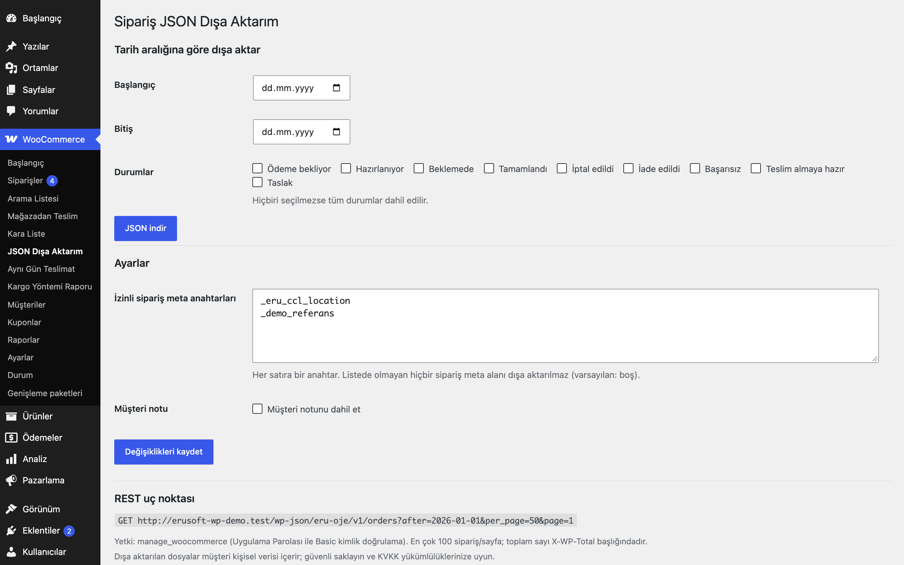

# Order JSON Export for WooCommerce

Siparişleri belgelenmiş, nötr bir şemayla JSON olarak dışa aktarır: toplu işlem, tarih aralığı ekranı ve yetkili REST uç noktası.

> **English:** Exports WooCommerce orders as JSON with a documented schema (order, items, billing, shipping, totals, allow-listed meta). Bulk action in the orders list, a date-range screen and an authenticated REST endpoint. Only meta keys you allow are exported.

   

## Ne işe yarar

Muhasebe, ERP veya kendi yazdığınız entegrasyonlar için siparişleri tek bir tutarlı JSON şemasında alırsınız. Hangi sipariş meta alanlarının dışarı çıkacağına siz karar verirsiniz; listede olmayan hiçbir meta aktarılmaz.

## Özellikler

- Sipariş listesinden seçili siparişler için **JSON olarak dışa aktar** toplu işlemi (HPOS ve klasik liste)
- WooCommerce → JSON Dışa Aktarım ekranında tarih aralığı ve durum filtresiyle indirme
- Satır bazında SKU, adet, birim fiyat, KDV tutarı ve KDV oranı; kargo, ücret ve kupon satırları
- İzinli meta anahtarları (varsayılan boş); müşteri notu isteğe bağlı
- Yetkili REST uç noktası: `GET /wp-json/eru-oje/v1/orders?after=…` (`manage_woocommerce`, Uygulama Parolaları)
- Sayfa başına en çok 100 sipariş; `X-WP-Total` ve `X-WP-TotalPages` başlıkları
- Türkçe karakterler kaçışsız (UTF-8) yazılır

## Kurulum

1. Klasörü `wp-content/plugins/` altına kopyalayın ve etkinleştirin (WooCommerce gerekir).
2. WooCommerce → **JSON Dışa Aktarım** ekranından indirin veya Siparişler listesinde toplu işlem kullanın.

## Nasıl kullanılır

Örnek senaryo: bir siparişi JSON olarak indirmek ve REST ile çekmek.

1. Eklentiyi etkinleştirin. "Demo Ürün" (250 TL) için `ornek@example.com` adresli bir deneme siparişi oluşturun.
2. **WooCommerce → Siparişler** listesinde siparişi işaretleyin, toplu işlemlerden **JSON olarak dışa aktar**'ı seçin; dosya indirilir.
3. İndirilen dosyada `schema` alanı `eru-oje/1`, `count` alanı 1 olur; `orders[0].items[0]` altında SKU, adet, birim fiyat ve KDV bilgisi yer alır.
4. Bir siparişe eklenti ya da kendi kodunuzun yazdığı bir meta alanını (örneğin `_ornek_meta_anahtari`) dahil etmek için **WooCommerce → JSON Dışa Aktarım** ekranındaki "İzinli sipariş meta anahtarları" kutusuna anahtarı satır başına bir tane yazıp kaydedin. Bundan sonra dosyada `meta{}` altında görünür.
5. Tarih aralığına göre almak için aynı ekranda başlangıç/bitiş tarihini ve istediğiniz sipariş durumlarını seçip **JSON indir**'e basın.
6. Bir entegrasyon için, `manage_woocommerce` yetkili bir kullanıcıya Uygulama Parolası oluşturun ve `GET /wp-json/eru-oje/v1/orders?after=2026-01-01&per_page=50` çağrısını Basic kimlik doğrulamayla yapın.

## Ayarlar

| Ayar | Varsayılan |
|---|---|
| `eru_oje_meta_allowlist` İzinli sipariş meta anahtarları (satır başına bir) | boş |
| `eru_oje_include_note` Müşteri notunu dahil et | kapalı |

**JSON şeması (`eru-oje/1`):** `schema`, `generated_at`, `count`, `orders[]`. Her sipariş: `id`, `number`, `status`, `currency`, `created_at`/`paid_at`/`completed_at` (ISO 8601, site saat dilimi), `payment_method`, `payment_method_title`, `customer_note`, `totals{subtotal,discount,shipping,fees,tax,total,refunded}`, `billing{…}`, `shipping{…}`, `items[{product_id,variation_id,sku,name,quantity,unit_price,subtotal,subtotal_tax,total,total_tax,tax_rate}]`, `shipping_lines[]`, `fees[]`, `coupons[]`, `meta{}`.

## Kısa kodlar, kancalar ve filtreler

| Ad | Tür | Açıklama |
|---|---|---|
| `eru_oje_order` | filtre | Dışa aktarılan tek siparişin dizisi (`$data`, `$order`) |
| `eru_oje_meta_allowlist` | filtre | İzinli meta anahtarları |
| `GET /eru-oje/v1/orders` | REST | `after`, `before`, `status`, `per_page` (1-100), `page` |

## Entegrasyonlar ve gereksinimler

WordPress 6.5+, PHP 8.0+, WooCommerce 9.0+, HPOS uyumlu.

## Sınırlamalar

- Zamanlanmış (cron) dışa aktarma, FTP gönderimi ve fatura yükleme yoktur; dosyayı elle indirir veya REST ile çekersiniz.
- Tarih aralığı indirmesi en çok 5.000 siparişle sınırlıdır; aralıkta daha fazla sipariş varsa indirme yapılmaz ve ekranda uyarı gösterilir (sessizce kesilmez). Aralığı daraltın veya REST sayfalamasını kullanın.
- JSON dosyası müşteri kişisel verisi içerir: güvenli saklayın, KVKK yükümlülüklerinize uyun.

## SSS

**Hangi meta alanları dışarı çıkar?** Yalnızca ayarlardaki izin listesinde olanlar. Liste varsayılan olarak boştur.

**REST uç noktasını kim çağırabilir?** `manage_woocommerce` yetkisi olan kullanıcılar; Uygulama Parolası ile Basic kimlik doğrulama kullanın.

**Devre dışı bırakırsam ya da silersem ne olur?** Devre dışı bırakınca toplu işlem, ekran ve REST uç noktası kalkar; ayarlar durur. Eklentiyi silerseniz (Eklentiler → Sil) yalnızca `eru_oje_meta_allowlist` ve `eru_oje_include_note` seçenekleri silinir; siparişlere hiç dokunulmaz, daha önce indirdiğiniz dosyalar sizde kalır. Veriyi koruyan bir sabit yoktur.

**HPOS ve blok sepet/ödeme?** Eklenti HPOS uyumluluğunu (`custom_order_tables`) bildirir ve Siparişler listesindeki toplu işlemi HPOS ve klasik listede sunar. Dışa aktarma yalnızca yönetim ve REST tarafında çalışır; sepet ya da ödeme sayfasını etkilemez.

**Dosya bir yere gönderiliyor mu?** Hayır. Eklenti hiçbir dış servise bağlanmaz; JSON tarayıcınıza indirilir ya da REST yanıtı olarak çağıranın eline geçer.

**Büyük mağazalarda ne yapmalıyım?** Tarih aralığı indirmesi en çok 5.000 sipariş aktarır; daha büyük aralıklar için REST uç noktasını sayfa sayfa (`per_page` en çok 100, `X-WP-TotalPages` başlığı) çağırın.

**Önbellek eklentisi REST yanıtını önbelleğe alır mı?** Uç nokta kimlik doğrulama gerektirir; yine de bir önbellek katmanı kullanıyorsanız `/wp-json/eru-oje/` yolunu hariç tutun.

## Değişiklik geçmişi

Bkz. [CHANGELOG.md](CHANGELOG.md).

## Destek

- Önce bu sayfadaki **SSS** ve **Sınırlamalar** bölümlerine göz atın; sık karşılaşılan durumlar orada.
- Hata mı buldunuz? [GitHub Issues](https://github.com/erayusta/erusoft-wp/issues) üzerinden bildirin. WordPress, WooCommerce, PHP ve eklenti sürümünü, adımları ve beklenen/gerçekleşen sonucu yazmanız işi hızlandırır.
- Kurulum, yapılandırma, özel geliştirme veya entegrasyon desteği için **[hello@erusoft.com](mailto:hello@erusoft.com)** adresine yazın. Erusoft hakkında: [erusoft.com](https://erusoft.com).
- Lütfen şifre, API anahtarı veya müşteri verisi (ad, telefon, TCKN, sipariş dökümü) göndermeyin; ekran görüntülerindeki kişisel verileri karartın.

## Lisans

GPL-2.0-or-later. Diğer Erusoft eklentileri: https://wordpress.erusoft.com/
