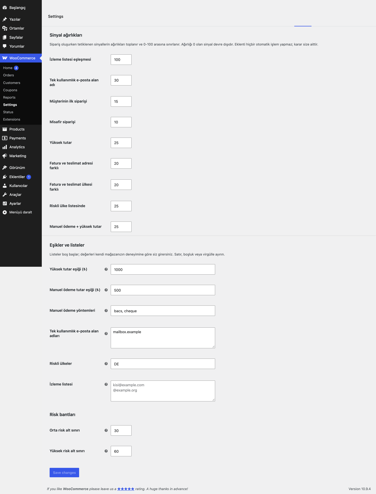

# Order Risk Score for WooCommerce

Siparişlere ayarlanabilir sinyallerle 0-100 arası risk puanı verir. Puan sipariş listesinde renkli rozet, sipariş detayında kutu olarak görünür. Eklenti hiçbir otomatik işlem yapmaz; karar mağaza sahibine aittir.

## Özellikler

- 9 sinyal: izleme listesi, tek kullanımlık e-posta alan adı, ilk sipariş, misafir siparişi, yüksek tutar, adres farkı, ülke farkı, riskli ülke, manuel ödeme + yüksek tutar
- Her sinyalin ağırlığı ayardır (0 = devre dışı); puan 0-100 arasına sınırlanır
- Düşük / Orta / Yüksek bantlar ve eşikleri ayarlanabilir
- Sipariş listesinde puan sütunu (HPOS ve klasik) ve sipariş detayında "Yeniden hesapla" düğmeli kutu
- Klasik ödeme, blok ödeme (Store API) ve kodla oluşturulan siparişlerde çalışır
- Listeler varsayılan olarak boştur; mağazanıza özgü değerleri siz girersiniz
- Müşteri tarafında hiçbir çıktı ve dış HTTP isteği yoktur

## Kurulum

1. `order-risk-score-for-woocommerce` klasörünü `wp-content/plugins/` altına kopyalayın (veya zip olarak yükleyin).
2. Eklentiler ekranından etkinleştirin.
3. WooCommerce → Ayarlar → **Risk Skoru** sekmesinden ağırlıkları ve listeleri girin.

## Nasıl kullanılır

1. Eklentiyi etkinleştirin; WooCommerce → Ayarlar → **Risk Skoru** sekmesini açın.
2. **Tek kullanımlık e-posta alan adları** kutusuna `example.com` yazın (yalnızca deneme için); diğer ağırlıkları varsayılan bırakıp kaydedin.
3. Mağazada misafir olarak, e-postası `ornek@example.com` olan bir "Demo Ürün" siparişi (250 TL) verin.
4. WooCommerce → Siparişler listesinde yeni **Risk** sütununda rozet görünür: tek kullanımlık alan adı (30) + misafir siparişi (10) = 40 puan, varsayılan eşiklerle "Orta" bant.
5. Siparişi açın; sağdaki kutuda puan ve tetiklenen sinyaller listelenir.
6. Ağırlıkları değiştirdiyseniz ya da sipariş verisini düzenlediyseniz kutudaki **Yeniden hesapla** düğmesine basın.

## Ayarlar

WooCommerce → Ayarlar → Risk Skoru. Ağırlıklar `eru_ors_weight_<sinyal>` (varsayılanlar: izleme listesi 100, tek kullanımlık e-posta 30, ilk sipariş 15, misafir 10, yüksek tutar 25, adres farkı 20, ülke farkı 20, riskli ülke 25, manuel ödeme 25).

| Seçenek | Varsayılan |
|---|---|
| `eru_ors_high_amount` Yüksek tutar eşiği | 1000 (mağaza para birimi) |
| `eru_ors_manual_amount` Manuel ödeme eşiği | 500 |
| `eru_ors_manual_gateways` Manuel ödeme yöntemleri | `bacs, cheque` |
| `eru_ors_disposable_domains` Tek kullanımlık alan adları | boş |
| `eru_ors_risky_countries` Riskli ülke kodları | boş |
| `eru_ors_watchlist` İzleme listesi (e-posta, `@alanadi`, telefon) | boş |
| `eru_ors_band_medium` / `eru_ors_band_high` Bant alt sınırları | 30 / 60 |

Sipariş meta alanları: `_eru_ors_score`, `_eru_ors_band`, `_eru_ors_signals`, `_eru_ors_calculated_at`.

## Kancalar ve filtreler

| Ad | Tür | Açıklama |
|---|---|---|
| `eru_ors_signals` | filtre | Sinyal tanımları (`label`, `weight`, `check` callable) — kendi sinyalinizi ekleyin |
| `eru_ors_score` | filtre | Hesaplanan nihai puan (`$score`, `$order`, `$detected`) |
| `eru_ors_scored` | eylem | Puan kaydedildikten sonra (`$order`, `$score`, `$band`, `$signals`) |

## Gereksinimler

WordPress 6.5+, PHP 8.0+, WooCommerce 9.0+. HPOS (özel sipariş tabloları) ile uyumludur. WooCommerce yoksa eklenti bir uyarı gösterir ve hiçbir şey yapmaz.

## Sınırlamalar

- Puan sipariş oluşurken bir kez hesaplanır; sonradan değişen sipariş verisi için "Yeniden hesapla" düğmesini kullanın.
- Sinyaller basit kurallardır; bir dolandırıcılık tespit servisinin yerini tutmaz.
- Tutar eşikleri mağaza para biriminde, kur dönüşümsüz karşılaştırılır.
- Eklenti silindiğinde (Eklentiler → Sil) yalnızca kendi ayarları (`eru_ors_*` seçenekleri) silinir; siparişlere yazılmış risk puanları (`_eru_ors_*` sipariş metası) korunur.

## SSS

**Siparişi otomatik iptal eder mi?** Hayır, yalnızca puan gösterir.

**Eski siparişler puanlanır mı?** Hayır; detay ekranından "Yeniden hesapla" ile tek tek puanlanabilir.

**Eklentiyi silersem ne olur?** Eklentiler → Sil, `eru_ors_*` seçeneklerini (ağırlıklar, eşikler, listeler) siler. Siparişlere yazılmış `_eru_ors_*` meta alanları korunur. Devre dışı bırakmak veri silmez; yeni siparişler puanlanmaz.

**HPOS ve blok ödeme ile uyumlu mu?** Evet. Eklenti HPOS uyumluluğunu bildirir ve puanlamayı hem klasik ödeme hem Store API (blok ödeme) kancalarına bağlar.

**Dışarıya istek yapıyor mu, müşteri bir şey görür mü?** Hayır; dış HTTP isteği ve müşteri tarafı çıktısı yoktur. Puan yalnızca yönetim ekranlarında görünür.

**Kendi sinyalimi ekleyebilir miyim?** Evet, `eru_ors_signals` filtresiyle (`label`, `weight`, `check` callable). Ağırlık ayarlar sekmesine de yansır.

## English summary

Scores each order from 0 to 100 using configurable signals (disposable e-mail domains, address/country mismatch, first or guest order, high amount, risky countries, manual payment, watchlist). Every weight, threshold and list is an option under WooCommerce > Settings > Risk Skoru; lists are empty by default. A score column is added to the orders list (HPOS and legacy). No automatic action is taken.

## Sürüm notları

Bkz. [CHANGELOG.md](CHANGELOG.md).

## Destek

- Önce bu sayfadaki **SSS** ve **Sınırlamalar** bölümlerine göz atın; sık karşılaşılan durumlar orada.
- Hata mı buldunuz? [GitHub Issues](https://github.com/erayusta/erusoft-wp/issues) üzerinden bildirin. WordPress, WooCommerce, PHP ve eklenti sürümünü, adımları ve beklenen/gerçekleşen sonucu yazmanız işi hızlandırır.
- Kurulum, yapılandırma, özel geliştirme veya entegrasyon desteği için **[hello@erusoft.com](mailto:hello@erusoft.com)** adresine yazın. Erusoft hakkında: [erusoft.com](https://erusoft.com).
- Lütfen şifre, API anahtarı veya müşteri verisi (ad, telefon, TCKN, sipariş dökümü) göndermeyin; ekran görüntülerindeki kişisel verileri karartın.

## Lisans

GPL-2.0-or-later. Diğer Erusoft eklentileri: https://wordpress.erusoft.com
