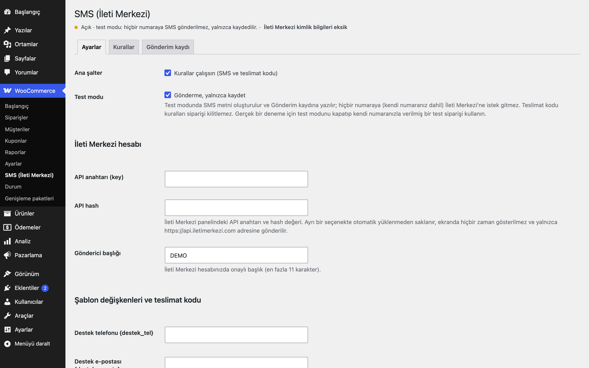
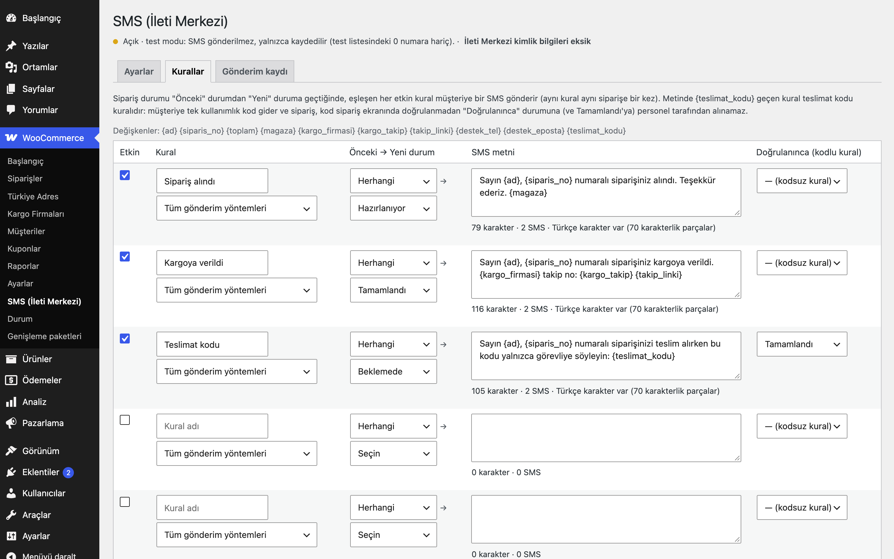
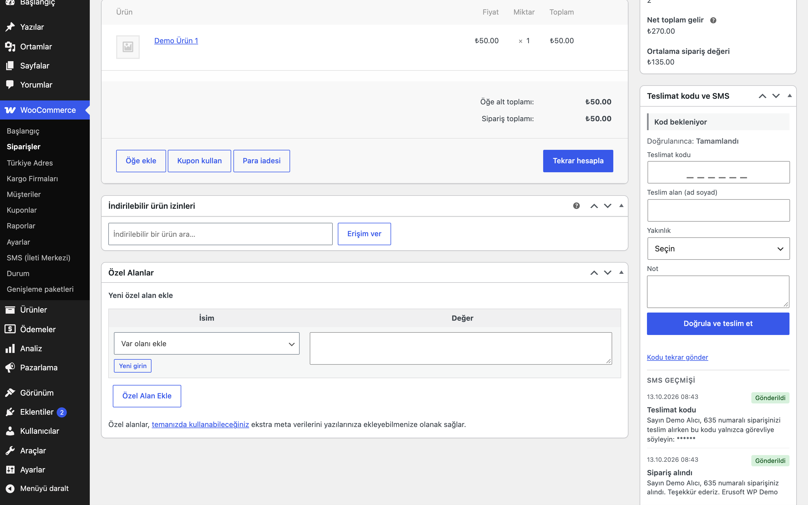
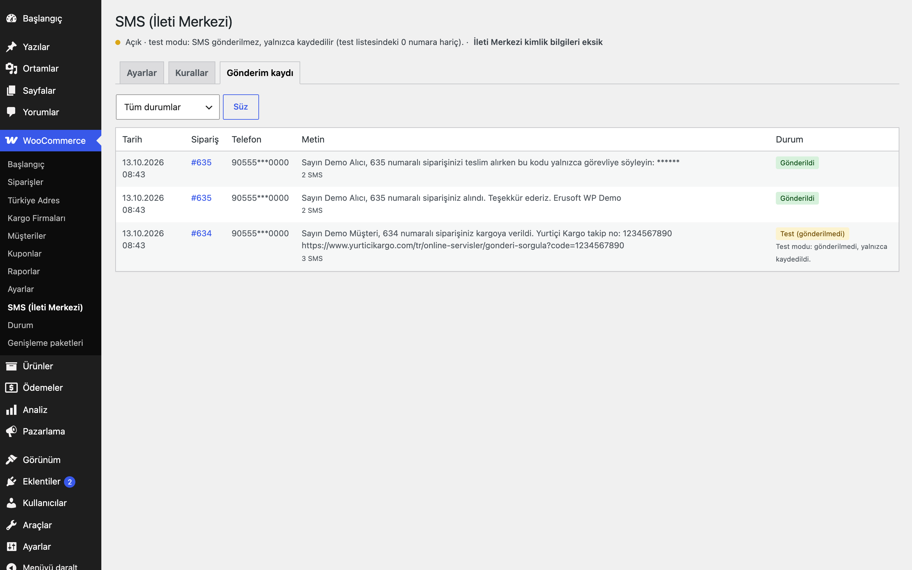

# Order SMS & Delivery Codes for İleti Merkezi

Sipariş durumu değişince İleti Merkezi üzerinden müşteriye SMS gönderir; isteğe bağlı teslimat kodu ile sipariş, müşteriye SMS'le giden tek kullanımlık kod girilmeden "teslim edildi" yapılamaz.

> **English:** Sends SMS through the İleti Merkezi JSON API when WooCommerce order statuses change. Rules (from status → to status, optional shipping method) with Turkish templates such as `{ad}`, `{siparis_no}`, `{kargo_takip}`. A rule containing `{teslimat_kodu}` is a delivery-code rule: the customer gets a one-time 6-digit code (only its hash is stored) and staff can only move the order to the delivery status by entering the code in the order screen; order form, bulk actions, list buttons and cookie-authenticated REST are blocked, API/system changes are recorded as "without code". Master switch off and test mode on by default: in test mode the rendered text is logged and nothing is sent. Credentials (key + hash) are stored in a separate non-autoloaded option, never printed back and only ever sent to `https://api.iletimerkezi.com`. Sending runs in Action Scheduler with retries.

   

## Ne işe yarar

"Siparişiniz alındı", "Kargoya verildi" gibi bilgilendirme SMS'lerini durum değişikliğine bağlar. Kendi kuryeniz veya mağazadan teslimde, teslimatın gerçekten müşteriye yapıldığını müşterinin telefonuna giden kodla doğrular.

## Özellikler

- Kural tablosu: etkin, ad, önceki durum (herhangi veya belirli), yeni durum, gönderim yöntemi (tümü veya belirli yöntem), SMS metni
- Değişkenler: `{ad}`, `{siparis_no}`, `{toplam}`, `{magaza}`, `{kargo_firmasi}`, `{kargo_takip}`, `{takip_linki}`, `{destek_tel}`, `{destek_eposta}`, `{teslimat_kodu}`
- Aynı kural aynı siparişe bir kez gönderilir; metin sayacı (karakter, SMS adedi, Türkçe karakterle 70'lik parçalar)
- Gönderim Action Scheduler kuyruğunda; geçici hatalarda 5 dk / 15 dk / 1 sa sonra yeniden deneme
- **Teslimat kodu:** 6 haneli kod gönderim anında üretilir, yalnızca özeti (`wp_hash_password`) saklanır; sipariş ekranında "Teslimat kodu ve SMS" kutusu (kod, teslim alan, yakınlık, not), deneme hakkı ve kilit, "Kodu tekrar gönder" (eski kod geçersiz)
- Kod beklenen sipariş; düzenleme formu, toplu işlemler, liste düğmeleri ve tarayıcı oturumlu REST ile teslim durumuna alınamaz. API ve sistem değişiklikleri engellenmez, "kodsuz teslim" olarak kaynağıyla kaydedilir
- Sipariş listesinde "Teslimat kodu" rozeti, sipariş ekranında SMS geçmişi, yönetimde gönderim kaydı (telefonlar maskeli, kod her yerde `******`)
- **Test modu** (varsayılan açık): yalnızca kayıt. SMS metni oluşturulur ve kayda yazılır; hiçbir numaraya (sizin numaranız dahil) istek gitmez
- Teslimat kodu 48 saat geçerlidir (`eru_osms_code_ttl`); süresi dolan kod deneme hakkı yemez, "Kodu tekrar gönder" ile yenilenir
- Müşterinin girdiği değişkenler (`{ad}`) SMS'e girmeden temizlenir: kontrol karakterleri, bağlantılar ve alan adları atılır, 40 karakterde kesilir
- Kuyruktaki gönderim, çalışmadan önce ana şalteri yeniden kontrol eder; şalter kapandıysa "Atlandı" olarak kaydedilir
- Turkish Shipping Carriers ile: takip numarası ve bağlantısı şablona otomatik gelir

## Kurulum

1. Klasörü `wp-content/plugins/` altına kopyalayın ve etkinleştirin.
2. WooCommerce → **SMS (İleti Merkezi)** → Ayarlar: API anahtarı, hash ve onaylı gönderici başlığını girin, ana şalteri açın (test modu açık kalsın).
3. Kurallar sekmesinde örnek kuralları düzenleyip etkinleştirin, kaydedin.
4. Gönderim kaydında test kayıtlarını kontrol edin; hazır olunca test modunu kapatın. Gerçek bir SMS denemesi için test modunu kapatıp kendi numaranızla bir test siparişi verin (test modu hiçbir numaraya göndermez).

## Ayarlar

| Ayar | Varsayılan |
|---|---|
| Ana şalter (`eru_osms_settings[enabled]`) | kapalı |
| Test modu | açık |
| Gönderici başlığı | boş |
| Destek telefonu / e-postası (şablon değişkenleri) | boş |
| Kod deneme hakkı | 5 |
| API anahtarı ve hash (`eru_osms_credentials`, autoload kapalı) | boş |
| Kurallar (`eru_osms_rules`) | boş (ekranda kapalı örnekler önerilir) |

Tablolar: `{prefix}eru_osms_log` (gönderim kaydı), `{prefix}eru_osms_delivery` (sipariş başına teslimat kodu satırı).

**İleti Merkezi API'si (kaynak koddaki biçim):** `POST https://api.iletimerkezi.com/v1/send-sms/json`, gövde `{"request":{"authentication":{"key":…,"hash":…},"order":{"sender":…,"iys":"0","message":{"text":…,"receipents":{"number":["905…"]}}}}}`; alan adı API'nin kendi yazımıyla `receipents`. Başarı `response.status.code = 200`. `iys` = `0`: bilgilendirme (işlemsel) iletisi. Pazarlama içerikli metin göndermeyin; ticari ileti için İYS onayı gerekir.

## Kısa kodlar, kancalar ve filtreler

| Ad | Tür | Açıklama |
|---|---|---|
| `eru_osms_variables` | filtre | Şablon değişkenleri (`$vars`, `$order`) |
| `eru_osms_customer_variables` | filtre | Müşteri girdisinden gelen, temizlenen değişken adları (varsayılan `ad`) |
| `eru_osms_customer_variable_length` | filtre | Bu değişkenlerin en fazla uzunluğu (varsayılan 40) |
| `eru_osms_code_ttl` | filtre | Teslimat kodunun geçerlilik süresi, saniye (varsayılan 48 saat; 0 = sınırsız) |
| `eru_osms_tracking` | filtre | Takip bilgisi (`carrier_name`, `number`, `url`) |
| `eru_osms_order_eligible` | filtre | Sipariş SMS alsın mı (ör. pazaryeri siparişlerini hariç tutmak için `false`) |
| `eru_osms_delivered_statuses` | filtre | "Teslim edildi" sayılan durumlar (varsayılan `completed`) |
| `eru_osms_request_body` | filtre | API isteğinin gövdesi |
| `eru_osms_endpoint` | filtre | API adresi; yalnızca `https://api.iletimerkezi.com` kabul edilir |
| `eru_osms_send` | Action Scheduler eylemi | Kuyruktaki gönderim |

## Entegrasyonlar ve gereksinimler

WordPress 6.5+, PHP 8.0+, WooCommerce 9.0+ (Action Scheduler ile), HPOS uyumlu. Bir İleti Merkezi hesabı ve onaylı gönderici başlığı gerekir. İleti Merkezi entegrasyon adı olarak kullanılır; eklenti İleti Merkezi ile bağlantılı değildir.

## Sınırlamalar

- Yalnızca İleti Merkezi desteklenir; teslim raporu (DLR) sorgulanmaz, "Gönderildi" API'nin kabul ettiği anlamına gelir.
- Yalnızca Türkiye cep numaralarına (`905XXXXXXXXX`) gönderilir; numara faturadan, olmazsa teslimat telefonundan alınır.
- Test modunda teslimat kodu kuralları siparişi kilitlemez (kod kimseye gitmediği için).
- Sipariş dışı SMS (harici sistemden REST ile tetikleme) ve CRM bağlantıları bu sürümde yoktur.
- Kayıtlar otomatik silinmez; kişisel veri (telefon, ad içeren metin) saklama sürenizi KVKK kapsamında belirleyin.

## SSS

**Kimlik bilgisi girmeden bir şey gider mi?** Hayır. Ana şalter açık ve test modu kapalı olsa bile kimlik bilgisi yoksa kayıt "Hata" olarak düşer, istek yapılmaz.

**Teslimat kodunu kim görür?** Kimse. Kod yalnızca müşterinin SMS'inde vardır; veritabanında özet saklanır, kayıtlarda `******` görünür.

**Kaldırınca ne silinir?** İki tablo ve `eru_osms_*` seçenekleri; sipariş notları korunur.

## Değişiklik geçmişi

Bkz. [CHANGELOG.md](CHANGELOG.md).

## Lisans

GPL-2.0-or-later. Diğer Erusoft eklentileri: https://wordpress.erusoft.com/
