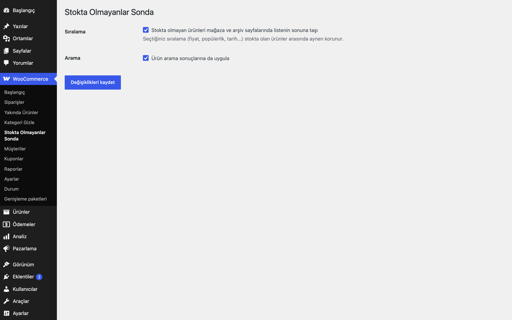
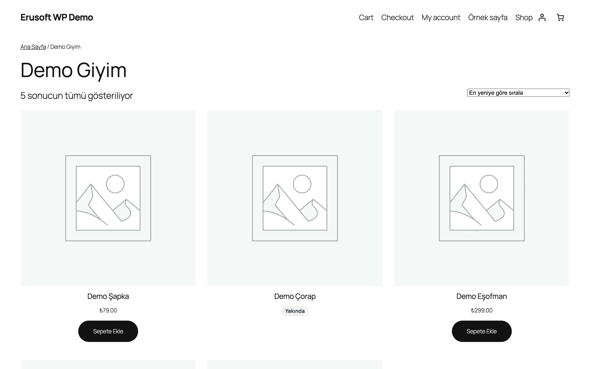
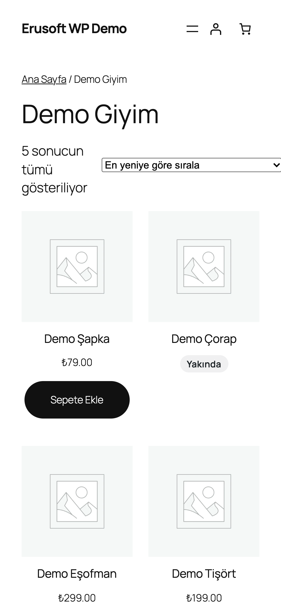

# Out-of-Stock Last for WooCommerce

Stokta olmayan ürünleri arşivlerde listenin sonuna taşır.

> **English:** Moves out-of-stock products to the end of shop, category, tag, brand and search results for every sort order, keeping the shopper's chosen order among in-stock products. On by default; a settings page toggles it and the search behaviour.

   

## Ne işe yarar

Mağaza, kategori, etiket, marka ve arama sayfalarında stokta olmayan ürünler her zaman listenin sonunda görünür. Seçilen sıralama (fiyat, tarih, popülerlik...) stokta olanlar arasında aynen korunur.

## Özellikler

- Her sıralama türünde çalışır (varsayılan, fiyat, tarih, popülerlik, puan)
- Yalnızca ön yüzdeki ana ürün sorgusuna uygulanır; yönetim ekranı ve ikincil sorgular etkilenmez
- Ürün aramasında uygulama ayrıca açılıp kapatılabilir
- Varsayılan olarak açıktır (zararsız varsayılan); ayarlardan kapatılabilir
- Tema AJAX "daha fazla yükle" sorguları için filtre ile genişletilebilir

## Kurulum

1. `out-of-stock-last-for-woocommerce` klasörünü `wp-content/plugins/` altına kopyalayın (veya zip olarak yükleyin).
2. Eklentiler ekranından etkinleştirin (WooCommerce gereklidir). Ek ayar gerekmez.

## Ayarlar

WooCommerce → **Stokta Olmayanlar Sonda**. İki onay kutusu: sıralama ve arama. Ayarlar `eru_osl_settings` seçeneğinde saklanır.

## Kancalar, filtreler ve veri alanları

| Ad | Tür | Açıklama |
|---|---|---|
| `eru_osl_apply_to_query` | filtre | Bir sorguya uygulanıp uygulanmayacağı (`$apply`, `$query`); tema AJAX sorguları için `true` dönebilirsiniz |
| `eru_osl => 1` | sorgu değişkeni | Kendi `WP_Query` nesnenizde sonda sıralamayı açar |

## Entegrasyonlar ve gereksinimler

WordPress 6.5+, PHP 8.0+, WooCommerce 9.0+. HPOS uyumludur. Harici servis kullanmaz. WooCommerce arama tablosunu (`wc_product_meta_lookup`) kullanır.

## Sınırlamalar

- "Ön sipariş" (backorder) durumundaki ürünler stokta sayılır; yalnızca "stokta yok" sona gider.
- Blok tabanlı ürün listelerinin ve kısa kodların sorguları ana sorgu olmadığı için etkilenmez.
- Sonsuz kaydırma yapan temalarda `eru_osl_apply_to_query` filtresiyle ilgili AJAX sorgusunu açmanız gerekebilir.

## SSS

**Marka sıralama eklentisiyle birlikte çalışır mı?** Evet. Önce stok durumu, sonra [Marka Ürün Sıralama](../brand-product-sorting-for-woocommerce/) sırası uygulanır.

## Değişiklik geçmişi

Bkz. [CHANGELOG.md](CHANGELOG.md).

## Lisans

GPL-2.0-or-later.

Diğer Erusoft eklentileri: https://wordpress.erusoft.com/
