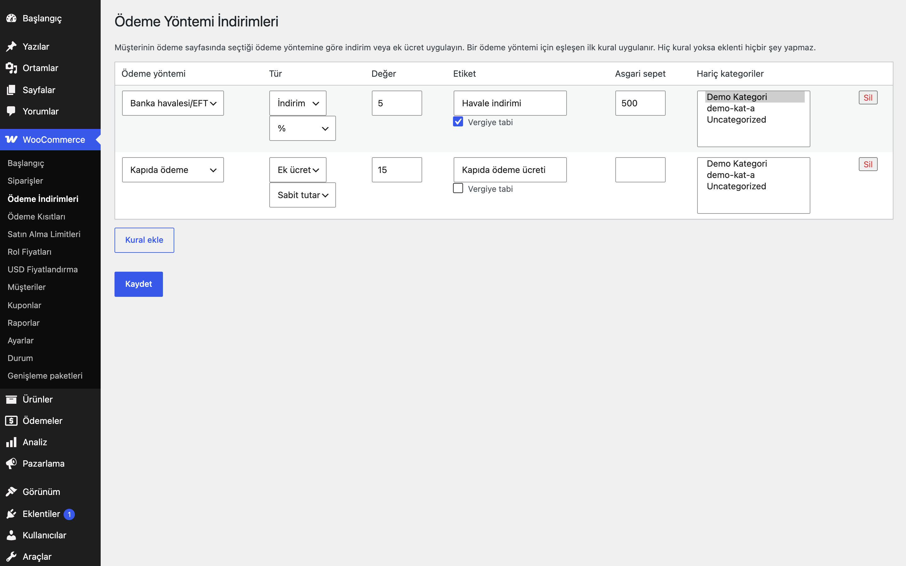

# Payment Method Discounts for WooCommerce

Ödeme sayfasında seçilen ödeme yöntemine göre yüzde veya sabit tutarlı indirim (ya da ek ücret) uygular.

> **English:** Applies a percentage or fixed discount (or a surcharge) depending on the payment method chosen at checkout. Rules have an optional minimum cart total and category exclusions. With no rules the plugin does nothing.

   

## Ne işe yarar

Havale/EFT gibi tercih etmenizi istediğiniz ödeme yöntemlerine, ödeme sayfasında müşteri yöntemi seçtiği anda indirim sunar; kapıda ödeme gibi maliyetli yöntemlere ise ek ücret ekleyebilirsiniz. İndirim veya ücret sepete bir "ücret satırı" olarak eklenir ve ödeme yöntemi değiştikçe anında yeniden hesaplanır.

## Özellikler

- Ödeme yöntemi başına kural: indirim veya ek ücret, yüzde veya sabit tutar
- Sepette görünen etiket ve "vergiye tabi" seçeneği
- Asgari sepet tutarı
- Hariç tutulacak kategoriler (alt kategoriler dahil); hesap yalnızca kalan satırlar üzerinden yapılır
- Taban, kupon sonrası ve KDV hariç satır toplamıdır; indirim sepet tutarını aşamaz
- Aynı ödeme yöntemi için eşleşen ilk kural uygulanır; toplamlar kaç kez yeniden hesaplanırsa hesaplansın aynı sonucu verir
- Ödeme yöntemi değiştiğinde ödeme sayfası otomatik yenilenir

## Kurulum

1. `payment-method-discounts-for-woocommerce` klasörünü `wp-content/plugins/` altına kopyalayın (veya zip olarak yükleyin).
2. Eklentiler ekranından etkinleştirin (WooCommerce gereklidir).
3. Aşağıdaki ayar ekranından yapılandırın. Yapılandırma yapılana kadar mağazanızda hiçbir değişiklik olmaz.

## Ayarlar

WooCommerce → **Ödeme İndirimleri**. Kurallar `eru_pmd_rules` seçeneğinde saklanır; varsayılan boştur.

## Kancalar, filtreler ve veri alanları

| Ad | Tür | Açıklama |
|---|---|---|
| `eru_pmd_rules` | seçenek | Kural listesi (`gateway`, `type`, `mode`, `value`, `label`, `min_cart`, `exclude_categories`, `taxable`) |
| `eru_pmd_fee_amount` | filtre | Eklenmeden önce işaretli tutar (`$amount`, `$rule`, `$cart`); 0 dönerseniz satır eklenmez |

## Entegrasyonlar ve gereksinimler

WordPress 6.5+, PHP 8.0+, WooCommerce 9.0+. HPOS (özel sipariş tabloları) ile uyumludur. WooCommerce yoksa eklenti bir uyarı gösterir ve hiçbir şey yapmaz. Harici servis kullanmaz; dış HTTP isteği yapmaz.

## Sınırlamalar

- Birden çok indirim eklentisi birlikte çalışırken toplam indirim sepet tutarını aşmaz: bu eklenti, önce çalışan eklentilerin eklediği indirimleri (negatif ücretler) düşüp kalan tutar kadar indirim yapar.
- Blok tabanlı ödeme sayfasında ücret satırı yalnızca oturumda kayıtlı ödeme yöntemine göre hesaplanır; ödeme yöntemi seçimine anında tepki için klasik ödeme sayfası önerilir.
- Her ödeme yöntemi için yalnızca ilk eşleşen kural uygulanır; kurallar birikmez.
- Ürün sayfalarında "havale ile X TL" gibi bir gösterim sunmaz.
- Eklenti silindiğinde (Eklentiler → Sil) yalnızca kendi ayarı (`eru_pmd_rules` seçeneği) silinir.

## SSS

**İndirim kuponla birlikte nasıl çalışır?** Yüzde, kupon sonrası satır toplamı üzerinden hesaplanır; böylece müşterinin ödemeyeceği tutardan indirim verilmez.

**Vergi nasıl hesaplanır?** "Vergiye tabi" işaretliyse ücret satırı vergilendirilir; negatif satır olduğu için vergi tutarını da orantılı düşürür.

**Diğer indirim eklentileriyle birlikte çalışır mı?** Evet. [Otomatik İndirimler](../automatic-discounts-for-woocommerce/), [Sepet Kampanyaları](../cart-campaigns-for-woocommerce/) ve [Birlikte Al İndirimleri](../bought-together-discounts-for-woocommerce/) da negatif ücret satırı ekler; satırlar toplanır ve her toplam hesaplamasında yeniden üretildiği için hiçbiri iki kez uygulanmaz.

## Değişiklik geçmişi

Bkz. [CHANGELOG.md](CHANGELOG.md).

## Lisans

GPL-2.0-or-later.

Diğer Erusoft eklentileri: https://wordpress.erusoft.com/
