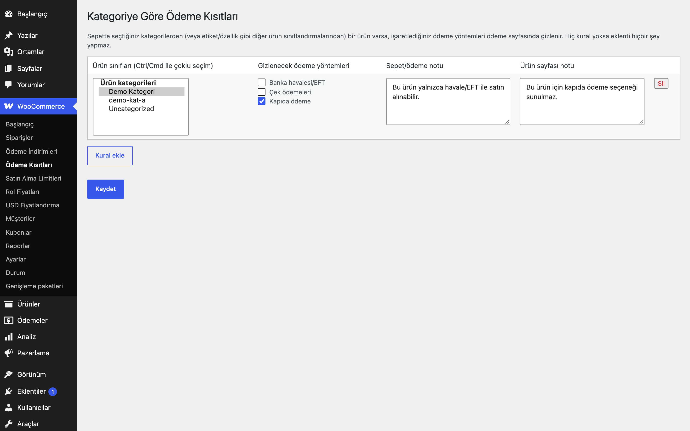
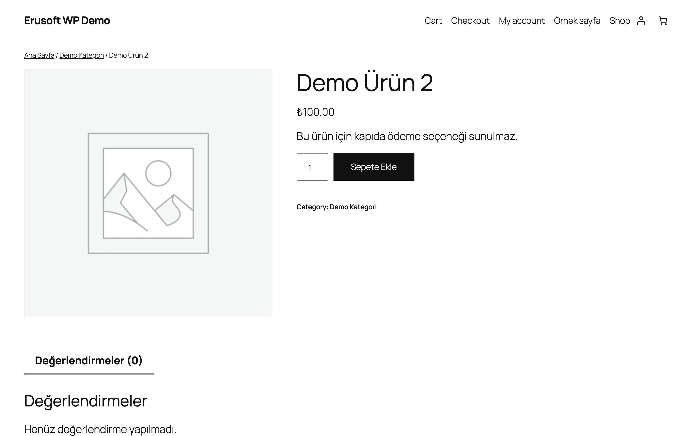
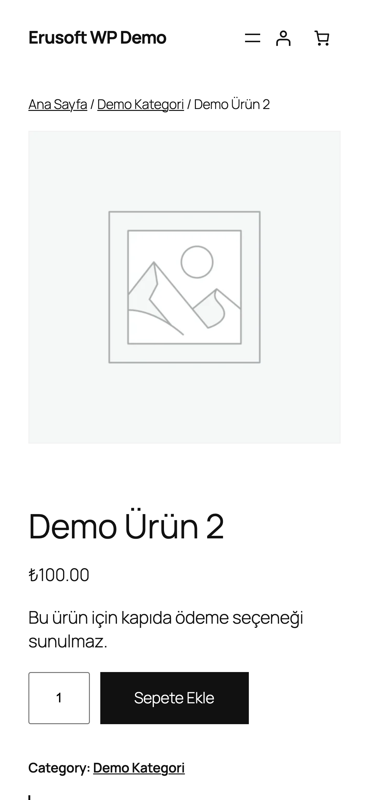

# Payment Restrictions by Category for WooCommerce

Sepette seçtiğiniz kategorilerden ürün varsa belirlediğiniz ödeme yöntemlerini gizler.

> **English:** Hides chosen payment gateways when the cart contains a product from selected categories (or other product taxonomies such as tags or brands) and can show explanatory notices. With no rules the plugin does nothing.

   

## Ne işe yarar

Bazı ürünlerin her ödeme yöntemiyle satılmasını istemeyebilirsiniz (örneğin yalnızca havale ile satılan ürünler). Bu eklenti, sepette ilgili sınıftan bir ürün olduğunda seçtiğiniz ödeme yöntemlerini ödeme sayfasından kaldırır ve müşteriye nedenini anlatan bir not gösterebilir.

## Özellikler

- Kural: ürün sınıfları + gizlenecek ödeme yöntemleri; birden çok kural
- Kategori, etiket ve ürüne bağlı diğer sınıflandırmalar seçilebilir (alt kategoriler otomatik kapsanır)
- Sepet ve ödeme sayfasında isteğe bağlı bilgi notu
- Ürün sayfasında isteğe bağlı bilgi notu
- Karışık sepette (kısıtlı + kısıtsız ürün) yöntem gizlenir
- Varyasyonlu ürünlerde üst ürünün sınıfları kullanılır

## Kurulum

1. `payment-restrictions-by-category-for-woocommerce` klasörünü `wp-content/plugins/` altına kopyalayın (veya zip olarak yükleyin).
2. Eklentiler ekranından etkinleştirin (WooCommerce gereklidir).
3. Aşağıdaki ayar ekranından yapılandırın. Yapılandırma yapılana kadar mağazanızda hiçbir değişiklik olmaz.

## Nasıl kullanılır

1. Eklentiyi etkinleştirin ve WooCommerce → **Ödeme Kısıtları** sayfasını açın.
2. **Kural ekle**'ye basın. **Ürün sınıfları** listesinden "Demo Kategori"yi seçin (birden fazlası için Ctrl/Cmd tuşunu kullanın).
3. **Gizlenecek ödeme yöntemleri** listesinden "Kapıda ödeme"yi işaretleyin.
4. İsterseniz **Sepet/ödeme notu** alanına "Bu üründe kapıda ödeme yapılamaz." ve **Ürün sayfası notu** alanına bir açıklama yazın, sonra kaydedin.
5. "Demo Kategori"deki bir ürünü sepete ekleyip ödeme sayfasına gidin: "Kapıda ödeme" listede yoktur ve not görünür. Ürün sayfasında da ürün sayfası notu çıkar.
6. Sepetten bu kategorideki ürünü çıkarın: ödeme yöntemi yeniden görünür.

## Ayarlar

WooCommerce → **Ödeme Kısıtları**. Kurallar `eru_prc_rules` seçeneğinde saklanır; varsayılan boştur.

## Kancalar, filtreler ve veri alanları

| Ad | Tür | Açıklama |
|---|---|---|
| `eru_prc_rules` | seçenek | Kural listesi (`terms` = `taksonomi:terim_id`, `gateways`, `notice`, `product_notice`) |
| `woocommerce_available_payment_gateways` | filtre | Eklenti 100 önceliğinde ödeme yöntemlerini çıkarır |

## Entegrasyonlar ve gereksinimler

WordPress 6.5+, PHP 8.0+, WooCommerce 9.0+. HPOS (özel sipariş tabloları) ile uyumludur. WooCommerce yoksa eklenti bir uyarı gösterir ve hiçbir şey yapmaz. Harici servis kullanmaz; dış HTTP isteği yapmaz.

## Sınırlamalar

- Tüm ödeme yöntemleri gizlenirse WooCommerce "uygun ödeme yöntemi yok" iletisi gösterir; kuralları buna göre planlayın.
- Yönetici ekranlarında (AJAX hariç) filtre çalışmaz.
- Notlar kısıtlı HTML (`wp_kses_post`) kabul eder.
- Eklenti silindiğinde (Eklentiler → Sil) yalnızca kendi ayarı (`eru_prc_rules` seçeneği) silinir.

## SSS

**Alt kategoriler kapsanır mı?** Evet, seçtiğiniz kategorinin alt kategorilerindeki ürünler de kuralı tetikler.

**Hangi ödeme yöntemleri listelenir?** WooCommerce'e kayıtlı tüm ödeme yöntemleri; etkin olup olmamaları fark etmez.

**Karışık sepette ne olur?** Sepette kuralın sınıfından en az bir ürün varsa seçilen yöntem, diğer ürünler kısıtsız olsa bile gizlenir.

**Varyasyonlu ürünlerde hangi sınıflar kullanılır?** Üst ürünün sınıfları. Kuralı varyasyon için ayrıca tanımlamanız gerekmez.

**Eklentiyi devre dışı bırakırsam veya silersem ne olur?** Devre dışı bırakınca ödeme yöntemleri ve notlar eski hâline döner; kurallar korunur. Eklenti silinirken yalnızca `eru_prc_rules` seçeneği silinir; ürün, sipariş ve sınıf verisine dokunulmaz.

**HPOS ve blok Sepet/Ödeme ile uyumlu mu?** HPOS uyumluluğu bildirilir. Blok Sepet/Ödeme için ayrı bir uyumluluk bildirimi yoktur: ödeme yöntemlerini süzen `woocommerce_available_payment_gateways` filtresi WooCommerce'in kendi hesabına bağlıdır, ancak sepet/ödeme notları klasik kancalarla (`woocommerce_before_cart`, `woocommerce_before_checkout_form`) yazıldığı için blok sayfalarda görünmeyebilir. Canlıya almadan önce ödeme sayfanızda deneyin.

**Önbellek eklentileri?** Ödeme yöntemleri sunucuda her ödeme sayfası yüklenişinde süzülür. Ürün sayfası notu kural değişince önbellekte eski kalabilir; kuralı değiştirdikten sonra önbelleği temizleyin.

## Değişiklik geçmişi

Bkz. [CHANGELOG.md](CHANGELOG.md).

## Destek

- Önce bu sayfadaki **SSS** ve **Sınırlamalar** bölümlerine göz atın; sık karşılaşılan durumlar orada.
- Hata mı buldunuz? [GitHub Issues](https://github.com/erayusta/erusoft-wp/issues) üzerinden bildirin. WordPress, WooCommerce, PHP ve eklenti sürümünü, adımları ve beklenen/gerçekleşen sonucu yazmanız işi hızlandırır.
- Kurulum, yapılandırma, özel geliştirme veya entegrasyon desteği için **[hello@erusoft.com](mailto:hello@erusoft.com)** adresine yazın. Erusoft hakkında: [erusoft.com](https://erusoft.com).
- Lütfen şifre, API anahtarı veya müşteri verisi (ad, telefon, TCKN, sipariş dökümü) göndermeyin; ekran görüntülerindeki kişisel verileri karartın.

## Lisans

GPL-2.0-or-later.

Diğer Erusoft eklentileri: https://wordpress.erusoft.com/
