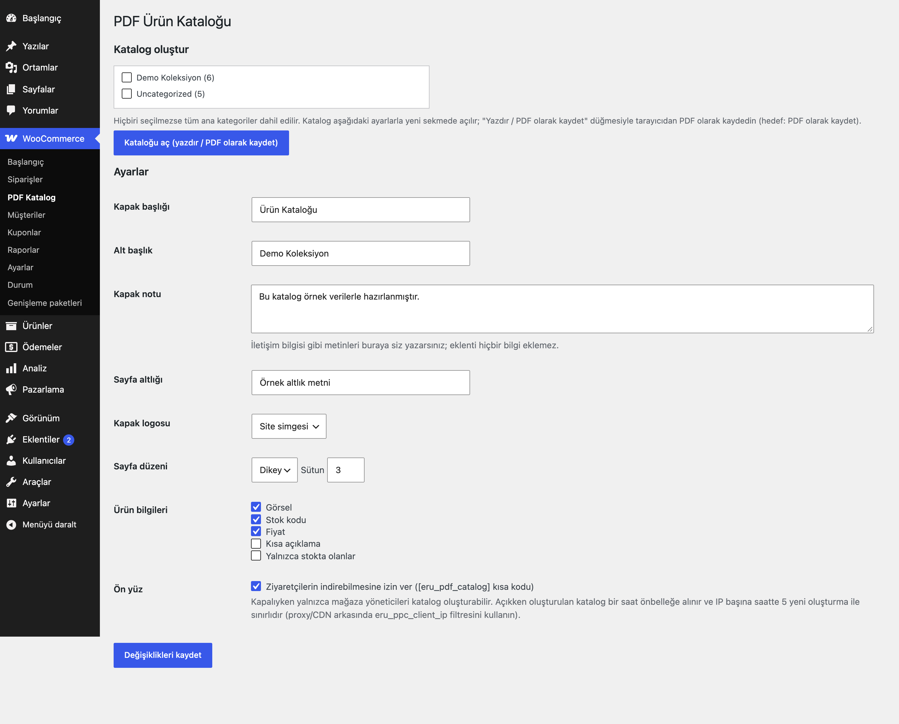
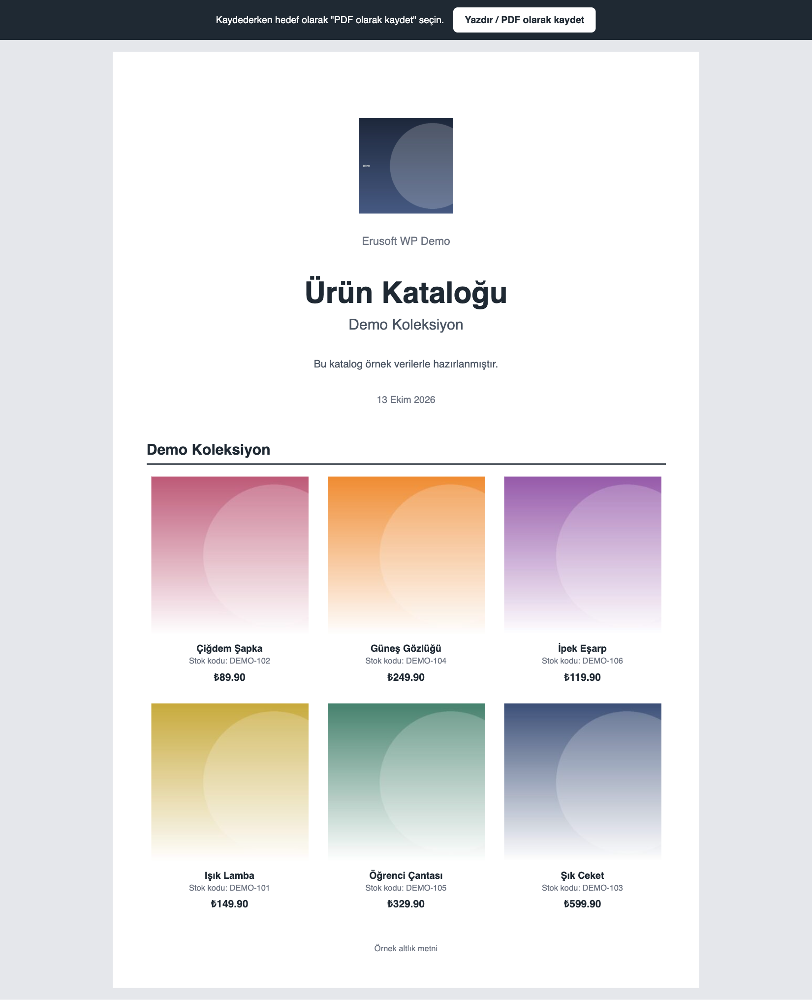
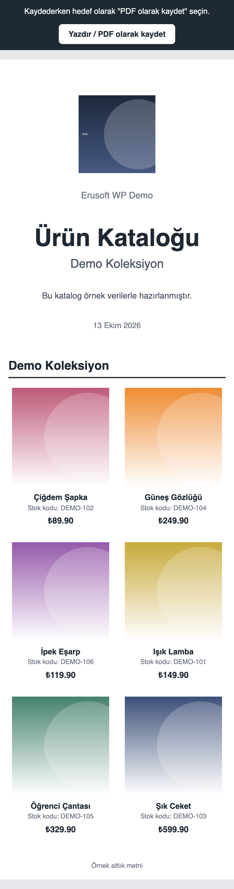

# PDF Product Catalog for WooCommerce

Seçtiğiniz kategorilerden kapaklı, kategori gruplu, yazdırmaya hazır ürün kataloğu üretir; tarayıcıdan "PDF olarak kaydet" ile PDF'e çevrilir. Türkçe karakterler doğru basılır.

> **English:** Generates a print-ready product catalogue (cover page, products grouped by category, image/name/SKU/price options) from selected WooCommerce categories. Save it as PDF from the browser's print dialog; no PDF library is bundled, and a `eru_ppc_render_pdf` filter lets you plug in a server-side engine. Default: admin-only; no public download until enabled.

   

## Ne işe yarar

Yönetim ekranından kategori seçip kataloğu yeni sekmede açarsınız; **Yazdır / PDF olarak kaydet** düğmesi tarayıcının yazdırma penceresini açar, hedef olarak "PDF olarak kaydet" seçilir. Kapakta başlık, alt başlık, not, site simgesi (logo) ve tarih; sonraki sayfalarda kategori başlıkları altında ürün ızgarası (görsel, ad, stok kodu, fiyat) yer alır. İsterseniz `[eru_pdf_catalog]` kısa koduyla ziyaretçilere de sunabilirsiniz.

## Özellikler

- Kategori seçimi (boşsa tüm ana kategoriler), kategori gruplu katalog
- Kapak: başlık, alt başlık, not, logo (site simgesi veya tema logosu), tarih; isteğe bağlı sayfa altlığı
- 2–4 sütun, dikey/yatay (A4 `@page` kuralları), görsel / stok kodu / fiyat / kısa açıklama seçenekleri, yalnızca stoktakiler
- Türkçe karakterler tarayıcının yazı tipleriyle (DejaVu Sans, Segoe UI, Roboto, Arial) doğru basılır
- Ön yüz kısa kodu: `[eru_pdf_catalog category="slug" label="…"]` (varsayılan kapalı; katalog 1 saat önbelleğe alınır, IP başına saatte 5 yeni oluşturma)
- Üst sınır: tek katalogda en fazla 500 ürün (`eru_ppc_max_products`)
- İsteğe bağlı sunucu tarafı PDF: `eru_ppc_render_pdf` filtresi

## Kurulum

1. `pdf-product-catalog-for-woocommerce` klasörünü `wp-content/plugins/` altına kopyalayın (veya zip olarak yükleyin).
2. Eklentiler ekranından etkinleştirin (WooCommerce gereklidir).
3. WooCommerce → **PDF Katalog**: kategorileri işaretleyip **Kataloğu aç** düğmesine basın; kapak metinleri ve düzen aynı ekrandaki ayarlardan gelir. Açılan sayfada **Yazdır / PDF olarak kaydet**'i kullanın.

## Ayarlar

Seçenek: `eru_ppc_settings`. Önbelleğe alınan ön yüz katalogları `uploads/eru-ppc/` altında tutulur (doğrudan erişime kapalı); kaldırınca silinir.

## Kısa kodlar, kancalar ve filtreler

| Ad | Tür | Açıklama |
|---|---|---|
| `[eru_pdf_catalog category="slug" label="…"]` | kısa kod | İndirme/açma bağlantısı (yalnızca ön yüz açıkken) |
| `eru_ppc_render_pdf` | filtre | `(null, $html)`: PDF baytları döndürürseniz katalog PDF dosyası olarak sunulur (kendi PDF motorunuzu bağlamak için) |
| `eru_ppc_max_products` | filtre | Katalogdaki en fazla ürün sayısı (varsayılan 500) |
| `eru_ppc_client_ip` | filtre | Ön yüz oluşturma sınırı için ziyaretçi IP'si (varsayılan `REMOTE_ADDR`); proxy/CDN arkasında gerçek adresi döndürün |
| `eru_ppc_rate_limit`, `eru_ppc_cache_ttl` | filtre | Saatlik oluşturma sınırı (5) ve önbellek süresi (1 saat) |

## Entegrasyonlar ve gereksinimler

WordPress 6.5+, PHP 8.0+, WooCommerce 9.0+. HPOS uyumludur. Harici servis veya gömülü üçüncü taraf kitaplık kullanmaz.

## Sınırlamalar

- Eklenti bir PDF dosyası üretmez; yazdırmaya hazır HTML üretir ve PDF'e çevirmeyi tarayıcıya bırakır (gömülü PDF kitaplıkları kendi lisans ve boyut yükünü getirdiği için seçilmedi). Sunucu tarafı PDF için `eru_ppc_render_pdf` filtresi vardır.
- Herkese açık katalog (kısa kod / `?eru_ppc=`) her zaman misafir fiyatlarıyla üretilir ve önbelleğe alınır; giriş yapmış bir müşterinin kendi fiyatı (B2B, fiyat listesi, rol fiyatı) bu dosyaya girmez. Yönetim ekranındaki indirme önbelleğe alınmaz.
- Sayfa numarası basılmaz (tarayıcı yazdırma penceresindeki "üst bilgi ve alt bilgi" seçeneğini kullanın).
- Düzen sabit bir ızgaradır; şablon düzenleyici yoktur.
- Çok sayıda ürün (yüzlerce) görselli sayfayı yavaşlatabilir; görseller küçük boyutta yüklenir.

## SSS

**Fiyat veya görsel çıkmıyor.** Ayarlarda ilgili kutuların açık olduğundan ve ürüne görsel/fiyat girildiğinden emin olun.

**Arka plan renkleri/görseller PDF'te yok.** Yazdırma penceresinde "Arka plan grafikleri"ni açın.

**Ziyaretçiler görebilsin istiyorum.** "Ön yüz" kutusunu işaretleyip `[eru_pdf_catalog]` kısa kodunu bir sayfaya ekleyin.

## Değişiklik geçmişi

Bkz. [CHANGELOG.md](CHANGELOG.md).

## Lisans

GPL-2.0-or-later.

Diğer Erusoft eklentileri: https://wordpress.erusoft.com/
