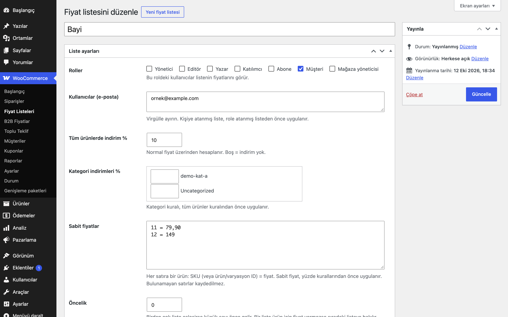

# Price Lists for WooCommerce

Adlandırılmış fiyat listeleri (yüzde, kategori, sabit fiyat) oluşturun ve role veya kişiye atayın.

> **English:** Named price lists with a catalogue-wide percentage, per-category percentages and fixed prices, assigned to user roles or individual users. Create a list, assign it, and the cart uses the list price. Nothing changes until you create a list.

   

## Ne işe yarar

"Bayi", "Toptan" gibi fiyat listeleri tanımlarsınız; her liste bir veya birden çok role ya da belirli kullanıcılara atanır. Listeye giren kullanıcı katalogda, ürün sayfasında, sepette ve ödemede liste fiyatını görür.

## Özellikler

- Liste = bir yazı (WooCommerce → Fiyat Listeleri); adı, atanan rolleri/kullanıcıları ve kuralları vardır
- Tüm ürünlerde yüzde indirim, kategori bazında yüzde indirim, ürün/varyasyon için sabit fiyat (`SKU = fiyat` satırları)
- Kural sırası: sabit fiyat > kategori yüzdesi > tüm ürünler yüzdesi
- Role veya doğrudan kullanıcıya atama; kişiye atanmış liste role atanmış listeden önce gelir, ardından öncelik sayısı
- Bir liste üründe fiyat vermiyorsa sıradaki liste denenir
- Yüzde, her zaman normal fiyat üzerinden hesaplanır; sepet toplamı tekrar tekrar hesaplansa da aynı kalır
- Varyasyonlu ürünlerde varyasyon bazında çalışır; fiyat aralığı önbelleği liste/kullanıcıya göre ayrılır
- Taslak listeler uygulanmaz

## Hangisini seçmeliyim?

Erusoft kataloğunda fiyatı kişiye göre değiştiren üç eklenti vardır:

- **Role-Based Prices for WooCommerce**: Az sayıda rol için ürün başına sabit fiyat girmek istiyorsanız. En basit seçenek.
- **Price Lists for WooCommerce**: Adlandırılmış fiyat listeleri (yüzde, kategori, sabit fiyat) tanımlayıp role veya kişiye atamak istiyorsanız.
- **B2B Customer Pricing for WooCommerce**: Belirli müşteriye veya müşteri grubuna özel fiyat/iskonto kuralları yazmak istiyorsanız.

Üçü aynı mağazada birlikte etkin olabilir; çakışmada öncelik şöyledir: **müşteriye özel kural (B2B Customer Pricing) > fiyat listesi (Price Lists) > rol fiyatı (Role-Based Prices)**. Bu, filtre önceliğiyle sağlanır (USD Pricing 998 temel fiyatı dolardan çevirir; rol fiyatı 999, fiyat listesi 1000, müşteri kuralı 1001; sonra çalışan kazanır). Bir üründe üst düzey eklenti fiyat vermiyorsa bir alttaki uygulanır. Yine de kafa karışıklığını önlemek için mümkünse tek bir yaklaşım seçin.

## Kurulum

1. `price-lists-for-woocommerce` klasörünü `wp-content/plugins/` altına kopyalayın (veya zip olarak yükleyin).
2. Eklentiler ekranından etkinleştirin (WooCommerce gereklidir).
3. WooCommerce → **Fiyat Listeleri** → Yeni liste. Liste yayımlanana kadar mağazanızda hiçbir değişiklik olmaz.

## Nasıl kullanılır

1. WooCommerce → **Fiyat Listeleri** → *Yeni liste*; adı `Demo Bayi` olsun.
2. **Roller** bölümünde `Customer` rolünü işaretleyin (ya da **Kullanıcılar** kutusuna `ornek@example.com` yazın).
3. **Tüm ürünlerde indirim %** alanına `15`, istediğiniz bir kategorinin yanındaki alana `20` yazın.
4. **Sabit fiyatlar** kutusuna `DEMO-001 = 250` satırını ekleyin (SKU'su `DEMO-001` olan "Demo Ürün" için).
5. Listeyi **yayımlayın**; taslak listeler uygulanmaz.
6. Atanan kullanıcıyla giriş yapıp mağazayı açın: "Demo Ürün" 250 TL görünür, o kategorideki ürünler normal fiyattan %20, diğerleri %15 indirimli listelenir; sepet ve ödeme aynı fiyatı kullanır.

## Ayarlar

Liste düzenleme ekranında:

- **Roller / Kullanıcılar (e-posta)**: Listenin kime uygulanacağı.
- **Tüm ürünlerde indirim %**, **Kategori indirimleri %**, **Sabit fiyatlar**.
- **Öncelik**: Birden çok liste eşleşirse küçük sayı önce gelir.

Veriler `eru_plst_list` yazı türünde ve `_eru_plst_*` meta alanlarında tutulur.

**Yönetim ekranı ve sipariş düzenleme:** wp-admin'de yöneticinin kendi kuralları hiçbir ürüne uygulanmaz (ürün listesi, ürün düzenleme). Yönetimden siparişe ürün eklerken (WooCommerce sipariş kalemi AJAX'ı) siparişin müşterisinin fiyatı kullanılır; misafir siparişte temel fiyat. Farklı davranış için `eru_plst_pricing_user_id` filtresi.

**Çalışma anında konan fiyat:** Bir eklenti sepet satırının fiyatını `set_price()` ile değiştirdiyse (ör. Gift Product Rules hediye satırı 0) bu eklenti o satıra dokunmaz.

**İndirimdeki ürünler:** Yüzde kuralı, ürünün etkin indirimli fiyatından yüksek bir fiyat üretemez (normal 100, indirimli 70, %10 kural → 70). Sabit fiyat kuralları olduğu gibi uygulanır.

## Kancalar, filtreler ve veri alanları

| Ad | Tür | Açıklama |
|---|---|---|
| `eru_plst_list` | yazı türü | Fiyat listeleri |
| `_eru_plst_roles`, `_eru_plst_users` | meta | Atama |
| `_eru_plst_percent`, `_eru_plst_cats`, `_eru_plst_prices` | meta | Kurallar |
| `eru_plst_price` | filtre | Liste fiyatını değiştirin (`$price`, `$product`, `$user_id`) |
| `eru_plst_pricing_user_id` | filtre | Fiyatı belirlenecek kullanıcı (`$uid`; wp-admin'de 0, sipariş kalemi AJAX'ında siparişin müşterisi) |

## Entegrasyonlar ve gereksinimler

WordPress 6.5+, PHP 8.0+, WooCommerce 9.0+. HPOS ile uyumludur. WooCommerce yoksa eklenti bir uyarı gösterir ve hiçbir şey yapmaz. Harici servis ve dış HTTP isteği yoktur. Fiyat filtreleri 1000 önceliğiyle çalışır (Role-Based Prices 999, B2B Customer Pricing 1001).

## Sınırlamalar

- Sayfa önbelleği (sayfa cache) kullanıyorsanız giriş yapmış kullanıcıları önbellekten hariç tutun, yoksa fiyatlar karışabilir.
- Liste fiyatı ürünün tüm fiyatının yerine geçer; indirimli fiyat rozeti gösterilmez.
- Kullanıcılar yalnızca e-posta ile atanır (kullanıcı arama kutusu yoktur); kullanıcı grubu kavramı yoktur, bunun için B2B Customer Pricing'e bakın.
- Eklenti silindiğinde (Eklentiler → Sil) tüm fiyat listeleri silinir.

## SSS

**Bir kullanıcı birden çok listeye uyuyorsa?** Kişiye atanan listeler önce, sonra rol listeleri; her grupta öncelik sayısı küçük olan başa gelir. İlk fiyat veren liste kazanır.

**Fiyat listesi, rol fiyatı ve müşteri kuralı birlikte?** Müşteriye özel kural > fiyat listesi > rol fiyatı.

**Eklentiyi silersem ne olur?** Eklentiler → Sil ile tüm fiyat listeleri (`eru_plst_list` yazıları) ve `eru_plst_version` seçeneği silinir. Devre dışı bırakmak yalnızca fiyat değişikliğini durdurur; listeler yerinde kalır.

**HPOS ve blok tabanlı sepet/ödeme ile uyumlu mu?** Eklenti HPOS uyumluluğunu bildirir. Cart/Checkout blokları için ayrı bir uyumluluk beyanı ya da test yoktur.

**Önbellek eklentisiyle çalışır mı?** Giriş yapmış kullanıcıları sayfa önbelleğinden hariç tutmanız gerekir; aksi halde bir kullanıcının fiyatı başkasına gösterilebilir.

**Dışarıya istek yapıyor mu?** Hayır, harici servis ve dış HTTP isteği yoktur.

## Değişiklik geçmişi

Bkz. [CHANGELOG.md](CHANGELOG.md).

## Destek

- Önce bu sayfadaki **SSS** ve **Sınırlamalar** bölümlerine göz atın; sık karşılaşılan durumlar orada.
- Hata mı buldunuz? [GitHub Issues](https://github.com/erayusta/erusoft-wp/issues) üzerinden bildirin. WordPress, WooCommerce, PHP ve eklenti sürümünü, adımları ve beklenen/gerçekleşen sonucu yazmanız işi hızlandırır.
- Kurulum, yapılandırma, özel geliştirme veya entegrasyon desteği için **[hello@erusoft.com](mailto:hello@erusoft.com)** adresine yazın. Erusoft hakkında: [erusoft.com](https://erusoft.com).
- Lütfen şifre, API anahtarı veya müşteri verisi (ad, telefon, TCKN, sipariş dökümü) göndermeyin; ekran görüntülerindeki kişisel verileri karartın.

## Lisans

GPL-2.0-or-later.

Diğer Erusoft eklentileri: https://wordpress.erusoft.com/
