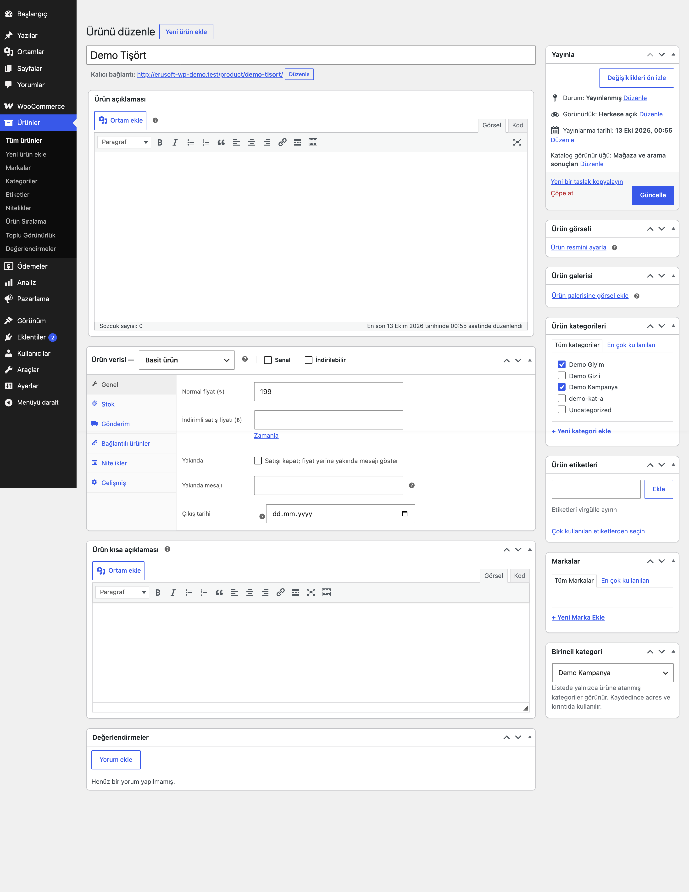

# Primary Category for WooCommerce

Ürüne birincil kategori seçtirir; adres (permalink) ve kırıntıda kullanılır.

> **English:** Choose a primary category per product. It drives the %product_cat% permalink segment and the WooCommerce breadcrumb, and is exposed through eru_pc_get_primary(). Yoast SEO and Rank Math primary-category meta is read as a fallback only and never written.

   

## Ne işe yarar

Birden fazla kategorideki ürünlerde hangi kategorinin adreste ve kırıntıda kullanılacağını siz seçersiniz. Ürün düzenleme ekranına "Birincil kategori" kutusu eklenir.

## Özellikler

- Ürün düzenleme ekranında birincil kategori seçici (yalnızca ürüne atanmış kategoriler listelenir, işaretli kutularla eşzamanlı güncellenir)
- `%product_cat%` içeren ürün adreslerinde seçilen kategori kullanılır
- WooCommerce kırıntısında ana kategori olarak kullanılır
- `eru_pc_get_primary( $product_id )` işlevi `WP_Term` veya `null` döner
- Seçim yoksa Yoast SEO (`_yoast_wpseo_primary_product_cat`) ve Rank Math (`rank_math_primary_product_cat`) değerleri yalnızca okunur, asla yazılmaz
- Ürüne atanmamış bir kategori geçersiz sayılır

## Kurulum

1. `primary-category-for-woocommerce` klasörünü `wp-content/plugins/` altına kopyalayın (veya zip olarak yükleyin).
2. Eklentiler ekranından etkinleştirin (WooCommerce gereklidir).
3. Ürün düzenleme ekranında "Birincil kategori" kutusundan seçim yapın. Seçilmemiş ürünlerde hiçbir şey değişmez.

## Ayarlar

Ayar ekranı yoktur. Seçim `_eru_pc_primary` ürün meta alanında saklanır.

## Kancalar, filtreler ve veri alanları

| Ad | Tür | Açıklama |
|---|---|---|
| `eru_pc_get_primary( $product_id, $taxonomy )` | işlev | Birincil `WP_Term` veya `null` |
| `eru_pc_primary_term` | filtre | Bulunan terimi değiştirir (`$term`, `$product_id`, `$taxonomy`) |
| `_eru_pc_primary` | ürün meta | Seçilen kategorinin terim kimliği |

## Entegrasyonlar ve gereksinimler

WordPress 6.5+, PHP 8.0+, WooCommerce 9.0+. HPOS uyumludur. Yoast SEO ve Rank Math isteğe bağlıdır ve yalnızca okunur. Harici servis kullanmaz.

## Sınırlamalar

- Rank Math / Yoast kırıntı ve şema çıktısı bu eklentiyle değiştirilmez; onlar kendi birincil kategori alanlarını kullanır.
- Adresin değişmesi için ürün kalıcı bağlantı yapısının `%product_cat%` içermesi gerekir; yönlendirme eklentiniz eski adresleri ayrıca yönetmelidir.
- Dışa aktarım ve toplu atama bu sürümde yoktur.

## SSS

**Yoast SEO'daki birincil kategori ezilir mi?** Hayır. Yoast değeri yalnızca bu eklentinin kendi seçimi yoksa okunur.

## Değişiklik geçmişi

Bkz. [CHANGELOG.md](CHANGELOG.md).

## Lisans

GPL-2.0-or-later.

Diğer Erusoft eklentileri: https://wordpress.erusoft.com/
