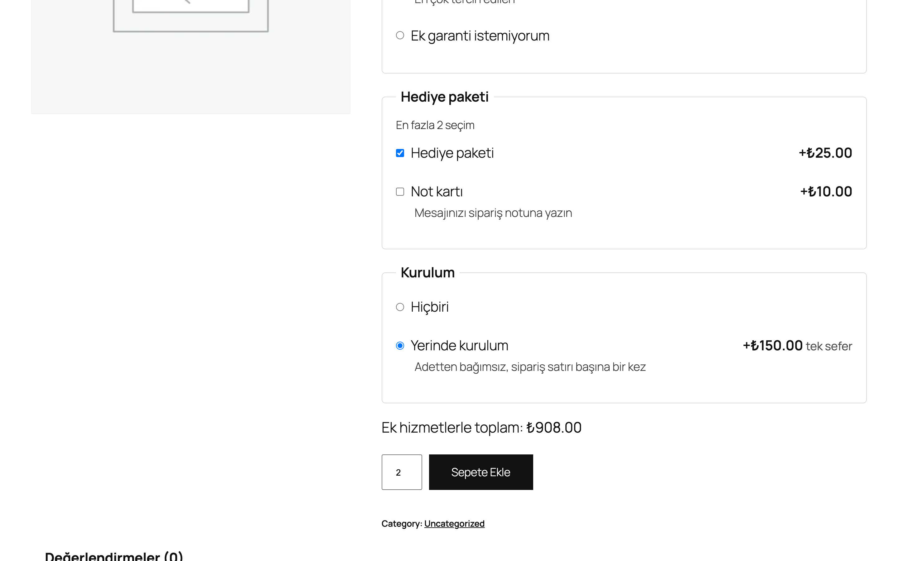
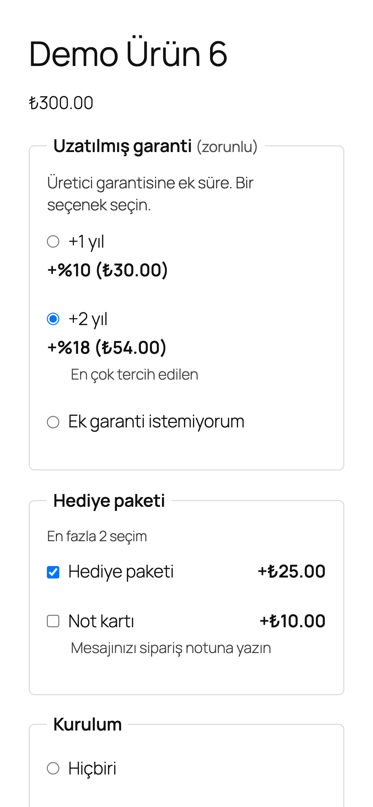
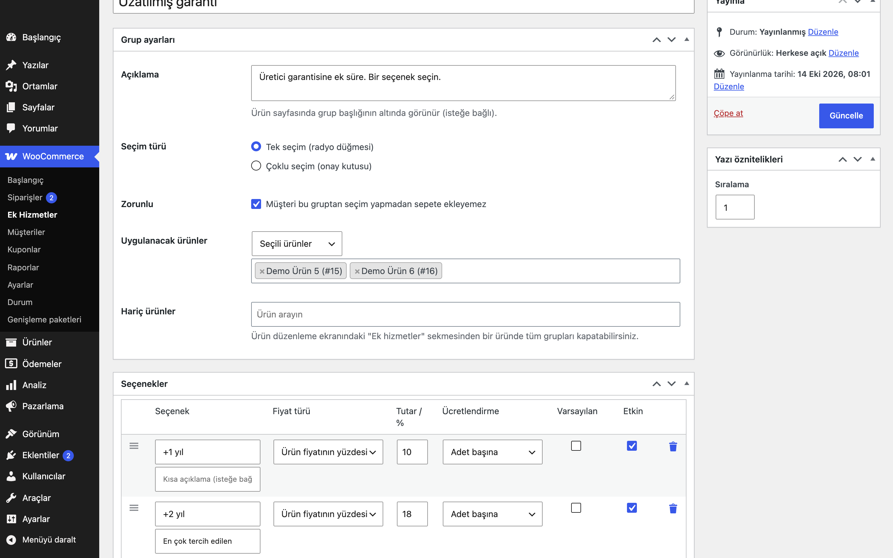
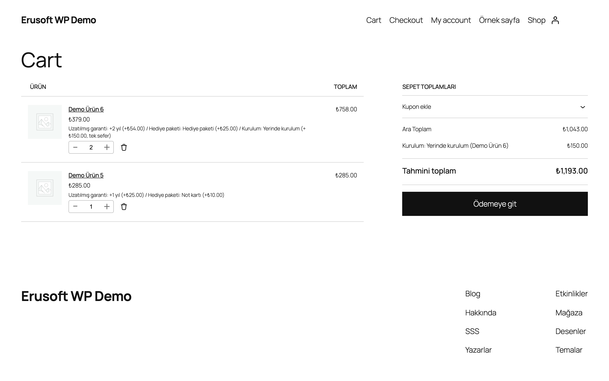
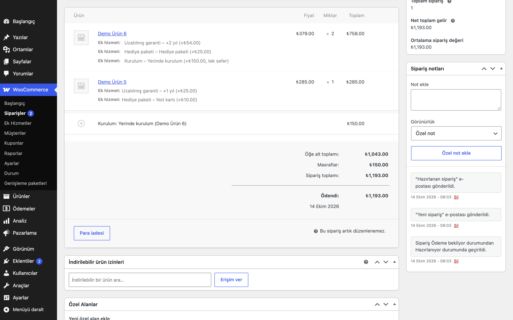

# Product Add-On Services for WooCommerce

Ürün sayfasında müşteriye ücretli ek hizmetler (uzatılmış garanti, hediye paketi, kurulum…) seçtirin. Hizmet grupları tüm ürünlere, kategorilere, etiketlere veya tek tek ürünlere uygulanır; fiyat sabit tutar ya da ürün fiyatının yüzdesidir, adet başına veya sepet satırı başına bir kez alınır.

> **English:** Lets customers choose paid add-on services on the WooCommerce product page. Service groups (single or multiple choice, optional or required, min/max) apply to all products, categories, tags or chosen products, with exclusions and a per-product off switch. Options cost a fixed amount or a percentage of the product price, charged per unit or once per cart line (as a separate, taxed fee line). The server validates every choice and computes every price (idempotent across recalculations); the form works without JavaScript, with a live total when JavaScript runs. Choices show in cart, checkout (classic and blocks), orders and e-mails, and "Order again" re-applies them from the current definitions and prices. `wp eru-aos export|import`. Nothing changes until you create a group.

[](https://www.gnu.org/licenses/gpl-2.0.html)   





## Ne işe yarar

Ürünün yanında satılan hizmetleri ayrı ürün olarak açmadan, ürün sayfasındaki sepete ekle formunun içinde seçenek olarak sunar. Seçilen hizmetler sepet satırına yazılır, fiyat sunucuda hesaplanır ve siparişte görünür.

## Özellikler

- Hizmet grubu: müşteriye görünen ad, açıklama, tek seçim (radyo) veya çoklu seçim (onay kutusu), zorunlu / isteğe bağlı, çoklu seçimde en az / en fazla, sıralama
- Kapsam: tüm ürünler, seçili kategoriler, etiketler veya ürünler; hariç ürünler; ürün düzenleme ekranında "Ek hizmetler" sekmesi (uygulanan gruplar + "ek hizmetleri kapat" kutusu)
- Seçenek: ad, kısa açıklama, sabit tutar veya ürün fiyatının yüzdesi, adet başına veya satır başına bir kez, varsayılan seçili, etkin / kapalı, sürükle-bırak sıralama
- Ürün sayfası: gerçek `<input>` radyo/onay kutuları, `fieldset`/`legend`, WooCommerce fiyat biçimi; JavaScript yoksa da çalışır
- Canlı toplam: seçimlere ve adede göre güncellenir, varyasyon değişince (`found_variation`) yüzde tutarları yeniden hesaplanır
- Sunucu doğrulaması: zorunlu grup, en az / en fazla ve seçeneklerin ürünün gruplarına ait olması `woocommerce_add_to_cart_validation` ile denetlenir
- Zorunlu grubu olan basit ürünlerde liste sayfasındaki "Sepete ekle" düğmesi "Seçenekleri seç" bağlantısına döner
- Sepet, ödeme (klasik ve blok), sipariş, e-posta ve "Tekrar sipariş ver" desteği
- WP-CLI: `wp eru-aos export` / `wp eru-aos import`
- Grup yoksa vitrinde hiçbir değişiklik ve dış HTTP isteği yoktur



## Kurulum

1. `product-add-on-services-for-woocommerce` klasörünü `wp-content/plugins/` altına kopyalayın (veya zip olarak yükleyin).
2. Eklentiler ekranından etkinleştirin.
3. WooCommerce → **Ek Hizmetler** → Grup ekle. Grubun kapsamını ve seçeneklerini girip yayınlayın.

## Fiyatlandırma

Tutarları ürün fiyatlarını girdiğiniz gibi girin: WooCommerce "Fiyatlar vergi dahil girilir" ayarı açıksa KDV dahil, kapalıysa KDV hariç. Yüzde, sepetteki ürünün o anki fiyatından (indirimli fiyat dahil) hesaplanır; ayarlardan normal fiyat da seçilebilir. Varyasyonlu üründe yüzde, seçilen varyasyonun fiyatından hesaplanır.

- **Adet başına (`per_unit`)**: tutar ürünün birim fiyatına eklenir, yani adetle çarpılır.
- **Satır başına bir kez (`per_line`)**: tutar adetten bağımsız olarak sepette ayrı bir ücret satırı ("Grup: Seçenek (Ürün)") olarak bir kez eklenir; ürünle aynı vergi sınıfıyla vergilendirilir.

| Örnek (ürün 1.000 ₺, adet 2) | Birim fiyat | Satır | Ücret satırı | Toplam |
|---|---|---|---|---|
| Garanti %10 (adet başına) | 1.100 ₺ | 2.200 ₺ | — | 2.200 ₺ |
| Garanti %10 + Hediye paketi 50 ₺ (adet başına) | 1.150 ₺ | 2.300 ₺ | — | 2.300 ₺ |
| Yukarıdaki + Kurulum 200 ₺ (satır başına) | 1.150 ₺ | 2.300 ₺ | 200 ₺ | 2.500 ₺ |
| Varyasyon 600 ₺, adet 1, Garanti %10 | 660 ₺ | 660 ₺ | — | 660 ₺ |

Sepet kaç kez yeniden hesaplanırsa hesaplansın sonuç aynıdır: ek hizmet tutarı, ürünün ek hizmetler eklenmeden önceki fiyatına (ürün sepete eklenirken veya oturumdan yüklenirken bir kez okunur; bu istek içi bilgi sepet satırına ve oturuma yazılmaz, sepet özeti/hash'i değişmez) eklenir; zaten artırılmış fiyatın üstüne tekrar eklenmez. Fiyat `woocommerce_before_calculate_totals` önceliği 20'de ayarlanır: daha önce çalışan (öncelik < 20) bir fiyat eklentisinin fiyatı taban olur; daha sonra çalışan bir eklenti ise ek hizmetli fiyat üzerinde çalışır ve tabanı değiştirmez.





## Ayarlar

WooCommerce → Ayarlar → Ürünler → **Ek Hizmetler**.

| Seçenek | Varsayılan |
|---|---|
| `eru_aos_show_prices` Seçenek fiyatlarını göster | evet |
| `eru_aos_live_total` Canlı toplamı göster | evet |
| `eru_aos_percent_base` Yüzde hesabı: güncel fiyat / normal fiyat | güncel fiyat |
| `eru_aos_position` Konum: sepete ekle düğmesinin üstünde / yalnızca kısa kodla | düğmenin üstünde |

Veri: gruplar `eru_aos_group` yazı türündedir (meta: `_eru_aos_type`, `_eru_aos_required`, `_eru_aos_min`, `_eru_aos_max`, `_eru_aos_scope`, `_eru_aos_scope_ids`, `_eru_aos_exclude`, `_eru_aos_options`, `_eru_aos_description`). Ürün metası: `_eru_aos_disabled`. Sipariş kalemi metası: görünür "Ek hizmet" satırları ve gizli `_eru_aos_choices`.

## WP-CLI

```bash
wp eru-aos export --file=gruplar.json   # tüm grupları JSON olarak yazar (dosya verilmezse ekrana)
wp eru-aos import gruplar.json          # JSON'daki grupları yeni grup olarak ekler
wp eru-aos import gruplar.json --replace  # önce mevcut tüm grupları siler
```

Kapsamdaki kategori, etiket ve ürün kimlikleri siteye özgüdür; başka bir siteye aktardıktan sonra kontrol edin.

## Kısa kodlar, kancalar ve filtreler

| Ad | Tür | Açıklama |
|---|---|---|
| `[eru_addon_services product_id=""]` | kısa kod | Grupları başka bir yerde gösterir (boşsa geçerli ürün). Konum "yalnızca kısa kodla" seçiliyken kullanın; form dışına konduğunda seçimler JavaScript ile sepete ekle formuna bağlanır |
| `eru_aos_groups_for_product` | filtre | Bir ürüne uygulanan gruplar (`$groups`, `$product_id`) |
| `eru_aos_option_amount` | filtre | Bir seçeneğin hesaplanan tutarı (`$amount`, `$choice`, `$product`, `$base`) |
| `eru_aos_render_position` | filtre | Grupları basan eylemin adı (varsayılan `woocommerce_before_add_to_cart_button`; `''` = yalnızca kısa kod) |

Şablon: `templates/addon-services.php`, temada `product-add-on-services-for-woocommerce/addon-services.php` olarak geçersiz kılınabilir (girdi adlarını koruyun).

## Entegrasyonlar ve gereksinimler

WordPress 6.5+, PHP 8.0+, WooCommerce 9.0+. HPOS (özel sipariş tabloları) ile uyumludur. WooCommerce yoksa eklenti bir uyarı gösterir ve hiçbir şey yapmaz.

## Sınırlamalar

- Seçim yalnızca klasik sepete ekle formunda yapılabilir. Blok temalarda varsayılan "Add to cart form" bloğu (`woocommerce/add-to-cart-form`) bu formu kullandığı için çalışır; WooCommerce'in yeni etkileşimli "Add to Cart + Options" bloğuyla oluşturulmuş tek ürün şablonunda 1.0.0 sürümünde ek hizmet seçimi **desteklenmez**.
- Blok sepet ve blok ödeme desteklenir: seçimler ürün satırında görünür, fiyat ve ücret satırı sunucuda hesaplanır. Store API ile (ör. blok ürün listesinden) seçim gönderilemez; zorunlu grubu olan ürün bu yolla sepete eklenemez, müşteri ürün sayfasına yönlendirilir.
- Zorunlu grup yalnızca müşterinin sepete ekleme isteğinde denetlenir; başka bir eklentinin kodla (`WC()->cart->add_to_cart()`) eklediği ürünler ek hizmetsiz eklenir.
- Yüzde tabanı ürünün ham fiyatıdır (`get_price('edit')`, `woocommerce_before_calculate_totals` ile değiştirilmiş hali dahil); fiyatı yalnızca görüntülemede filtreleyen eklentiler (`woocommerce_product_get_price` vb.) yüzde hesabına yansımaz.
- Gruplanmış (grouped) ürün sayfasında ek hizmet alanı yoktur: alt ürünler oradan ek hizmetsiz eklenir (zorunlu grup bu formda denetlenmez); ek hizmet için alt ürünün kendi sayfası kullanılmalıdır.
- Aynı ürün farklı seçimlerle ayrı sepet satırlarına düşer; "satır başına bir kez" seçenekleri her satır için ayrı ücret satırı olarak eklenir.
- Seçenek başına stok, metin/dosya girişi ve koşullu (bir seçime bağlı) grup yoktur.
- Sepetteki seçimler eklendiği andaki grup tanımını saklar; grubu sonradan değiştirmek sepetteki satırları değiştirmez. "Tekrar sipariş ver" yalnızca güncel tanımları ve güncel fiyatları kullanır (siparişteki eski fiyatlar kullanılmaz): artık sunulmayan seçenekler ve gruplar (ürünün ek hizmetleri kapatıldıysa hepsi) bırakılır, müşteri "Bazı ek hizmetler artık sunulmadığı için sepete eklenmedi." uyarısını görür; zorunlu bir grup artık karşılanamıyorsa kalem sepete eklenmez ve hata uyarısı gösterilir.
- Eklenti silindiğinde (Eklentiler → Sil) hizmet grupları, ayarlar (`eru_aos_*`) ve ürünlerdeki "kapat" işareti silinir; siparişlere yazılmış ek hizmet metası ve ücret satırları korunur.

## SSS

**Ek hizmetler stok düşer mi?** Hayır, yalnızca fiyat ve sipariş bilgisidir.

**"Satır başına bir kez" neden ayrı satır?** Tutarı birim fiyata bölüştürmek yuvarlama hatası ve adet değişince yanlış toplam üretir; ayrı ücret satırı adetten bağımsız ve vergisi doğru kalır.

**JavaScript kapalıysa?** Form normal gönderilir, doğrulama ve fiyat sunucudadır; yalnızca canlı toplam görünmez.

## Değişiklik geçmişi

Bkz. [CHANGELOG.md](CHANGELOG.md).

## Lisans

GPL-2.0-or-later. Diğer Erusoft eklentileri: https://wordpress.erusoft.com
