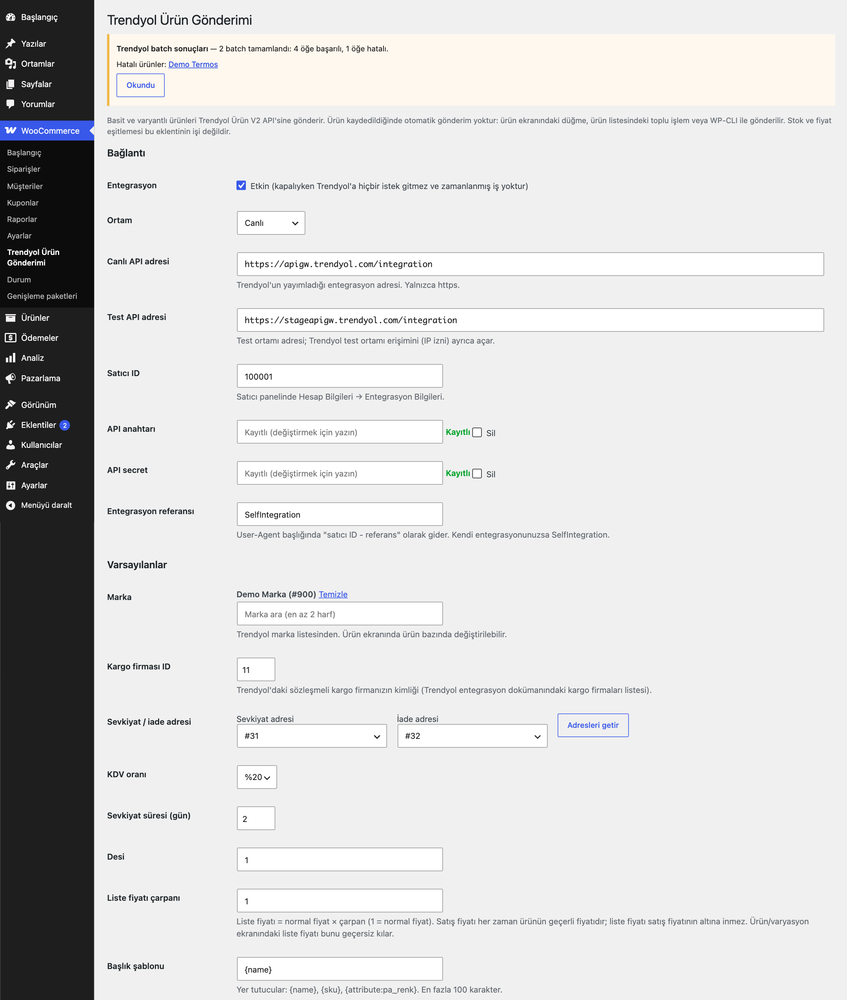
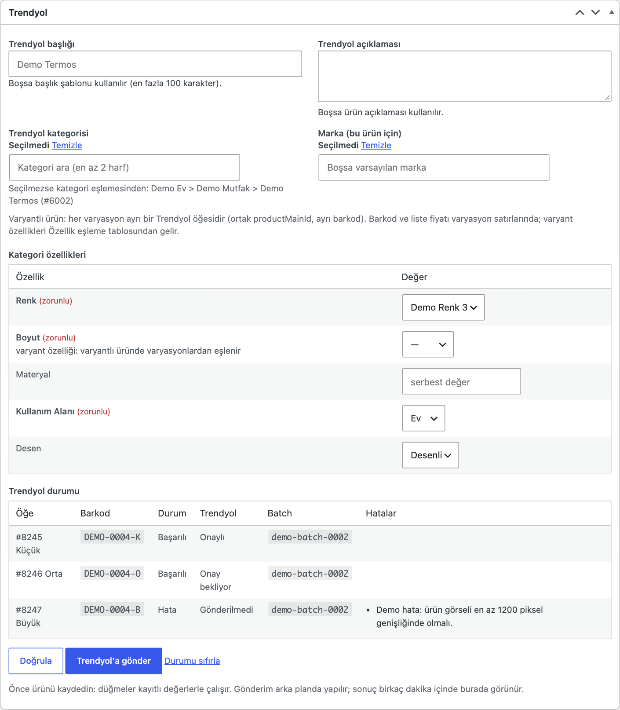
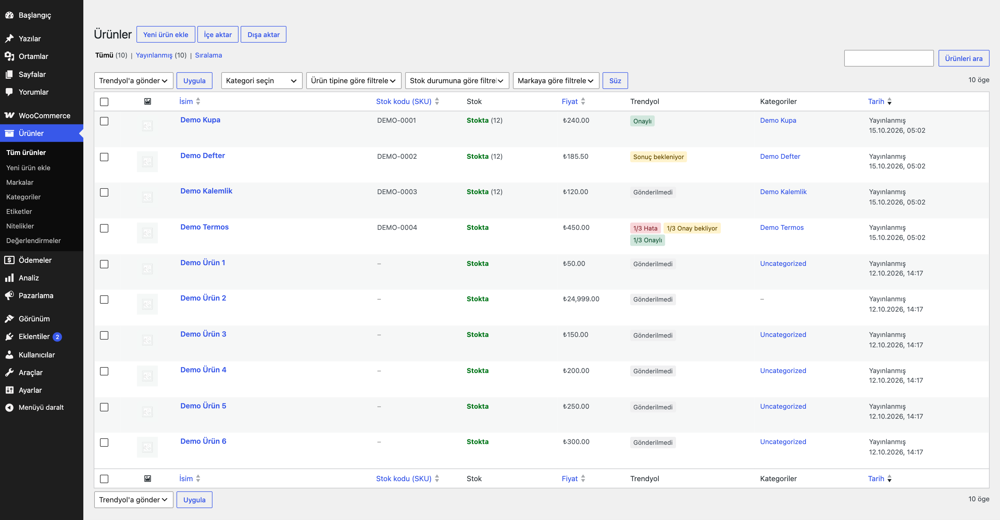
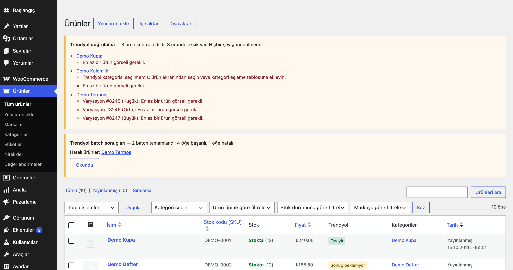

# Product Push for Trendyol

> **English:** Pushes simple and variable WooCommerce products to Trendyol over the Product V2 integration API. A "Trendyol" box on the product screen holds title/description overrides, a category picker (Ajax search over a cached category tree) with the category's attribute form, brand, barcode and list price. A category map and an attribute map (with value mapping) cover whole catalogues. Products are validated before anything is sent, pushed in the background from a bulk action, the product box or WP-CLI, and routed by approval state: new items go to the V2 create endpoint, approved ones to the content and variant update endpoints, items waiting for approval to the unapproved update endpoint. Batch results are polled every 10 minutes and written back per barcode. A product is never created twice: ambiguous failures are looked up in Trendyol's listings before anything is re-sent. Own, write-only credentials (or the `eru_ppt_credentials` filter). Inert until you switch it on.

[](https://www.gnu.org/licenses/gpl-2.0.html)   

> **Beta:** canlı API ile kendi hesabınızla doğrulayın.

WooCommerce ürünlerini (basit ve varyantlı) Trendyol Ürün V2 API'si ile Trendyol'a gönderir; gönderim öncesinde doğrular, onay durumunu izler ve ürünü doğru güncelleme ucuna yönlendirir.



## Özellikler

- Ürün ekranında Trendyol alanları: başlık ve açıklama (boşsa şablon / ürün açıklaması), kategori, kategoriye göre zorunlu özellik formu, marka, barkod, liste fiyatı, son durum
- Ajax kategori arama (önbellekteki kategori ağacında) ve WooCommerce → Trendyol kategori eşleme tablosu
- Basit ve varyantlı ürünlerde toplu gönderim ("Trendyol'a gönder") ve gönderim öncesi doğrulama ("Trendyol: doğrula")
- Onay durumu takibi: yeni ürün oluşturma, onaylı ürün için içerik + varyant güncelleme, onay bekleyen ürün için onaysız güncelleme ucu
- Batch sonuçlarının 10 dakikada bir sorgulanması, hatanın yalnızca ilgili ürüne/varyasyona yazılması, ürün listesinde Trendyol sütunu ve özet bildirim
- WP-CLI: kategori, özellik, marka, adres sorgusu, doğrulama, gönderim, batch sorgusu



## Kurulum

1. `product-push-for-trendyol` klasörünü `wp-content/plugins/` altına kopyalayın (veya zip olarak yükleyin) ve etkinleştirin. WooCommerce gereklidir.
2. WooCommerce → **Trendyol Ürün Gönderimi**: satıcı ID, API anahtarı ve API secret'ı girin (satıcı paneli → Hesap Bilgileri → Entegrasyon Bilgileri), **Entegrasyon**'u işaretleyip kaydedin.
3. Varsayılan markayı arayıp seçin, kargo firması kimliğini girin, **Adresleri getir** ile sevkiyat/iade adresini seçin.
4. **Kategori eşleme** tablosunda WooCommerce kategorilerinizi Trendyol kategorilerine bağlayın; varyantlı ürünleriniz varsa **Özellik eşleme**'de boyut/renk gibi özellikleri ve değerlerini eşleyin.
5. Bir ürünü açın, **Kategori özellikleri** formunu doldurup kaydedin, **Doğrula** ile eksikleri görün, sonra **Trendyol'a gönder**.

Etkinleştirme sonrası eklenti pasiftir: ana anahtar açılıp üç kimlik bilgisi girilene kadar Trendyol'a istek gitmez, zamanlanmış iş kurulmaz, ön yüzde hiçbir şey değişmez. **Ürün kaydedildiğinde otomatik gönderim yoktur**; gönderim yalnızca ürün kutusundaki düğme, toplu işlem veya WP-CLI ile başlar. Kategori ve marka araması da entegrasyon açıkken çalışır (Trendyol'a sorar).

## Bağlantı ve güvenlik

| Ayar | Açıklama |
|---|---|
| Ortam | Canlı veya test (stage). Adresler varsayılan olarak Trendyol'un yayımladığı `https://apigw.trendyol.com/integration` ve `https://stageapigw.trendyol.com/integration`; ekrandan ya da `eru_ppt_base_url` filtresiyle değiştirilebilir. Yalnızca `trendyol.com` alan adındaki https adresleri kaydedilir (kimlik bilgileri bu adrese gider); başka bir adres yalnızca filtreyle verilebilir. Test ortamına erişimi Trendyol ayrıca (IP izniyle) açar. |
| Satıcı ID / API anahtarı / API secret | Anahtar ve secret yalnızca yazılabilir: ekrana geri yazılmaz ("Kayıtlı"), boş bırakılırsa korunur, "Sil" ile silinir. Ayarlar tek seçenekte `autoload=no` saklanır. Kimlik bilgileri yalnızca `Authorization: Basic` başlığında gider, adrese (GET) eklenmez, günlüğe yazılmaz. |
| Entegrasyon referansı | `User-Agent: <satıcı ID> - <referans>` başlığı; kendi entegrasyonunuzsa `SelfIntegration`. |

Kimlik bilgilerini başka bir eklenti sağlıyorsa `eru_ppt_credentials` filtresini kullanın (ör. ileride Marketplace Orders): `seller_id`, `api_key`, `api_secret`, `integration_ref` anahtarlı diziyi döndürün; filtre ayarların üzerine yazar. Bilgilerden biri boşsa hiçbir istek gönderilmez ve açık bir hata döner.

Her istek `wp_remote_request` ile tek denemedir (30 sn zaman aşımı, yönlendirme yok, `sleep` yok). JSON gövdesi `serialize_precision = -1` ile kodlanır ve önceki değer geri yüklenir; böylece `194.35` her sunucuda `194.35` olarak gider. Ayar ekranının altındaki **Son istekler** günlüğü yalnızca son 100 isteğin yöntem, yol, HTTP kodu, süre ve (gizlenmiş) hata metnini tutar; başlık ve gövde saklanmaz.

## Varyantlı ürünler

- **Basit ürün → 1 öğe. Varyantlı ürün → yayındaki her varyasyon için 1 öğe.** Bir ürünün tüm öğeleri aynı `productMainId` ile gider: üst ürünün SKU'su, yoksa `ppt-<üst ürün ID>`.
- Her öğenin kendi **barkodu** vardır. Sıra: ürün/varyasyon ekranındaki "Trendyol barkodu" → ayardaki kaynak (SKU, GTIN/UPC/EAN/ISBN alanı veya bir meta anahtarı) → yedek önek + ID (önek boşsa barkodu olmayan öğe gönderilmez). Bir üründe aynı barkod iki kez kullanılamaz; barkod en fazla 40 karakter, harf, rakam, `.`, `-`, `_`. **Barkod Trendyol'da öğenin kimliğidir; gönderildikten sonra değiştirmeyin.**
- Varyasyonun özellikleri (ör. `pa_boyut = m`) **Özellik eşleme** tablosuyla Trendyol özelliğine ve değerine çevrilir; bunlar varyant özelliği olarak öğeye eklenir, ürün düzeyindeki formun aynı özelliğinin önüne geçer.
- Görseller: varyasyon görseli (varsa) önce, sonra üst ürünün görseli ve galerisi; en fazla 8, hepsi `https://` ile başlayan herkese açık adresler.
- Satış fiyatı öğenin geçerli fiyatıdır (indirim dahil). Liste fiyatı = ürün/varyasyon ekranındaki liste fiyatı, yoksa normal fiyat × **liste fiyatı çarpanı**; satış fiyatının altına inmez.
- Stok: ayara göre gerçek stok (stok yönetimi kapalıysa 0) veya her zaman 0. Stok ve fiyat yalnızca **oluşturma** isteğinde gider.

## Kategori ve özellik eşleme

- **Kategori:** ürün ekranında seçilen kategori, yoksa ürünün WooCommerce kategorileri ve onların üst kategorileri arasından eşleme tablosunda bulunan **en derin** olan. Yalnızca en alt seviye Trendyol kategorileri kullanılabilir.
- **Kategori ağacı** 7 gün önbellekte tutulur (ortam başına tek kayıt); "Kategori ağacını yenile" düğmesi önbelleği temizleyip yeniden almayı arka plana (Action Scheduler) kuyruğa alır, `wp eru-ppt categories --refresh` hemen alır. **Kategori özellikleri** kategori başına 7 gün saklanır; en fazla 300 kategori tutulur, en eskisi silinir. Değer listesinin bir sayfası alınamazsa hiçbir şey önbelleğe yazılmaz; 20 sayfadan (2.000 değer) uzun listeler "eksik" işaretiyle saklanır ve doğrulama bu listede olmayan değeri geçersiz saymaz. Başarısız istekler 10 dakika negatif önbellekte tutulur (kesinti sırasında aynı istek tekrarlanmaz). Özellik isteği yalnızca önbellekteki ağaçta en alt seviye olarak bulunan kimlikler için yapılır; Ajax aramaları (`manage_woocommerce` + nonce) serbest metinle önbellek kaydı oluşturamaz, marka araması hiç önbelleğe alınmaz.
- **Özellik formu** (ürün ekranı): kategori seçilince Trendyol'un özellik listesi gelir; zorunlu olanlar işaretlidir, listeden seçilir veya özellik izin veriyorsa serbest değer girilir.
- **Özellik eşleme** satırı: Trendyol kategorisi (boş = tüm kategoriler), WooCommerce özelliği (`pa_boyut` veya özel özellik adı), Trendyol özellik ID'si ("Listeden seç" ile) ve değer satırları (`m=802`). Satırı olmayan değer, Trendyol'da aynı adda değer varsa ona eşlenir; özellik serbest değer kabul ediyorsa metin olarak gider; yoksa doğrulama hatası olur. Basit ürünlerin varyasyonsuz özellikleri de bu tabloyla doldurulur (ürün formu önce gelir).
- **Sayfa isteklerinde uzak çağrı yok:** ürün kutusundaki Doğrula/Gönder, toplu doğrulama ve özellik formu yalnızca önbelleği okur. Önbellekte yoksa "Trendyol kategori verisi yükleniyor" der ve arka planda (`eru_ppt_refresh`) yenileme kuyruğa alır; form birkaç saniyede bir yeniden dener. Son 10 dakikada başarısız olan bir istek varsa (ör. hatalı API bilgileri) "yükleniyor" yerine o hata gösterilir. Değer listesi eksik işaretli bir özellikte listede olmayan değer engellemez; "değer doğrulanamadı" uyarısı verilir ve kesin sonucu Trendyol batch'i belirler. Arka plan gönderimi ve WP-CLI gerektiğinde Trendyol'a sorar.
- **Doğrulama** gönderimden önce her öğe için çalışır ve Türkçe hata listesi verir: kategori, marka, kargo firması, barkod, zorunlu özellikler, eşlenmemiş/geçersiz değerler, görsel (en az bir, https), fiyat > 0, başlık (≤ 100 karakter), açıklama. Hatası olan ürün hiç gönderilmez.
- `eru_ppt_item` filtresi her öğeyi gönderimden önce değiştirmenize izin verir (ör. mağazanızın başlık kuralları).

## Onaylı / onay bekleyen ürünler

Her öğe (basit ürün veya varyasyon) için Trendyol'daki durum (`_eru_ppt_remote`: boş, `unknown`, `unapproved`, `approved`) ve son işlemin sonucu (`_eru_ppt_status`: `sending`, `pending`, `success`, `failed`, `invalid`, `needs_review`) saklanır.

| Durum | Uç |
|---|---|
| Trendyol'da yok | `POST /product/sellers/{id}/v2/products` (oluşturma) |
| Onaylı | `POST …/products/content-bulk-update` (başlık, açıklama, görseller, varyant dışı özellikler; içerik kimliği başına bir kez) ve `POST …/products/variant-bulk-update` (barkod başına stok kodu, KDV, desi, adresler) |
| Onay bekliyor | `POST …/products/unapproved-bulk-update` (tüm içerik alanları) |

- Daha önce gönderilmiş her öğenin durumu gönderimden hemen önce Trendyol'un onaylı ve onay bekleyen listelerinden barkodla **tazelenir** ve yönlendirme bu güncel duruma göre yapılır. Güncellemeler fiyat ve stok taşımaz.
- İstekler en fazla 100 öğelik gruplarla gider. Yanıttaki batch kimliği saklanır; kendi Action Scheduler işi (`eru_ppt_poll`, 10 dakikada bir, başka bir eklentinin zamanlamasına bağlı değil) açık batch'leri (en uzun süredir sorgulanmamış olandan başlayarak, çalışma başına 20) sorgular, her öğenin sonucunu barkoduyla (içerik güncellemesinde içerik kimliğiyle) **yalnızca o ürüne/varyasyona** yazar. 3 günde sonuçlanmayan batch bırakılır ve öğeleri "belirsiz" sayılır.
- Aynı iş, onay bekleyen öğeleri (öğe başına en çok saatte bir, çalışma başına 20) onaylı listede arar ve onaylananları "Onaylı" yapar.
- Ürün listesinde **Trendyol** sütunu (varyantlı üründe "2/3 Onaylı" gibi) ve tamamlanan batch'lerin özet bildirimi görünür.



### Aynı ürün iki kez oluşturulmaz

- Açık batch'lerin her biri ayrı bir seçenek satırında tutulur; gönderim yeni batch açarken sorgu işi diğerini kapatsa da kayıtlar birbirini ezmez.
- Gönderimler (ve "Durumu sıfırla") tek bir kilitle sırayla çalışır (toplu işlem, ürün düğmesi, WP-CLI aynı anda iki gönderim yapamaz; kilitliyse iş 2 dakika sonra yeniden kuyruğa girer).
- Oluşturma isteğinden **önce** öğe "belirsiz" (`unknown`) işaretlenir. Batch kimliği gelirse öğe sonucu beklenir; 4xx gelirse öğe "Trendyol'da yok" durumuna döner ve düzeltilip tekrar gönderilebilir.
- Zaman aşımı, 5xx veya okunamayan yanıt **belirsizdir**: bir sonraki gönderimde öğe önce onaylı ve onay bekleyen listelerde barkodla aranır. Bulunursa doğru güncelleme ucuna gider; ikisi de açıkça "yok" derse ve ilk denemeden bu yana 1 saat geçtiyse yeniden oluşturulur (daha erken ise beklenir, çünkü Trendyol batch'leri gecikmeli işler); listeler sorgulanamazsa öğe **İnceleme gerekli** olur ve yalnızca ürün ekranındaki **Durumu sıfırla** ile (onaylı) açılır.
- Sonucu beklenen bir batch'teki öğe yeniden gönderilmez.



## WP-CLI

```bash
wp eru-ppt categories [--search=<metin>] [--refresh]   # kategori ağacı / arama
wp eru-ppt attributes <kategori-id> [--refresh]        # kategori özellikleri ve değerleri
wp eru-ppt brands --search=<ad>                        # marka arama
wp eru-ppt addresses                                   # sevkiyat / iade adresleri
wp eru-ppt validate <ürün-id>... [--json]              # doğrula, gönderilecek JSON'u göster (göndermez)
wp eru-ppt push <ürün-id>...                           # hemen gönder (oluştur / güncelle)
wp eru-ppt poll                                        # açık batch'leri şimdi sorgula
```

## Kancalar ve filtreler

| Kanca | Açıklama |
|---|---|
| `eru_ppt_credentials` | `seller_id`, `api_key`, `api_secret`, `integration_ref` dizisini değiştirir. |
| `eru_ppt_base_url` | API adresi (`$url`, `$environment`). |
| `eru_ppt_paths` | Uç yolları (`create`, `content_update`, `variant_update`, `unapproved_update`, `approved`, `unapproved`, `batch`, `categories`, `category_attributes`, `attribute_values`, `brands`, `addresses`). Trendyol bir yolu değiştirirse eklenti güncellemesini beklemeden düzeltin. |
| `eru_ppt_item` | Gönderilecek öğe (`$item`, `$object`, `$parent`). |

## Gereksinimler

WordPress 6.5+, PHP 8.0+, WooCommerce 9.0+ (Action Scheduler WooCommerce ile gelir). HPOS ile uyumludur; eklenti sipariş verisine dokunmaz. Kişisel veri saklamaz (yalnızca ürün verisi).

## Sınırlamalar

- **Beta:** Trendyol Ürün V2 uçlarının tamamı (oluşturma, onaylı/onaysız güncelleme, onaylı/onaysız listeler, batch sonucu, kategori ağacı, kategori özellikleri, marka, adres) yalnızca belgelenen biçimdeki **uydurma (mock) yanıtlarla** sınandı. Özellikle listelerin `barcode` filtresi, batch sonucundaki `requestItem` biçimi ve güncelleme uçlarının alan listeleri kendi hesabınızla (önce test ortamında) doğrulanmalıdır; yollar `eru_ppt_paths` ile değiştirilebilir.
- **Yalnızca içerik gönderimi yapılır.** Fiyat ve stok eşitlemesi (price-and-inventory) bu eklentide yoktur; stok ve fiyat yalnızca ilk oluşturmada gider. Sürekli eşitleme için Marketplace Orders (yakında) planlanmaktadır.
- Trendyol'un içerik kuralları (yasaklı kelimeler, görsel boyutu, başlık biçimi, marka yetkisi) mağazanın sorumluluğundadır; eklenti bunları denetlemez. Gerekirse `eru_ppt_item` filtresiyle uygulayın.
- Teslimat süresi/kargo firması güncelleme ucu (delivery-info) ve ürün silme/arşivleme desteklenmez. Gruplanmış, harici ve diğer ürün türleri gönderilmez.
- Kargo firması kimliği elle girilir (listesi Trendyol entegrasyon dokümanındadır).

## Kaldırma

Eklenti silindiğinde (Eklentiler → Sil) ayarlar, istek günlüğü, açık batch listesi, kategori/özellik önbellekleri, kilitler ve zamanlanmış işler silinir. Ürün/varyasyon üzerindeki `_eru_ppt_*` alanları (girdiğiniz barkodlar, özellik yanıtları ve Trendyol'daki onay durumuna bağlantı) **korunur**: bunlar olmadan yeniden kurulumda hangi ürünlerin Trendyol'da zaten bulunduğu bilinemez. Bu alanları da silmek için `wp-config.php` içinde `define( 'ERU_PPT_REMOVE_DATA', true );` tanımlayın. Trendyol'daki ürünlere dokunulmaz. Sipariş verisi yazılmadığı için silinecek sipariş metası yoktur.

## Sürüm notları

Bkz. [CHANGELOG.md](CHANGELOG.md).

## Lisans

GPL-2.0-or-later. Diğer Erusoft eklentileri: https://wordpress.erusoft.com
