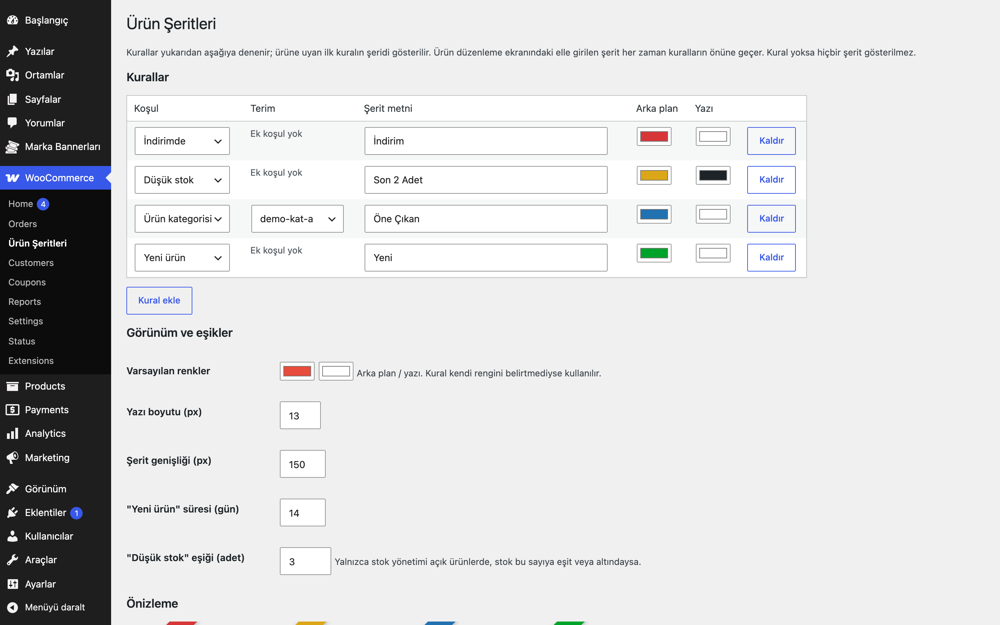
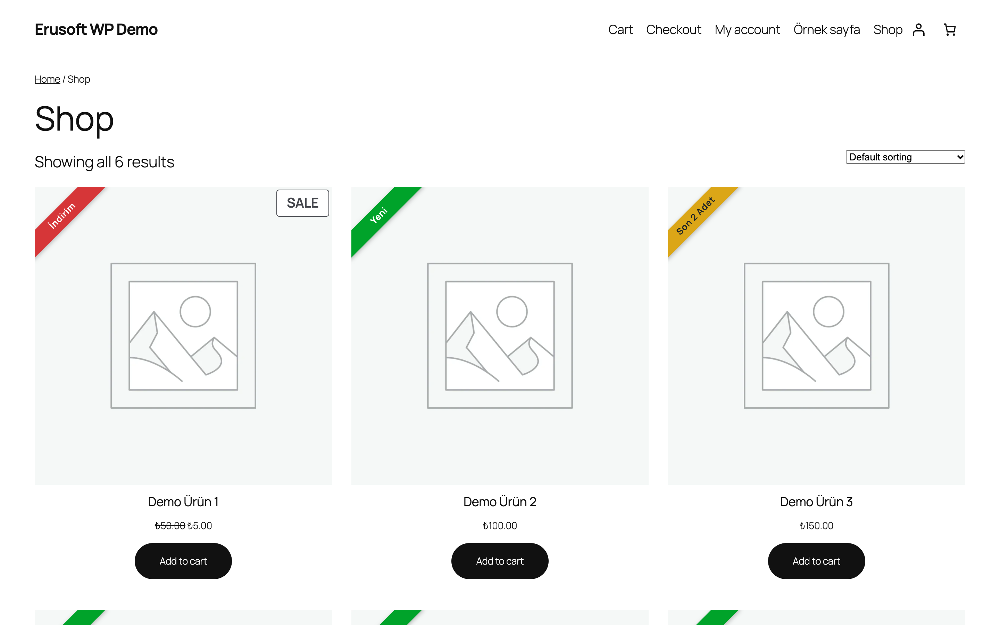

# Product Ribbons for WooCommerce

Ürün görsellerine köşegen şerit ekler. Kategori, etiket, indirimde, yeni ürün ve düşük stok kuralları ayarlardan tanımlanır; istenirse ürün düzenleme ekranından elle şerit girilir.

## Özellikler

- Kural tablosu: ürün kategorisi, ürün etiketi, indirimde, yeni ürün, düşük stok
- Her kural için metin, arka plan ve yazı rengi; yukarıdan aşağıya ilk eşleşen kazanır
- "Yeni ürün" süresi ve "düşük stok" eşiği ayarlanabilir
- Ürün bazında elle şerit (kuralların önüne geçer)
- Mağaza listeleri, ilgili ürünler ve tekil ürün görselinde; klasik ve blok temalarda
- Kural yoksa ön yüze hiçbir şey eklenmez (stil yalnızca şerit varsa yüklenir)

## Kurulum

1. `product-ribbons-for-woocommerce` klasörünü `wp-content/plugins/` altına kopyalayın (veya zip olarak yükleyin).
2. Eklentiler ekranından etkinleştirin.
3. WooCommerce → Ürün Şeritleri ekranından kuralları ekleyin.

## Ayarlar

WooCommerce → Ürün Şeritleri: kural tablosu, varsayılan renkler, yazı boyutu, şerit genişliği, yeni ürün günü, düşük stok eşiği (`eru_pr_options`). Ürün düzenleme → Genel sekmesinde elle şerit alanları.

## Kancalar ve filtreler

| Ad | Tür | Açıklama |
|---|---|---|
| `eru_pr_ribbon` | filtre | Ürün için şeridi değiştirir veya kaldırır (`$ribbon`: text, bg, color, font_size veya null; `$product`) |

## Gereksinimler

WordPress 6.5+, PHP 8.0+, WooCommerce 9.0+.

## Sınırlamalar

- Eski "WooCommerce Blocks" ürün ızgarası (wc-block-grid) şeritlerini göstermez; Ürün Koleksiyonu bloğu ve klasik şablonlar desteklenir.
- Düşük stok kuralı yalnızca stok yönetimi açık ürünlerde çalışır.
- Özel temalar ürün görselini farklı işaretlerle çıkarıyorsa CSS ayarı gerekebilir.
- Eklenti silindiğinde (Eklentiler → Sil) yalnızca kendi ayarları (`eru_pr_*` seçenekleri) silinir; ürün bazlı şerit ayarları (`_eru_pr_*` ürün metası) korunur.

## SSS

**Hangi şerit gösterilir?** Önce üründeki elle şerit, yoksa kurallar sırasıyla; ilk eşleşen.

**Şeridi kod ile değiştirebilir miyim?** Evet, `eru_pr_ribbon` filtresi.

## English summary

Adds diagonal ribbons to product images. Rules (category, tag, on sale, new, low stock) with label and colours are defined in settings; per-product manual ribbons override rules. Works with classic and block themes and outputs nothing when no rule matches.

## Sürüm notları

Bkz. [CHANGELOG.md](CHANGELOG.md).

## Lisans

GPL-2.0-or-later. Diğer Erusoft eklentileri: https://wordpress.erusoft.com
