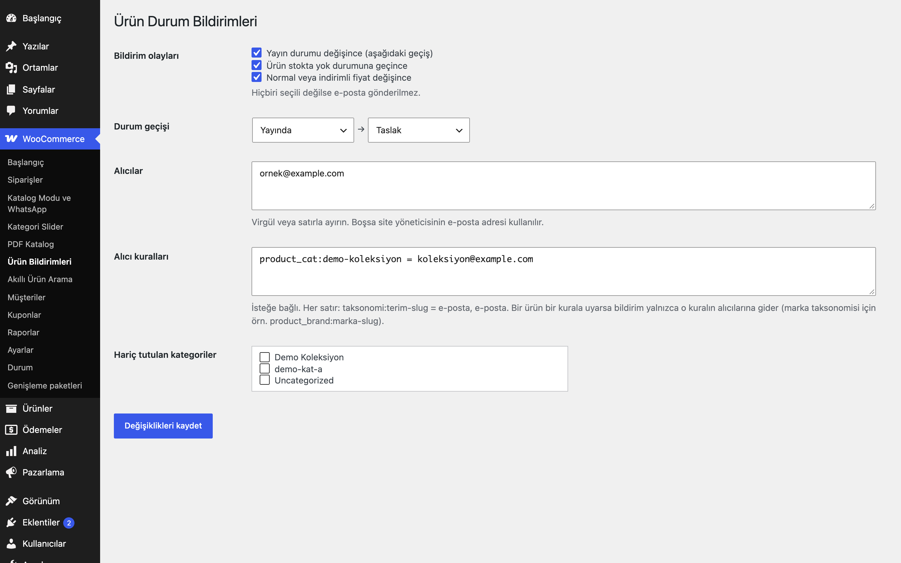

# Product Status Notifications for WooCommerce

Ürün yayın durumu değişince, stoğu tükenince veya fiyatı değişince belirlediğiniz alıcılara e-posta gönderir.

> **English:** E-mails a configurable recipient list when a product changes status, goes out of stock or has its price changed. Default: no events selected (no mail is sent); default recipient is the site admin e-mail.

   

## Ne işe yarar

Olayları siz seçersiniz: yayın durumu geçişi (örn. yayında → taslak), stokta yok durumuna geçiş, normal/indirimli fiyat değişikliği. Her olay için ürün adı, stok kodu, önceki/sonraki değer ve değişikliği yapan kullanıcıyı içeren tek bir e-posta gider.

## Özellikler

- Olaylar: durum geçişi (başlangıç/bitiş durumu seçilir), stok bitti, fiyat değişti
- Varsayılanda hiçbir olay seçili değildir
- Alıcılar: virgül/satır ile liste; boşsa site yöneticisinin e-postası
- Alıcı kuralları: `product_cat:slug = e-posta` (ör. marka taksonomisi için `product_brand:slug = …`)
- Hariç tutulan kategoriler
- Bir istekte yapılan tüm değişiklikler tek bir özet e-postada toplanır (alıcı listesi başına bir e-posta; ürün başına değil); en fazla 50 ürün listelenir, kalanı "+N ürün daha" olarak yazılır
- İçe aktarma (`WP_IMPORTING`) sırasında bildirim gönderilmez; yeni oluşturulan ürünler durum olayı sayılmaz
- Stok, sipariş kaynaklı düşüşlerde de (`wc_update_product_stock`) algılanır; varyasyon değişiklikleri üst ürünün kuralıyla bildirilir

## Kurulum

1. `product-status-notifications-for-woocommerce` klasörünü `wp-content/plugins/` altına kopyalayın (veya zip olarak yükleyin).
2. Eklentiler ekranından etkinleştirin (WooCommerce gereklidir).
3. WooCommerce → **Ürün Bildirimleri**: olayları işaretleyin, alıcıları girin.

## Ayarlar

Seçenek: `eru_psn_settings` (`events`, `status_from`, `status_to`, `recipients`, `rules`, `excluded`).

## Kısa kodlar, kancalar ve filtreler

| Ad | Tür | Açıklama |
|---|---|---|
| `eru_psn_recipients` | filtre | Bir ürün için alıcı listesi (`$list`, `$product_id`) |
| `eru_psn_max_items` | filtre | Özet e-postada listelenecek en fazla ürün (varsayılan 50) |
| `eru_psn_skip_import` | filtre | `WP_IMPORTING` sırasında bildirimleri atla (varsayılan `true`) |

## Entegrasyonlar ve gereksinimler

WordPress 6.5+, PHP 8.0+, WooCommerce 9.0+. HPOS uyumludur. E-postalar WordPress'in `wp_mail` işleviyle gider; canlı sitede çalışan bir SMTP kurulumu önerilir.

## Sınırlamalar

- Özet e-posta istek sonunda (`shutdown`) gönderilir; çok uzun süren toplu işlemlerde (WP-CLI dahil) değişiklikler işlem bitince tek e-postada gelir.
- Fiyat/stok karşılaştırması ürün nesnesi kaydedilirken yapılır; veritabanına doğrudan yazan araçlar algılanmaz.
- Çöp kutusuna taşıma gibi durum değişiklikleri "Durum geçişi" ayarına göre süzülür.
- Stokta yok olarak oluşturulan yeni ürünler bildirim üretmez; yalnızca mevcut bir ürünün (stokta / ön sipariş →) stokta yok durumuna geçişi bildirilir ve e-postada gerçek önceki durum yazılır.

## SSS

**E-posta gelmiyor.** En az bir olay seçili olmalı ve sitenizde e-posta gönderimi çalışmalıdır (SMTP).

## Değişiklik geçmişi

Bkz. [CHANGELOG.md](CHANGELOG.md).

## Lisans

GPL-2.0-or-later.

Diğer Erusoft eklentileri: https://wordpress.erusoft.com/
